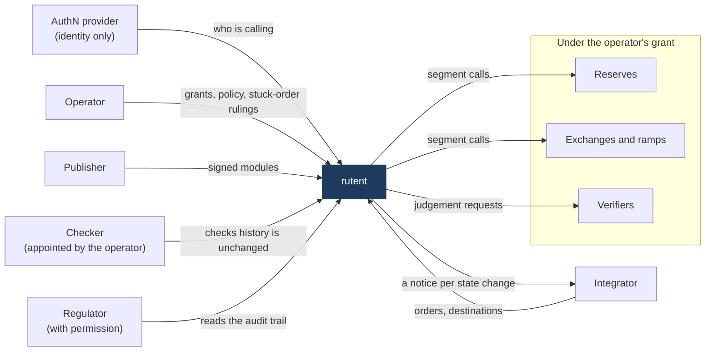
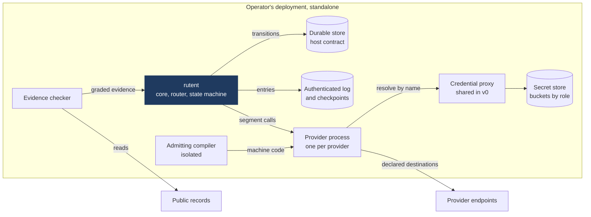

# rutent — Software Architecture Document

This SAD covers the five areas `REQ-CHN-8` requires (components; interfaces and contracts; data model; deployment
view; security architecture), allocates every requirement to a component, names each component's build mode
(`REQ-CHN-10`), and revisits the threat model against this design (`REQ-CHN-7`). Every architecture decision it
assumes is an ADR in `adr/`, each linked to its decision-form item (`REQ-CHN-9`); where Pablo has not yet ruled, the
ADR is "Proposed" and this SAD is provisional wherever that ADR is load-bearing.

`SPEC.md` decides; this document proposes how to build what it requires, and is itself subject to Pablo's
acceptance before `STEP-3` construction starts on anything it describes.

## 0. What this SAD does not re-decide

`SPEC.md`'s settled architecture is a given, not a choice: three standalone libraries (router, state machine,
provider system) bound by a core (`REQ-MOD-1`); four provider roles (reserve, exchange, ramp, verifier); the
router's `(node, asset)` multigraph with amount-dependent, path-order-dependent edge cost (`REQ-QTE-12`); no
rollback, only recalculation and provider-side reversal; a holding account at every node where value rests between
segments; a notice on every state change; dry-runs that change nothing at a provider; scheduling left to the
integrator. This document builds components, interfaces, data and deployment around those givens.

## 1. Context and external actors

| Actor | Relationship with rutent | Spec |
|---|---|---|
| AuthN provider | Says who is calling; rutent's own policy still decides each action | `REQ-OPS-4`, `REQ-AUZ-1`, `AC-25` |
| Integrator | Files orders, registers destinations before quoting, consumes notices instead of polling | `REQ-ORD-20`, `INTEGRATORS.md` |
| Operator | Grants entry, sets policy and ceilings, posts routes, resolves and bears stuck orders | `REQ-AUZ-2`, `REQ-CAT-2`, `REQ-ORD-8` |
| Publisher | Publishes a provider's module with a signed assertion; Bloque's own team until `DEF-4` | `REQ-MDL-1`, `REQ-MDL-15` |
| Reserves, exchanges and ramps | Providers in the catalogue, under the operator's grant; each segment call is policy-gated | `REQ-CAT-2`, `REQ-AUZ-1` |
| Verifiers | Providers that answer judgements about a person and a class; move no value | `REQ-CPL-1`, `REQ-CPL-10` |
| Checker | Appointed by the operator, outside it; checks that history hasn't changed | `OBL-4`, `REQ-AUZ-7`, `INV-6` |
| Regulator | Reads the audit trail through an identified, recorded permission | `REQ-AUD-12`, `REQ-AUZ-7` |

rutent authenticates nobody itself beyond what an external authN provider establishes (`REQ-AUZ-1`); it never
holds customer value (`INV-5`); it is deployed and operated standalone, decoupled from any integrating platform
(`REQ-OPS-4`). The integrator owns destination registration before quoting, all scheduling/mandates, and reacting
to notices rather than polling (`INTEGRATORS.md`). The appointed checker and any permitted regulator are read-only
external actors, not components of rutent.

## 2. Components

Three outer libraries, each usable standalone with no dependency on the others or on Core (`REQ-MOD-1`), each
fully documenting its public contract (`REQ-MOD-2`, `NFR-7`), and a core that reaches each only through that
contract (`REQ-MOD-3`). No component depends on a specific provider (`REQ-MOD-4`).

| Component | What it does | Standalone? |
|---|---|---|
| `CMP-ROUTER` | Reads the catalogue's advertised tuples, finds routes and splits for a customer's objective, under a hop limit, evaluated at the actual amount and direction (`REQ-QTE-11/12`) | Yes — pure function of (request, catalogue snapshot) |
| `CMP-STM` | One current state per order and segment; changes only on a recorded input; replay-deterministic (`REQ-STM-1/3`) | Yes — host-agnostic transition library (ADR-0002) |
| `CMP-PROV` | The provider catalogue, module admission/runtime/sandbox, the credential proxy (ADR-0004: shared while every provider is the operator's own, per-provider before an outside one joins), and the holding-account modules at public nodes (`REQ-CAT-23`) | Yes |
| `CMP-CORE-ORCH` | Binds the three: order/segment orchestration, decision-record capture (`REQ-AUD-4`), notice emission (`REQ-ORD-20`) | No — this is Core's binding logic |
| `CMP-CORE-AUTHZ` | The policy and authorization engine: every value-moving/route-posting/catalogue-changing action passes it (`REQ-AUZ-1`); judgements are a policy input, never the decision (`REQ-CPL-3`) | No |
| `CMP-CORE-AUDIT` | The authenticated log, checkpoints (ADR-0005), and the `REQ-AUD-15` holding-account balance check (reading `CMP-PROV`'s holding-account data) | No |
| `CMP-EVIDENCE` | A read-only, per-public-node checker, deliberately apart from any provider's module: grades/validates segment evidence (ADR-0007) and replays a private node's recorded inner segments against its public exit (ADR-0005/0007) | Yes, as a standalone checking service; not one of the three `REQ-MOD-1` libraries, since it is neither reused-elsewhere-shaped nor bound into Core's order logic |

`CMP-CORE-ORCH`, `CMP-CORE-AUTHZ` and `CMP-CORE-AUDIT` are Core's own internal decomposition (ADR-0001) — `SPEC.md`
requires Core to bind the three outer libraries but says nothing about Core's own shape. Naming these three now is
what makes allocating `REQ-AUD-*`, `REQ-AUZ-*` and the cross-cutting slice of `REQ-ORD-*` to *a* component
(`REQ-CHN-8`) meaningful rather than a single catch-all "Core" bucket.

## 3. Interfaces and contracts

- **Provider role contract** (`REQ-CAT-8/9/21`): one common interface, four roles. Reserve: withdrawals, deposits,
  balance verification. Exchange: conversions, detailed quotes. Ramp: transfers, fees. Verifier: judgements only.
  A module may take internal steps but can't change the route or step outside its advertised role.
- **Module interface split** (`REQ-MDL-15/16`, ADR-0003): a sandboxed part and an outside part. The sandboxed part
  never sees secret plaintext (`REQ-MDL-6`); the outside part reaches only declared destinations (`REQ-MDL-7`) and
  performs only interface-declared operations for an identified transaction (`REQ-MDL-8`). The interface is fixed
  across module versions (`REQ-MDL-19`).
- **Router API**: `route(request, catalogueSnapshot, policyBounds) → {candidates, chosen, decisionRecord}`, a pure
  function (ADR-0006); the decision record alone must let a changed objective re-derive the choice, no provider
  call needed (`AC-2`, `REQ-AUD-4`).
  **Core may call `CMP-ROUTER` more than once per order** — at acceptance and at every recalculation (`REQ-ORD-4`,
  `REQ-ORD-22`) — each call producing its own decision record, chained to the order's history.
- **State machine API**: `transition(state, recordedInput) → newState`, replay-deterministic (`REQ-STM-3`, `NFR-4`);
  a chosen route enters only as a recorded input, never computed inside the state machine (`R26`).
- **`CMP-EVIDENCE`'s interface**: read-only per-network checks (finality, reorg handling, movement-to-segment
  matching) and a replay call (recorded inner segments vs. a public exit). Called by `CMP-CORE-ORCH`/`CMP-CORE-AUDIT`,
  never by a provider module checking itself (ADR-0007).
- **Notice contract** (`REQ-ORD-20`): authenticated, safe to receive twice or out of order, current state always
  pullable on demand. Integrators are told to act on notices, not poll (`INTEGRATORS.md`).
- **Credential/destination contract** (ADR-0004): a narrow resolve-by-name-at-call-time interface; destination
  allow-lists checked by name and connected address, re-checked on redirect.

## 4. Data model

Primary records, each with its owning component:

| Record | Holds | Owner |
|---|---|---|
| Order / segment state | Current state, history pointer (`REQ-STM-1/2`) | `CMP-CORE-ORCH` (via `CMP-STM`) |
| Route decision record | Request, every candidate + drop reason, each input's age/origin, objective, policy+module versions (`REQ-AUD-4`) | `CMP-CORE-ORCH`, produced by `CMP-ROUTER` |
| Holding account | Balance, the sum held for orders at that node (`REQ-CAT-23`, `INV-1`, `AUD-15`) | `CMP-PROV` (public nodes: a registered module; private nodes: the publisher's record, reached through its outside part) |
| Catalogue entry / grant | Provider identity, role(s), tuples, bands, declared evidence/retry behaviour, expiry (`REQ-CAT-2/11/13`) | `CMP-PROV` |
| Module admission record | Admitted binary + platform build version, signature, capability declaration, version history (`REQ-MDL-1/2/3`) | `CMP-PROV` |
| Credential-proxy declaration | Resolver binding and destination allow-list, keyed by provider even while one proxy serves them all (ADR-0004) | `CMP-PROV` |
| Authenticated log entry | Who, what, when, outcome; party-stated vs. rutent-verified distinguished (`REQ-AUD-1/2`) | `CMP-CORE-AUDIT` |
| Checkpoint | A signed, salted, size-hiding commitment to the log's root, on a fixed schedule (`REQ-AUD-14`, ADR-0005) | `CMP-CORE-AUDIT` |
| Judgement | Maker, subject reference, class, time, validity (`REQ-CPL-1`) | `CMP-CORE-AUTHZ`, presented by the holder, consumed as a policy input |
| Fee record | Per-settled-segment fee captured, attributed to provider or operator, no running balance (`REQ-AUD-11`) | `CMP-CORE-ORCH` |

This table is the data-model skeleton; the full field-level schema for each record is construction detail
(`STEP-3`), not a STEP-2 commitment.

## 5. Deployment view

Read with the bullets below: the durable store's runtime is a milestone-1 experiment (ADR-0002); the module format
is another (ADR-0003); the shared proxy is v0's, per-provider proxies come before v1 (ADR-0004); the log is kept
apart from the execution store (ADR-0005); the evidence checker is operator-run, apart from provider modules
(ADR-0007).

- **Standalone operation** (`REQ-OPS-4`): one deployment, no higher-order platform; humans and agents share one
  contract (`REQ-OPS-5`).
- **Process boundary** (ADR-0003, firm regardless of module format): one OS process per provider. A module's
  outside part and sandboxed part are split within that process; the compiler that admits a module's binary runs
  in its own isolation, since it parses hostile input.
- **Durable-store / host contract** (ADR-0002): `CMP-STM` is written against a host-agnostic contract — an
  interface for durable transition storage and recorded-input delivery — so the execution environment can be
  replaced without losing in-flight orders (`REQ-OPS-3`). Which concrete runtime implements that contract (VOS,
  or a purpose-built store) is a milestone-1 experiment, not a STEP-2 commitment (Pablo, 2026-11-06, decision
  form item `runtime-host-seam`).
- **`CMP-EVIDENCE`'s placement**: operator-run, apart from provider modules. Requiring an *outside* party to run it
  would conflict with `REQ-OPS-4`'s independent-operation requirement, so it is explicitly operator-run — weaker
  than third-party verification, and stated as such in §6.
- **Module lifecycle**: adding, upgrading or removing one provider's module must not reload the service or
  interrupt others (`REQ-MDL-13`, `NFR-2/3`); upgrades are staged and observable with rollback (`REQ-MDL-4`,
  ADR-0014).

## 6. Security architecture

- **AuthN external, authZ internal** (`REQ-AUZ-1`): external authentication says who is calling and nothing more;
  every value-moving, route-posting or catalogue-changing action passes `CMP-CORE-AUTHZ`'s own decision, with no
  bypass path.
- **Module sandboxing and secrets** (`REQ-MDL-6/7/8/9`, ADR-0003/0004): sandboxed part never sees secret plaintext;
  outside part reaches only declared destinations; a compromised module's reach is bounded and stated.
- **Data classification**: carried from `SPEC.md` §8's five-level table (Secret/Restricted/Confidential/
  Internal/Public) unchanged — this SAD adds no new data categories.
- **Operator obligations vs. rutent's own guarantees** (`oss-ledger-2`): `GUA-*` is what this design must make
  true in code; `OBL-*` is what the operator must additionally do (hold narrow credentials, appoint a checker,
  check providers' reversal capacity, set ceilings, honour local disclosure/erasure rules) and is **not** allocated
  to any `CMP-*` below — it binds the deploying operator, not this architecture.

### Threat-model revisit (`REQ-CHN-7`)

`SPEC.md` §8's threat model is written abstraction-agnostic to implementation; five areas become concrete only
once a component's design is chosen, and each is re-checked here against this SAD's proposed design rather than
left as a narrative mitigation:

| Threat area | Concrete design here | Status after this design |
|---|---|---|
| `THR-85` (sandbox escape), `THR-18` (build tampering) | ADR-0003 as amended by `EXP-2`: Wasm components on Wasmtime 48.0.8, an LTS release, are the one admitted format. Each provider's module runs in its own OS process. That process is the PID-1 child of `unshare`, in new user, network, IPC, UTS, mount and PID namespaces. Before it reads any input it sets `no_new_privs`, pivots into an empty read-only root, drops every capability, applies Landlock with no rule, and installs a seccomp allow-list for x86_64 only. Inherited descriptors are closed before `exec` and again in the jail. The admitting compiler is a fresh process per admission, in the same jail, with 8 GiB of address space and 60 CPU seconds. It refuses precompiled code, and a provider loads only machine code whose digest matches its artefact's | **Narrowed; the residual stays accepted (`R72`).** An escape from Wasmtime now lands in one provider's jailed process, with no network, no file, no other process, no signal to one and no inherited descriptor. Each was probed on the scoring platform (`EXP-2-wasm-20261107-2`). A provider's process that stops answering is killed at the operation's deadline, and the outside part's fuel is one budget per operation. Going further needs a second flaw, in the kernel, reached through the allowed calls. Not closed: unknown flaws and hardware side channels as a class. Spectre settings are Wasmtime's defaults (`G-09`), the pin isn't checked against 2026's advisories (`G-02`), no fuzzer-made binary was admitted (`B-09`), and the jail's layers were probed only together. On Ubuntu 24.04 the jail needs an operator setting, an operator obligation (`F-033`). `THR-18`: each part's machine code is digested at admission and checked before load (`B-10`), and it was identical across two compiler processes. Re-derived on separate hardware (ADR-0014), it was identical on an AMD EPYC 9V74 and an EPYC 7763 (`B-11`, `G-04`, `EXP-2-wasm-20261107-2` and `-3`); no other vendor was tried. Re-checked by `EXP-2` (ADR-0003 as amended, 2026-11-07); re-check again at `F-025`. |
| `THR-132`/`THR-130` (checkpoint integrity/traffic analysis) | ADR-0005: fixed-tick, salted, size-hiding commitment; no raw tree size published | **Narrowed**: `AC-37`'s indistinguishability bar is met by construction (salt + no size), not by policy. Residual: a checkpoint still only proves the log is self-consistent, never that recorded segments happened (`THR-131`, unchanged, accepted). |
| `THR-10`/`THR-135`/`THR-136` (route-computation tampering, split-gaming) | ADR-0006: router is a pure, replayable function of (request, snapshot); decision record is self-contained | **Narrowed to detect-only**, as `SPEC.md` already stated; this design doesn't newly mitigate split-gaming, only makes it detectable via the decision record and `REQ-AUD-7`'s bulk measures. No new mitigation found — restate as accepted residual risk, not a gap this SAD closes. |
| `THR-79`/`THR-80`/`THR-86` (module egress, credential over-scope, cross-module calls) | ADR-0004: one OS process per provider with caller-scoped secret lookups, a shared credential proxy while every provider is the operator's own (per-provider before an outside one joins), deny-by-default destination allow-list, declared cross-module calls only when the route names them (`REQ-MDL-21`) | **Narrowed, with an accepted concentration risk**: a compromised module still can't reach another provider's secrets, but one exploit of the shared proxy reaches all of them (`THR-79`'s unbounded case). Accepted by the reserved item `credential-proxy-scope` (`REQ-CHN-7`) while the roster is the operator's own; Pablo's mitigation is vault buckets separated by process role at deployment. Residual either way: misuse at an allowed host, or data leaving in a request to one. |
| `THR-2`/`THR-66`/`THR-67` (operator/role-overlap compromise) | None — `SPEC.md` already accepts these under `R119` | **Unchanged**, restated as residual risk, not re-litigated by this SAD. |

No threat in this pass turned up a *new*, previously-unlisted threat; where a concrete choice narrows a `SPEC.md`
threat's "detect-only" ending into an actual closed gap, that is noted above and should be reflected as an
amendment to `SPEC.md` §8's Coverage table once the owner rules on the relevant ADR — never as a direct edit to
`SPEC.md` itself. Where the experiment (sandbox tech, runtime) is still open, the threat re-check is correspondingly
provisional and will be re-run when that ADR is amended.

## 7. Requirement, invariant, NFR and guarantee allocation

Allocated by component. Every `REQ-*`, `INV-*`, `NFR-*` and `GUA-*` identifier in `SPEC.md` v0.4.1 appears exactly
once below (`REQ-AUZ-10` and `REQ-MDL`'s family have no withdrawn numbers in the current text — `REQ-AUZ-10` is
the one withdrawal in the whole document, confirmed directly against `SPEC.md`, not taken from an earlier digest).
`OBL-*` is listed separately in §6 as operator-side, not allocated to a component.

**`CMP-ROUTER`**: `REQ-QTE-1` to `REQ-QTE-16` (all 16).

**`CMP-STM`**: `REQ-STM-1` to `REQ-STM-8` (all 8).

**`CMP-PROV`**: `REQ-CAT-1` to `REQ-CAT-23` (all 23); `REQ-MDL-1` to `REQ-MDL-21` (all 21); `REQ-MOD-4`.

**`CMP-CORE-ORCH`**: `REQ-MOD-1/2/3`; `REQ-ORD-1` to `REQ-ORD-43` as the default owner, **except** the following,
which are shared with the component named: `ORD-3`/`ORD-11`/`ORD-30` (reversal evidence, shared with `CMP-PROV`
and, for grading, `CMP-EVIDENCE`); `ORD-9` (cross-report comparison → `CMP-CORE-AUDIT`, ADR-0009); `ORD-16`/`ORD-40`/
`ORD-43` (route start/end, holding-account handoff, shared with `CMP-PROV`); `ORD-39`/`ORD-41` (evidence grading
and private-node replay → `CMP-EVIDENCE`, ADR-0007/0005); `ORD-6`/`ORD-7`/`ORD-28`/`ORD-29` (stuck-order detection,
shared with `CMP-CORE-AUTHZ` for resolution, ADR-0011); `ORD-8` (ceilings, shared with `CMP-CORE-AUTHZ`); `ORD-32`
(reserve's-yes gating, shared with `CMP-PROV`); `ORD-37`/`ORD-42` (route/split structure, shared with `CMP-ROUTER`).

**`CMP-CORE-AUTHZ`**: `REQ-AUZ-1` to `REQ-AUZ-9` (`REQ-AUZ-10` withdrawn, `R115`); `REQ-CPL-1` to `REQ-CPL-12` (all
12, except `CPL-7`'s "providers may vouch" half, shared with `CMP-PROV`).

**`CMP-CORE-AUDIT`**: `REQ-AUD-1` to `REQ-AUD-15` (all 15); `ORD-9` (see above).

**`CMP-EVIDENCE`**: `ORD-39`, `ORD-41` (see above) — otherwise not independently named in `SPEC.md`'s requirement
families; it exists to satisfy the evidence-grading intent behind `REQ-ORD-39` and the replay intent behind
`REQ-ORD-41` concretely (ADR-0007).

**Cross-cutting, no single owner** (deployment view and protocol, not component behaviour): `REQ-OPS-1` to
`REQ-OPS-5`; `REQ-PRT-1` to `REQ-PRT-5`; `REQ-EXT-1`/`REQ-EXT-2`; `NFR-1` to `NFR-8`.

**Invariants** (`CMP-CORE-ORCH` + `CMP-CORE-AUDIT` jointly, as the properties their combined design must preserve):
`INV-1` (conservation, `CMP-PROV`'s holding accounts + `CMP-CORE-AUDIT`'s `AUD-15` check); `INV-2` (failed segment
stays at origin, `CMP-PROV`); `INV-3` (per-segment atomicity, `CMP-STM`); `INV-4` (no double-move, `CMP-STM` +
`CMP-CORE-ORCH`); `INV-5` (no custody, `CMP-PROV` + `CMP-CORE-ORCH`); `INV-6` (tamper-evident history, `CMP-CORE-AUDIT`);
`INV-7` (no effect without record, `CMP-CORE-AUDIT`); `INV-8` (idempotent identifiers, `CMP-CORE-ORCH`); `INV-9`
(balance check reveals only sufficiency, `CMP-PROV`); `INV-10` (recalculation never changes destination/to-asset,
`CMP-CORE-ORCH` + `CMP-CORE-AUTHZ`'s `AUZ-3`).

**Guarantees** (`GUA-1` to `GUA-7`): mirror the invariants above one-to-one in component ownership and are not
re-listed separately.

## 8. Build mode per component

All seven components are **code** (`REQ-CHN-10`); no low-code or no-code element is proposed anywhere in this
design. Each component's public contract and spec is identical whatever builds it, per that requirement, even
though nothing here currently builds any of them another way.

## 9. First-milestone contracts and conformance suites (`REQ-CHN-12`, SHOULD)

- Freeze at milestone 1: the module interface split (`REQ-MDL-15/16`), the provider role contract (`REQ-CAT-8/9`),
  the router API, and the state-machine API — these four are what every later provider module and every later
  runtime choice is written against.
- Give a layer with several implementations a shared conformance suite (`ASM-16`): `CMP-PROV`'s module boundary
  (multiple languages, multiple sandbox technologies under evaluation) is exactly this case, and `AC-19/20/21`
  already describe the test shape such a suite should take.

**v0 and v1.** `SPEC.md` defines v1. v0 is a first build ahead of it (Pablo, 2026-11-06, `v0-before-v1`, answered
in chat). What this design already fixes about v0, for the plan to carry:

- No order splitting in v0; it ships in v1 (`R127`, `REQ-QTE-16`). The router's contract and decision record carry
  splits from v0 on, so v1 adds the rule without reshaping the router (ADR-0006).
- Every provider in v0 is operated by Bloque. Before v1, or before the first outside provider if one comes sooner:
  per-provider credential proxies (ADR-0004) and counsel's read on bond custody (ADR-0010).

The rest of v0's scope, and how it splits into milestones, belongs in `PLAN.md`, not here.

## 10. ADR index

| ADR | Decision | Status |
|---|---|---|
| `adr/0001-core-decomposition.md` | Core's internal shape: `CMP-CORE-ORCH`/`CMP-CORE-AUTHZ`/`CMP-CORE-AUDIT` | **Accepted** (Pablo, 2026-11-06, `core-decomposition`) |
| `adr/0002-runtime-host-seam.md` | State-machine host contract; VOS as a milestone-1 experiment | **Accepted** (Pablo, 2026-11-06, `runtime-host-seam`) |
| `adr/0003-module-format-sandbox.md` | Process-per-provider boundary; format (Wasm/PVM) as experiment | **Accepted** (Pablo, 2026-11-06, `module-sandbox-boundary`) |
| `adr/0004-outside-part-credential-proxy.md` | Shared credential proxy now, per-provider before outside providers; resolver interface | **Accepted** (Pablo, 2026-11-06, `credential-proxy-model` and `credential-proxy-scope`) |
| `adr/0005-authenticated-log-checkpoints.md` | Merkle log + salted, size-hiding checkpoints | **Accepted** (Pablo, 2026-11-06, `log-checkpoints-mechanism`) |
| `adr/0006-route-search-quoting.md` | Hop-limited search over a snapshot; simple threshold splitting, in v1 and not v0 | **Accepted** (Pablo, 2026-11-06, `route-search-algorithm` and `v0-before-v1`) |
| `adr/0007-transition-evidence-checker.md` | Four-grade evidence scale; `CMP-EVIDENCE` | **Accepted** (Pablo, 2026-11-06, `evidence-grading-checker`) |
| `adr/0008-reversal-confirmation.md` | Origin reserve's own signed statement | **Accepted** (Pablo, 2026-11-06, `reversal-confirmation-source`) |
| `adr/0009-report-difference-detection.md` | Detection-only comparison, no state/value power | **Accepted** (Pablo, 2026-11-06, `report-difference-detection-scope`) |
| `adr/0010-reversal-backing.md` | Third-party-held bond sized to the per-provider ceiling | **Accepted** (Pablo, 2026-11-06, `reversal-bonding-model`), with a scope note: a reversal guarantee while every provider is Bloque's own (v0); counsel before v1 |
| `adr/0011-stuck-order-dual-approval.md` | Separate decide/move permissions | **Accepted** (Pablo, 2026-11-06, `stuck-order-dual-approval`) |
| `adr/0012-judgements-verifiers.md` | Per-provider subject reference; signed judgement token | **Accepted** (Pablo, 2026-11-06, `judgements-verifier-model`) |
| `adr/0013-balance-check-allowance.md` | Platform-kept allowance bucket (low priority, mostly moot post-`R96`) | **Accepted** (Pablo, 2026-11-06, `balance-check-allowance-priority`) |
| `adr/0014-staged-rollout-rebuild.md` | Staged traffic share; independent machine-code re-derivation | **Accepted** (Pablo, 2026-11-06, `staged-rollout-rebuild`) |
