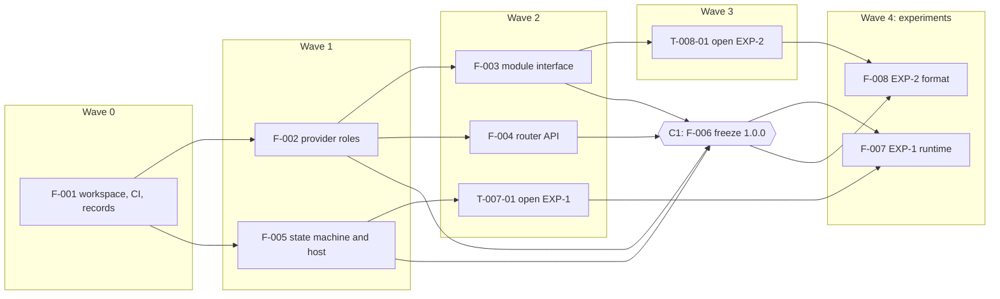
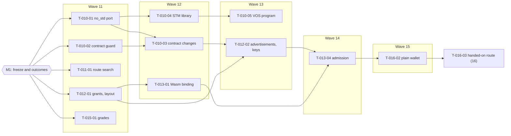
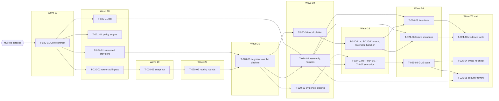

# rutent: implementation plan

This plan opens `STEP-3`, construction, under the Narthex method (Narthex `REQ-SKL-6`, `REQ-CHN-11`,
`REQ-CHN-12`). It turns the accepted SAD (`ARCHITECTURE.md`) and its fourteen ADRs into plan decisions,
milestones, features and tasks, each tracing to the `SPEC.md` and ADR identifiers it serves. It changes neither
`SPEC.md` nor the SAD. Where it goes further than the SAD, a plan decision says so.

`SPEC.md` defines v1. v0 is a first build ahead of it (owner ruling `v0-before-v1`, 2026-11-06). This plan builds
v0, then the work due before v1.

**v0 in one paragraph.** A Rust platform (`DEC-1`) that goes to production with real customer value (`DEC-19`),
every provider operated by Bloque, routing across public networks and more than one private rail (`DEC-24`), with
no order splitting (`DEC-8`) and with verifiers and judgements left to v1 (`DEC-16`).

---

## 1. How to read

Read §3 for the milestones, then §4 for the first milestone in detail. §2 holds the rules the build follows. §5
shows what runs in parallel. §6 lists the risks, the legal points, and the open
items. §7 shows that every requirement has a place.

### Identifiers

| Prefix | Meaning | Example |
|---|---|---|
| `DEC-*` | A plan decision | `DEC-3` |
| `M1`, `M2`, … | A milestone. Numbered from 1, so "milestone 1" in ADR-0002, ADR-0003 and SAD §9 means `M1` | `M1` |
| `F-NNN` | A feature: one goal, one agent at a time, one worktree | `F-005` |
| `T-NNN-NN` | A task of feature `F-NNN`: one commit, integrated into its milestone's branch; the pull request is the milestone's (`construction-autonomy`) | `T-005-02` |
| `EXP-n` | An experiment under Narthex's `experiments/` mechanism (Narthex `REQ-EXP-1`) | `EXP-1` |
| `C1` | The contract freeze inside `M1` | |

`REQ-*`, `INV-*`, `AC-*`, `NFR-*`, `GUA-*`, `OBL-*`, `ASM-*`, `DEF-*`, `THR-*` and `PS-*` are `SPEC.md`'s and
`PRODUCT.md`'s. `CMP-*` are the SAD's components. Narthex's own identifiers are always written with the prefix
"Narthex", as in Narthex `REQ-CHN-11`, so they are never read as rutent's. `REQ-AUZ-10` is withdrawn and is never
cited. Identifiers are stable; a withdrawn one is never reused.

### Rulings applied in v0.1.0

The owner answered these on the decision form on 2026-11-06 (archived in `decisions/responses/`), and gave the
Haiku ruling in chat the same day.

| Item | Ruling | Applied in |
|---|---|---|
| `plan-language` | Rust | `DEC-1`, `T-001-01` |
| `plan-v0-end-state` | Production, with real customer value | `DEC-19`, `M4`, `F-030` to `F-034`, §6.1 |
| `plan-v0-private-rails` | Yes, and "more than one" | `DEC-24`, `F-012`, `F-015`, `M3` |
| `plan-v0-verifiers` | Defer to v1, the role kept in the contract | `DEC-16`, `T-002-01`, `F-021`, `F-053` |
| `accept-plan` | Accept the plan | this document's status; every `proposed` decision below is accepted |
| `counsel-licences` | No counsel: "an open software solution with a mixed licensing model"; legal affairs are handled apart, as long as the build sticks to the spec | `DEC-6`, `T-001-04`, `T-007-03`, §6.1 |
| `counsel-v0-production` | No counsel, and no single jurisdiction: binding to one "deviates the open nature of the protocol"; "gates are artificial at this point" | `DEC-19`, `M4`, `F-034`, §6.1 |
| `plan-haiku-tier` | Haiku for lightweight verifications and purely mechanical code tasks, where contracts are fixed and no design decision is adjacent (ruled in chat) | `DEC-22`, §4 Model columns |

### Rulings applied in v0.2.0

The owner gave these on the form or in chat between 2026-11-06 and 2026-11-09 (archived in `decisions/responses/`).
Until v0.2.0, `HOUSE-RULES.md` carried them over this plan; from v0.2.0 the plan states them itself. On
2026-11-09 the owner told the agent in chat to make this amendment ("yes, amend the plan", item
`plan-amend-branch-model`). Since then agents have edited it only as §3 schedules and as reviews find: `M2`'s
task tables were written when `M1` ended, `M2`'s rows were added or amended on findings during `M2`'s tasks and reviews, and `M3`'s
task tables are written as `M2` ends.

| Item | Ruling | Applied in |
|---|---|---|
| `construction-autonomy` | One pull request per milestone, for an external reviewer; the orchestrating session integrates each task into the milestone branch; no cap on parallel agents (ruled in chat) | §1 Identifiers, `DEC-20`, `DEC-22`, §5 |
| `protect-main` | The agent protects `main`: the four required checks and a pull request with code-owner review | `DEC-20` |
| `branch-model` | Develop against `develop`, through `REVIEW-WORKFLOW.md`; `main` takes only releases, merged by the owner. Amended in chat the same day: a merge into `develop` needs no human, and `DEC-20`'s click moves to the release into `main` | `DEC-20`, `DEC-25`, `DEC-6`, `T-006-01`, `T-007-03`, `M1` exit |
| `default-branch` | Keep `main` as the repository's default branch, so each milestone pull request sets its base to `develop` | `DEC-20` |
| `exp2-adopt-format` | Wasm only for `M2`; PolkaVM dropped for v0 | `DEC-27`, §6.2 risk 3, §7.2 |
| `licence-llvm-exception` | The standing permission covers `Apache-2.0 WITH LLVM-exception` | `DEC-27` |
| `exp1-adopt-runtime` | VOS as the whole runtime, three replicas | `DEC-26`, §7.2 |
| `vault-busl` | Support Vault (`BUSL-1.1`) beside OpenBao, through its HTTP API only (answered 2026-11-09): no Vault code is linked, so no `BUSL-1.1` code ships | `DEC-9`, `F-014`, `T-014-01`, `licences/RECORD` |

### Status of plan decisions

`accepted` means an accepted ADR or an owner ruling backs it. `proposed` marked a plan-only choice that stood
unless the owner objected on reading this plan; the owner accepted the plan (`accept-plan`), so each now stands as
accepted. A later `pending <item>` means a decision item must be answered first; until then the stricter reading
applies and no task that depends on it starts.

### Task tables

Each task row names the work, the tasks it waits on, the identifiers it serves, the tests that prove it, and when
it is done. "Done when" is always something a script can decide (Narthex `REQ-SKL-14`). Test names are plain
sentences; the identifiers in square brackets after a test name go in a `verifies:` comment on that test, which the
tag check reads (`DEC-21`).

---

## 2. Plan decisions

### 2.1 From the SAD and the ADRs

| ID | Decision | Source | Status |
|---|---|---|---|
| `DEC-1` | **Rust** for the platform: core, router, state machine, provider system, evidence checker and the hosts, in one Cargo workspace. Provider modules stay in any language that compiles to the admitted format (`REQ-MDL-15`). The SAD left this open; it is a plan decision citing its item, not a new ADR | item `plan-language` | accepted (Pablo) |
| `DEC-2` | One package per SAD component, seven in all: `CMP-ROUTER`, `CMP-STM`, `CMP-PROV`, `CMP-CORE-ORCH`, `CMP-CORE-AUTHZ`, `CMP-CORE-AUDIT`, `CMP-EVIDENCE`, plus `contracts/` and `conformance/`. The three outer libraries import nothing of ours but `contracts/`; Core reaches them only through their public contracts. A boundary check in CI enforces both. Every component is code (SAD §8) | `REQ-MOD-1`, `REQ-MOD-3`, ADR-0001, SAD §2, §8 | accepted |
| `DEC-3` | Five contracts freeze at `C1`, inside `M1`: the provider role contract, the module interface split, the router API, the state-machine API, and the state machine's host contract. SAD §9 lists four; the host contract is the fifth because ADR-0002 defines it and the runtime experiment must be scored against a fixed one. It is frozen as part of the state-machine contract package | SAD §9, ADR-0002, Narthex `REQ-CHN-12` | accepted (`accept-plan`) |
| `DEC-4` | The module interface and the provider role contract are format-neutral and language-neutral: schemas of operations, shapes, capability, destination and secret declarations, and the sandboxed/outside split, each with valid and invalid fixtures. Bindings to a binary format (Wasm, PVM) are outside the frozen contract and belong to `EXP-2`. The router and state-machine APIs are library APIs in `DEC-1`'s language, and their records (decision records, recorded inputs) have serialised schemas and fixtures. Each contract carries a version and a changelog; a change after `C1` needs a version bump, a changelog entry naming a `DEC-*`, and the owner's click (`DEC-20`) | ADR-0003, ADR-0002, SAD §3 | accepted (`accept-plan`) |
| `DEC-5` | Shared conformance suites, one per contract: the module-boundary suite (the shapes of `AC-19`, `AC-20`, `AC-21`, plus hostile modules for `REQ-MDL-6`, `REQ-MDL-7`, `REQ-MDL-9`, `REQ-MDL-12`), run against every format binding and every language; the host-contract suite, with fault injection; the router suite (recompute from the record alone, purity); the role suite (a stand-in per category, a stand-in that breaks its role). The same suites score the two experiments | Narthex `REQ-CHN-12`, SAD §9, `AC-19` to `AC-21` | accepted (`accept-plan`) |
| `DEC-6` | `EXP-1`, the durable-store runtime: VOS against a purpose-built store, each behind the frozen host contract, scored by the host-contract suite and by the gap list of `research/2026-11-02-vos.md`. Its outcome amends ADR-0002 and does not reopen `runtime-host-seam`. Adopting VOS also records the owner's decision on its AGPL-3.0-or-later licence in the dependency licence record, as `REQ-MOD-5` requires of every dependency, case by case, with no counsel step (`counsel-licences`). The licence-record check (`T-001-04`) keeps any dependency without a decision in `licences/RECORD` off `develop` and `main`, where it is a required check (`branch-model`). For VOS today that decision is each locked crate's permission for the experiment (`DEC-6`, `counsel-licences`); VOS's adoption decision, its `vos` line, is `DEC-26`'s, due before v0 | ADR-0002, `REQ-OPS-3`, `NFR-6`, `REQ-MOD-5`, `PS-66`; item `counsel-licences` | accepted (Pablo) |
| `DEC-7` | `EXP-2`, the module format: Wasm against PVM, one stand-in module per provider category in two languages, scored by the module-boundary suite against `AC-20`. One OS process per provider whichever format wins, and the admitting compiler in its own isolation. A second format is kept only if it earns its upkeep. Its outcome amends ADR-0003 and re-runs the `THR-85` check of SAD §6 | ADR-0003, `REQ-MDL-15`, `REQ-MDL-18`, `THR-85` | accepted |
| `DEC-8` | The router is a pure function of request, catalogue snapshot and policy bounds: a hop-limited exhaustive search, each candidate evaluated at the actual amount and direction, fresh quotes, dry-runs and eligibility only for the shortlist. Its result and decision record carry a split of N parts from `C1` on; v0's router always returns one route, recorded as a split of one part. v1 adds the splitting rule without changing the contract | ADR-0006, `REQ-QTE-11`, `REQ-QTE-12`, `REQ-QTE-16`, `REQ-AUD-4` | accepted |
| `DEC-9` | v0 runs one shared credential proxy, answering each lookup only for the calling process's own provider, with vault buckets separated by process role at deployment. Credentials are keyed by provider from the start. The resolver interface is resolve-by-name at call time, implemented against both Vault and OpenBao | ADR-0004, `REQ-MDL-6`, `REQ-MDL-9`, `REQ-MDL-17` | accepted |
| `DEC-10` | **Admission gate.** A provider Bloque does not operate MUST NOT be admitted to the catalogue until (a) per-provider credential proxies are in force (`F-051`) and (b) counsel's read on third-party bond custody is recorded (ADR-0010). This holds whether that provider comes before v1 or with it, and the admission path checks it (`F-051`) | ADR-0004, ADR-0010, SAD §9 | accepted |
| `DEC-11` | v0 records each grant's reversal-capacity check and sizes each provider's ceiling to its bond (ceiling follows bond). While every provider is Bloque's own, the bond stands as a guarantee that reversals can be made | ADR-0010, `REQ-CAT-7`, `REQ-ORD-8`, `OBL-3` | accepted |
| `DEC-12` | The authenticated log is a Merkle log in `CMP-CORE-AUDIT`'s own store, apart from the execution store, with signed receipts per party on request. Checkpoints are fixed-tick, fixed-size, salted commitments to its root, with no raw size published | ADR-0005, `REQ-AUD-1`, `REQ-AUD-9`, `REQ-AUD-14` | accepted |
| `DEC-13` | Evidence uses the four-grade scale, declared per provider. `CMP-EVIDENCE` checks grade 1 and 2 claims per public network; each network gets its finality definition, reorg rule and movement-to-segment matching as its own task when it joins the catalogue. One destination per route is a load-bearing assumption | ADR-0007, `REQ-ORD-39` | accepted |
| `DEC-14` | Built as their ADRs decide: the origin reserve's own signed statement confirms a reversal (ADR-0008); cross-report comparison is a pure, detection-only function in `CMP-CORE-AUDIT` (ADR-0009); stuck orders need separate decide and move permissions, compared at the accountable party (ADR-0011); module releases are staged on a traffic share and machine code is re-derived after compiler fixes (ADR-0014) | ADR-0008, ADR-0009, ADR-0011, ADR-0014 | accepted |
| `DEC-15` | The balance-check allowance of ADR-0013 is the design of record and gets no task in this plan | ADR-0013 | accepted |
| `DEC-16` | **Verifiers and judgements wait for v1** (`F-053`, `M5`), built then as ADR-0012 decides. The verifier role is in the frozen provider role contract at `C1`, so v1 changes no contract. v0 keeps what doesn't need a verifier: each shortlisted provider checks eligibility itself (`REQ-CPL-6`), for the parties its rules name; who may ask about a person is identified and bounded (`REQ-CPL-2`, `REQ-CPL-5`); policy can refuse a provider's yes (`REQ-CPL-3`); a reserve's proof about its users and its presence rule (`REQ-CPL-8`, `REQ-CPL-9`); a third-party payer's details stay at the provider (`REQ-CPL-11`); the loss from a reserve's false judgement falls on the provider that relied on it (the reserve half of `REQ-CPL-12`); a missing input is a refusal (`REQ-AUZ-5`). Deferred: `REQ-CPL-1`, `REQ-CPL-4`, `REQ-CPL-7`, `REQ-CPL-10`, and the verifier half of `REQ-CPL-12`. This split is the plan's reading of the ruling | item `plan-v0-verifiers`, ADR-0012, `REQ-CAT-8` | accepted (Pablo); the split accepted with the plan |
| `DEC-26` | **VOS, as the whole runtime, is v0's runtime.** `CMP-STM` runs as a VOS program on three replicas, at a `vos-core` commit pinned by SHA and mirrored with its forks (`EXP-1` outcome: VOS adapted, the purpose-built store the fallback; `EXP-1-vos-rt1-20261107-2`, `EXP-1-vos-rt3-20261107-2`, `EXP-1-pb-20261107-5`). `F-010` builds it, once `contracts/` is ported to `no_std` + `alloc` under a `DEC-4` bump that the reviewer has approved onto `develop` (`DEC-20`); the owner's click on that bump follows on the next release into `main`, and `F-010` does not wait for it. The purpose-built store stays ADR-0002's ruled fallback behind its flag, and the host contract stays runtime-neutral. Before v0 ships on VOS: the licence ruled for a state machine that links `vos-sdk`; `G-54` tested by damaging the frame that holds the last acknowledged append, then fixed upstream or its residual accepted for both candidates; a total-loss recovery story (scheduled halted exports with their downtime and RPO written down, or upstream `vos node restore`); the JIT verified on the production host and a build without native codegen (`G-37`); journal growth bounded (`G-33`). `F-033` takes metrics (`G-41`) and load figures (`G-42`), measuring `R-05`, `R-08` and `R-09` again, and replaying `R-01` to `R-03`, over a synthetic network, since every scored run had all three replicas on one host; `F-022` the audit rows (`G-04`, `G-05`, `G-09` to `G-11`; ADR-0005); `F-025` `G-26`; `F-034` the release (`G-46`) | ADR-0002 as amended; `DEC-6`; `DEC-4`; `REQ-OPS-3`, `NFR-6`, `REQ-MOD-5`, `PS-66`, `DEC-19`; item `exp1-adopt-runtime` | accepted (Pablo, 2026-11-08) |
| `DEC-27` | **Wasm components are v0's one module format.** `F-013` builds module admission and runtime on Wasmtime 48.0.8, the LTS release, from `T-008-02`'s binding, out of its experimental workspace. The binding brings components with its WIT world, the format name `wasm-component`, an explicit compile target, no WASI interface, fuel and a memory limit per part. Rust and C are `AC-20`'s two languages. One OS process per provider and the admitting compiler in its own isolation stand, as `DEC-7` has them. PolkaVM is not adopted for v0 (`EXP-2` outcome: PolkaVM dropped, Wasm adapted), and no second format is kept. The module interface stays format-neutral (`DEC-4`), so a later `EXP-n` may score another format. Wasmtime's licence, `Apache-2.0 WITH LLVM-exception`, is covered by the standing permission (item `licence-llvm-exception`) and recorded in `licences/RECORD`. Before v0 reaches production, `F-013` closes `B-14`, `B-19`, `G-05`, `G-09`, `B-09`, `B-01`, and re-derivation on a CPU of another vendor (`B-11`, `G-04`, shown on two AMD models), and reads the pin against the advisories when it sets it (`G-02`). `F-014` closes `B-17` and `B-18`, `F-025` reads `G-02` again and probes each jail layer alone, and `F-030` and `F-033` take the AppArmor obligation | ADR-0003 as amended; `DEC-7`; `REQ-MDL-15`, `REQ-MDL-18`, `AC-20`, `THR-85`, `REQ-MOD-5`, `DEC-19`; items `exp2-adopt-format`, `licence-llvm-exception` | accepted (Pablo, 2026-11-07) |

### 2.2 Plan-only decisions

| ID | Decision | Serves | Status |
|---|---|---|---|
| `DEC-17` | **Always in v0, never offered as cuts:** every invariant (`INV-1` to `INV-10`); guarantees `GUA-1` to `GUA-5` and `GUA-7`; `REQ-AUZ-1` (no path skips rutent's own policy); the authenticated log (`REQ-AUD-1` to `REQ-AUD-9`); notices (`REQ-ORD-20`); statements bound to their deployment and protocol version (`REQ-PRT-1`). `GUA-6` and `REQ-PRT-3` (the protocol's specification published) are v1's by their own text, so they sit in `M5` | `oss-ledger-1`, `oss-ledger-2` | accepted (`accept-plan`) |
| `DEC-18` | **Construction method per milestone** (Narthex `REQ-CHN-11`): `M1` TDD, contract first, with two experiments under Narthex's experiment mechanism; `M2` TDD with property tests for each invariant a library carries (`oss-ledger-1`); `M3` BDD: every in-scope `AC-*` is an executable scenario, with property and simulation tests for the invariants and fault injection for `NFR-5`; `M4` BDD against the deployment, producing the `STEP-4` evidence; `M5` TDD | Narthex `REQ-CHN-11` | accepted (`accept-plan`) |
| `DEC-19` | **v0 ends in production, with real customer value.** So v0 passes the `STEP-4` and `STEP-5` gates; Bloque, as operator, meets the `OBL-*` that bear on a live deployment (`F-033`), a named checker (`OBL-4`) and published checkpoints (`OBL-8`) among them; and no single jurisdiction is assumed: the specification stays jurisdiction-neutral (`PS-65`), and `OBL-7` and `OBL-9` stay the operator's, handled apart from the build (`counsel-v0-production`). Bloque-run providers are admitted on test networks and sandboxes first, then on production rails | items `plan-v0-end-state`, `counsel-v0-production`; `REQ-OPS-4`, `INV-5`, `PS-65` | accepted (Pablo) |
| `DEC-20` | **Merge rule.** The orchestrating session integrates a task into its milestone's branch only when every check passes and a fresh reviewer agent, not the author, finds nothing. A milestone's pull request targets `develop` (its base set by hand, since `main` stays the default branch) and goes through `REVIEW-WORKFLOW.md`; once the reviewer approves and every check passes, the orchestrating session merges it with a merge commit, with no human step, and keeps the milestone and task branches. `main` takes only releases: a `develop` → `main` pull request that the owner merges, never an agent, listing every path below that it carries. These paths reach `main` only with the owner's click on that release, after a separate security review: `contracts/`, including each version bump; the credential proxy and resolvers; module admission and signature checking; `CMP-CORE-AUTHZ`'s policy engine; the log's and checkpoints' signing | Narthex `REQ-SKL-25`, `REQ-SKL-20`; items `construction-autonomy`, `branch-model`, `protect-main`, `default-branch` | accepted (`accept-plan`); amended by `construction-autonomy` and `branch-model` (Pablo) |
| `DEC-21` | **Test naming.** Plain sentences, with the identifiers each test verifies in a `verifies:` comment on it. A tag check reports a test with none and an identifier no document defines | Narthex `REQ-SKL-30` | accepted (`accept-plan`) |
| `DEC-22` | **Agents.** One agent per feature, each in its own worktree and build directory; the orchestrating session writes no code; no cap on parallel helpers (`construction-autonomy`); one CI watcher; every spawn names its model (the Model column of §4). **Haiku** takes lightweight verifications (the plan check, a suite run at a freeze, the CI watcher) and purely mechanical code tasks whose contracts are fixed and with no design decision next to them; Sonnet takes bounded coding with design nearby; Opus contracts, experiments and design still open. A task may name a lighter model than its feature | Narthex `REQ-SKL-7`, `REQ-SKL-29`; items `plan-haiku-tier`, `construction-autonomy` | accepted (Pablo); the cap removed by `construction-autonomy` |
| `DEC-23` | **Bloque's own provider modules live outside this repository.** This repository holds only the catalogue, the hosts and stand-in providers; every provider, Bloque's included, reaches the platform through the common interface | `PS-67`, `REQ-MOD-4`, `PS-61` | accepted (`accept-plan`) |
| `DEC-24` | **Private nodes are in v0, more than one of them.** `REQ-CAT-22`, `REQ-ORD-41`, and the private side of `REQ-ORD-3`, `REQ-ORD-33` and `REQ-AUD-15` are built in `M2` and `M3`, with replay in `CMP-EVIDENCE`. Scenarios cover a route crossing two private nodes | item `plan-v0-private-rails`, `REQ-ORD-33`, `REQ-ORD-41`, `REQ-CAT-22` | accepted (Pablo) |
| `DEC-25` | The project's house-rules file, `HOUSE-RULES.md`, takes Narthex's defaults and adds `DEC-20`'s paths and the branch model; `REVIEW-WORKFLOW.md` beside it says how a milestone pull request is reviewed and answered. Every brief carries the house rules in full | Narthex `REQ-SKL-17`, `REQ-SKL-18`; item `branch-model` | accepted (`accept-plan`); amended by `branch-model` |

---

## 3. Milestones

| Milestone | Goal | Method | Features |
|---|---|---|---|
| `M1` | Freeze the contracts, give each a conformance suite, and run the two experiments | TDD, contract first; experiments | `F-001` to `F-008` |
| `M2` | The three outer libraries and the evidence checker, each standalone, on the runtime and format the experiments chose | TDD with property tests | `F-010` to `F-016` |
| `M3` | Core binds them; v0's scope runs end to end against simulated providers | BDD and simulation tests | `F-020` to `F-025` |
| `M4` | v0 in production, with real customer value | BDD against the deployment | `F-030` to `F-034` |
| `M5` | Before v1, or before the first provider Bloque doesn't operate: splitting, per-provider proxies, counsel's read on the bond, the published protocol, verifiers and judgements | TDD | `F-050` to `F-054` |

### `M1`: contracts, conformance suites and the two experiments

**Goal.** Every later module and every later runtime is written against frozen contracts. The experiments are
scored by the same suites the platform will keep.

**Method.** TDD, contract first (`DEC-18`): fixtures and suites before implementations. The experiments follow
Narthex `REQ-EXP-1` to `REQ-EXP-7`: their questions go to their own logs, their changes stay drafts, and each ends
with a one-page outcome and one adoption item on the owner's form.

**Starts when** the owner accepts this plan. `DEC-1` is ruled, and no other item blocks `M1`.

**Exit criteria.** All must hold at one commit: the milestone's merge into `develop`. Its tags go on the release into `main` (`DEC-20`).

| # | Criterion | Ids |
|---|---|---|
| E1 | The five contracts are under `contracts/`, each at 1.0.0 or the later version a reviewed bump gave it, with a changelog, and the contract guard is green | `DEC-3`, `DEC-4`, Narthex `REQ-CHN-12` |
| E2 | The module-boundary suite passes for each kept format binding in two languages, and refuses every hostile fixture | `AC-19`, `AC-20`, `AC-21`, `REQ-MDL-15`, `REQ-MDL-9` |
| E3 | The host-contract suite passes on the reference host and has scored every runtime candidate | `REQ-OPS-3`, `NFR-6`, `INV-7` |
| E4 | Both experiments have outcome pages whose numbers each name a run; each adoption is an item on the form; the amendments to ADR-0002 and ADR-0003 are drafted. Whatever runtime is adopted has its licence decision in the dependency record | `DEC-6`, `DEC-7`, `REQ-MOD-5` |
| E5 | The boundary, documentation, licence-record and tag checks run in CI and are green | `REQ-MOD-1`, `REQ-MOD-2`, `REQ-MOD-3`, `REQ-MOD-5`, `NFR-7` |
| E6 | The milestone retrospective is written (Narthex `REQ-CHN-18`) | |

### `M2`: the libraries, standalone

**Goal.** `CMP-STM`, `CMP-ROUTER`, `CMP-PROV` and `CMP-EVIDENCE` each pass their own tests from a program that
uses only that component (`REQ-MOD-1`), on the runtime and format `M1` adopted. **Exit:** each library's suite and
the contract suites pass; every invariant a library carries has a property test; every public element is
documented (`NFR-7`). Tasks are written when `M1` ends, from the experiments' outcomes.

### `M3`: Core, and v0 end to end in simulation

**Goal.** `CMP-CORE-ORCH`, `CMP-CORE-AUTHZ` and `CMP-CORE-AUDIT` bind the libraries. Every `AC-*` in v0's scope
passes as a scenario against simulated providers, and every invariant passes its property or simulation test,
with fault injection. Scenarios include routes across two private nodes (`DEC-24`).
**Exit:** the requirement-to-evidence table for v0's scope has a passing verifier for each
row; the threat re-check of SAD §6 is re-run with `EXP-2`'s outcome. Tasks are written when `M2` ends.

Core's three parts talk to each other through interfaces `C1` does not freeze. They are settled, as one
contract task, before `F-020`, `F-021` and `F-022` run side by side, so their agents never edit one another's
interfaces.

### `M4`: v0 in production

**Goal.** v0 runs in production with real customer value (`DEC-19`). A standalone deployment (`REQ-OPS-4`);
Bloque-run provider modules, built outside this repository (`DEC-23`), admitted through the catalogue on test
networks and sandboxes, then on production rails; the `STEP-4` evidence; and `STEP-5`: runbooks, SLOs and their
signals, an incident contact, Bloque's operator obligations in force, and the release.

**Method.** BDD against the deployment (`DEC-18`).

**Exit.** The requirement-to-evidence table passes at the release candidate; the owner records validation on the
form (Narthex `REQ-CHN-13`); `F-025`'s security review and a review of the deployment have no open high or critical finding, and the `THR-85` re-check of `T-008-04` is recorded; the operator obligations of `F-033` are each met or recorded; and the owner answers the release item, an outward action
(Narthex `REQ-CHN-14`). The first real order follows that answer, not before it.

### `M5`: before v1

Due before v1, or before the first provider Bloque doesn't operate if one comes sooner (`DEC-10`). Splitting
(`REQ-QTE-16`'s rule, `REQ-ORD-42`, `AC-38`); per-provider credential proxies (ADR-0004); counsel's read on bond
custody (ADR-0010); the protocol's specification published (`REQ-PRT-3`, `GUA-6`); and verifiers and judgements
(`DEC-16`).

---

## 4. Features and tasks

### 4.1 `M1` features

| Feature | Title | Model | Depends on | Contracts | Tasks |
|---|---|---|---|---|---|
| `F-001` | Workspace, CI, house rules and records | Sonnet; Haiku for `T-001-04`, `T-001-05` | none | creates the contract guard | 5 |
| `F-002` | Contract: provider roles | Opus | `F-001` | implements provider role | 3 |
| `F-003` | Contract: module interface split | Opus | `F-002` | implements module interface; consumes provider role | 3 |
| `F-004` | Contract: router API | Opus | `F-002` | implements router API; consumes provider role | 2 |
| `F-005` | Contract: state machine and host | Opus | `F-001` | implements state machine and host | 4 |
| `F-006` | Contract freeze `C1` | Haiku | `F-002` to `F-005` | tags all five | 1 |
| `F-007` | `EXP-1`: durable-store runtime | Opus | `F-005`, `F-006` | consumes host | 4 |
| `F-008` | `EXP-2`: module format | Opus | `F-003`, `F-006` | consumes module interface, provider role | 4 |

`M1` has 26 tasks.

#### `F-001` Workspace, CI, house rules and records

- **Goal:** the empty workspace of `DEC-2`, CI, the house rules, and the records later checks read.
- **Serves:** `REQ-MOD-1`, `REQ-MOD-2`, `REQ-MOD-3`, `REQ-MOD-5`, `NFR-7`, `DEC-2`, `DEC-4`, `DEC-21`, `DEC-25`.

| Task | Work | Depends on | Serves | Tests | Done when |
|---|---|---|---|---|---|
| `T-001-01` | A Cargo workspace (`DEC-1`): one empty crate per component of `DEC-2`, plus `contracts/` and `conformance/`; a boundary check over the crate graph | none | `REQ-MOD-1`, `REQ-MOD-3`, `DEC-1`, `DEC-2` | `router imports nothing of ours but contracts`; `state machine imports nothing of ours but contracts`; `provider system imports nothing of ours but contracts`; `core reaches libraries only through their public contracts` [`REQ-MOD-1`, `REQ-MOD-3`] | the workspace builds and the boundary check passes locally |
| `T-001-02` | CI: build, test, lint, the boundary check, and a documentation check that fails on an undocumented public element | `T-001-01` | `REQ-MOD-2`, `NFR-7` | `undocumented public element fails the check` [`REQ-MOD-2`, `NFR-7`] | CI is green on the pull request |
| `T-001-03` | `HOUSE-RULES.md` (`DEC-25`, with `DEC-20`'s paths); a tag check reading `verifies:` comments against the identifiers `SPEC.md`, the ADRs and `PLAN.md` define; a plan check: every task traces to a defined identifier, no cycle, milestone order, and the waves of §5 | `T-001-01` | `DEC-21`, `DEC-25` | `test without a verifies comment is reported`; `verifies comment naming an unknown id is reported`; `withdrawn id is reported`; `task depending on a later milestone is reported`; `dependency cycle is reported` [`DEC-21`] | both checks run in CI, the tag check in report mode |
| `T-001-04` | A dependency licence record: each required dependency with its licence and the decision on it; CI fails on a dependency not in the record, or in it with its decision still pending. VOS's AGPL-3.0 and Vault's BSL-1.1 are entered with "decision pending", for the owner to rule when each is adopted | `T-001-01` | `REQ-MOD-5` | `unrecorded dependency fails the check`; `dependency with a pending decision fails the check`; `recorded dependency with a decision passes` [`REQ-MOD-5`] | the check runs in CI and fails on its fixture |
| `T-001-05` | Contract guard: a change under `contracts/` needs a version bump and a changelog entry naming a `DEC-*` | `T-001-02` | `DEC-4` | `contract change without a version bump fails`; `changelog entry without a plan decision fails` [`DEC-4`] | the guard runs in CI and fails on its fixtures |

#### `F-002` Contract: provider roles

- **Goal:** one common interface with four categories, each role's contract, and the declarations every provider
  makes, as format-neutral schemas with fixtures (`DEC-4`).
- **Serves:** `REQ-CAT-6`, `REQ-CAT-8` to `REQ-CAT-14`, `REQ-CAT-16`, `REQ-CAT-18`, `REQ-CAT-20` to `REQ-CAT-22`,
  `REQ-MOD-4`, `INV-9`, `REQ-ORD-39`, `REQ-PRT-1`, `REQ-EXT-2`.

| Task | Work | Depends on | Serves | Tests | Done when |
|---|---|---|---|---|---|
| `T-002-01` | Advertisement and declaration schemas: the four categories (verifier included, `DEC-16`), tuples, private nodes and their publisher, per-tuple bands, increments, units, gross or net, evidence availability and grade, safe retry, required inputs, a reserve's declarations | `T-001-05` | `REQ-CAT-8`, `REQ-CAT-10`, `REQ-CAT-11`, `REQ-CAT-12`, `REQ-CAT-13`, `REQ-CAT-6`, `REQ-CAT-20`, `REQ-CAT-22`, `REQ-ORD-39` | `exchange spanning two nodes is invalid`; `ramp within one node is invalid`; `verifier advertising a tuple is invalid`; `provider without an identifier or status query is invalid` [`REQ-CAT-13`, `REQ-CAT-16`] | the schemas validate every valid fixture and reject every invalid one |
| `T-002-02` | Operation and result schemas per role: withdrawal, deposit, balance verification, conversion with a detailed quote, transfer with fees, judgement; dry-run; outcome unknown as its own result; refusal classes. Every party statement carries an envelope naming its deployment and protocol version | `T-002-01` | `REQ-CAT-9`, `REQ-CAT-14`, `REQ-CAT-18`, `INV-9`, `REQ-ORD-1`, `REQ-PRT-1` | `balance answer carrying anything but yes or no is invalid`; `refusal without its class is invalid`; `outcome unknown is distinct from success and failure`; `statement without its deployment and protocol version is invalid` [`INV-9`, `REQ-CAT-18`, `REQ-ORD-1`, `REQ-PRT-1`] | as `T-002-01` |
| `T-002-03` | The role conformance suite and one in-memory stand-in per category | `T-002-02` | `REQ-CAT-8`, `REQ-CAT-21`, `REQ-MOD-4` | `stand-in of each category passes its role suite`; `stand-in that breaks its role is flagged`; `stand-in with internal steps passes` [`REQ-CAT-21`, `AC-30`] | the suite passes on the four stand-ins and flags the breaking one |

#### `F-003` Contract: module interface split

- **Goal:** the module boundary every later module is written against, format-neutral (`DEC-4`), and the shared
  suite that scores `EXP-2` (`DEC-5`).
- **Serves:** `REQ-MDL-1` to `REQ-MDL-3`, `REQ-MDL-6` to `REQ-MDL-9`, `REQ-MDL-12`, `REQ-MDL-15` to `REQ-MDL-19`,
  `REQ-MDL-21`, `AC-19`, `AC-20`, `AC-21`.

| Task | Work | Depends on | Serves | Tests | Done when |
|---|---|---|---|---|---|
| `T-003-01` | The split: the sandboxed part's operations and the outside part's; capability and destination declarations; secret resolve-by-name, outside part only; the record of an outbound call; declared cross-module calls | `T-002-02` | `REQ-MDL-6`, `REQ-MDL-7`, `REQ-MDL-8`, `REQ-MDL-16`, `REQ-MDL-17`, `REQ-MDL-19`, `REQ-MDL-21` | `sandboxed part declaring a secret lookup is invalid`; `outbound call record without a transaction is invalid` [`REQ-MDL-6`, `REQ-MDL-8`] | the schemas validate and reject their fixtures |
| `T-003-02` | The admission artefact: signed assertion, binary digest, capability declaration, platform build version, version history | `T-003-01` | `REQ-MDL-1`, `REQ-MDL-2`, `REQ-MDL-3`, `REQ-MDL-15` | `artefact without a signed assertion is invalid`; `release widening capabilities is marked for fresh acceptance` [`REQ-MDL-1`, `REQ-MDL-3`] | as `T-003-01` |
| `T-003-03` | The module-boundary suite: a harness any format binding plugs into, with the shapes of `AC-19`, `AC-20` and `AC-21` and hostile modules reading secrets, reaching undeclared destinations, following redirects, reaching another provider, and returning malformed or oversized output. Runs against an in-process reference double | `T-003-02`, `T-002-03` | `AC-19`, `AC-20`, `AC-21`, `REQ-MDL-7`, `REQ-MDL-9`, `REQ-MDL-12`, `DEC-5` | `hostile module cannot read another provider's secrets`; `redirect to an undeclared destination is refused`; `oversized output is refused`; `widened release needs fresh acceptance` [`REQ-MDL-9`, `REQ-MDL-7`, `REQ-MDL-12`, `AC-21`] | the suite passes on the reference double and every hostile fixture fails as expected |

#### `F-004` Contract: router API

- **Goal:** `route(request, snapshot, policy bounds) → {candidates, chosen, decision record}`, split-shaped from the
  start (`DEC-8`).
- **Serves:** `REQ-QTE-1`, `REQ-QTE-4`, `REQ-QTE-11`, `REQ-QTE-16`, `REQ-AUD-4`, `REQ-ORD-37`, `REQ-PRT-1`, `REQ-PRT-5`, `AC-2`.

| Task | Work | Depends on | Serves | Tests | Done when |
|---|---|---|---|---|---|
| `T-004-01` | Types and serialised schemas: request with objective and floor, catalogue snapshot with each figure's age and origin, policy bounds, candidates with drop reasons, the chosen split of N parts, each an ordered list of typed operations, and the decision record. Quotes and records carry the statement envelope of `T-002-02`; an operation of an unknown kind is refused | `T-002-01` | `REQ-QTE-1`, `REQ-QTE-4`, `REQ-QTE-16`, `REQ-AUD-4`, `REQ-ORD-37`, `REQ-PRT-1`, `REQ-PRT-5`, `DEC-8` | `figure without age or origin is invalid`; `split of one part is valid`; `split of three parts is valid`; `route with an untyped operation is invalid`; `operation of an unknown kind is refused` [`REQ-QTE-4`, `REQ-QTE-16`, `REQ-ORD-37`, `REQ-PRT-5`] | the schemas validate and reject their fixtures |
| `T-004-02` | The router suite: the choice is recomputed from the record alone; same inputs give the same output; a changed objective can change the choice | `T-004-01` | `AC-2`, `REQ-AUD-4`, `REQ-QTE-11`, `DEC-5` | `choice is recomputed from its record with no provider call`; `same request and snapshot give the same result` [`AC-2`, `REQ-AUD-4`] | the suite passes on a reference double |

#### `F-005` Contract: state machine and host

- **Goal:** the state-machine API and its host contract (ADR-0002), and the host-contract suite that scores
  `EXP-1`.
- **Serves:** `REQ-STM-1` to `REQ-STM-7`, `REQ-OPS-3`, `NFR-4`, `NFR-6`, `INV-7`, `INV-8`.

| Task | Work | Depends on | Serves | Tests | Done when |
|---|---|---|---|---|---|
| `T-005-01` | The published state list (every state of `REQ-STM-2`'s table, the handed-on order included); the recorded-input shape; `transition(state, input) → state`; an order as one or more parts | `T-001-05` | `REQ-STM-1`, `REQ-STM-2`, `REQ-STM-3`, `REQ-STM-7` | `state list covers every state SPEC requires`; `input from outside without a record is invalid` [`REQ-STM-2`, `REQ-STM-3`] | the schemas validate and reject their fixtures |
| `T-005-02` | The host contract: durable transition storage, exactly-once delivery of recorded inputs, replacing the execution environment without losing an order in flight | `T-005-01` | `REQ-OPS-3`, `NFR-6`, `REQ-STM-4` | `host contract states delivery and swap guarantees` [`REQ-OPS-3`] | the contract and its fixtures are reviewed and merged |
| `T-005-03` | The host-contract suite, with fault injection: a crash between record and effect, a repeated and a reordered delivery, a swap mid-order, replay of a recorded run | `T-005-02` | `INV-7`, `INV-8`, `REQ-STM-4`, `NFR-4`, `NFR-5`, `NFR-6`, `DEC-5` | `crash between record and effect leaves no effect`; `repeated input moves nothing twice`; `swap mid-order loses no order`; `replay reaches the same states` [`INV-7`, `REQ-STM-4`, `NFR-6`, `NFR-4`] | the suite runs and reports per fault |
| `T-005-04` | An in-memory reference host that passes the suite: the baseline both candidates are compared with | `T-005-03` | `REQ-OPS-3`, `DEC-6` | the suite of `T-005-03` | the suite passes on the reference host |

#### `F-006` Contract freeze `C1`

| Task | Work | Depends on | Serves | Tests | Done when |
|---|---|---|---|---|---|
| `T-006-01` | Freeze the five contracts at 1.0.0, with their changelogs; from here a change follows `DEC-4` and waits for the owner's click (`DEC-20`). Each is tagged at the version it then has on the merge commit of the first release into `main` (`branch-model`) | `T-002-03`, `T-003-03`, `T-004-02`, `T-005-04` | `DEC-3`, `DEC-4`, Narthex `REQ-CHN-12` | every contract suite | every suite passes at the tagged commit and the guard is green |

#### `F-007` `EXP-1`: durable-store runtime

- **Goal:** decide which runtime implements the host contract (`DEC-6`).
- **Serves:** ADR-0002, `REQ-OPS-3`, `NFR-6`, `REQ-MOD-5`, `PS-66`.

| Task | Work | Depends on | Serves | Tests | Done when |
|---|---|---|---|---|---|
| `T-007-01` | Open `experiments/<start date>-runtime-host/` with its id, question, scope, own decision log, draft changes and outcome placeholder (Narthex `REQ-EXP-1`); the scoring sheet: the host-contract suite plus the gap list of `research/2026-11-02-vos.md` | `T-005-03` | `DEC-6` | none: a record | the directory holds every field Narthex `REQ-EXP-1` names |
| `T-007-02` | A purpose-built store behind the host contract, behind a flag | `T-007-01`, `T-006-01` | `REQ-OPS-3`, `NFR-6` | the host-contract suite | the suite's results are recorded in the scoring sheet with a run id |
| `T-007-03` | VOS behind the host contract, fault-injected, the gap list scored. Merged to `develop`, and so to `main`, only behind a flag, and only once every VOS crate it locks has a decision in `licences/RECORD` (`DEC-6`); until then only measurement notes merge. Today that decision is the permission for the experiment (`DEC-6`, `counsel-licences`); VOS's adoption decision is `DEC-26`'s, before v0 | `T-007-01`, `T-006-01` | `REQ-OPS-3`, `NFR-6`, `REQ-MOD-5`, `PS-66` | the host-contract suite | the results and the gap list are recorded with a run id |
| `T-007-04` | The one-page outcome (adopt, adapt or drop, each number naming a run); one adoption item on the owner's form; the amendment to ADR-0002 drafted | `T-007-02`, `T-007-03` | `DEC-6`, ADR-0002 | none: a record | the outcome page exists and the item is published |

#### `F-008` `EXP-2`: module format

- **Goal:** decide the admitted binary format or formats (`DEC-7`).
- **Serves:** ADR-0003, `REQ-MDL-15`, `REQ-MDL-18`, `REQ-MDL-13`, `AC-20`, `THR-85`.

| Task | Work | Depends on | Serves | Tests | Done when |
|---|---|---|---|---|---|
| `T-008-01` | Open `experiments/<start date>-module-format/` with the fields of Narthex `REQ-EXP-1`; the scoring sheet: the module-boundary suite per format and language | `T-003-03` | `DEC-7` | none: a record | as `T-007-01` |
| `T-008-02` | A Wasm binding of the suite; one OS process per provider; the admitting compiler in its own isolation; one stand-in module per category in two languages | `T-008-01`, `T-006-01` | `REQ-MDL-15`, `REQ-MDL-18`, `AC-20`, `REQ-MDL-13` | the module-boundary suite; `restarting one provider's process leaves the others running` [`REQ-MDL-13`] | the results are recorded with a run id |
| `T-008-03` | A PVM binding with the same stand-ins; a second guest language found or built, or the gap against `AC-20` recorded | `T-008-01`, `T-006-01` | `REQ-MDL-15`, `REQ-MDL-18`, `AC-20` | the module-boundary suite | the results are recorded with a run id |
| `T-008-04` | The one-page outcome; one adoption item on the owner's form; the amendment to ADR-0003 drafted; the `THR-85` row of SAD §6 re-checked | `T-008-02`, `T-008-03` | `DEC-7`, ADR-0003, `THR-85` | none: a record | the outcome page exists and the item is published |

### 4.2 `M2` to `M5` features

Tasks for these are written when the milestone before ends, so they can use the experiments' outcomes and what
the milestone before measured. Each feature owns one component's files, so no two agents write the same files.

| Feature | Milestone | Title | Component | Model | Depends on | Serves |
|---|---|---|---|---|---|---|
| `F-010` | `M2` | State machine library | `CMP-STM` | Sonnet; Opus for `T-010-03` and `T-010-09`, contract work | `F-006`, `F-007` | `REQ-STM-1` to `REQ-STM-8`, `INV-3`, `INV-4`, `INV-8`, `NFR-4` |
| `F-011` | `M2` | Router library | `CMP-ROUTER` | Opus | `F-006` | `REQ-QTE-1` to `REQ-QTE-15`, the shape of `REQ-QTE-16`, `REQ-EXT-2`, `AC-2`, `AC-3`, `AC-13`, `AC-14`, ADR-0006 |
| `F-012` | `M2` | Catalogue and grants | `CMP-PROV` | Sonnet | `F-006` | `REQ-CAT-1` to `REQ-CAT-23`, `REQ-MOD-4`, `AC-15`, `AC-29`, `AC-30`, `AC-34`, `DEC-11`, `DEC-24` |
| `F-013` | `M2` | Module admission, runtime and lifecycle | `CMP-PROV` | Sonnet | `F-008`, `F-012` | `REQ-MDL-1` to `REQ-MDL-5`, `REQ-MDL-10` to `REQ-MDL-16`, `REQ-MDL-18` to `REQ-MDL-20`, `AC-19` to `AC-21`, `NFR-2`, `NFR-3`, ADR-0014 |
| `F-014` | `M2` | Shared credential proxy and resolvers | `CMP-PROV` | Opus | `F-013` | `REQ-MDL-6` to `REQ-MDL-9`, `REQ-MDL-17`, `REQ-MDL-21`, `DEC-9` |
| `F-015` | `M2` | Evidence checker | `CMP-EVIDENCE` | Sonnet | `F-006` | `REQ-ORD-39`, `REQ-ORD-41`, `AC-35`, `DEC-13`, `DEC-24` |
| `F-016` | `M2` | Holding-account modules at public nodes | `CMP-PROV` | Sonnet | `F-013` | `REQ-CAT-23`, `INV-5`, `INV-1` |
| `F-020` | `M3` | Order orchestration | `CMP-CORE-ORCH` | Opus | `F-010`, `F-011`, `F-012`, `F-015` | `REQ-ORD-1` to `REQ-ORD-40`, `REQ-ORD-43` in v0's scope; `INV-2`, `INV-4`, `INV-5`, `INV-10`; `REQ-OPS-1`, `REQ-OPS-2`, `REQ-OPS-5` |
| `F-021` | `M3` | Policy and authorisation | `CMP-CORE-AUTHZ` | Opus | `F-006` | `REQ-AUZ-1` to `REQ-AUZ-9`, ADR-0011, `AC-6`, `AC-17`, `AC-18`, `AC-25`; v0's part of `REQ-CPL` (`DEC-16`) |
| `F-022` | `M3` | Authenticated log, checkpoints and checks | `CMP-CORE-AUDIT` | Opus | `F-006` | `REQ-AUD-1` to `REQ-AUD-15`, `REQ-ORD-9`, `INV-1`, `INV-6`, `INV-7`, `AC-22`, `AC-36`, `AC-37`, `AC-39`, ADR-0005, ADR-0009 |
| `F-023` | `M3` | Notices | `CMP-CORE-ORCH` | Sonnet | `F-020` | `REQ-ORD-20`, `AC-41` |
| `F-024` | `M3` | Simulated providers and the scenario harness | `conformance/` | Sonnet | `F-013` | every in-scope `AC-*` as a scenario; `INV-1` to `INV-10` by property and simulation tests; `NFR-5` |
| `F-025` | `M3` | Threat re-check and security review | all | Opus | `F-020` to `F-022` | SAD §6, `THR-85`, `THR-79`; `DEC-20`'s paths |
| `F-030` | `M4` | Standalone deployment and protocol cutovers | deployment | Sonnet | `M3` | `REQ-OPS-3`, `REQ-OPS-4`, `REQ-OPS-5`, `AC-25`; `REQ-PRT-2`, `REQ-PRT-4` (production has cutovers); `REQ-PRT-1` across the test and production deployments |
| `F-031` | `M4` | Admitting Bloque-run providers | `CMP-PROV` | Sonnet | `F-030` | `REQ-CAT-2`, `REQ-CAT-22`, `REQ-MDL-1`, `DEC-23`; test networks first, then production rails (`DEC-19`); one task per public network for `DEC-13`; one per private rail for `DEC-24` |
| `F-032` | `M4` | Verification evidence (`STEP-4`) | all | Sonnet | `F-031` | the requirement-to-evidence table (Narthex `REQ-CHN-13`) |
| `F-033` | `M4` | Operations (`STEP-5`) and Bloque's operator obligations | deployment | Sonnet | `F-032` | runbooks, SLOs, signals, contact (Narthex `REQ-CHN-14`); `OBL-1` to `OBL-6`, `OBL-8`; `REQ-AUD-10`, `REQ-AUD-12`; `NFR-8`. `OBL-7` and `OBL-9` stay the operator's, outside the build (`DEC-19`) |
| `F-034` | `M4` | Release | all | Sonnet | `F-033` | the release record and its reserved item (Narthex `REQ-SKL-12`) |
| `F-050` | `M5` | Splitting | `CMP-ROUTER`, `CMP-CORE-ORCH` | Opus | `M4` | the rule of `REQ-QTE-16`, `REQ-ORD-42`, the split side of `REQ-ORD-8` and `REQ-ORD-33`, `AC-38` |
| `F-051` | `M5` | Per-provider credential proxies and the admission gate | `CMP-PROV` | Opus | `F-014` | ADR-0004, `DEC-10`, `THR-79` |
| `F-052` | `M5` | The protocol's specification, published | protocol | Opus | `M4` | `REQ-PRT-3`, `GUA-6`, `REQ-EXT-1` |
| `F-053` | `M5` | Verifiers and judgements | `CMP-CORE-AUTHZ`, `CMP-PROV` | Opus | `F-021` | the deferred part of `REQ-CPL` (`DEC-16`), ADR-0012, `AC-16` |
| `F-054` | `M5` | Outside providers' entry | `CMP-PROV` | Sonnet | `F-051` | `REQ-CAT-7`, `OBL-3`, `DEC-10`, `DEC-11`; waits on counsel's read on bond custody |

### 4.3 `M2` tasks

Written when `M1` ended (2026-11-09), from `EXP-1`'s and `EXP-2`'s outcomes and drafts (`DEC-26`, `DEC-27`), the
`M1` retrospective, and the features' notes. Each library is built against the frozen contracts (provider-role
2.1.0, module-interface 2.0.1, host 2.0.0, router-api 2.0.0, state-machine 2.0.0) and their conformance suites, and
is TDD with a property test for each invariant it carries (`DEC-18`). The outer libraries import nothing of ours but
`contracts/` (`DEC-2`). A row of an experiment's scoring sheet (`G-54`, `B-14`, …) is named in Work, never in Serves.

Files are owned so that no two features edit the same ones. In `M2`, `contracts/`, `conformance/` and
`tools/contract-guard/` are edited only by `F-010`'s tasks `T-010-01` to `T-010-03`, so every contract bump goes
through one feature and one `DEC-20` review. `CMP-PROV`'s package is split by module path: `T-012-01` owns
`components/prov/src/lib.rs` and declares the four modules; `F-012` owns `catalogue/`, `F-013` `module/`, `F-014`
`proxy/` and `egress/`, `F-016` `holding/`. A later feature adds only its own dependency lines to
`components/prov/Cargo.toml`, the root `Cargo.lock` and `licences/RECORD`, after `T-012-01`, and says so in its
commit body. A guest that builds for another target (the VOS program, the plain wallet) is its own package with
its own lock under its component's directory, owned by that component's feature: the plan's reading of `DEC-2`,
since one package can't build for two targets.

`M2` has 32 tasks.

#### `F-010` State machine library

- **Goal:** `CMP-STM` as a VOS program on three replicas (`DEC-26`), with its library, a thin `Host` client, and
  the contract work `M2` needs; owns `components/stm/`, and in `M2` the only edits to `contracts/`, `conformance/`
  and `tools/contract-guard/`.
- **Serves:** `REQ-STM-1` to `REQ-STM-8`, `INV-3`, `INV-4`, `INV-8`, `NFR-4`, `NFR-6`, `REQ-OPS-3`, `DEC-4`,
  `DEC-6`, `DEC-26`, ADR-0002.
- **Gate, not a task:** v0 does not ship on VOS until the owner records VOS's licence for a state machine that links
  `vos-sdk`, moving the `vos` line of `licences/RECORD` off `pending` (`DEC-6`, `REQ-MOD-5`). No task here records
  it. The `vos-sdk` crates' lines already read `permitted` for `EXP-1`, so the licence check alone does not hold
  this gate.

| Task | Work | Depends on | Serves | Tests | Done when |
|---|---|---|---|---|---|
| `T-010-01` | The `DEC-4` port of `contracts/` to `no_std` + `alloc`, behind a default-on `std` feature; a minor bump for each contract it touches, with changelog entries naming `DEC-26`; a CI step that builds the contracts without `std`; the VOS adapter's `contracts-nostd.patch` retired. Touches a `DEC-20` path | `T-006-01` | `DEC-4`, `DEC-20`, `DEC-6`, ADR-0002, `REQ-OPS-3` | `contracts build without the standard library` [`DEC-4`]; every contract suite, with `std` on | the CI `no_std` build step passes, every contract suite passes, the adapter's patch is gone, and the guard is green |
| `T-010-02` | The contract guard's three findings from the `M1` security review: a shared file under `contracts/` needs the crate changelog, not any contract's bump; a change to a contract's dependents or to the root `Cargo.lock` that moves a contract's dependency needs that contract's bump; a changelog entry naming a `DEC-*` that `PLAN.md` doesn't define fails | `T-001-05` | `DEC-4`, `DEC-20` | `shared contracts file changed with only a contract's bump fails`; `lockfile change moving a contract dependency without a bump fails`; `changelog entry naming an undefined plan decision fails` [`DEC-4`] | the guard's tests pass and the guard runs green in CI |
| `T-010-03` | The contract changes `M1` routed to `M2`, as one bump each, after the port: one canonical JSON encoder in `contracts/`, written to RFC 8785 as the host contract and the signing rule name it (`EXP-1` outcome, finding 7); module-interface's closer refusal reasons for a limit hit, a disallowed import and a re-admitted version, in place of `Unavailable` and `UnreadableBinary`; `validate_call_against` accepting the platform's `undeclared_kind` refusal of a call whose forwarded kind is declared and whose guest names another; a cross-module call recorded as delivered only when its callee answered; the role suite's `SignatureVerifier` given the statement's bytes as received. Touches a `DEC-20` path | `T-010-01`, `T-010-02` | `REQ-STM-4`, `INV-8`, `REQ-MDL-11`, `REQ-MDL-21`, `REQ-PRT-1`, `DEC-4`, `DEC-20` | `canonical encoding matches the RFC 8785 test vectors` [`REQ-STM-4`, `INV-8`, `REQ-PRT-1`]; `limit hit is refused with its own reason` [`REQ-MDL-11`]; `call refused as an undeclared kind passes validate call against` [`REQ-MDL-21`]; `call its callee never answered is not recorded as delivered` [`REQ-MDL-21`] | the contract tests and every suite pass, each bumped contract's changelog names its `DEC-*`, and the guard is green |
| `T-010-04` | The library, `no_std` + `alloc` so the VOS program can run it: `StateMachine`'s `open` and `transition` over the published lists; how an order's state follows from its parts' states (F-005's notes); the start rule across two orders, a handed-on route starting where the first order's deposit failed, as a function Core calls with both orders (F-005, finding 4); recalculation through `recalculation_starts_where_value_sits`. No transition reads an amount: which amount the next segment moves and the `exact_out` remainder stay `F-020`'s (F-005, finding 2; F-002's notes), and a transition that reads one would be a state-machine major. Property tests per invariant | `T-010-01` | `REQ-STM-1`, `REQ-STM-2`, `REQ-STM-3`, `REQ-STM-4`, `REQ-STM-5`, `REQ-STM-6`, `REQ-STM-7`, `REQ-STM-8`, `INV-3`, `INV-4`, `INV-8`, `NFR-4`, `REQ-ORD-43`, `INV-10`, `DEC-18` | `no sequence of inputs gives an order zero or two states` [`REQ-STM-1`]; `repeated and reordered inputs change no state twice` [`REQ-STM-4`, `INV-8`]; `every segment ends settled or reversed in full or its order stuck` [`INV-3`]; `no route restarts before the value is evidenced at a node` [`INV-4`]; `an ended order changes only when its starting segment is proven undone` [`REQ-STM-6`]; `a provider that never answers leaves its segment unresolved` [`REQ-STM-5`]; `handed on route starting away from the failed deposit is refused` [`REQ-ORD-43`, `INV-4`]; `no recalculation changes the destination or to asset` [`INV-10`]; `replaying a recorded run reaches the same states` [`NFR-4`, `REQ-STM-3`]; the host-contract suite on the reference host | the library's tests and the host-contract suite pass, and it builds without `std` |
| `T-010-05` | The VOS program out of `EXP-1`'s adapter, on `T-010-04`'s library, at `vos-core` `5c7897582688ea93f8d02506bee8ea25da6b1458` pinned by SHA with its forks (`lsm-tree`, `stwo`, `s4`) at their pinned revisions, its sources read from a list a mirror can replace (`G-48`); the thin `Host` client over the node API. The client, and the purpose-built store kept as the fallback behind its flag, retry an open refused while the platform spawns children (F-007's notes). The program is its own package, `components/stm/vos-program/`, building for VOS's guest target with its own lock; the client is its own package beside the program, `components/stm/vos-program/client/`, with its own lock, so the root lock never carries VOS (a `vos` feature of `rutent-stm` would); both packages are AGPL-3.0-or-later under `vos-licence-v0`, everything else MIT | `T-010-04`, `T-007-04` | `REQ-OPS-3`, `NFR-6`, `INV-7`, `DEC-6`, ADR-0002 | the host-contract suite on one node and on three; `open refused while children spawn is retried` [`REQ-OPS-3`]; `killing the leader mid-submit loses no acknowledged record` [`NFR-6`, `INV-7`] | the host-contract suite passes on one VOS node and on three in CI, its run id is in F-010's notes, and the licence check is green |
| `T-010-06` | The `G-54` test: damage the frame holding the last acknowledged append, on one VOS node and on the leader of three, and record whether VOS refuses it, recovers it, or cuts it silently. Fixing it upstream or accepting the residual for both candidates is the owner's; on a silent cut the task drafts that item in F-010's notes. The purpose-built store, the fallback, refuses a damaged acknowledged entry and bounds its memory (the `M1` retrospective) | `T-010-05` | `NFR-6`, `INV-7`, ADR-0002 | `damaged last acknowledged append is refused or recovered and never cut silently` [`NFR-6`, `INV-7`]; `purpose built store refuses a damaged acknowledged last frame` [`NFR-6`, `INV-7`]; `purpose built store's memory stays bounded as its history grows` [`REQ-OPS-3`] | the VOS test runs in CI on both setups and its result, with a run id, is in F-010's notes, and need not pass; the store's two tests pass |
| `T-010-07` | Journal growth bounded (`G-33`): the program archives terminal orders, and an archived order stays replayable from its archive | `T-010-05` | `REQ-OPS-3`, `NFR-4`, `REQ-STM-3` | `live journal stays bounded under a stream of completed orders` [`REQ-OPS-3`]; `archived order replays to the same states` [`NFR-4`, `REQ-STM-3`] | both tests pass in CI on three nodes |
| `T-010-08` | The production-host check (`G-37`): a script that fails unless the kernel is 6.7 or later, userfaultfd write-protect is allowed and the JIT's perf map appears, run in CI on the runner (`F-030` runs it on the production host); a VOS node build without native codegen. The recovery runbook for total loss: scheduled halted exports, their downtime and RPO at the measured sizes (`R-08`), and a restore drill | `T-010-05` | `NFR-6`, `REQ-OPS-3`, ADR-0002 | `host check fails on a host without userfaultfd write protect` [`REQ-OPS-3`]; the host-contract suite on the build without native codegen; `halted export imported onto fresh nodes keeps every record acknowledged before it` [`NFR-6`, `INV-7`] | the script passes on the CI runner and fails on its fixture, the suite passes on that build, and the drill passes in CI |
| `T-010-09` | The refusal reasons `M2`'s tasks found missing, as one `DEC-4` bump each of the contracts they touch: a call refused by a limit or by too little of the caller's deadline left (`T-013-02`, recorded as `callee_unavailable` until now); an outbound call whose TLS check failed (`T-014-03`, recorded as `undeclared_destination`); a secret store that gave no answer (`T-014-02`, which `World::secret`'s `Option` would show as `not_found`); an `unknown` outbound record whose last hop connected to nothing (`T-014-03`); an admission refused while a widened release waits (`AdmissionPending`) and a release whose assertion doesn't verify (`AssertionUnverified`, both `T-013-04`). Each with fixtures, the guard green, and the `no_std` build | `T-013-02`, `T-014-02`, `T-014-03` | `DEC-4`, `REQ-MDL-9`, `REQ-MDL-6`, `REQ-AUD-1` | `call refused by a limit names its own reason` [`DEC-4`, `REQ-MDL-9`]; `outbound call that failed its tls check names its own reason` [`DEC-4`, `REQ-MDL-6`]; `secret store that gave no answer is not reported as not found` [`DEC-4`, `REQ-MDL-6`] | each new reason is in its contract with a fixture, the bumps are recorded, and the contract guard and the suites pass |
| `T-010-10` | The conformance suites sign for real: the boundary and role suites' statement key becomes a real Ed25519 key, their advertisements and release assertions are signed over `T-010-03`'s canonical bytes, and the binding runs them through the catalogue's verifier (`T-012-02`) instead of a judge that trusts every assertion (`T-013-04` found the gap) | `T-012-02`, `T-013-04` | `REQ-MDL-12`, `REQ-MDL-18`, `DEC-4` | `boundary suite refuses a release whose assertion is signed by another key` [`REQ-MDL-12`]; `role suite passes with every statement verified` [`REQ-MDL-18`] | the boundary and role suites run with no trusting judge and pass, and a forged assertion fails them |

#### `F-011` Router library

- **Goal:** `route(request, snapshot, policy bounds)` as router-api defines it (2.0.0, then 3.0.0 from `T-011-05`), a pure hop-limited exhaustive
  search (ADR-0006) returning one route as a split of one part (`DEC-8`); owns `components/router/`.
- **Serves:** `REQ-QTE-1` to `REQ-QTE-15`, the shape of `REQ-QTE-16`, `REQ-EXT-2`, `AC-2`, `AC-3`, `AC-13`, `AC-14`,
  ADR-0006.

| Task | Work | Depends on | Serves | Tests | Done when |
|---|---|---|---|---|---|
| `T-011-01` | The search over a snapshot: each candidate evaluated at the actual amount and direction, each segment's amount checked against its provider's band in its own asset after the fees before it; any reachable origin to any reachable destination, with no local money or exchange needed; no figure past its validity used; the route's price the sum of its segments'. Order books stay possible (`REQ-EXT-2`, reviewed in F-011's notes) | `T-006-01` | `REQ-QTE-4`, `REQ-QTE-8`, `REQ-QTE-11`, `REQ-QTE-12`, `REQ-QTE-14`, `REQ-EXT-2`, `DEC-8`, ADR-0006 | `amount that clears the first band and misses a later one is dropped` [`REQ-QTE-12`]; `expired figure is never used` [`REQ-QTE-4`]; `route price is the sum of its segments' prices` [`REQ-QTE-8`]; `any reachable origin reaches any reachable destination without an exchange` [`REQ-QTE-14`]; `same request and snapshot always give the same result` [`AC-2`, `REQ-AUD-4`] | the router suite of `T-004-02` and these tests pass on the library |
| `T-011-02` | The shortlist: fresh quotes, dry-runs and eligibility asked only of shortlisted providers, entering as recorded answers so the router stays pure; a dry-run's rejection drops that option for another provider of the tuple; a route with no path arriving with a positive balance is refused | `T-011-01` | `REQ-CAT-5`, `REQ-CAT-14`, `REQ-QTE-13`, `AC-3` | `provider whose dry run rejects is dropped for another serving the tuple` [`AC-3`, `REQ-CAT-14`]; `provider off the shortlist is never asked` [`REQ-CAT-5`]; `route with no positive arrival is refused` [`REQ-QTE-13`] | these tests pass |
| `T-011-03` | The quote rules as pure checks: a quote's fields; the difference between the quotes and the shown price, the operator's fee by formula; declared settlement time recorded; a fee formula's maximum, a charge above it flagged; a formula binding from segment start; quote versus price labels; slippage within three days; no firm rate past three days, naming the segment and needing acceptance; held quotes and their validity | `T-011-01` | `REQ-QTE-1`, `REQ-QTE-2`, `REQ-QTE-3`, `REQ-QTE-5`, `REQ-QTE-6`, `REQ-QTE-7`, `REQ-QTE-9`, `REQ-QTE-10`, `REQ-QTE-15`, `AC-13`, `AC-14` | `route with a segment over three days has no firm rate and names it` [`AC-13`, `REQ-QTE-10`]; `charge above the formula's maximum is flagged` [`AC-14`, `REQ-QTE-5`]; `formula changed after segment start does not apply to it` [`REQ-QTE-6`]; `held quote past its validity is refused` [`REQ-QTE-15`] | these tests pass |
| `T-011-04` | Objectives and the decision record: the customer's objective, lowest total cost by default; the record names every candidate with its drop reason and recomputes the choice alone; the result always a split of one part | `T-011-02`, `T-011-03` | `AC-2`, `REQ-AUD-4`, `REQ-QTE-11`, `REQ-QTE-16`, `DEC-8` | `changed objective can change the chosen route` [`AC-2`, `REQ-QTE-11`]; `decision record recomputes the choice with no provider call` [`AC-2`, `REQ-AUD-4`]; `every result is a split of one part` [`REQ-QTE-16`] | these tests and the router suite pass, and every public element is documented |
| `T-011-05` | Router-api 3.0.0 (`DEC-4`): drop reasons for the candidates `T-011-04` found the contract can't state: a path through a tuple with no price, an operation whose fee is above the amount that reaches it, and a step that delivers nothing before the destination (`nothing_delivered`), so the decision record names every candidate and why it was dropped. The router emits them; the router suite and fixtures carry them; the owner ruled it for `M2` (item `aud4-unstateable-candidates`, 2026-11-09) | `T-011-04` | `REQ-AUD-4`, `DEC-4`, `DEC-8`, ADR-0006 | `path through a tuple with no price is recorded with its drop reason` [`REQ-AUD-4`]; `operation whose fee is above what reaches it is recorded with its drop reason` [`REQ-AUD-4`] | router-api is at 3.0.0 with the three reasons and their fixtures, the record names every candidate, and the contract guard and the router suite pass |
| `T-011-06` | The calls a route makes, in router-api 3.0.0 before its release: each segment of a route names the cross-module calls it makes (callee, kind), so the platform's `RouteCalls` (`T-014-04`) is filled from the router's decision rather than by hand; the decision record carries them; fixtures and the router suite updated | `T-011-05`, `T-014-04` | `REQ-MDL-9`, `DEC-4`, `DEC-8` | `route names the calls each segment makes` [`REQ-MDL-9`]; `call a route doesn't name is refused when the route comes from the router` [`REQ-MDL-9`] | router-api 3.0.0 carries the calls with fixtures, the router fills them, and the guard and the suites pass |

#### `F-012` Catalogue and grants

- **Goal:** the catalogue, its grants and the duties the contracts hand it; owns `components/prov/src/lib.rs` and
  `components/prov/src/catalogue/`.
- **Serves:** `REQ-CAT-1` to `REQ-CAT-23`, `REQ-MOD-4`, `AC-15`, `AC-29`, `AC-30`, `AC-34`, `INV-9`, `NFR-8`,
  `DEC-11`, `DEC-24`.

| Task | Work | Depends on | Serves | Tests | Done when |
|---|---|---|---|---|---|
| `T-012-01` | `CMP-PROV`'s layout (`lib.rs` declaring `catalogue`, `module`, `proxy`, `egress` and `holding`); grants: attributable, scoped to a named legal party, categories and tuples, with an expiry, and losing standing stops routing; the operator's bounds per tuple; an identifier or status query to join; each declaration recorded once and shown before acceptance; the publisher behind each provider and node; the reversal-capacity check, with the ceiling following the bond | `T-006-01` | `REQ-CAT-1`, `REQ-CAT-2`, `REQ-CAT-6`, `REQ-CAT-7`, `REQ-CAT-16`, `REQ-CAT-20`, `DEC-11`, `REQ-MOD-4` | `restricted tuple is not usable` [`REQ-CAT-1`]; `expired grant stops the provider being routed` [`REQ-CAT-2`]; `ceiling above the bond is refused` [`DEC-11`]; `silence leaves an owed reversal owed` [`REQ-CAT-7`]; `declaration is recorded once and shown before acceptance` [`REQ-CAT-6`] | these tests pass and the boundary check is green |
| `T-012-02` | Advertisements, with the key history provider-role's README gives the catalogue: an Ed25519 verifier over `T-010-03`'s canonical bytes that refuses non-canonical base64 and non-canonical or small-order points (F-002's notes), which `F-013` reuses for release assertions; first trust by the operator's grant; a successor only through `validate_successor` against the last accepted; no replay; no dropped `statements` key re-listed; an advertisement dated more than a bounded skew ahead of the catalogue's clock refused; a key used for `statements` anywhere never accepted for `advertising` anywhere. The role suite runs with this verifier | `T-012-01`, `T-010-03` | `REQ-CAT-2`, `REQ-CAT-8`, `REQ-PRT-1`, `THR-4`, `THR-8` | `advertisement dated too far ahead of the catalogue's clock is refused`; `advertisement no newer than the last accepted is refused` [`REQ-CAT-2`]; `key once used for statements is never accepted for advertising in any deployment` [`REQ-CAT-2`, `THR-4`]; `small order public key is refused` [`REQ-PRT-1`]; the role suite with signatures verified | these tests pass and the role suite reports no deferred signature on the signed fixtures |
| `T-012-03` | Tuples and nodes, and the snapshot the router reads: every tuple advertised; the operator's list of public nodes and each provider's declared private nodes, every inner node on one or the other; outer nodes named for network and reserve; bands, increments, units and gross or net; evidence availability and safe retry; required inputs; the evidence floor per tuple; a node without a holding account kept off routes; each figure with its age and origin | `T-012-01` | `REQ-CAT-10`, `REQ-CAT-11`, `REQ-CAT-12`, `REQ-CAT-13`, `REQ-CAT-17`, `REQ-CAT-21`, `REQ-CAT-22`, `REQ-CAT-23`, `REQ-ORD-39`, `AC-29`, `AC-30`, `AC-34`, `DEC-24` | `node neither public nor declared private cannot be on a route` [`REQ-CAT-22`]; `provider below the tuple's evidence floor is left out of the snapshot` [`REQ-ORD-39`]; `one publisher with several providers and a private node is shown behind each` [`AC-29`, `REQ-CAT-20`]; `exchange spanning two networks is refused` [`AC-30`, `REQ-CAT-13`]; `node without a holding account cannot be on a route` [`REQ-CAT-23`] | these tests pass and the snapshot passes router-api's schema |
| `T-012-04` | Balance checks and eligibility: yes or no for a stated amount, only in the holder's session, bounded and logged per account; anything revealing sufficiency counted as a check; refusal classes; dry-runs that change nothing; a segment without a true undo declined; a silent reserve marked ineligible within a configured time, with an alert (`NFR-8` sets no bound, so the time is the operator's setting) | `T-012-03` | `REQ-CAT-3`, `REQ-CAT-4`, `REQ-CAT-9`, `REQ-CAT-14`, `REQ-CAT-15`, `REQ-CAT-18`, `REQ-CAT-19`, `INV-9`, `INV-2`, `AC-15`, `NFR-8` | `every balance answer reveals only whether funds suffice` [`INV-9`, `AC-15`]; `balance check outside the holder's session is refused` [`REQ-CAT-3`]; `dry run revealing sufficiency counts as a balance check` [`REQ-CAT-4`, `AC-15`]; `silent reserve is marked ineligible and an alert is raised` [`REQ-CAT-19`, `NFR-8`]; `failed segment's result leaves its value at its origin in full` [`INV-2`] | these tests, the first and last property tests, pass |

#### `F-013` Module admission, runtime and lifecycle

- **Goal:** module admission, runtime and lifecycle on Wasm components and Wasmtime 48.0.8 (`DEC-27`), from
  `T-008-02`'s binding, closing `EXP-2`'s follow-up rows; owns `components/prov/src/module/`.
- **Serves:** `REQ-MDL-1` to `REQ-MDL-5`, `REQ-MDL-10` to `REQ-MDL-16`, `REQ-MDL-18` to `REQ-MDL-20`, `AC-19` to
  `AC-21`, `NFR-2`, `NFR-3`, `DEC-7`, `DEC-27`, ADR-0003, ADR-0014.

| Task | Work | Depends on | Serves | Tests | Done when |
|---|---|---|---|---|---|
| `T-013-01` | The binding out of its experimental workspace into `module/`: components with its WIT world, the format name `wasm-component`, an explicit compile target, no WASI, fuel and a memory limit per part, one OS process per provider, the admitting compiler in its own isolation. The pin read against 2026's advisories when it is set (`G-02`). The role suite through the binding with `M1`'s four stand-ins as guests (`B-01`). Keeps the binding's tests for an outside part naming another operation and for the undeclared-kind probe (`M-10`) | `T-008-04`, `T-012-01` | `REQ-MDL-15`, `REQ-MDL-16`, `REQ-MDL-18`, `REQ-MDL-13`, `AC-20`, `DEC-7`, ADR-0003 | the module-boundary suite in Rust and C [`AC-20`]; `restarting one provider's process leaves the others running` [`REQ-MDL-13`]; `stand-in of each category passes its role suite through the binding` [`REQ-CAT-21`] | the suite passes in Rust and C on x86_64 Linux in CI, each advisory's verdict is in F-013's notes, and the licence check is green |
| `T-013-02` | Limits and calls: outbound calls, state and pending work limited per module and per provider (`B-14`); host-call bytes and counts bounded per operation and key lengths bounded on the platform side; a provider process's whole memory bounded (`G-05`; the cgroup is `F-030`'s); a wall-time deadline on the admitting compiler; a cross-module call refused when too little of the caller's deadline is left; a call recorded as delivered only when its callee answered; the restart stderr list bounded. Uses `T-010-03`'s refusal reasons | `T-013-01`, `T-010-03` | `REQ-MDL-11`, `REQ-MDL-21`, `NFR-3`, `THR-57` | `module hitting each limit leaves its transaction in a known state` [`REQ-MDL-11`]; `oversized state read key is refused before it is copied` [`REQ-MDL-11`, `THR-57`]; `call with too little deadline left is refused` [`REQ-MDL-11`]; `admitting compiler past its wall time deadline is stopped` [`REQ-MDL-11`]; `binding records a call its callee never answered as undelivered` [`REQ-MDL-21`]; `provider process memory is bounded as a whole` [`REQ-MDL-11`, `NFR-3`]; `restarts do not grow platform memory` [`REQ-MDL-11`] | these tests pass in CI |
| `T-013-03` | Output: each output checked against its schema's patterns and lengths, not only its shape (`B-19`); guest strings never echoed into refusal logs or reports; everything downstream treats provider output as untrusted | `T-013-01`, `T-010-03` | `REQ-MDL-12`, `REQ-MDL-9` | `output breaking its schema's pattern or length is refused` [`REQ-MDL-12`]; `guest string never appears in a refusal log` [`REQ-MDL-12`, `REQ-MDL-9`] | these tests and the module-boundary suite pass |
| `T-013-04` | Admission: integrity and the signed assertion checked with `T-012-02`'s verifier against the advertisement the catalogue accepted; acceptance recorded and bound to the assertion's digest; a new admission refused while one is pending; capability widening needing a fresh acceptance; the platform build version recorded with the machine code. Touches a `DEC-20` path | `T-013-01`, `T-012-02` | `REQ-MDL-1`, `REQ-MDL-2`, `REQ-MDL-3`, `AC-21`, `THR-4` | `release with an unverified assertion is refused` [`REQ-MDL-1`]; `acceptance of another assertion digest does not admit the release` [`REQ-MDL-1`]; `admission while one is pending is refused` [`REQ-MDL-1`]; `widened release needs fresh acceptance` [`AC-21`, `REQ-MDL-3`] | these tests pass in CI |
| `T-013-05` | Hardening the admitting compiler: fuzzer-made binaries and a fuzz corpus through admission (`B-09`); Spectre settings chosen on purpose and recorded (`G-09`); re-derivation on a CPU of another vendor than the two AMD models shown (`B-11`, `G-04`). Touches a `DEC-20` path | `T-013-04` | `REQ-MDL-2`, `THR-18`, `THR-85`, ADR-0014 | `re derived machine code matches on a CPU of another vendor` [`REQ-MDL-2`, `THR-18`]; `fuzz corpus never crashes the admitting compiler` [`THR-85`]; `engine is built with the chosen Spectre settings` [`THR-85`] | the fuzz job and the re-derivation run in CI with their run ids in F-013's notes; the re-derivation has run on a CPU of another vendor than the reference's, not AMD's, at least once, with its run id recorded, and skips with a notice on any other draw; the settings test passes |
| `T-013-06` | Lifecycle: releases staged on a traffic share with a minimum observation volume beside the time window (§6.2 risk 7), observed and rolled back; a failed upgrade leaves the previous version; an in-flight segment moves only to an accepted version, recorded per segment; stale versions; revoked versions finishing in flight unless actively exploited; per-transaction and shared state; a release waiting for the owner's acceptance can be withdrawn, and acceptance re-checks its assertion (`T-013-04`'s review) | `T-013-04` | `REQ-MDL-4`, `REQ-MDL-5`, `REQ-MDL-10`, `REQ-MDL-14`, `REQ-MDL-19`, `REQ-MDL-20`, `AC-19`, `NFR-2`, `INV-8`, ADR-0014 | `failed upgrade leaves the previous version in force` [`AC-19`, `REQ-MDL-4`]; `upgrade of one provider interrupts no order at another` [`AC-19`, `NFR-2`]; `low volume release stays staged until its minimum is observed` [`REQ-MDL-4`]; `segment on a revoked version finishes on it unless it is exploited` [`REQ-MDL-20`]; `transaction cannot read another transaction's state` [`REQ-MDL-10`]; `duplicate transaction identifier is refused` [`REQ-MDL-14`, `INV-8`] | these tests pass in CI |
| `T-013-07` | The WIT world says what `T-014-05` found it can't: a secret lookup answers `store-unavailable` apart from `not-found`, and an outbound call carries a full request (method, path, headers, body) that egress checks and records, so a guest can make more than a bare call to a declared destination. The binding's version, the guests and the stand-ins in both languages follow | `T-014-05` | `REQ-MDL-6`, `REQ-MDL-15`, `REQ-MDL-17` | `guest tells an unreachable secret store from a missing secret` [`REQ-MDL-17`]; `outbound request's method path and headers reach only its declared destination` [`REQ-MDL-6`] | both tests pass through the binding in Rust and C, and the module-boundary suite passes |

#### `F-014` Shared credential proxy and resolvers

- **Goal:** v0's one shared credential proxy and its two resolvers (`DEC-9`, ADR-0004), and the outside part's
  egress; owns `components/prov/src/proxy/` and `components/prov/src/egress/`.
- **Serves:** `REQ-MDL-6` to `REQ-MDL-9`, `REQ-MDL-17`, `REQ-MDL-21`, `DEC-9`, `THR-79`.
- **Ruled, not a gate:** the owner ruled Vault's `BUSL-1.1` on 2026-11-09 (`vault-busl`): Vault is reached through its
  HTTP API only. No Vault code is linked, so its line in `licences/RECORD` is `permitted` and says so (`REQ-MOD-5`);
  the Vault resolver is tested against a server run apart and enters no lockfile.

| Task | Work | Depends on | Serves | Tests | Done when |
|---|---|---|---|---|---|
| `T-014-01` | The resolver interface, resolve-by-name at call time, with credentials keyed by provider; implemented against OpenBao and Vault; rotating a secret takes no new release | `T-012-01` | `REQ-MDL-17`, `REQ-MDL-6`, `DEC-9`, ADR-0004 | `secret is resolved by name through each resolver` [`REQ-MDL-17`]; `rotated secret is used with no new release` [`REQ-MDL-6`] | the tests pass against both servers in CI |
| `T-014-02` | The proxy: answers each lookup only for the calling process's own provider, and only for the transaction and operation of an outside request in flight for that module; resolves only the `statement_key` an admitted release declares, never a key listed for `advertising`; every use attributable per transaction; buckets by process role read from deployment settings. Touches a `DEC-20` path | `T-014-01`, `T-013-01` | `REQ-MDL-6`, `REQ-MDL-9`, `DEC-9`, `THR-79` | `lookup for another provider's secret is refused` [`REQ-MDL-9`]; `lookup for an operation with no request in flight is refused` [`REQ-MDL-6`]; `advertising key is never resolved` [`REQ-MDL-6`, `THR-4`]; `every use is recorded with its transaction` [`REQ-MDL-6`] | these tests and the module-boundary suite's secret probes pass |
| `T-014-03` | Egress: only declared destinations, every redirect checked; DNS rebinding refused (`B-17`); TLS verified, never downgraded (`B-18`); every outbound call recorded with destination, version and transaction | `T-013-01` | `REQ-MDL-7`, `REQ-MDL-8`, `THR-79` | `destination re resolved to an undeclared address is refused` [`REQ-MDL-7`]; `redirect to an undeclared destination is refused` [`REQ-MDL-7`]; `failed TLS check to a declared destination is refused` [`REQ-MDL-7`]; `every outbound call is recorded with destination version and transaction` [`REQ-MDL-8`] | these tests pass in CI |
| `T-014-04` | Cross-module calls on each module's own credentials: a call only where the route declares it, the callee resolving only its own secrets, checked with `T-010-03`'s `validate_call_against` | `T-014-02`, `T-013-02`, `T-010-03` | `REQ-MDL-21`, `REQ-MDL-9` | `undeclared cross module call is refused` [`REQ-MDL-21`]; `declared call runs on the callee's own credentials` [`REQ-MDL-21`, `REQ-MDL-9`] | these tests pass in CI |
| `T-014-05` | The production world: `CredentialProxy` as the platform's `World`, opened and closed per outside request (`begin_*` and `end_*`); `Egress` wired into `module/platform.rs` so a call resolves once and dials only the checked address; a rustls `Connector` built on `T-014-02`'s client configuration and handshake (dial an address, verify as a name, no proxy settings, no pooling by host name, redirects returned, no TLS 1.3 early data); `tls_probe` run against loopback certificates for a wrong name and for none; the statement key's wire message; and the refusal reasons of `T-010-09` used; a call back into a provider already running stays refused on purpose, not only because its process is busy (`T-014-04`); `store_unavailable` mapped explicitly at the lookup (`T-010-09`); the platform's no-route path records its own reason. Filling `Platform::routes` from live orders is Core's (`M3`); the platform's results signed with the statement key, held through the proxy and never by the module, so the role suite runs through the platform with nothing deferred (`T-010-10`'s review) | `T-010-09`, `T-013-02`, `T-014-02`, `T-014-03` | `REQ-MDL-6`, `REQ-MDL-7`, `REQ-MDL-9`, `REQ-MDL-17`, `DEC-9` | `running platform resolves a destination once and dials only the checked address` [`REQ-MDL-6`]; `tls check against a wrong name or no certificate is refused end to end` [`REQ-MDL-6`]; `secret is answered only inside the outside request in flight on the running platform` [`REQ-MDL-17`, `REQ-MDL-9`] | the three tests pass on the running platform in CI, and B-17 and B-18 hold on the platform's path |

#### `F-015` Evidence checker

- **Goal:** `CMP-EVIDENCE`, the read-only checker apart from every provider's module: grades (ADR-0007) and
  private-node replay (ADR-0005); owns `components/evidence/`.
- **Serves:** `REQ-ORD-39`, `REQ-ORD-41`, `AC-35`, `DEC-13`, `DEC-24`.

| Task | Work | Depends on | Serves | Tests | Done when |
|---|---|---|---|---|---|
| `T-015-01` | The four-grade scale, declared per provider; the per-network interface for grade 1 and 2 claims (finality, reorg rule, movement-to-segment matching), each real network joining as its own task in `F-031`; a statement alone graded as a statement; one destination per route checked as the assumption it is | `T-006-01` | `REQ-ORD-39`, `DEC-13`, ADR-0007 | `statement alone is graded as a statement and not as proof` [`REQ-ORD-39`]; `claim above the provider's declared grade is refused` [`REQ-ORD-39`, `DEC-13`] | these tests pass and the boundary check is green |
| `T-015-02` | A simulated public network behind that interface, with finality and reorgs, as the reference the real networks are tested against | `T-015-01` | `REQ-ORD-39`, `DEC-13` | `movement reorged out before finality evidences no segment` [`REQ-ORD-39`, `DEC-13`]; `movement to another destination matches no segment` [`DEC-13`] | these tests pass |
| `T-015-03` | Private-node replay: the recorded inner segments replayed and compared with the public movement out and the stated outcomes; a mismatch recorded; a match recorded as consistency only; a route ending inside the node left its publisher's word; a route crossing two private nodes | `T-015-01` | `REQ-ORD-41`, `AC-35`, `DEC-24`, ADR-0005, `THR-131` | `mismatch with the public movement out is recorded` [`REQ-ORD-41`, `AC-35`]; `match is recorded as consistency only` [`AC-35`]; `route ending inside the node records no replay check` [`AC-35`]; `replay is a pure function of the recorded segments` [`REQ-ORD-41`]; `route across two private nodes replays each` [`DEC-24`] | these tests, the purity one a property test, pass |

#### `F-016` Holding-account modules at public nodes

- **Goal:** each public node's holding account, by default a plain wallet, as a module outside the core;
  owns `components/prov/src/holding/` and the wallet's guest, `components/prov/guests/plain-wallet/`.
- **Serves:** `REQ-CAT-23`, `INV-5`, `INV-1`.

| Task | Work | Depends on | Serves | Tests | Done when |
|---|---|---|---|---|---|
| `T-016-01` | The holding-account interface: the balance, as the sum held for the orders at that node, attributed per order, for `CMP-CORE-AUDIT` to read | `T-012-01` | `REQ-CAT-23`, `INV-1`, `REQ-AUD-15` | `holding account balance equals the sum held for its orders` [`INV-1`, `REQ-CAT-23`] | this property test passes |
| `T-016-02` | The plain wallet, a Wasm component in Rust, admitted through `T-013-04` like any module and registered by the operator for a public node | `T-016-01`, `T-013-04` | `REQ-CAT-23`, `INV-5`, `REQ-MDL-1` | `operator registers a plain wallet as a node's holding account` [`REQ-CAT-23`]; `value between segments rests only in a node's holding account` [`INV-5`] | these tests pass in CI |
| `T-016-03` | A route handed on: the holding account's own record proves its withdrawal, and the holding account counts as the route's starting reserve | `T-016-02` | `REQ-ORD-40`, `INV-5` | `handed on route's withdrawal is proven by the holding account's record` [`REQ-ORD-40`, `INV-5`] | this test passes |
| `T-016-04` | Operator-published holding modules: a holding-account module the operator publishes is admitted on the operator's own signed release, without a provider advertisement, and only such a module can be registered as a node's holding account; a provider's module can't (`T-016-02`'s review). The catalogue records the operator as its publisher | `T-016-02` | `REQ-CAT-23`, `REQ-MDL-1`, `INV-5` | `operator published holding module is admitted on the operators own release` [`REQ-MDL-1`]; `provider module cannot be registered as a holding account` [`REQ-CAT-23`] | both tests pass with real signing, and no test registers a provider's module as a holding account |

### 4.4 `M3` tasks

Written when `M2` ended (2026-11-10), from `retrospectives/M2.md` and what it says `M3` inherits, the `M2` features'
notes, the contracts' READMEs, and `DEC-26` and `DEC-27`. Core's three parts bind the libraries through their public
contracts (`DEC-2`, `REQ-MOD-3`), starting from the contracts as `M2` left them (provider-role 3.0.0,
module-interface 4.0.0, router-api 3.0.0, state-machine 2.1.0, host 2.1.0). The method is BDD (`DEC-18`): every
in-scope `AC-*` is an executable scenario against simulated providers, every invariant has a property or simulation
test, and fault injection stands behind `NFR-5`. A row of an experiment's scoring sheet is named in Work, never in
Serves, and always with its experiment, since the two sheets share numbers: `EXP-1`'s `G-04` is a runtime row and
`EXP-2`'s `G-04` a Wasmtime one.

**Core's contract.** Core's three parts talk through interfaces `C1` does not freeze (§3). `T-020-01` settles them
before any other row of `F-020`, `F-021` or `F-022` starts. They live under `contracts/` as a sixth contract,
`core-internal`: its artefacts in `contracts/core-internal/`, its Rust module in `contracts/src/core_internal/`, and
a line in `contracts/CONTRACTS`. So they are a `DEC-20` path, versioned under `DEC-4` from 1.0.0, and each later
change is a bump, a changelog entry naming a `DEC-*` and the owner's click on the release into `main`. This is the
plan's reading: `rutent-contracts` is the one crate all three parts already reach, so the interfaces add no edge
between them, and the contract guard, not convention, keeps one feature's agent off another's interface. The
alternative, a Core-only crate, would spare Core's internal changes the click, but it would need a new edge in the
boundary check and would sit outside the guard. It is an item for the owner's form. One cost of the reading: in
`rutent-contracts`, Core's internal types are visible to the router, the state machine and the provider system, and
a crate-level boundary check can't stop that, so `T-020-01` adds a source check that no outer library names
`core_internal`. Core's three crates still import none of one another. They are put together by one assembly
package, `rutent-scenarios` at `conformance/scenarios/`, which runs `M3`'s scenarios, and nothing in the root
workspace imports it. The scenarios' run on VOS is a package of its own, `rutent-scenarios-vos` at
`components/stm/vos-program/scenarios/`, in the AGPL workspace of the VOS client (`rutent-stm-vos`), so VOS's crates
stay out of the root lock, as `vos-licence-v0`'s partial adoption has them; this placement is an item for the form.
The production assembly is `F-030`'s.

**Files are owned** so that no two features edit the same ones:

- **`contracts/` and `tools/boundary-check/`:** in `M3`, only `T-020-01` and `T-020-02` edit them, so every
  contract bump goes through one feature and one `DEC-20` review.
  - A contract gap found later becomes a new `F-020` row (retrospective lesson 5).
  - It folds into an unreleased major where one is pending against `develop` (lesson 7). Once `M2` is merged into
    `develop`, its majors count as released to the guard, and a change that breaks them is a major of its own.
- **Core's three crates are split by module path.** `T-020-01` writes each crate's `lib.rs`, declares one module per
  row, and leaves a stub in `components/core-authz/` and `components/core-audit/` that builds against
  `core-internal`. From then on only the owning row edits a module.
  - In `components/core-orch/`: `intake` (`T-020-03`), `arrival` (`T-020-04`), `snapshot` (`T-020-05`), `rounds`
    (`T-020-06`), `quote` (`T-020-07`), `segments` (`T-020-08`), `closing` (`T-020-09`), `recalc` (`T-020-10`),
    `stuck` (`T-020-11`), `reversal` (`T-020-12`), `hand_on` (`T-020-13`), and `notice`, which `F-023` owns.
  - In `components/core-authz/`: `engine`, `session`, `roles`, `funds`, `parties`, `stuck` and `cpl`, one each for
    `T-021-01` to `T-021-07`.
  - In `components/core-audit/`: `log`, `statements`, `receipts`, `checkpoint`, `compare` and `measures`, one each for
    `T-022-01` to `T-022-06`.
  - Where two rows of one wave must change a type outside their own modules, the lead runs them one after the other
    and says so in the feature's notes.
- **The shared tooling:** `F-024` owns `conformance/`, the assembly package included, `tools/records/` and
  `components/stm/vos-program/scenarios/`. Each scenario row writes its own test file. The exception is
  `T-020-02`, which edits the router suite, `conformance/src/router/`, beside router-api.
- **The root manifest:** `T-020-01` adds `conformance/scenarios` to the root `Cargo.toml`'s members, with the
  package's empty skeleton. `T-024-02` adds `rutent-scenarios-vos` to the VOS client's workspace.
- **`.github/workflows/`** is a `DEC-20` path. In `M3`, `F-024` owns it, and a row of another feature adds only its
  own job: `T-025-02` a Linux job for the jail probes, `T-025-03` a step in `stm-vos.yml`. Each row that edits a
  workflow says it touches a `DEC-20` path.
- **Outer libraries and the evidence checker:** an `M3` row edits their code only where its Work names it, and
  says so in its commit body. `T-020-01` adds the transaction to the platform's `StateEvent`; `T-020-02` edits the
  router's `quote` module; `T-025-02` adds the jail's layer builder to `components/prov/src/module/`, reachable
  only from test code. A gap found there later becomes a row of the `M3` feature that found it.
- **`F-025`** reviews and records. Its records sit under its feature directory, and its probes are test files of
  `components/prov/`. `T-025-01` and `T-025-02` share a wave and write separate files. Every other finding of its
  becomes a new row of the feature that owns the file.
- **Shared manifests:** a feature adds only its own dependency lines to a crate's `Cargo.toml`, the root
  `Cargo.lock` and `licences/RECORD`, and says so in its commit body.

**What `M3` inherits, and where it goes.** Each item of `retrospectives/M2.md`'s list, and each hand-off to Core in
the libraries' notes and the contracts' READMEs, has an owning row here, or is placed in `M4` with its reason.

| Inherited | Owner | Reading |
|---|---|---|
| `Platform::routes` filled from live orders | `T-020-08` | Core names each live segment's calls through `RouteCalls::name_segment` when it hands that segment's operation over |
| `quote_voided` | `T-020-06` | Core asks again at the shifted amount and cites the voided quote; the router keeps `stale_figure` for the validity case |
| The inputs router-api lacks: the operator's fee formula, the slippage limits, the history of stated terms, the actual settlement times and the held quote | `T-020-02` for the contract, `T-020-07` for Core's use | The decision record names the fee formula and the slippage limits; the rest are Core's records over router-api's types |
| Whether ranking is net of the operator's fee | `T-020-02` | Default: ranking stays on the providers' amounts before the operator's fee, `F-011`'s reading, which holds while one formula applies at the destination to every candidate (it then differs only where the fee turns a difference into a tie). `REQ-QTE-2` lets the operator's formula depend on the tuple (`REQ-QTE-5`), and then gross ranking may not give `REQ-QTE-11`'s lowest total cost; that case is an item for the form, and `T-020-02` pins the reading with a test |
| How Core reaches the `quote` module's types under `DEC-2` | `T-020-02` | The types move into router-api; the checks stay public functions of the router |
| A malformed request aimed at an undeclared host | none | It stays `request_not_allowed`, read in `T-013-07`; no work |
| One amount per tuple (`cat5-single-amount-asks`), with questions kept unlinkable | `T-020-06` | Each question is its own transaction, with no order reference beyond its own. Timing correlation is left, a residual against `REQ-CAT-5`'s MUST that only the owner can accept, on the form; until then the evidence table shows `REQ-CAT-5` as partly met, not verified, and `T-025-05` reviews it without counting it closed |
| Staging defaults, `Lifecycle::default()` | `M4`, `F-030` | They are the deployment's settings, and there is no deployment before `F-030`; `M3`'s scenarios set staging explicitly (`T-024-02`) |
| The cold store for what the journal archives, the rest of `EXP-1`'s `G-33` | `M4`, `F-030` | A deployment's storage, whose shape also waits on the owner's item `vos-storage-bound` |
| Core's guards from `F-012`: the clock passed as `at`, the session register, the `own_order` check, the owed reversals and the ceiling in flight | `T-020-05` (clock, ceiling), `T-021-02` (sessions), `T-020-06` (`own_order`), `T-020-12` (owed reversals) | |
| Delivery to the operator of a holding account's difference | `T-022-05` | |
| Statements tied to their makers' keys before a record is formed, and `refines` tied to its shortlist (router-api's "Unchecked by either") | `T-020-05`, `T-020-06` | |
| The snapshot's `calls` figure, written from each accepted release | `T-020-05` | |
| Which amount the next segment moves, and the `exact_out` remainder | `T-020-08` | |
| `check_amounts`, which provider-role's README gives `CMP-CORE-ORCH` when it matches a result to its operation | `T-020-08` | |
| `Platform::take_events`: the outbound call records, lookups, state reads and cross-module calls the platform reports | `T-020-08` drains them, `T-022-01` keeps them | `F-013`'s notes: dropping an outbound call record would break `REQ-MDL-8` |
| The proxy's `take_uses`, each secret use with its transaction | `T-020-08` drains them, `T-022-01` keeps them | `F-014`'s notes give where they are kept to `CMP-CORE-AUDIT` |
| `Platform::begin_segment` and `end_segment`, and the `SegmentRecord` that `end_segment` hands over | `T-020-08` begins and ends segments, `T-022-01` keeps the records | `F-013`'s notes: keeping the record per segment durably is Core's (`REQ-MDL-5`) |
| The start rule across two orders on a route handed on | `T-020-13` | |
| Simulated providers that carry state across operations | `T-024-01` | |
| The module-boundary suite's probes for a re-admitted version and a step limit | `T-024-01` | |
| The x86-64 AVX advisory the explicit baseline target does not emit | `T-025-01` | |
| The cgroup that bounds what a provider may use, and the operator's rate over time | `M4`, `F-030` | Settings of the production host, which `M3` does not have |
| The operator's runner obligation (user namespaces under AppArmor) | `M4`, `F-030`, `F-033` | `DEC-27` places it there: it binds the production host |
| Each network's finality rules | `M4`, `F-031` | Each real network joins as its own task when it joins the catalogue (`DEC-13`) |
| Name resolution not bounded by an operation's deadline (`getaddrinfo`) | `T-025-04` | Named as a residual in the threat re-check; a fix, if one is chosen, is a new row |

**`DEC-27`'s rows for `F-013` and `F-014`.** `M2` closed each one. Where something is left, it has an `M3` row or an
`M4` place.

| Item (`EXP-2`'s scoring sheet) | Closed in `M2` by | Left |
|---|---|---|
| The role suite through the binding (`B-01`) | `T-013-01` | none |
| Limits per module and per provider (`B-14`) | `T-013-02` | none |
| A provider process's whole memory (`EXP-2`'s `G-05`) | `T-013-02`: 16 MiB reserved per memory, no guard region, `RLIMIT_AS` of 4 GiB in the jail | the Linux assertions with a run id, `T-025-02`; the cgroup, `F-030` (`M4`) |
| Output checked against its schema's patterns and lengths (`B-19`) | `T-013-03` | none |
| Fuzzed binaries through admission (`B-09`) | `T-013-05`, CI runs 42754273532 and 42756806042 | the verdict on coverage-guided fuzzing, `T-025-05` |
| Spectre settings chosen and recorded (`EXP-2`'s `G-09`) | `T-013-05` | none |
| Re-derivation on a CPU of another vendor (`B-11`, `EXP-2`'s `G-04`) | `T-013-05`, CI run 42754273532, from AMD to Intel | none |
| The pin read against the advisories (`EXP-2`'s `G-02`) | `T-013-01`, read on 2026-11-09 | read again, `T-025-01` |
| DNS rebinding refused (`B-17`) | `T-014-03`, and on the platform's path in `T-014-05` | none |
| TLS to the endpoint the declared host certifies (`B-18`) | `T-014-03`, and end to end in `T-014-05` | none |
| Each jail layer probed alone | not in `M2` | `T-025-02` |
| The AppArmor obligation | not in `M2` | `F-030`, `F-033` (`M4`) |

`M3` has 43 tasks.

#### `F-020` Order orchestration

- **Goal:** `CMP-CORE-ORCH` takes an order from request to close. It binds the router, the state machine, the provider
  system and the evidence checker through their public contracts, with Core's own contract settled first. It owns
  `components/core-orch/` except `src/notice/`, and in `M3` it makes the only edits to `contracts/` and
  `tools/boundary-check/`.
- **Serves:** `REQ-ORD-1` to `REQ-ORD-6`, `REQ-ORD-8`, `REQ-ORD-10` to `REQ-ORD-19`, `REQ-ORD-21` to `REQ-ORD-41`,
  `REQ-ORD-43`, `INV-2`, `INV-4`, `INV-5`, `INV-8`, `INV-10`, `REQ-OPS-1`, `REQ-OPS-2`, `REQ-OPS-5`, `REQ-AUD-4`,
  `REQ-AUD-11`, `REQ-QTE-2`, `REQ-QTE-3`, `REQ-QTE-6`, `REQ-QTE-9`, `REQ-QTE-15`, `DEC-2`, `DEC-24`, ADR-0001,
  ADR-0008.
- **Model:** Opus for the contract work (`T-020-01`, `T-020-02`), the statement keys (`T-020-05`), the routing rounds
  and unlinkable questions (`T-020-06`), the platform's route calls (`T-020-08`) and recalculation's invariants
  (`T-020-10`). Sonnet for the rest: bounded coding against the settled contract (`DEC-22`).
- **Readings, for the owner's form:** where `core-internal` lives, and the assembly package, as above; ranking
  before the operator's fee, and its tuple-dependent case, and the `quote` types moved into router-api
  (`T-020-02`); unlinkable questions as separate transactions, with timing correlation a residual only the owner can
  accept (`T-020-06`).

| Task | Work | Depends on | Serves | Tests | Done when |
|---|---|---|---|---|---|
| `T-020-01` | Core's contract (§3). A sixth contract, `core-internal`, under `contracts/` (`contracts/core-internal/`, `contracts/src/core_internal/`, a line in `contracts/CONTRACTS`), at 1.0.0 with a changelog naming `DEC-2`, as schemas with valid and invalid fixtures (`DEC-4`). From orchestration to policy: one decision call for every action that moves value, posts a route or changes the catalogue, answering permit, refuse with its class, or not known; the authorisation that names one order, its destination, its to asset and its floor; a stuck order's decide and move steps as two calls (ADR-0011); sessions; a charge of fanned-out work to the caller's accountable party, answered within or over its bound (`REQ-OPS-1`, `REQ-AUZ-8`); a question about a person, naming the asker, the person's reference, its authority (the person or a shortlisted route) and the providers already asked about that order across its recalculations, answered allowed, refused or past the bound (`REQ-CPL-2`, `REQ-CPL-5`); a read check, naming the reader, its role (customer, provider, regulator or checker) and the order or segment read, answered allowed or refused and recorded either way (`REQ-AUZ-7`, `REQ-AUD-12`). From orchestration to the log's checks: each segment's pair of reports, what one party says it sent and the next says it received, the holding accounts' readings, and the records the bulk measures read (quotes against executed prices, dry-runs against outcomes, refusals, reversals and rates of no) (`REQ-ORD-9`, `REQ-AUD-15`, `REQ-AUD-7`); the platform's drained events, the proxy's uses and each `SegmentRecord`, handed over as entries (`REQ-MDL-8`, `REQ-MDL-5`). From orchestration and policy to the log: an append that answers with a receipt before the effect it records; entries with who, what, when, the source of when and the outcome, a party's statement apart from what rutent verified. From the log to the operator: a raise that carries a difference and nothing that can move value (ADR-0009). From orchestration to notices: `F-023`'s module. The shared files it touches (`contracts/CONTRACTS`, `contracts/src/lib.rs`) take an entry in the crate changelog, `contracts/CHANGELOG.md`, as the guard requires since `T-010-02`, and `contracts/README.md`'s table of contracts gains the sixth; the guard takes a contract absent from the base as new, so it needs no change. `components/core-orch/src/lib.rs` declares its modules, `notice` among them. The boundary check: Core's three crates still import none of one another, only the contracts and the four libraries; `rutent-scenarios` at `conformance/scenarios/` may import every crate of ours, and nothing in the root workspace imports it; a source check fails when an outer library names `core_internal`, which a crate-level check can't see. The root `Cargo.toml` gains `conformance/scenarios` with the package's skeleton. The platform's `StateEvent` (`components/prov/src/module/types.rs`) gains the transaction of the operation it was made for, which the platform already holds, so every state read handed to the log names its transaction (`REQ-MDL-8`; added on review). The log takes entries through two handles: orchestration's and the checks', `Log`, takes a `GeneralEntry`, which holds no decision kind (a decide, an authorisation, a stuck decide or move, a session, a read check, a permission granted or revoked, a charge or a question about a person), and policy's, `PolicyLog`, takes a `DecisionEntry`, which holds nothing else, so no part but the policy engine can write a decision, however it builds or reads the entry; the log's admission refuses a decision kind on the general path as well; `rutent-scenarios` holds the log and hands policy's handle to the policy engine alone; and the boundary check reads the crate graph from `cargo metadata`, so no crate but the assembly reaches `core-audit`, which builds the log, or `core-authz`, which holds policy's handle (`REQ-AUZ-1`, `INV-7`; added after the row merged, since orchestration could append a permitting decide of its own and admit an effect on it). The handles hold while Core's parts share one process, a residual `T-025-05` reviews. Touches a `DEC-20` path, `tools/boundary-check/` and `components/prov/` | `T-010-07`, `T-011-06`, `T-013-07`, `T-014-05`, `T-016-04` | `DEC-2`, `DEC-4`, `DEC-20`, ADR-0001, ADR-0009, ADR-0011, `REQ-MOD-3`, `REQ-AUZ-1`, `REQ-AUZ-3`, `REQ-AUZ-7`, `REQ-AUZ-8`, `REQ-OPS-1`, `REQ-CPL-2`, `REQ-CPL-5`, `REQ-AUD-1`, `REQ-AUD-2`, `REQ-AUD-7`, `REQ-AUD-12`, `REQ-AUD-15`, `REQ-ORD-9`, `REQ-MDL-5`, `REQ-MDL-8`, `INV-7` | `value moving action without a policy decision is invalid` [`REQ-AUZ-1`]; `log entry without the source of its time is invalid` [`REQ-AUD-1`]; `stated entry and verified entry are distinct shapes` [`REQ-AUD-2`]; `authorisation naming two orders is invalid` [`REQ-AUZ-3`]; `raise carrying an order state change is invalid` [`REQ-ORD-9`]; `effect without a log receipt is invalid` [`INV-7`]; `fanned out work charged to no party is invalid` [`REQ-OPS-1`, `REQ-AUZ-8`]; `question about a person without its authority is invalid` [`REQ-CPL-2`]; `question without the providers already asked about its order is invalid` [`REQ-CPL-5`]; `read check without the reader's role is invalid` [`REQ-AUZ-7`, `REQ-AUD-12`]; `segment report pair without both parties' reports is invalid` [`REQ-ORD-9`]; `holding account reading without its order attribution is invalid` [`REQ-AUD-15`]; `measure record without its provider is invalid` [`REQ-AUD-7`]; `platform event handed to the log without its transaction is invalid` [`REQ-MDL-8`]; `segment record without the version it began on is invalid` [`REQ-MDL-5`]; `core crate importing another core crate fails the boundary check` [`REQ-MOD-3`, `DEC-2`]; `only the scenario assembly may import core crates` [`DEC-2`]; `outer library naming core internal fails the boundary check` [`DEC-2`]; `each state read names the transaction it was made for` [`REQ-MDL-8`]; `a decision entry reaches the log only through policy's handle` [`REQ-AUZ-1`, `INV-7`]; `the assembly hands policy's handle to the policy engine alone` [`REQ-AUZ-1`, `INV-7`, `DEC-2`]; `only the assembly reaches the log and the policy engine` [`DEC-2`, `REQ-AUZ-1`] | `core-internal` is at 1.0.0 with its fixtures and changelog, Core's three crates build against it with stub implementations, the boundary check's tests pass, every state read the platform reports names its transaction, a decision entry reaches the log only through policy's handle, which only the policy engine holds, CI's `no_std` build of the contracts passes, and the contract guard is green |
| `T-020-02` | The inputs router-api doesn't carry (`F-011`'s notes), as one `DEC-4` bump of router-api. If `develop` doesn't yet hold router-api 3.0.0 when this row lands, the change folds into that unreleased major; if `M2` has been merged into `develop`, the guard reads 3.0.0 as released, and the new required `PolicyBounds` fields make router-api 4.0.0. The `quote` module's argument types (the operator's fee formula, the slippage limit, stated terms with their times, the held quote, and the declared and actual settlement-time pair) move into router-api, so Core reaches them through the contract and `rutent_router::quote` takes them from there. `PolicyBounds` carries the operator's fee formula and each tuple's slippage limit, so a decision record names the bounds it ran under. Ranking stays on the providers' amounts before the operator's fee, and router-api's README says so, with the case where the operator's formula depends on the tuple named as an item for the form. Fixtures, the router suite (`conformance/src/router/`) and the router follow. Touches a `DEC-20` path | `T-020-01` | `REQ-QTE-2`, `REQ-QTE-3`, `REQ-QTE-6`, `REQ-QTE-9`, `REQ-QTE-11`, `REQ-QTE-15`, `REQ-AUD-4`, `REQ-MOD-3`, `AC-2`, `DEC-2`, `DEC-4`, `DEC-8` | `decision record names the fee formula and slippage limits it ran under` [`REQ-AUD-4`, `REQ-QTE-2`, `REQ-QTE-9`]; `policy bounds without a slippage limit for a tuple settling within three days are invalid` [`REQ-QTE-9`]; `held quote without a validity is invalid` [`REQ-QTE-15`]; `stated terms without the time they were stated are invalid` [`REQ-QTE-6`]; `settlement time pair without its declared time is invalid` [`REQ-QTE-3`]; `same request and snapshot still give the same result` [`AC-2`, `REQ-AUD-4`]; `one operator formula at the destination ranks candidates the same before and after its fee` [`REQ-QTE-11`, `REQ-QTE-2`]; `decision record says its ranking is before the operator's fee` [`REQ-AUD-4`, `REQ-QTE-11`]; `router's quote checks take their argument types from router api` [`REQ-MOD-3`, `DEC-2`] | router-api carries the five inputs with their fixtures, `rutent_router::quote` takes them from router-api, the router's tests and the router suite pass, and the contract guard is green |
| `T-020-03` | Order intake and acceptance: requester, beneficiary and payer recorded apart, a settlement-account beneficiary's payees left to its reserve and the record saying so (`REQ-ORD-17`); one order per request identifier, the caller told "refused, nothing exists" from "exists, outcome to come" (`REQ-ORD-19`, `INV-8`); a stable class of cause when an order can't proceed, "no route for this amount" apart from "no route right now", and no provider text reaching the customer (`REQ-ORD-18`); the quote shown and the acceptance recorded, an agent's as an agent's, and no order started without it (`REQ-ORD-10`, `REQ-ORD-34`); the destination resolved at acceptance, "not yet" apart from "no", and a change of owner making the order wait (`REQ-ORD-24`); a deposit to an address the requester gives, inside what the authorisation protects (`REQ-ORD-35`); humans and agents on one contract (`REQ-OPS-5`); each question to a provider, a reserve's request for its yes among them, is asked under a fresh transaction for its order and appended to the log, signed with the operator's key and about that order and transaction, before it is sent, and its answer is appended with that transaction in its `about`, so the log binds the answer to that order before it exists (`REQ-ORD-32`, `REQ-ORD-38`; added on `T-020-01`'s review) | `T-020-01` | `REQ-ORD-10`, `REQ-ORD-17`, `REQ-ORD-18`, `REQ-ORD-19`, `REQ-ORD-24`, `REQ-ORD-34`, `REQ-ORD-35`, `REQ-OPS-5`, `INV-8` | `repeated request under one identifier creates one order` [`REQ-ORD-19`, `INV-8`]; `caller tells refused from exists with outcome to come` [`REQ-ORD-19`]; `no route for this amount differs from no route right now` [`REQ-ORD-18`]; `provider failure text never reaches the customer` [`REQ-ORD-18`]; `order is not started without acceptance` [`REQ-ORD-34`]; `agent's acceptance is recorded as an agent's` [`REQ-ORD-10`]; `requester beneficiary and payer are recorded apart` [`REQ-ORD-17`]; `destination's change of owner makes the order wait` [`REQ-ORD-24`]; `deposit to the requester's address is part of the authorised destination` [`REQ-ORD-35`]; `human and agent callers use the same contract` [`REQ-OPS-5`] | these tests pass, the repeated-request one a property test |
| `T-020-04` | Arrivals and automatic deposits: value arriving with no order opens none and counts nothing against the operator (`REQ-ORD-14`); an arrival that differs from an open order's amount settles nothing by itself, the reserve's report is recorded, and only the operator or an authorised reserve files it anew (`REQ-ORD-23`); a reserve that declared it may start a route on an automatic deposit, which counts as acceptance and is recorded as such (`REQ-ORD-13`, `REQ-ORD-15`); each question to a provider, a reserve's request for its yes among them, is asked under a fresh transaction for its order and appended to the log, signed with the operator's key and about that order and transaction, before it is sent, and its answer is appended with that transaction in its `about`, so the log binds the answer to that order before it exists (`REQ-ORD-32`, `REQ-ORD-38`; added on `T-020-01`'s review) | `T-020-03` | `REQ-ORD-13`, `REQ-ORD-14`, `REQ-ORD-15`, `REQ-ORD-23` | `unattributed arrival creates no order` [`REQ-ORD-14`]; `short excess and split arrivals settle no first segment by themselves` [`REQ-ORD-23`]; `automatic deposit is recorded as acceptance apart from an explicit one` [`REQ-ORD-15`]; `automatic deposit at a reserve that never declared it starts nothing` [`REQ-ORD-13`] | these tests pass |
| `T-020-05` | The snapshot Core hands the router: the catalogue's tuples and figures read at Core's own clock, passed as `at` (`F-012`'s notes); exposures from Core's records, so the ceilings on value in flight per provider and per publisher hold, a split order's parts counting together, and exposure on stuck orders readable at any time (`REQ-ORD-8`); the `calls` figure written from each accepted release's declaration (`F-011`'s notes); before a record is formed, each provider statement it carries, nested ones included, tied to a `statements` key of its provider's advertisement current at the statement's `made_at`, and the operator's own to the deployment's `operator_key` (router-api's "Unchecked by either"); a route that doesn't start with a withdrawal from a reserve and end with a deposit into one, changes asset outside an exchange, or isn't an ordered list of typed operations, refused (`REQ-ORD-16`, `REQ-ORD-36`, `REQ-ORD-37`); `PolicyBounds` as `T-020-02` leaves it | `T-020-01`, `T-020-02` | `REQ-ORD-8`, `REQ-ORD-16`, `REQ-ORD-36`, `REQ-ORD-37`, `REQ-AUD-4`, `REQ-PRT-1`, `REQ-CAT-2`, `THR-3` | `route over a provider's ceiling in flight is not offered` [`REQ-ORD-8`]; `orders at one publisher's providers count together against its ceiling` [`REQ-ORD-8`]; `exposure on stuck orders is readable at any time` [`REQ-ORD-8`]; `statement signed by a key not current at its making is refused before the record` [`REQ-AUD-4`, `THR-3`]; `statement of another deployment is refused before the record` [`REQ-PRT-1`]; `route without a withdrawal and a deposit at a reserve is refused` [`REQ-ORD-16`]; `asset change outside an exchange is refused` [`REQ-ORD-36`]; `route that isn't an ordered list of typed operations is refused` [`REQ-ORD-37`]; `snapshot read at core's clock honours no expired grant` [`REQ-CAT-2`] | these tests pass and every snapshot Core forms passes router-api's schema |
| `T-020-06` | The routing rounds: `route` twice per routing, the shortlist round then the choice round, with `refines.taken_at` tied to the shortlist record Core keeps (router-api's README); fresh quotes, dry-runs and eligibility asked only of the shortlist, eligibility by each shortlisted provider for the parties its rules name, through `F-021`; a route offered only on the reserve's yes, asked in the user's session, never one the user carries, except on an automatic deposit (`REQ-ORD-32`); `own_order` set only for a check that is the holder's own order (`F-012`'s notes); one amount per tuple (`cat5-single-amount-asks`): the other paths' operations at that tuple are asked again at their own amounts in a later round, each question its own transaction, and an operation whose fresh quote at another amount lists `amount_changes` is dropped as `quote_voided`, citing that quote (`F-011`'s notes); the questions fanned out counted against the caller's bound (`REQ-OPS-1`); each call's decision record chained to the order's history (`REQ-AUD-4`); each question to a provider, a reserve's request for its yes among them, is asked under a fresh transaction for its order and appended to the log, signed with the operator's key and about that order and transaction, before it is sent, and its answer is appended with that transaction in its `about`, so the log binds the answer to that order before it exists (`REQ-ORD-32`, `REQ-ORD-38`; added on `T-020-01`'s review) | `T-020-05` | `REQ-ORD-32`, `REQ-OPS-1`, `REQ-AUD-4`, `REQ-CPL-6`, `REQ-CAT-3`, `REQ-CAT-5`, `REQ-QTE-1` | `route is not offered without the reserve's yes in the user's session` [`REQ-ORD-32`]; `yes carried by the user is refused` [`REQ-ORD-32`]; `own order is claimed only for a check that belongs to the holder's order` [`REQ-CAT-3`]; `operation asked at another amount is dropped as quote voided citing that quote` [`REQ-QTE-1`]; `questions at one tuple at two amounts share no transaction identifier` [`REQ-CAT-5`]; `provider off the shortlist is asked nothing` [`REQ-CPL-6`, `REQ-CAT-5`]; `questions fanned out count against the caller's bound` [`REQ-OPS-1`]; `every routing call's decision record is chained to the order's history` [`REQ-AUD-4`]; `refines names the shortlist record it was taken from` [`REQ-AUD-4`] | these tests pass |
| `T-020-07` | The quote shown: any difference between the quotes' sum and the price shown explicit, the operator's fee by its formula and shown apart (`REQ-QTE-2`); each segment's slippage limit under three days recorded and shown (`REQ-QTE-9`); a route with a segment over three days given no firm rate, naming that segment, and accepted first (`REQ-QTE-10`); a price before execution labelled a quote, the final executed one reported as the price (`REQ-QTE-7`); a provider's stated terms kept with their times, binding from its segment's start (`REQ-QTE-6`); a reserve's held quote with its validity, a quote until each segment starts (`REQ-QTE-15`); a charge above its formula's maximum flagged to the operator (`REQ-QTE-5`) | `T-020-02`, `T-020-03`, `T-020-06` | `REQ-QTE-2`, `REQ-QTE-5`, `REQ-QTE-6`, `REQ-QTE-7`, `REQ-QTE-9`, `REQ-QTE-10`, `REQ-QTE-15`, `AC-13`, `AC-14` | `operator's fee is shown apart from the quotes' sum` [`REQ-QTE-2`]; `segment's slippage limit is recorded and shown` [`REQ-QTE-9`]; `route with a segment over three days starts only after acceptance` [`AC-13`, `REQ-QTE-10`]; `price before execution is labelled a quote and the executed one the price` [`REQ-QTE-7`]; `terms stated after a segment started do not apply to it` [`REQ-QTE-6`]; `held quote past its validity starts nothing` [`REQ-QTE-15`]; `charge above the formula's maximum is flagged to the operator` [`AC-14`, `REQ-QTE-5`] | these tests pass |
| `T-020-08` | Handing segments to the platform and taking their results: Core begins each segment with `Platform::begin_segment` and ends it with `end_segment`, handing the `SegmentRecord` to the log (`REQ-MDL-5`); after each operation it drains the platform's events (`take_events`: outbound call records, lookups, state reads, cross-module calls) and the proxy's uses (`take_uses`) and hands them to the log, dropping none (`REQ-MDL-8`, `REQ-MDL-6`); it matches each result to its operation with provider-role's `check_amounts`, a result that breaks it counting as no result; Core assigns each segment's id and fills `Platform::routes` from the live order through `RouteCalls::name_segment` when it hands a segment's operation over, so a cross-module call runs only where the live route names it (`T-014-04`, `T-014-05`); the withdrawal first, the route started on the reserve's proof, and a failed withdrawal cancelling the order (`REQ-ORD-40`); the amount given to the next segment from what is evidenced at the node, never from the quote, and an `exact_out` segment's remainder from the quote it was priced on (`F-010`'s notes and provider-role's README), a shortfall not counted as the next provider's failure (`REQ-ORD-21`); one final outcome per segment, outcome unknown left only on stated evidence, and a result counting only when it is attributable to that segment's provider and transaction (`REQ-ORD-1`); a place a provider sends a person to approve labelled as its statement and checked as output (`REQ-ORD-26`); each segment's actual settlement time recorded beside the declared one (`REQ-QTE-3`); an order's state and age readable by its customer and the operator (`REQ-ORD-5`); each effect acted on once for its receipt, however often its append was retried, since the log admits an identical effect again (`INV-8`, `core-internal`'s README; added on `T-020-01`'s review) | `T-020-06`, `T-024-01` | `REQ-ORD-1`, `REQ-ORD-5`, `REQ-ORD-21`, `REQ-ORD-26`, `REQ-ORD-40`, `REQ-QTE-3`, `REQ-MDL-5`, `REQ-MDL-6`, `REQ-MDL-8`, `REQ-MDL-21`, `REQ-MDL-9`, `INV-1`, `INV-8` | `call the live segment doesn't name is refused` [`REQ-MDL-21`, `REQ-MDL-9`]; `segment's record of its versions and moves reaches the log when it ends` [`REQ-MDL-5`]; `every outbound call record the platform reports reaches the log` [`REQ-MDL-8`]; `every secret use reaches the log with its transaction` [`REQ-MDL-6`]; `result whose amounts break check amounts does not count` [`REQ-ORD-1`, `INV-1`]; `failed withdrawal cancels the order with nothing moved` [`REQ-ORD-40`]; `next segment moves what is evidenced at the node and not what was quoted` [`REQ-ORD-21`]; `shortfall at a node is not the next provider's failure` [`REQ-ORD-21`]; `result from another provider or transaction does not count` [`REQ-ORD-1`]; `outcome unknown is left only on stated evidence` [`REQ-ORD-1`]; `approval place is labelled as the provider's statement` [`REQ-ORD-26`]; `segment's actual settlement time is recorded beside the declared one` [`REQ-QTE-3`]; `order's state and age are readable by its customer and the operator` [`REQ-ORD-5`]; `retried effect append is acted on once` [`INV-8`, `INV-7`] | these tests pass on the running platform with simulated providers, in CI |
| `T-020-09` | Evidence and closing: each segment's evidence graded through `CMP-EVIDENCE` and recorded, a statement alone as a statement, and no provider below the tuple's floor routed through (`REQ-ORD-39`); an order closed at its final deposit on a public record of the movement plus the reserve's signed statement for its book, or, within a private node, on the public movements into and out of it, the record saying whose evidence each is (`REQ-ORD-33`); value leaving a private node replayed through `CMP-EVIDENCE` against the public movement out, each of two private nodes on one route in turn (`REQ-ORD-41`, `DEC-24`); one movement shared among orders kept as one segment per order, recorded as the provider's word unless its evidence grades higher (`REQ-ORD-38`); value between segments only in a node's holding account (`INV-5`); a fee record per settled segment, attributed to a provider or the operator, with no balance kept (`REQ-AUD-11`) | `T-020-08` | `REQ-ORD-33`, `REQ-ORD-38`, `REQ-ORD-39`, `REQ-ORD-41`, `REQ-AUD-11`, `INV-5`, `DEC-13`, `DEC-24` | `statement alone does not close an order` [`REQ-ORD-33`, `REQ-ORD-39`]; `provider below the tuple's floor is not routed through` [`REQ-ORD-39`]; `segment within a private node closes on the public movements in and out` [`REQ-ORD-33`]; `route across two private nodes replays each on its way out` [`REQ-ORD-41`, `DEC-24`]; `shared movement keeps one segment per order as the provider's word` [`REQ-ORD-38`]; `value between segments rests only in a holding account` [`INV-5`]; `every settled segment has its fee record and no balance is kept` [`REQ-AUD-11`] | these tests pass on the running platform with simulated providers, in CI |
| `T-020-10` | Failure and recalculation: a route recalculated only from a node where the value is evidenced, never released by silence, a stopped advertisement or a stale version (`REQ-ORD-2`, `INV-4`); recalculations bounded in count and kept above the customer's floor, a provider passed again without progress made visible, and past the bound no route left (`REQ-ORD-4`); recalculation automatic and at the user's cost, the failed provider covering only the return to its segment's origin (`REQ-ORD-22`, `INV-2`); the floor checked at each settled segment against the value evidenced and the quotes still ahead, the order waiting for the customer past it (`REQ-ORD-27`); every recalculation inside the order's authorisation, through `F-021`, never changing destination or to asset (`REQ-AUZ-3`, `INV-10`) | `T-020-08` | `REQ-ORD-2`, `REQ-ORD-4`, `REQ-ORD-22`, `REQ-ORD-27`, `INV-2`, `INV-4`, `INV-10`, `REQ-AUZ-3` | `silence never releases a route` [`REQ-ORD-2`, `INV-4`]; `late delivery after a recalculation moves nothing twice` [`INV-4`]; `recalculation past its bound leaves no route` [`REQ-ORD-4`]; `provider passed again without progress is visible` [`REQ-ORD-4`]; `failed provider pays only the return to its origin` [`REQ-ORD-22`, `INV-2`]; `settled segment that crosses the floor makes the order wait` [`REQ-ORD-27`]; `no recalculation changes destination or to asset` [`INV-10`, `REQ-AUZ-3`] | these tests pass, the `INV-4` and `INV-10` ones property tests |
| `T-020-11` | Stuck orders: with no route left the order is stuck and its processing recorded, never rolled back in normal conditions (`REQ-ORD-28`); funds past twice the p99 at that provider, or twice its advertised time until it has history, make the order stuck and warn the operator (`REQ-ORD-29`); the figures behind a stuck call recorded when used, a material change in a provider's p99 raised, and the stuck state visible to the customer and the provider (`REQ-ORD-6`); stuck orders seen by value and age (`REQ-OPS-2`); a resolution's move step, run only on `F-021`'s decision by another actor and naming its evidence (`REQ-AUZ-4`, ADR-0011) | `T-020-10` | `REQ-ORD-6`, `REQ-ORD-28`, `REQ-ORD-29`, `REQ-OPS-2`, `REQ-AUZ-4`, ADR-0011 | `no route left makes the order stuck and nothing is rolled back` [`REQ-ORD-28`]; `segment past twice the p99 makes the order stuck and warns the operator` [`REQ-ORD-29`]; `provider with no history is timed on twice its advertised time` [`REQ-ORD-29`]; `figures behind a stuck call are on record` [`REQ-ORD-6`]; `material change in a provider's p99 is raised` [`REQ-ORD-6`]; `one large stuck order is seen among many small` [`REQ-OPS-2`]; `move step without another actor's decision is refused` [`REQ-AUZ-4`] | these tests pass, the timing ones as simulation tests |
| `T-020-12` | Reversals and ending: a reversal complete only on a statement from a party other than the failed provider and its publisher showing the value back at the origin, in full and in its asset, or on the origin reserve's own, labelled its word (`REQ-ORD-3`, ADR-0008); the failed provider carrying it unless it shows the fault was the customer's or the operator's, and a dispute making the order stuck (`REQ-ORD-11`); owed reversals fed to the catalogue's list and discharged only by a confirmation (`REQ-CAT-7`, `F-012`'s notes); evidence of an undone starting segment kept as it arrives, even in pieces (`REQ-ORD-30`); an order ending without completing only until its first segment settles, and after that only when its start is proven undone, then marked failed (`REQ-ORD-12`); a complete order later returned recorded and notified, and still complete (`REQ-ORD-31`); a late origin approval starting nothing, recorded and visible (`REQ-ORD-25`) | `T-020-10` | `REQ-ORD-3`, `REQ-ORD-11`, `REQ-ORD-12`, `REQ-ORD-25`, `REQ-ORD-30`, `REQ-ORD-31`, `REQ-CAT-7`, `REQ-STM-6`, ADR-0008 | `failed provider's own statement does not complete its reversal` [`REQ-ORD-3`]; `origin reserve's statement completes a reversal as its word` [`REQ-ORD-3`]; `dispute over a fault makes the order stuck` [`REQ-ORD-11`]; `owed reversal stays owed until it is confirmed` [`REQ-CAT-7`]; `partial evidence of an undone start is kept` [`REQ-ORD-30`]; `order ends without completing only before its first segment settles` [`REQ-ORD-12`]; `complete order whose start is proven undone is marked failed` [`REQ-ORD-12`, `REQ-STM-6`]; `return after complete is recorded and the order stays complete` [`REQ-ORD-31`]; `late origin approval starts nothing and is visible` [`REQ-ORD-25`] | these tests pass |
| `T-020-13` | A failed final deposit and a route handed on: a failed final deposit never rolls the order back; recalculation to the same destination comes first, then the order waits for the customer, who may choose another route and destination from where the value sits, or the operator hands the value on to a linked order (`REQ-ORD-43`); the start rule across the two orders, `handed_on_route_starts_where_value_sits`, called with both (`F-010`'s notes); the holding account's record proving the handed-on route's withdrawal and counting as its starting reserve (`REQ-ORD-40`, `T-016-03`), the original customer kept as requester (`REQ-ORD-13`); only the customer's own choice changing the destination (`INV-10`) | `T-020-10` | `REQ-ORD-43`, `REQ-ORD-40`, `REQ-ORD-13`, `INV-4`, `INV-5`, `INV-10` | `failed final deposit is recalculated to the same destination first` [`REQ-ORD-43`]; `with no route to it the order waits for the customer` [`REQ-ORD-43`]; `customer's new destination starts from where the value sits` [`REQ-ORD-43`, `INV-10`]; `handed on route starting away from the value is refused` [`REQ-ORD-43`, `INV-4`]; `handed on route's withdrawal is proven by the holding account's record` [`REQ-ORD-40`, `INV-5`]; `handed on route keeps the original customer as requester` [`REQ-ORD-13`] | these tests pass |

#### `F-021` Policy and authorisation

- **Goal:** `CMP-CORE-AUTHZ`'s policy engine, behind `core-internal`'s decision call. It owns
  `components/core-authz/`, a `DEC-20` path.
- **Serves:** `REQ-AUZ-1` to `REQ-AUZ-9`, ADR-0011, `AC-6`, `AC-17`, `AC-18`, `AC-25`, and `REQ-CAT-3`'s sessions.
  Of `REQ-CPL`, v0's part (`DEC-16`): `REQ-CPL-2`, `REQ-CPL-3`, `REQ-CPL-5`, `REQ-CPL-6`, `REQ-CPL-8`, `REQ-CPL-9`,
  `REQ-CPL-11` and the reserve half of `REQ-CPL-12`.
- **Model:** Opus for every row, since each touches the policy engine.

| Task | Work | Depends on | Serves | Tests | Done when |
|---|---|---|---|---|---|
| `T-021-01` | The policy engine: external authentication says who is calling and nothing more, and every action that moves value, posts a route or changes the catalogue reaches one decision, with no path around it (`REQ-AUZ-1`); a decision missing an input is a refusal, an unreachable policy service or verifier gives "not known", and nothing moves on it (`REQ-AUZ-5`); a judgement or a provider's yes is an input that policy can refuse (`REQ-CPL-3`); each decision appended to the log before it answers. Touches a `DEC-20` path | `T-020-01` | `REQ-AUZ-1`, `REQ-AUZ-5`, `REQ-CPL-3`, `AC-17`, `AC-25` | `every value moving action is refused when policy denies` [`REQ-AUZ-1`]; `authenticated caller is still decided by policy` [`AC-25`, `REQ-AUZ-1`]; `decision missing an input is a refusal` [`REQ-AUZ-5`]; `unreachable policy service gives not known and nothing moves` [`AC-17`, `REQ-AUZ-5`]; `policy refuses on a provider's yes` [`REQ-CPL-3`]; `no public entry point of core reaches an effect without a decision` [`REQ-AUZ-1`] | these tests pass, the last over every public entry point of Core's three crates |
| `T-021-02` | Sessions and reads: the session register the catalogue reads (`open_session`), a session issued only to an account's holder or its delegate and bounded in time (`F-012`'s notes); a customer reads only its own orders and a provider only its own segments; a regulator's or a checker's access is an identified permission and each read is recorded (`REQ-AUZ-7`). Touches a `DEC-20` path | `T-021-01` | `REQ-AUZ-7`, `REQ-CAT-3`, `REQ-AUD-12` | `session is issued only to the account's holder or delegate` [`REQ-CAT-3`]; `expired session answers no balance check` [`REQ-CAT-3`]; `customer cannot read another customer's order` [`REQ-AUZ-7`]; `provider cannot read another provider's segment` [`REQ-AUZ-7`]; `regulator's read without its permission is refused and recorded` [`REQ-AUZ-7`, `REQ-AUD-12`] | these tests pass |
| `T-021-03` | Roles and permissions: only the operator posts a route, and a suggested route has no standing until posted, its suggester named (`REQ-AUZ-2`); granting, accepting a module, revoking, marking stale, declaring a version exploited and setting a tuple's slippage are separate permissions, each recorded with its actor (`REQ-AUZ-6`); a user authorises at the origin and providers carry that onward, the operator acts for a user only at a reserve that declared it can't require the user's own withdrawal, and the record says who acted (`REQ-AUZ-9`). Touches a `DEC-20` path | `T-021-01` | `REQ-AUZ-2`, `REQ-AUZ-6`, `REQ-AUZ-9`, `REQ-AUD-8` | `provider posting a route is refused` [`REQ-AUZ-2`]; `suggested route has no standing until posted and names its suggester` [`REQ-AUZ-2`]; `each permission alone allows only its own action` [`REQ-AUZ-6`, `REQ-AUD-8`]; `operator acting for a user at a reserve that never declared it is refused` [`REQ-AUZ-9`]; `record says who acted for the user` [`REQ-AUZ-9`] | these tests pass |
| `T-021-04` | The authorisation to move funds: it names one order, its destination, its to asset and any floor the customer set, a recalculated route acts only inside it, and anything else needs a new one (`REQ-AUZ-3`); the customer's own choice after a failed final deposit is such a new authorisation (`REQ-ORD-43`). Touches a `DEC-20` path | `T-021-01` | `REQ-AUZ-3`, `INV-10`, `REQ-ORD-43` | `no recalculation changes destination or to asset under one authorisation` [`REQ-AUZ-3`, `INV-10`]; `route outside the authorisation needs a new one` [`REQ-AUZ-3`]; `customer's new destination after a failed deposit is authorised anew` [`REQ-ORD-43`] | these tests pass, the first a property test |
| `T-021-05` | Agents and accountable parties: every agent acts for an identified accountable party, within the scope that party set, and the limits on work and on asking about people bind at that party, the requests an order fans out to providers included (`REQ-AUZ-8`, `REQ-OPS-1`). Touches a `DEC-20` path | `T-021-01` | `REQ-AUZ-8`, `REQ-OPS-1`, `AC-18` | `agent without an accountable party is refused` [`REQ-AUZ-8`]; `thousand agents under one party hit one limit` [`AC-18`, `REQ-AUZ-8`]; `requests fanned out to providers count against the caller's party` [`REQ-OPS-1`] | these tests pass |
| `T-021-06` | Resolving a stuck order: decide and move are separate permissions, with their actors compared at the accountable party, so no single party both decides the outcome and moves value, and the decision names the evidence it relied on (`REQ-AUZ-4`, ADR-0011). Touches a `DEC-20` path | `T-021-05` | `REQ-AUZ-4`, `REQ-AUZ-8`, `AC-6`, ADR-0011 | `one actor attempting both decide and move is refused` [`REQ-AUZ-4`, `AC-6`]; `two agents of one party count as one actor` [`REQ-AUZ-4`, `REQ-AUZ-8`]; `resolution naming no evidence is refused` [`REQ-AUZ-4`] | these tests pass |
| `T-021-07` | v0's part of `REQ-CPL` (`DEC-16`): a party asking about a person identified, bounded, and holding authority from that person or a shortlisted route (`REQ-CPL-2`); the set of providers asked about one order across recalculations recorded and bounded, past the bound no route left (`REQ-CPL-5`); only shortlisted providers asked about eligibility, a no bringing a recalculation (`REQ-CPL-6`); a reserve's proof that its users may enact a set of transactions, attributed, and one in another's name refused (`REQ-CPL-8`); where a reserve demands a person's presence, the reserve decides and rutent reports the outcome (`REQ-CPL-9`); a third-party payer's details kept at the provider, the record holding a reference at most (`REQ-CPL-11`); the record showing whose judgement it was and who relied on it, the loss falling on the provider that relied on a reserve's (`REQ-CPL-12`, its reserve half). Touches a `DEC-20` path | `T-021-05` | `REQ-CPL-2`, `REQ-CPL-5`, `REQ-CPL-6`, `REQ-CPL-8`, `REQ-CPL-9`, `REQ-CPL-11`, `REQ-CPL-12`, `DEC-16` | `question about a person with no authority is refused` [`REQ-CPL-2`]; `providers asked past the bound leave no route` [`REQ-CPL-5`]; `provider off the shortlist is never asked about eligibility` [`REQ-CPL-6`]; `eligibility no brings a recalculation` [`REQ-CPL-6`]; `reserve's proof in another's name is refused` [`REQ-CPL-8`]; `presence demanded of an agent is reported as the reserve's outcome` [`REQ-CPL-9`]; `records after a third party payment hold a reference at most` [`REQ-CPL-11`]; `record names whose judgement was relied on and by whom` [`REQ-CPL-12`] | these tests pass |

#### `F-022` Authenticated log, checkpoints and checks

- **Goal:** `CMP-CORE-AUDIT`: ADR-0005's Merkle log in its own store, apart from the execution store, with its
  receipts and checkpoints, whose signing is a `DEC-20` path, and ADR-0009's detection-only comparisons. It owns
  `components/core-audit/`. It closes `DEC-26`'s audit rows from `EXP-1`'s scoring sheet (`G-04`, `G-05`, `G-09`,
  `G-10`, `G-11`) against rutent's own log, since the VOS journal fails each of them.
- **Serves:** `REQ-AUD-1` to `REQ-AUD-15`, `REQ-ORD-9`, `INV-1`, `INV-6`, `INV-7`, `AC-22`, `AC-36`, `AC-37`,
  `AC-39`, ADR-0005, ADR-0009, `DEC-12`, `DEC-26`. Of `REQ-AUD-10` and `REQ-AUD-12` it builds the means; appointing
  the checker and naming a regulator are `F-033`'s, and `REQ-AUD-11`'s fee record is written by `T-020-09`.
- **Model:** Opus for `T-022-01` to `T-022-04` (signing, and the log's design); Sonnet for `T-022-05` and `T-022-06`.

| Task | Work | Depends on | Serves | Tests | Done when |
|---|---|---|---|---|---|
| `T-022-01` | The log: a Merkle log in `CMP-CORE-AUDIT`'s own store, apart from the state machine's and the provider system's (ADR-0005); who, what, when, the source of when and the outcome for every action `PS-21` names, every manual action, every refusal and every request left unanswered (`REQ-AUD-1`); every kind of record Core writes in the log, with no opt-in (`EXP-1`'s `G-11`); `core-internal`'s append answering before the effect it records, so a failure injected between record and effect leaves no effect (`INV-7`, `NFR-5`); no secret plaintext and no balance in any entry, identity only as a reference (`REQ-AUD-6`); the platform's events, the proxy's uses and the segment records that `T-020-08` hands over kept whole and durably, none dropped when an append fails and is retried (`REQ-MDL-8`, `REQ-MDL-5`). The log sets a stated entry's attribution on append, never its writer: a stated entry reaches the general handle unverified, naming its claimed maker and its bytes' commitment, and the log runs `core-internal`'s `attribute` over the bytes it fetches by that commitment from the evidence store (`KeptStatements`), the maker's statement keys at the bytes' `made_at` and this deployment, which it takes only from advertisements the log itself recorded under permitted `change_catalogue` effects, since the catalogue the state machine holds is state orchestration drives, and never from orchestration (`StatementKeys`), and a strict Ed25519 check of the signature over provider-role's signing input (`Signatures`), recording it verified only where the bytes bear the claim out and refusing it where no bytes are kept (`REQ-AUD-2`; added after `T-020-01` merged, since orchestration could log a verified yes the origin reserve never gave). `core-audit`'s own checks (`T-022-05`, `T-022-06`) append through a general handle, never the log's concrete type, so they can't write a decision entry or attribute a statement. Touches a `DEC-20` path | `T-020-01` | `REQ-AUD-1`, `REQ-AUD-2`, `REQ-AUD-6`, `REQ-MDL-5`, `REQ-MDL-8`, `INV-7`, `NFR-5`, `DEC-12`, `DEC-26`, ADR-0005 | `every action leaves its record` [`REQ-AUD-1`]; `refusal and unanswered request each leave a record` [`REQ-AUD-1`]; `every record kind core writes is in the log` [`REQ-AUD-1`]; `failure between record and effect leaves no effect` [`INV-7`, `NFR-5`]; `log holds no secret plaintext and no balance after a full run` [`REQ-AUD-6`]; `no platform event handed to the log is missing from it` [`REQ-MDL-8`]; `segment record is kept durably with its versions and moves` [`REQ-MDL-5`]; `handed over events survive a failed append that is retried` [`REQ-MDL-8`, `NFR-5`]; `a stated entry claiming a verified signature it doesn't have is recorded unverified` [`REQ-AUD-2`] | these tests pass, the failure ones under fault injection |
| `T-022-02` | Party statements: what a party stated kept apart from what rutent verified, attributed to its maker, and a restatement by anyone else detectable (`REQ-AUD-2`); each signature kept with the bytes it signed (`EXP-1`'s `G-04`); a statement's signature verified against its maker's key before it is logged as attributed, and one that doesn't verify logged as unverified, so the operator can't log an origin nobody checked (`EXP-1`'s `G-09`); every operator command's entry naming its operator (`EXP-1`'s `G-05`); each role recorded apart, even where one party holds several (`REQ-AUD-8`). Touches a `DEC-20` path | `T-022-01` | `REQ-AUD-1`, `REQ-AUD-2`, `REQ-AUD-8`, `DEC-26` | `restated quote is detected` [`REQ-AUD-2`]; `signature is kept with the bytes it signed` [`REQ-AUD-2`]; `statement whose signature doesn't verify is not logged as attributed` [`REQ-AUD-2`]; `operator command's entry names its operator` [`REQ-AUD-1`]; `one party with several roles is recorded per role` [`REQ-AUD-8`] | these tests pass |
| `T-022-03` | Receipts, and evidence apart from the log: signed receipts per party on request, in the style of RFC 9943, so each party keeps evidence of what it stated and was told about its part (ADR-0005, `REQ-AUD-5`); the evidence behind entries kept in a store apart from the log and named from it by digest (`EXP-1`'s `G-10`); erasure reaching only what a reference names, outside the log, the reference staying and history still checking, with retention left to the operator (`REQ-AUD-13`). Touches a `DEC-20` path | `T-022-01` | `REQ-AUD-5`, `REQ-AUD-13`, `AC-36`, ADR-0005, `DEC-26` | `party's receipt shows a changed record` [`REQ-AUD-5`]; `evidence is named from the log by digest and stored apart` [`REQ-AUD-5`]; `erasure leaves the reference and history still checks` [`AC-36`, `REQ-AUD-13`] | these tests pass |
| `T-022-04` | Checkpoints and the outside checker: fixed-tick, fixed-size, salted commitments to the log's root, on a schedule fixed in advance, with no raw size, ticking in idle periods too (`REQ-AUD-14`, `DEC-12`, `EXP-1`'s `G-11` in a quiet space); a checker outside the operator, holding the history and the checkpoints, detects a rewrite or a removal made with full operator access (`REQ-AUD-9`, `REQ-AUD-3`, `INV-6`); the checker's tool, so an appointed checker can run its check (the means of `REQ-AUD-10`; the appointment is `F-033`'s). Touches a `DEC-20` path | `T-022-01` | `REQ-AUD-3`, `REQ-AUD-9`, `REQ-AUD-10`, `REQ-AUD-14`, `INV-6`, `AC-22`, `AC-37`, `GUA-7`, `DEC-12` | `checkpoints of busy and idle periods can't be told apart` [`AC-37`, `REQ-AUD-14`, `GUA-7`]; `altered history fails against a checkpoint` [`AC-37`, `REQ-AUD-14`]; `rewrite with full operator access is detected by the checker` [`AC-22`, `REQ-AUD-9`, `INV-6`]; `removed record is noticed by the operator's own review` [`REQ-AUD-3`]; `checker's tool runs from the history and checkpoints alone` [`REQ-AUD-10`] | these tests pass |
| `T-022-05` | Comparisons that only detect: what one provider reports sending compared with what the next party reports receiving, a difference raising the order to the operator and changing nothing else, the comparison a pure function with no reach to anything that moves value (`REQ-ORD-9`, ADR-0009); each holding account's balance (`holding_balance`) against the sum held there for its orders, a short or an over raised to the operator and nothing else changed, a private node's balance labelled its publisher's word (`REQ-AUD-15`, `F-016`'s notes); across orders, the value evidenced at nodes equal to the holding accounts' balances (`INV-1`). Touches a `DEC-20` path, `components/core-audit/` | `T-022-01` | `REQ-ORD-9`, `REQ-AUD-15`, `INV-1`, `AC-39`, ADR-0009 | `difference between reports raises and changes nothing else` [`REQ-ORD-9`]; `comparison is a pure function of the two reports` [`REQ-ORD-9`]; `holding account short or over raises the operator and changes nothing` [`AC-39`, `REQ-AUD-15`]; `private node's balance is labelled its publisher's word` [`AC-39`, `REQ-AUD-15`]; `value evidenced at nodes equals the holding accounts' balances` [`INV-1`] | these tests pass, the purity and `INV-1` ones property tests |
| `T-022-06` | Bulk measures and the regulator's read: per provider and per verifier, quotes against executed prices, dry-runs against outcomes, failures against market direction, refusals, reversals and rates of no, measurable in bulk (`REQ-AUD-7`); a regulator holding `T-021-02`'s permission reads the trail, and the read is recorded (the means of `REQ-AUD-12`). Touches a `DEC-20` path, `components/core-audit/` | `T-022-01` | `REQ-AUD-7`, `REQ-AUD-12` | `each measure is computed from simulated runs` [`REQ-AUD-7`]; `regulator's permitted read is recorded` [`REQ-AUD-12`] | these tests pass |

#### `F-023` Notices

- **Goal:** `REQ-ORD-20`'s notices, Core's half of the SAD's notice contract (§3). It owns
  `components/core-orch/src/notice/`, which `T-020-01` declares.
- **Serves:** `REQ-ORD-20`, `REQ-ORD-7`, `AC-41`.
- **Model:** Opus for `T-023-01`, whose notices are authenticated per receiver; Sonnet for `T-023-02`.

| Task | Work | Depends on | Serves | Tests | Done when |
|---|---|---|---|---|---|
| `T-023-01` | Every change of an order's state, failure included, notified to its originating user and the operator; each notice authenticated for its receiver and carrying a sequence, so a repeated or reordered one changes nothing, and the receiver able to ask for the current state (`REQ-ORD-20`) | `T-020-01` | `REQ-ORD-20`, `AC-41` | `each state change is notified to the user and the operator` [`AC-41`, `REQ-ORD-20`]; `notice for another receiver fails its check` [`REQ-ORD-20`]; `repeated or reordered notices leave the receiver's view right` [`REQ-ORD-20`]; `receiver can ask for the current state` [`REQ-ORD-20`] | these tests pass, the reordering one a property test |
| `T-023-02` | Delivery and its watch: an undelivered notice retried within a bound and recorded; the path that warns the operator watched by a heartbeat of its own, so a cut path is noticed on a second path (`REQ-ORD-7`) | `T-023-01` | `REQ-ORD-7`, `REQ-ORD-20` | `cut warning path is noticed` [`REQ-ORD-7`]; `undelivered notice is retried and recorded` [`REQ-ORD-20`] | these tests pass |

#### `F-024` Simulated providers and the scenario harness

- **Goal:** `DEC-18`'s BDD. It builds the simulated providers and networks, the assembly that runs Core end to end,
  every in-scope `AC-*` as a scenario, `INV-1` to `INV-10` by property and simulation tests with fault injection,
  and the requirement-to-evidence table that `M3`'s exit reads. It owns `conformance/`, the assembly package
  `conformance/scenarios/` included, and `tools/records/`.
- **Serves:** every in-scope `AC-*`: `AC-1` to `AC-15`, `AC-17` to `AC-37` and `AC-39` to `AC-43`. `AC-16` is
  `M5`'s (`F-053`), `AC-38`'s rule is v1's (`F-050`), and `AC-25` against the deployment is `F-030`'s. Also `INV-1`
  to `INV-10`, `NFR-5`, `DEC-18` and `DEC-24`.
- **Model:** Sonnet. Haiku for `T-024-10`, a lightweight verification at a milestone's end (`DEC-22`).
- **Readings, for the owner's form:** the scope file's place, `conformance/evidence/v0-scope`, and how CI hands the
  table its results (`T-024-09`). The scenarios set staging explicitly, and `Lifecycle::default()` (a 10 % share, a
  one-day window, a minimum of 100 operations) stays `F-030`'s to set.
- **Reading of `M3`'s exit, for the owner's form:** §3 asks for a passing verifier on each row of the table for v0's
  scope. Every identifier §7.1 places in `M1` to `M3` is an `M3` row there, and `T-024-10` holds each to it.
  - `REQ-AUD-10`, `REQ-AUD-12` and `AC-25` stay `M3` rows, since §4.4 gives each an `M3` verifier (`T-022-04`,
    `T-021-02` and `T-022-06`, `T-024-07`). Their `M4` halves, the appointed checker, the named regulator (§4.2's
    `F-033`) and `AC-25` against the deployment (§4.2's `F-030`), are carried as notes for `F-032`.
  - `REQ-OPS-4`, `REQ-PRT-2` and `REQ-PRT-4` are `M4` rows (§7.1, and §4.2's `F-030`), listed with their owner.
  - `REQ-CAT-5` shows as partly met while its timing residual waits on the form (`T-020-06`).

| Task | Work | Depends on | Serves | Tests | Done when |
|---|---|---|---|---|---|
| `T-024-01` | Simulated providers: one per value-moving category, reserve, exchange and ramp, as Wasm components in Rust, admitted through the platform like any module (`REQ-MOD-4`, `DEC-23`), carrying their books across operations in the platform's shared state (the `M2` hand-off), each scriptable to answer, refuse, stay silent, answer late, crash mid-operation, report outcome unknown, deliver short or in pieces, and confirm a reversal or not; a verifier stand-in, for the role only (`DEC-16`); simulated public networks on `T-015-02`'s reference; two private nodes, each with its publisher and its recorded inner segments (`DEC-24`); the module-boundary suite's probes for a re-admitted version and for a step limit (`F-010`'s notes) | `T-020-01` | `REQ-MOD-4`, `REQ-CAT-21`, `REQ-STM-5`, `REQ-MDL-1`, `REQ-MDL-11`, `REQ-ORD-41`, `NFR-5`, `DEC-24` | `simulated reserve keeps its book across operations` [`REQ-MOD-4`]; `each simulated provider passes its role suite through the platform` [`REQ-CAT-21`]; `scripted silence leaves its segment unresolved` [`REQ-STM-5`]; `provider crashing mid operation leaves the operation's outbound calls recorded` [`NFR-5`]; `re admitted version is refused with its own reason` [`REQ-MDL-1`]; `module past its step limit is refused` [`REQ-MDL-11`]; `two private nodes each record their inner segments` [`DEC-24`, `REQ-ORD-41`] | these tests pass in CI |
| `T-024-02` | The assembly and the harness: `rutent-scenarios` builds Core from its three crates over `core-internal`, with the platform and the simulated providers, the evidence checker, and the state machine on the reference host; `rutent-scenarios-vos`, in the VOS client's AGPL workspace beside `rutent-stm-vos`, runs the same scenarios with the state machine on three VOS replicas in the `STM on VOS` workflow, so no VOS crate enters the root lock; scenarios written as given, when and then, each tagged with the `AC-*` it accepts; faults injected: a crash between record and effect, a repeated and a reordered delivery, a provider's silence, and the execution environment swapped mid-order; runs seeded and replayable; staging set explicitly. Touches `.github/workflows/` (`ci.yml`, `stm-vos.yml`), a `DEC-20` path | `T-024-01`, `T-020-08`, `T-022-01` | `DEC-18`, `NFR-4`, `NFR-5`, `NFR-6`, `REQ-OPS-3`, `INV-7` | `crash between record and effect leaves no effect in the assembled core` [`NFR-5`, `INV-7`]; `execution environment swapped mid order loses no order` [`NFR-6`, `REQ-OPS-3`]; `replaying a scenario's recorded inputs reaches the same states` [`NFR-4`]; `scenario run twice with one seed gives one run` [`DEC-18`] | these tests pass on the reference host in the `ci` job and on three VOS replicas in the `STM on VOS` workflow, the licence check is green, and the run ids are in `F-024`'s notes |
| `T-024-03` | Routing, quoting and acceptance scenarios: `AC-2`, `AC-3`, `AC-13`, `AC-14`, `AC-15`, `AC-23`, `AC-24`, `AC-33`, `AC-43` | `T-024-02`, `T-020-07`, `T-021-02` | `AC-2`, `AC-3`, `AC-13`, `AC-14`, `AC-15`, `AC-23`, `AC-24`, `AC-33`, `AC-43`, `GUA-2`, `REQ-QTE-13` | `changed objective can change the route and the record explains it with no provider call` [`AC-2`]; `rejected dry run falls to another provider of the tuple` [`AC-3`]; `segment over three days has no firm rate and waits for acceptance` [`AC-13`]; `charge above the formula's maximum is flagged` [`AC-14`]; `balance check answers yes or no and is logged and counted` [`AC-15`]; `repeated order request leaves one order` [`AC-23`]; `requester beneficiary and payer are recorded apart and checked by their providers' rules` [`AC-24`]; `provider below the floor is not routed through` [`AC-33`]; `dry run changes nothing and refuses an undepositable destination` [`AC-43`]; `route with no positive arrival is not offered` [`GUA-2`, `REQ-QTE-13`] | each scenario passes in CI |
| `T-024-04` | Execution and closing scenarios: `AC-1`, `AC-10`, `AC-11`, `AC-26`, `AC-27`, `AC-28`, `AC-30`, `AC-31`, `AC-32` | `T-024-02`, `T-020-04`, `T-020-09` | `AC-1`, `AC-10`, `AC-11`, `AC-26`, `AC-27`, `AC-28`, `AC-30`, `AC-31`, `AC-32` | `order across three providers completes with who did what when and the executed price` [`AC-1`]; `value arriving with no order opens none` [`AC-10`]; `automatic deposit filed by an authorised reserve counts as acceptance` [`AC-11`]; `on chain origin with an automatic deposit and two ramps runs with no exchange` [`AC-26`]; `deposit to the requester's address shows the outer node and the address` [`AC-27`]; `one reserve's withdrawal and deposit make a route of two segments` [`AC-28`]; `module with internal steps leaves the route's segments unchanged` [`AC-30`]; `shared movement keeps each order's own segment` [`AC-31`]; `final deposit closes on the public record and the reserve's statement and not on a statement alone` [`AC-32`] | each scenario passes in CI |
| `T-024-05` | Private-node scenarios (`DEC-24`): `AC-29`, `AC-34`, `AC-35`, `AC-39`, and routes across two private nodes: one that closes with each node replayed, and one with a mismatch at the second node | `T-024-02`, `T-020-09`, `T-022-05` | `AC-29`, `AC-34`, `AC-35`, `AC-39`, `DEC-24`, `REQ-ORD-41`, `REQ-CAT-22` | `route through one publisher's providers and private node is expressed and run` [`AC-29`]; `deposit at a private node closes on the movement in and the reserve's statement` [`AC-34`]; `mismatch out of a private node is recorded and a match is consistency only` [`AC-35`]; `route ending inside a private node records no replay check` [`AC-35`]; `shared holding account raises on a difference and only then` [`AC-39`]; `route across two private nodes closes and replays each` [`DEC-24`, `REQ-ORD-41`]; `mismatch at the second of two private nodes is recorded against it` [`DEC-24`, `REQ-ORD-41`]; `node neither public nor declared private is on no scenario's route` [`REQ-CAT-22`] | each scenario passes in CI |
| `T-024-06` | Failure, stuck, reversal and ending scenarios: `AC-4`, `AC-5`, `AC-6`, `AC-7`, `AC-8`, `AC-9`, `AC-12`, `AC-40`, `AC-41`, `AC-42` | `T-024-02`, `T-020-11`, `T-020-12`, `T-020-13`, `T-021-06`, `T-023-02` | `AC-4`, `AC-5`, `AC-6`, `AC-7`, `AC-8`, `AC-9`, `AC-12`, `AC-40`, `AC-41`, `AC-42` | `true undo is shown back at the origin by another party` [`AC-4`]; `provider silent past twice its p99 makes the order stuck and a late delivery moves nothing twice` [`AC-5`]; `failed segment with no route left is resolved under policy by two actors` [`AC-6`]; `order ends without completing before its first segment settles and not after` [`AC-7`]; `complete order whose start is proven undone is marked failed and notified` [`AC-8`]; `payment returned after complete is recorded and notified` [`AC-9`]; `recalculation past the floor makes the order wait visibly with its age` [`AC-12`]; `refused final deposit is recalculated first and then waits for the customer` [`AC-40`]; `each state change is notified to the user and the operator` [`AC-41`]; `settled segment below the floor makes the order wait there` [`AC-42`] | each scenario passes in CI |
| `T-024-07` | Authorisation, audit and module scenarios over the assembled Core: `AC-17`, `AC-18`, `AC-19`, `AC-20`, `AC-21`, `AC-22`, `AC-25` (in simulation, behind a stand-in for external authentication; `F-030` runs it against the deployment), `AC-36`, `AC-37`. `AC-20`'s two languages are Rust and `M2`'s C stand-in | `T-024-02`, `T-020-08`, `T-021-01`, `T-021-05`, `T-022-03`, `T-022-04` | `AC-17`, `AC-18`, `AC-19`, `AC-20`, `AC-21`, `AC-22`, `AC-25`, `AC-36`, `AC-37`, `GUA-5` | `unreachable verifier gives a refusal and nothing moves` [`AC-17`]; `thousand agents under one party share one limit` [`AC-18`]; `upgrade of one provider interrupts no order at another and a failed one leaves the previous version` [`AC-19`]; `modules in rust and in c run sandboxed and read no other provider's state or secrets` [`AC-20`, `GUA-5`]; `widened release needs fresh acceptance before it serves an order` [`AC-21`]; `rewrite with full operator access is detected by the outside checker` [`AC-22`]; `externally authenticated caller is still decided by policy` [`AC-25`]; `erasure leaves the reference and history checks` [`AC-36`]; `busy and idle periods give indistinguishable checkpoints` [`AC-37`] | each scenario passes in CI |
| `T-024-08` | Invariants over the assembled Core: `INV-1` to `INV-10`, each by a property or simulation test over seeded runs with `T-024-02`'s faults injected; across the runs, the count of actions with an effect and no record is 0 (`NFR-5`) | `T-024-02`, `T-020-09`, `T-020-11`, `T-020-12`, `T-020-13`, `T-022-02`, `T-022-04`, `T-022-05` | `INV-1`, `INV-2`, `INV-3`, `INV-4`, `INV-5`, `INV-6`, `INV-7`, `INV-8`, `INV-9`, `INV-10`, `NFR-5`, `GUA-1`, `GUA-3`, `GUA-4` | `value in equals value delivered plus fees remainder and value held across every run` [`INV-1`]; `every failure path leaves the value at its origin in full` [`INV-2`]; `every segment ends settled reversed in full or its order stuck` [`INV-3`]; `silence and late delivery never move one value from two places` [`INV-4`]; `no value rests outside a reserve or a holding account` [`INV-5`, `GUA-1`]; `history rewritten with operator access is detected` [`INV-6`, `GUA-3`]; `no action takes effect without its record under injected faults` [`INV-7`, `NFR-5`, `GUA-3`]; `repeated transaction identifiers move nothing twice` [`INV-8`]; `no balance answer reveals more than sufficiency across all reserves` [`INV-9`, `GUA-4`]; `no recalculation changes destination or to asset` [`INV-10`] | each test passes in CI over the seeded runs CI sets, with the run id in `F-024`'s notes |
| `T-024-09` | The requirement-to-evidence table's tool: a `rutent-records` binary, `evidence-table`. It reads a scope file, `conformance/evidence/v0-scope`, that lists every requirement, invariant, acceptance criterion, non-functional requirement and guarantee `SPEC.md` defines, each in one class: `M3`'s (what §7.1 places in `M1` to `M3`); `M4`'s, with its feature (`REQ-OPS-4`, `REQ-PRT-2`, `REQ-PRT-4`, by §7.1 and §4.2's `F-030`); or deferred, with the decision that defers it (`REQ-QTE-16`'s rule, `REQ-ORD-42` and `AC-38` by `DEC-8`; `REQ-CPL-1`, `REQ-CPL-4`, `REQ-CPL-7`, `REQ-CPL-10` and `AC-16` by `DEC-16`; `REQ-PRT-3` and `GUA-6` by `DEC-17`; `REQ-EXT-1` to `M5`'s `F-052` by §7.1; `NFR-1` by `ASM-1` and §6.2 risk 9). An identifier with an `M3` part and an `M4` part is `M3`'s, with a note naming its `M4` owner for `F-032`. A row may be marked partly met with the form item it waits on (`REQ-CAT-5`); it is listed as partly met, not verified. For an identifier verified by inspection (`REQ-MOD-2`, `REQ-MOD-3`, `REQ-MOD-5`, `NFR-7`, `REQ-EXT-2`), the file names the check (the documentation, boundary and licence checks) or the recorded review (`F-011`'s notes, for `REQ-EXT-2`) that verifies it. The tool also reads the `verifies:` tags and a results file the CI test step writes. It prints the table, and with `--strict` it fails on an `M3` row with no passing verifier, an identifier in no row, a deferred row without its decision, or a partly met row without its item. It adds two CI steps: the report-mode run, and the strict run, switched off by a line in the scope file (`strict: off`) so that `T-024-10` turns it on without editing a workflow. Only that CI step reads the switch; `--strict` on the command line always runs strictly. The switch is a one-way ratchet, compared against `develop` as the contract guard compares contracts: when `develop`'s scope file reads `strict: on`, a head that reads `off` fails. The same comparison reports an identifier that `develop` classes as `M3`'s and the head classes as `M4`'s or deferred, unless the scope file's new entry cites its reason: the plan decision that defers it, or, for `M4`, the §7.1 placement row and the §4.2 feature. The cited row must itself be changed against `develop` and must place the identifier in its new class; an edit elsewhere in a row that names the identifier excuses nothing. The comparison starts once the scope file is on `develop`. Until then, which is all of `M3`, `T-024-10`'s restriction to the `strict:` line and `T-025-05`'s review of the file cover it. Touches `.github/workflows/ci.yml`, a `DEC-20` path | `T-020-01` | `DEC-17`, `DEC-21` | `scope file missing a spec identifier is reported` [`DEC-21`]; `m3 row whose only tests failed is reported` [`DEC-21`]; `m3 row with no tagged test is reported` [`DEC-21`]; `deferred row without its plan decision is reported` [`DEC-17`]; `partly met row without its form item is reported` [`DEC-17`]; `inspection row naming no check or review is reported` [`DEC-21`]; `strict switch turned off after develop has it on fails` [`DEC-17`]; `m3 row reclassified against develop is reported` [`DEC-17`]; `reclassification is excused only by a changed placement that it cites` [`DEC-17`]; `unrelated edit to a row naming the id does not excuse a reclassification` [`DEC-17`] | the binary's tests pass, it runs in CI in report mode, and the strict step is in CI and reads the scope file's switch as off |
| `T-024-10` | `M3`'s exit: the table for v0's scope, with a passing verifier for every `M3` row, run strictly in CI at the milestone's tip; the `M4` and deferred rows listed with their owners and decisions; the table and its run id in `F-024`'s notes. It turns the strict step on by setting the scope file's switch to `strict: on`, and edits no workflow | `T-020-07`, `T-021-03`, `T-021-04`, `T-021-07`, `T-022-06`, `T-024-03`, `T-024-04`, `T-024-05`, `T-024-06`, `T-024-07`, `T-024-08`, `T-024-09` | `DEC-17`, `DEC-18` | `evidence table has a passing verifier for every m3 row` [`DEC-17`, `DEC-18`] | `cargo run -p rutent-records --bin evidence-table -- --strict` exits 0 in CI at the milestone's tip, and its run id is recorded; the scope file reads `strict: on` at the milestone's tip, and the strict step's log at that commit shows it ran strictly; its commit changes no line of the scope file but the `strict:` line, which a script checks from the diff |

#### `F-025` Threat re-check and security review

- **Goal:** `M3`'s threat re-check of SAD §6, with `EXP-2`'s outcome, and the security review of what `M3` changed on
  `DEC-20`'s paths. It closes `DEC-27`'s `F-025` items (`EXP-2`'s `G-02` read again; each jail layer probed alone)
  and `DEC-26`'s `EXP-1` `G-26`. Its records sit under its feature directory, and every finding becomes a row of the
  feature that owns the file.
- **Serves:** SAD §6, `THR-85`, `THR-79`, `DEC-20`'s paths, `DEC-26`, `DEC-27`.
- **Model:** Opus.
- **Readings, for the owner's form:** shipped code carries no switch that turns a jail layer off; the probes compose
  the layers one at a time through a builder only test code can reach, and a test inspects the shipped binary
  (`T-025-02`). A hit in `T-025-03`'s scan fails that row.

| Task | Work | Depends on | Serves | Tests | Done when |
|---|---|---|---|---|---|
| `T-025-01` | `EXP-2`'s `G-02`, read again: the Wasmtime pin against every advisory published up to the day of the read, each verdict by its vulnerable range and patched versions, in `F-025`'s notes, and a bump, as a new row of this feature, where one affects the pin; the x86-64 AVX advisory (`GHSA-vc8c-j3xm-xj73`) checked against the engine's explicit baseline target | `T-020-01` | `THR-85`, `DEC-27` | `engine's compile target enables no avx feature` [`THR-85`, `DEC-27`] | each advisory's verdict is in `F-025`'s notes with the date it was read, and the test passes in CI |
| `T-025-02` | Each jail layer probed alone (`DEC-27`), for each layer SAD §6's `THR-85` row names: the user, network, IPC, UTS, mount and PID namespaces; `no_new_privs`; the empty read-only root; every capability dropped; Landlock with no rule; the seccomp allow-list; inherited descriptors closed before `exec` and in the jail; and `RLIMIT_AS` (`EXP-2`'s `G-05`). For each, a hostile probe that only that layer stops, run on Linux in a jail composed with that layer alone. Shipped code has no switch that turns a layer off: the tests compose the layers one at a time through a builder in `components/prov/src/module/` that only test code can reach, and a test reads the release build of the provider binary to show that no such entry point is in it. A layer that can't be isolated is named with its reason: an unprivileged process needs the user namespace to make the others, so the mount, network, IPC, UTS and PID namespaces are each probed over the user namespace alone, and the root pivot needs the mount namespace beneath it. `EXP-2`'s `G-05` assertions are shown on Linux with a run id, which `T-013-02`'s notes left to CI. Touches `components/prov/src/module/` and adds a Linux job to `.github/workflows/`, both `DEC-20` paths | `T-020-01` | `THR-85`, `THR-79`, `GUA-5`, `REQ-MDL-11`, `DEC-27` | `probe for the host's users is refused by the user namespace alone` [`THR-85`]; `network probe is refused by the network namespace alone` [`THR-85`, `THR-79`]; `shared memory probe is refused by the ipc namespace alone` [`THR-85`]; `hostname change is refused by the uts namespace alone` [`THR-85`]; `signal to a host process is refused by the pid namespace alone` [`THR-85`]; `probe in the mount namespace sees only the empty root` [`THR-85`]; `privilege gain is refused by no new privs alone` [`THR-85`]; `capability use is refused by the dropped capabilities alone` [`THR-85`]; `filesystem probe is refused by landlock alone` [`THR-85`]; `forbidden system call is refused by seccomp alone` [`THR-85`]; `inherited descriptor is closed inside the jail` [`THR-85`]; `mapping past the address space limit is refused` [`REQ-MDL-11`, `THR-85`]; `release build of the provider binary has no way to turn a jail layer off` [`GUA-5`] | each probe passes on Linux in CI, with the run id in `F-025`'s notes; a layer that stops nothing alone is an item on the owner's form |
| `T-025-03` | `EXP-1`'s `G-26`: no provider credential and no module state is readable by a VOS space's operators. After full simulated runs on three VOS replicas (`rutent-scenarios-vos`), the journal and the nodes' state are scanned for any credential, secret plaintext or module state, and where module state sits (`CMP-PROV`) is recorded. A hit fails this row: it is done only when the hit is fixed by a new row of the owning feature and the scan passes again. Adds a step to `.github/workflows/stm-vos.yml`, a `DEC-20` path | `T-024-04` | `THR-79`, `REQ-AUD-6`, ADR-0004, `DEC-26` | `vos journal after a full run holds no credential or module state` [`THR-79`, `REQ-AUD-6`] | the scan passes in the `STM on VOS` workflow, with its run id in `F-025`'s notes |
| `T-025-04` | The threat re-check of SAD §6 with `EXP-2`'s outcome, built on `T-008-04`'s `experiments/2026-11-07-module-format/drafts/thr-85-recheck.md`: each threat area of SAD §6's table (`THR-85` and `THR-18`; `THR-132` and `THR-130`; `THR-10`, `THR-135` and `THR-136`; `THR-79`, `THR-80` and `THR-86`; `THR-2`, `THR-66` and `THR-67`) restated with its status after `M2` and `M3`, citing `T-025-01` to `T-025-03` and the name-resolution residual (`getaddrinfo` takes no deadline, `T-014-05`); amendments to SAD §6 and to `SPEC.md` §8's coverage table drafted for the owner, never applied; each residual an item on the owner's form | `T-025-01`, `T-025-02`, `T-025-03` | `THR-85`, `THR-79`, ADR-0003, ADR-0004, `DEC-7`, `DEC-27` | `network probe is refused by the network namespace alone` and the other probes of `T-025-02`, re-run at the re-check's commit [`THR-85`, `THR-79`]; `vos journal after a full run holds no credential or module state`, re-run there [`THR-79`] | the record gives each threat area its status and the run ids it rests on, the probes and the scan pass at its commit, and the drafted amendments and items exist |
| `T-025-05` | The security review of what `M3` changed on `DEC-20`'s paths, by a fresh reviewer, not an author, against `develop` at the milestone branch's merge base (`git merge-base develop m3`), once `M2` is merged into `develop`, so the diff holds `M3`'s changes alone: `core-internal` and the router-api bump, `CMP-CORE-AUTHZ`'s policy engine, the log's and the checkpoints' signing, `T-020-05`'s binding of statements to keys, the jail's test-only builder (`T-025-02`), every workflow edit of `M3`, the last of them `T-024-02`'s and `T-025-03`'s, and `conformance/evidence/v0-scope`, an input that switches a gate (`T-024-09`'s strict switch and the classes it holds the table to); the unlinkable questions of `T-020-06`, whose timing residual it reviews but does not count closed; the verdict on coverage-guided fuzzing of the admitting compiler, which `T-013-05` left to this review; the log's two handles (`T-020-01`), which keep decision entries to the policy engine only while Core's parts share one process: were they split across processes, a decision entry would need the engine's signature for the log to tell it from a forgery, a residual this review records, as is the log's statement keys, which hold only while the log takes them from advertisements it recorded under permitted `change_catalogue` effects and not from orchestration, which drives the catalogue; a statement key checked as current at the statement's own `made_at`, so a key revoked since can still sign a statement backdated before its revocation (`THR-3`); a question asked under a false label, which the log binds to the order it names though orchestration could ask it for another, caught only by comparing its signed account and amount with the labelled order's (`core-internal`'s README); each finding with its severity, routed as a new row of its owning feature | `T-020-02`, `T-020-05`, `T-020-06`, `T-021-02`, `T-021-03`, `T-021-04`, `T-021-05`, `T-021-06`, `T-021-07`, `T-022-02`, `T-022-03`, `T-022-04`, `T-022-05`, `T-022-06`, `T-024-02`, `T-025-02`, `T-025-03` | `DEC-20`, `REQ-AUZ-1`, `REQ-AUD-9`, `THR-3` | `every value moving action is refused when policy denies` [`REQ-AUZ-1`], `rewrite with full operator access is detected by the checker` [`REQ-AUD-9`] and `statement signed by a key not current at its making is refused before the record` [`THR-3`], re-run at the reviewed commit; a test for each high or critical finding, written first and seen red [`DEC-20`] | every path under a `DEC-20` prefix that `git diff --name-only $(git merge-base develop m3)` lists, run once `M2` is merged into `develop`, and `conformance/evidence/v0-scope`, are in the review record with their verdicts, and no high or critical finding is open |

---

## 5. Dependencies and waves

Generated from the task table of §4.1 (Narthex `REQ-SKL-6`). There is no cap on parallel helpers (`DEC-22`), so a
wave runs at once.

| Wave | Tasks |
|---|---|
| 0 | `T-001-01` |
| 1 | `T-001-02`, `T-001-03`, `T-001-04` |
| 2 | `T-001-05` |
| 3 | `T-002-01`, `T-005-01` |
| 4 | `T-002-02`, `T-004-01`, `T-005-02` |
| 5 | `T-002-03`, `T-003-01`, `T-004-02`, `T-005-03` |
| 6 | `T-003-02`, `T-005-04`, `T-007-01` |
| 7 | `T-003-03` |
| 8 | `T-006-01`, `T-008-01` |
| 9 | `T-007-02`, `T-007-03`, `T-008-02`, `T-008-03` |
| 10 | `T-007-04`, `T-008-04` |

**Critical path:** `T-001-01` → `T-001-02` → `T-001-05` → `T-002-01` → `T-002-02` → `T-003-01` → `T-003-02` →
`T-003-03` → `T-006-01` (the freeze, beside `T-008-01`) → `T-008-02` or `T-008-03` → `T-008-04`: eleven tasks.
The module contract is the longest chain, so `F-002` and `F-003` take the first helper slot; `F-004` and `F-005` take the second.

**Checks on this table** (Narthex `REQ-SKL-6`): every task serves at least one identifier that `SPEC.md`, an ADR or
this plan defines; the graph has no cycle; no task waits on a task of a later milestone. The orchestrating session
runs these checks on each plan change until `T-001-03` puts them in CI.

### `M2` waves

Generated from the task tables of §4.3. The plan check reads one graph across milestones, and `M2`'s first tasks
wait on `M1`'s freeze (`T-006-01`, wave 8) and outcomes (`T-007-04`, `T-008-04`, wave 10), so `M2`'s waves are
numbered on from 11.

| Wave | Tasks |
|---|---|
| 11 | `T-010-01`, `T-010-02`, `T-011-01`, `T-012-01`, `T-015-01` |
| 12 | `T-010-03`, `T-010-04`, `T-011-02`, `T-011-03`, `T-012-03`, `T-013-01`, `T-014-01`, `T-015-02`, `T-015-03`, `T-016-01` |
| 13 | `T-010-05`, `T-011-04`, `T-012-02`, `T-012-04`, `T-013-02`, `T-013-03`, `T-014-02`, `T-014-03` |
| 14 | `T-010-06`, `T-010-07`, `T-010-08`, `T-010-09`, `T-013-04`, `T-014-04` |
| 15 | `T-010-10`, `T-011-05`, `T-013-05`, `T-013-06`, `T-014-05`, `T-016-02` |
| 16 | `T-011-06`, `T-013-07`, `T-016-03`, `T-016-04` |

**Critical path:** `T-010-01` → `T-010-03` → `T-012-02` → `T-013-04` → `T-016-02` → `T-016-03`: six tasks. The
contract changes carry the Ed25519 verifier's canonical bytes, which admission and the holding account's
admission wait on, so `T-010-01` and `T-010-02` start first, beside `F-011`, `F-012` and `F-015`, which wait on
nothing else.

### `M3` waves

Generated from the task tables of §4.4. `M3`'s contract task waits on `M2`'s last rows (waves 14 to 16), so `M3`'s
waves are numbered on from 17. A wave may run at once (`DEC-22`), but the `M2` retrospective's memory budget holds: the
lead starts only as many builds as the machine's memory allows, each with `CARGO_BUILD_JOBS` set and its own
`CARGO_TARGET_DIR`, so a wide wave such as 18 or 19 runs in batches.

| Wave | Tasks |
|---|---|
| 17 | `T-020-01` |
| 18 | `T-020-02`, `T-020-03`, `T-021-01`, `T-022-01`, `T-023-01`, `T-024-01`, `T-024-09`, `T-025-01`, `T-025-02` |
| 19 | `T-020-04`, `T-020-05`, `T-021-02`, `T-021-03`, `T-021-04`, `T-021-05`, `T-022-02`, `T-022-03`, `T-022-04`, `T-022-05`, `T-022-06`, `T-023-02` |
| 20 | `T-020-06`, `T-021-06`, `T-021-07` |
| 21 | `T-020-07`, `T-020-08` |
| 22 | `T-020-09`, `T-020-10`, `T-024-02` |
| 23 | `T-020-11`, `T-020-12`, `T-020-13`, `T-024-03`, `T-024-04`, `T-024-05`, `T-024-07` |
| 24 | `T-024-06`, `T-024-08`, `T-025-03` |
| 25 | `T-024-10`, `T-025-04`, `T-025-05` |

**Critical path:** `T-020-01` → `T-020-02` → `T-020-05` → `T-020-06` → `T-020-08` → `T-020-10` → `T-020-11` →
`T-024-06` → `T-024-10`: nine tasks. A second chain ends in the same wave: `T-020-08` → `T-020-09` → `T-024-04` →
`T-025-03` → `T-025-04`. The contract task runs alone in wave 17, because every other row of `F-020`, `F-021` and
`F-022` builds on it. After it, `F-021`, `F-022`, `F-023`, the simulated providers, the evidence table's tool and the
first two `F-025` rows run beside `F-020`. The snapshot waits on router-api's `PolicyBounds` (`T-020-02`), and the
harness waits on segments reaching the platform and the log (`T-020-08`, `T-022-01`). The order's path through the
platform is the longest chain, so `F-020` takes the first build slot in each wave. The security review (`T-025-05`) runs
in wave 25, after the last row that edits a workflow, so its diff holds every `M3` edit of `.github/workflows/`;
`T-024-10` only turns on a strict step that `T-024-09` added.

---

## 6. Risks, gates and open items

### 6.1 Legal points

The owner rules that legal affairs are handled apart from the build, as long as it sticks to the specification,
and that v0 has no counsel gate (`counsel-licences`, `counsel-v0-production`). Dependency licences are the owner's
decisions, recorded case by case (`REQ-MOD-5`, `T-001-04`). No jurisdiction is assumed (`PS-65`). `ASM-5` and
`ASM-6` stay as the specification states them.

Two points the accepted ADRs place after v0 are kept, as the owner ruled them there:

| Point | Bears on | Source |
|---|---|---|
| A third party holding a provider's bond: counsel's read, which the owner placed at "V1 and further" | Admitting the first provider Bloque doesn't operate (`DEC-10`, `F-054`) | ADR-0010, item `reversal-bonding-model` |
| FATF's current text and Mexico's "facilitation" reading, a named risk | Building judgements (`F-053`, `M5`) | ADR-0012 |

### 6.2 Risks

| # | Risk | Mitigation |
|---|---|---|
| 1 | **The freeze collides with the format experiment.** A Wasm or PVM finding needs a contract change | The module contract is format-neutral (`DEC-4`); bindings stay outside it; a change after `C1` is a `DEC-*`, a version bump and the owner's click |
| 2 | **Neither runtime candidate passes the host-contract suite** | The reference host of `T-005-04` is the floor; the purpose-built store is the ruled fallback (ADR-0002) |
| 3 | **Retired in v0.2.0.** ~~PVM has one guest language, against `AC-20`'s two~~ | Both formats ran Rust and C guests, and Wasm, the format kept (`DEC-27`), claims `AC-20` in both (`EXP-2`: `G-10`, `G-22`, `M-16`) |
| 4 | **A sandbox escape** (`THR-85`) is still open | One process per provider bounds it; `T-008-04` re-checked the `THR-85` row with `EXP-2`'s outcome (`experiments/2026-11-07-module-format/drafts/thr-85-recheck.md`), and `F-025` re-runs it |
| 5 | **The shared proxy concentrates every provider's secrets** (`THR-79`) | Accepted while the roster is Bloque's own (`credential-proxy-scope`); vault buckets by process role; `DEC-10` gates outside providers on `F-051` |
| 6 | **Split-shaped contracts drift from v1's needs** before splitting is built | `T-004-01` validates a split of three parts at `C1`; `F-050` changes the rule, not the contract |
| 7 | **Low-volume providers never fill a staging window** (ADR-0014) | `F-013` adds a minimum observation volume next to the time window |
| 8 | **A node with several reserves** has no settlement path for a return to another reserve (ADR-0008) | A decision item before any multi-reserve node is admitted |
| 9 | **No load figure** (`NFR-1`, `ASM-1`), and no bound on marking a silent reserve (`NFR-8`), while production SLOs need both | No throughput target is claimed before `M4`; the owner sets both bounds when `M4`'s tasks are written, from the latencies `M3` and the test networks measure |

### 6.3 Open items

None blocks `M1`. The scope items, the acceptance and the two legal items are ruled (§1). The bounds `NFR-8` and
`NFR-1` leave unset, which `STEP-5`'s SLOs need, are asked when `M4`'s tasks are written (§6.2).

---

## 7. Traceability

### 7.1 Placement by family

"Shape in v0, rule in v1" means the frozen contract and the records carry the capability from `C1`, and the
behaviour arrives in `M5`.

| Family | Placed in | Deferred |
|---|---|---|
| `REQ-MOD` | `M1`: `REQ-MOD-1` to `REQ-MOD-3`, `REQ-MOD-5` (`F-001`); `REQ-MOD-4` (`F-002`, `F-012`) | none |
| `REQ-STM` | `M1`: contract (`F-005`); `M2`: library (`F-010`) | none |
| `REQ-QTE` | `M1`: contract (`F-004`); `M2`: `REQ-QTE-1` to `REQ-QTE-15` (`F-011`) | `REQ-QTE-16`: shape in v0, rule in v1 (`F-050`) |
| `REQ-CAT` | `M1`: schemas (`F-002`); `M2`: `F-012` (`REQ-CAT-22` included, `DEC-24`), `F-016`; `M4`: `F-031` | none |
| `REQ-MDL` | `M1`: contract and suite (`F-003`), format (`F-008`); `M2`: `F-013`, `F-014` | per-provider proxies: `M5` (`F-051`) |
| `REQ-ORD` | `M3`: `F-020`, `F-023`; `REQ-ORD-9` in `F-022`; `REQ-ORD-39` and `REQ-ORD-41` in `F-015` | `REQ-ORD-42`: shape in v0, rule in v1 (`F-050`) |
| `REQ-AUD` | `M3`: `F-022` | none |
| `REQ-CPL` | `M3`: `REQ-CPL-2`, `REQ-CPL-3`, `REQ-CPL-5`, `REQ-CPL-6`, `REQ-CPL-8`, `REQ-CPL-9`, `REQ-CPL-11`, the reserve half of `REQ-CPL-12` (`F-021`, `DEC-16`) | `M5`: `REQ-CPL-1`, `REQ-CPL-4`, `REQ-CPL-7`, `REQ-CPL-10`, the verifier half of `REQ-CPL-12` (`F-053`) |
| `REQ-AUZ` | `M3`: `REQ-AUZ-1` to `REQ-AUZ-9` (`F-021`) | none |
| `REQ-OPS` | `M1`: `REQ-OPS-3` contract (`F-005`); `M3`: `REQ-OPS-1`, `REQ-OPS-2`, `REQ-OPS-5` (`F-020`); `M4`: `REQ-OPS-4` (`F-030`) | none |
| `REQ-PRT` | `M1`: `REQ-PRT-1` and `REQ-PRT-5` in the frozen contracts (`T-002-02`, `T-004-01`); `M4`: `REQ-PRT-2`, `REQ-PRT-4` (`F-030`) | `REQ-PRT-3`: `M5` (`F-052`), v1 by its own text |
| `REQ-EXT` | `REQ-EXT-2` reviewed against the router (`F-011`); `REQ-EXT-1` against the protocol (`F-052`) | none |
| `INV` | `INV-1` to `INV-10`, always in v0 (`DEC-17`): `M2` and `M3` | none |
| `GUA` | `GUA-1` to `GUA-5`, `GUA-7` in v0 (`DEC-17`) | `GUA-6`: `M5` (`F-052`) |
| `NFR` | `NFR-4`, `NFR-6`, `NFR-7` from `M1`; `NFR-2`, `NFR-3` in `F-013`; `NFR-5` in `F-024`; `NFR-8` in `F-012` | `NFR-1`: no bound set (`ASM-1`) |
| `AC` | `AC-2`, `AC-19` to `AC-21`, `AC-30` shapes in `M1`; every in-scope `AC-*` as a scenario in `M3` (`F-024`) | `AC-38`: shape in v0, rule in v1; `AC-16`: `M5` (`F-053`) |
| `OBL` | Not allocated to a component (SAD §6): they bind the operator. v0 goes to production with Bloque as operator, so `F-033` puts `OBL-1` to `OBL-6` and `OBL-8` in force before the release. `OBL-7` and `OBL-9` stay the operator's, handled outside the build (`DEC-19`) | |

### 7.2 ADRs to plan decisions

| ADR | Plan decisions | Features |
|---|---|---|
| ADR-0001 | `DEC-2` | `F-001`, `F-020` to `F-022` |
| ADR-0002 | `DEC-3`, `DEC-6`, `DEC-26` | `F-005`, `F-007`, `F-010` |
| ADR-0003 | `DEC-7`, `DEC-27` | `F-003`, `F-008`, `F-013` |
| ADR-0004 | `DEC-9`, `DEC-10` | `F-014`, `F-051` |
| ADR-0005 | `DEC-12` | `F-022` |
| ADR-0006 | `DEC-8` | `F-004`, `F-011`, `F-050` |
| ADR-0007 | `DEC-13` | `F-015`, `F-031` |
| ADR-0008 | `DEC-14` | `F-020` |
| ADR-0009 | `DEC-14` | `F-022` |
| ADR-0010 | `DEC-10`, `DEC-11` | `F-012`, `F-054` |
| ADR-0011 | `DEC-14` | `F-021` |
| ADR-0012 | `DEC-16` | `F-053` |
| ADR-0013 | `DEC-15` | none |
| ADR-0014 | `DEC-14` | `F-013` |
