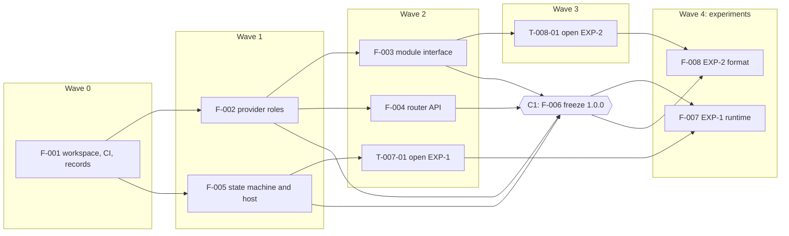

# rutent: implementation plan

This plan opens `STEP-3`, construction, under the Narthex method (Narthex `REQ-SKL-6`, `REQ-CHN-11`,
`REQ-CHN-12`). It turns the accepted SAD (`ARCHITECTURE.md`) and its fourteen ADRs into plan decisions,
milestones, features and tasks, each tracing to the `SPEC.md` and ADR identifiers it serves. It changes neither
`SPEC.md` nor the SAD. Where it goes further than the SAD, a plan decision says so.

`SPEC.md` defines v1. v0 is a first build ahead of it (owner ruling `v0-before-v1`, 2026-11-06). This plan builds
v0, then the work due before v1.

**v0 in one paragraph.** A Rust platform (`DEC-1`) that goes to production with real customer value (`DEC-19`),
every provider operated by Bloque, routing across public networks and more than one private rail (`DEC-24`), with
no order splitting (`DEC-8`) and with verifiers and judgements left to v1 (`DEC-16`).

---

## 1. How to read

Read §3 for the milestones, then §4 for the first milestone in detail. §2 holds the rules the build follows. §5
shows what runs in parallel. §6 lists the risks, the legal points, and the open
items. §7 shows that every requirement has a place.

### Identifiers

| Prefix | Meaning | Example |
|---|---|---|
| `DEC-*` | A plan decision | `DEC-3` |
| `M1`, `M2`, … | A milestone. Numbered from 1, so "milestone 1" in ADR-0002, ADR-0003 and SAD §9 means `M1` | `M1` |
| `F-NNN` | A feature: one goal, one agent at a time, one worktree | `F-005` |
| `T-NNN-NN` | A task of feature `F-NNN`: one commit, integrated into its milestone's branch; the pull request is the milestone's (`construction-autonomy`) | `T-005-02` |
| `EXP-n` | An experiment under Narthex's `experiments/` mechanism (Narthex `REQ-EXP-1`) | `EXP-1` |
| `C1` | The contract freeze inside `M1` | |

`REQ-*`, `INV-*`, `AC-*`, `NFR-*`, `GUA-*`, `OBL-*`, `ASM-*`, `DEF-*`, `THR-*` and `PS-*` are `SPEC.md`'s and
`PRODUCT.md`'s. `CMP-*` are the SAD's components. Narthex's own identifiers are always written with the prefix
"Narthex", as in Narthex `REQ-CHN-11`, so they are never read as rutent's. `REQ-AUZ-10` is withdrawn and is never
cited. Identifiers are stable; a withdrawn one is never reused.

### Rulings applied in v0.1.0

The owner answered these on the decision form on 2026-11-06 (archived in `decisions/responses/`), and gave the
Haiku ruling in chat the same day.

| Item | Ruling | Applied in |
|---|---|---|
| `plan-language` | Rust | `DEC-1`, `T-001-01` |
| `plan-v0-end-state` | Production, with real customer value | `DEC-19`, `M4`, `F-030` to `F-034`, §6.1 |
| `plan-v0-private-rails` | Yes, and "more than one" | `DEC-24`, `F-012`, `F-015`, `M3` |
| `plan-v0-verifiers` | Defer to v1, the role kept in the contract | `DEC-16`, `T-002-01`, `F-021`, `F-053` |
| `accept-plan` | Accept the plan | this document's status; every `proposed` decision below is accepted |
| `counsel-licences` | No counsel: "an open software solution with a mixed licensing model"; legal affairs are handled apart, as long as the build sticks to the spec | `DEC-6`, `T-001-04`, `T-007-03`, §6.1 |
| `counsel-v0-production` | No counsel, and no single jurisdiction: binding to one "deviates the open nature of the protocol"; "gates are artificial at this point" | `DEC-19`, `M4`, `F-034`, §6.1 |
| `plan-haiku-tier` | Haiku for lightweight verifications and purely mechanical code tasks, where contracts are fixed and no design decision is adjacent (ruled in chat) | `DEC-22`, §4 Model columns |

### Rulings applied in v0.2.0

The owner gave these on the form or in chat between 2026-11-06 and 2026-11-09 (archived in `decisions/responses/`).
Until v0.2.0, `HOUSE-RULES.md` carried them over this plan; from v0.2.0 the plan states them itself. On
2026-11-09 the owner told the agent in chat to make this amendment ("yes, amend the plan", item
`plan-amend-branch-model`); it is the one time an agent has edited this file.

| Item | Ruling | Applied in |
|---|---|---|
| `construction-autonomy` | One pull request per milestone, for an external reviewer; the orchestrating session integrates each task into the milestone branch; no cap on parallel agents (ruled in chat) | §1 Identifiers, `DEC-20`, `DEC-22`, §5 |
| `protect-main` | The agent protects `main`: the four required checks and a pull request with code-owner review | `DEC-20` |
| `branch-model` | Develop against `develop`, through `REVIEW-WORKFLOW.md`; `main` takes only releases, merged by the owner. Amended in chat the same day: a merge into `develop` needs no human, and `DEC-20`'s click moves to the release into `main` | `DEC-20`, `DEC-25`, `DEC-6`, `T-006-01`, `T-007-03`, `M1` exit |
| `default-branch` | Keep `main` as the repository's default branch, so each milestone pull request sets its base to `develop` | `DEC-20` |

### Status of plan decisions

`accepted` means an accepted ADR or an owner ruling backs it. `proposed` marked a plan-only choice that stood
unless the owner objected on reading this plan; the owner accepted the plan (`accept-plan`), so each now stands as
accepted. A later `pending <item>` means a decision item must be answered first; until then the stricter reading
applies and no task that depends on it starts.

### Task tables

Each task row names the work, the tasks it waits on, the identifiers it serves, the tests that prove it, and when
it is done. "Done when" is always something a script can decide (Narthex `REQ-SKL-14`). Test names are plain
sentences; the identifiers in square brackets after a test name go in a `verifies:` comment on that test, which the
tag check reads (`DEC-21`).

---

## 2. Plan decisions

### 2.1 From the SAD and the ADRs

| ID | Decision | Source | Status |
|---|---|---|---|
| `DEC-1` | **Rust** for the platform: core, router, state machine, provider system, evidence checker and the hosts, in one Cargo workspace. Provider modules stay in any language that compiles to the admitted format (`REQ-MDL-15`). The SAD left this open; it is a plan decision citing its item, not a new ADR | item `plan-language` | accepted (Pablo) |
| `DEC-2` | One package per SAD component, seven in all: `CMP-ROUTER`, `CMP-STM`, `CMP-PROV`, `CMP-CORE-ORCH`, `CMP-CORE-AUTHZ`, `CMP-CORE-AUDIT`, `CMP-EVIDENCE`, plus `contracts/` and `conformance/`. The three outer libraries import nothing of ours but `contracts/`; Core reaches them only through their public contracts. A boundary check in CI enforces both. Every component is code (SAD §8) | `REQ-MOD-1`, `REQ-MOD-3`, ADR-0001, SAD §2, §8 | accepted |
| `DEC-3` | Five contracts freeze at `C1`, inside `M1`: the provider role contract, the module interface split, the router API, the state-machine API, and the state machine's host contract. SAD §9 lists four; the host contract is the fifth because ADR-0002 defines it and the runtime experiment must be scored against a fixed one. It is frozen as part of the state-machine contract package | SAD §9, ADR-0002, Narthex `REQ-CHN-12` | accepted (`accept-plan`) |
| `DEC-4` | The module interface and the provider role contract are format-neutral and language-neutral: schemas of operations, shapes, capability, destination and secret declarations, and the sandboxed/outside split, each with valid and invalid fixtures. Bindings to a binary format (Wasm, PVM) are outside the frozen contract and belong to `EXP-2`. The router and state-machine APIs are library APIs in `DEC-1`'s language, and their records (decision records, recorded inputs) have serialised schemas and fixtures. Each contract carries a version and a changelog; a change after `C1` needs a version bump, a changelog entry naming a `DEC-*`, and the owner's click (`DEC-20`) | ADR-0003, ADR-0002, SAD §3 | accepted (`accept-plan`) |
| `DEC-5` | Shared conformance suites, one per contract: the module-boundary suite (the shapes of `AC-19`, `AC-20`, `AC-21`, plus hostile modules for `REQ-MDL-6`, `REQ-MDL-7`, `REQ-MDL-9`, `REQ-MDL-12`), run against every format binding and every language; the host-contract suite, with fault injection; the router suite (recompute from the record alone, purity); the role suite (a stand-in per category, a stand-in that breaks its role). The same suites score the two experiments | Narthex `REQ-CHN-12`, SAD §9, `AC-19` to `AC-21` | accepted (`accept-plan`) |
| `DEC-6` | `EXP-1`, the durable-store runtime: VOS against a purpose-built store, each behind the frozen host contract, scored by the host-contract suite and by the gap list of `research/2026-11-02-vos.md`. Its outcome amends ADR-0002 and does not reopen `runtime-host-seam`. Adopting VOS also records the owner's decision on its AGPL-3.0-or-later licence in the dependency licence record, as `REQ-MOD-5` requires of every dependency, case by case, with no counsel step (`counsel-licences`). The licence-record check (`T-001-04`) keeps any dependency without a recorded decision off `develop` and `main`, where it is a required check (`branch-model`) | ADR-0002, `REQ-OPS-3`, `NFR-6`, `REQ-MOD-5`, `PS-66`; item `counsel-licences` | accepted (Pablo) |
| `DEC-7` | `EXP-2`, the module format: Wasm against PVM, one stand-in module per provider category in two languages, scored by the module-boundary suite against `AC-20`. One OS process per provider whichever format wins, and the admitting compiler in its own isolation. A second format is kept only if it earns its upkeep. Its outcome amends ADR-0003 and re-runs the `THR-85` check of SAD §6 | ADR-0003, `REQ-MDL-15`, `REQ-MDL-18`, `THR-85` | accepted |
| `DEC-8` | The router is a pure function of request, catalogue snapshot and policy bounds: a hop-limited exhaustive search, each candidate evaluated at the actual amount and direction, fresh quotes, dry-runs and eligibility only for the shortlist. Its result and decision record carry a split of N parts from `C1` on; v0's router always returns one route, recorded as a split of one part. v1 adds the splitting rule without changing the contract | ADR-0006, `REQ-QTE-11`, `REQ-QTE-12`, `REQ-QTE-16`, `REQ-AUD-4` | accepted |
| `DEC-9` | v0 runs one shared credential proxy, answering each lookup only for the calling process's own provider, with vault buckets separated by process role at deployment. Credentials are keyed by provider from the start. The resolver interface is resolve-by-name at call time, implemented against both Vault and OpenBao | ADR-0004, `REQ-MDL-6`, `REQ-MDL-9`, `REQ-MDL-17` | accepted |
| `DEC-10` | **Admission gate.** A provider Bloque does not operate MUST NOT be admitted to the catalogue until (a) per-provider credential proxies are in force (`F-051`) and (b) counsel's read on third-party bond custody is recorded (ADR-0010). This holds whether that provider comes before v1 or with it, and the admission path checks it (`F-051`) | ADR-0004, ADR-0010, SAD §9 | accepted |
| `DEC-11` | v0 records each grant's reversal-capacity check and sizes each provider's ceiling to its bond (ceiling follows bond). While every provider is Bloque's own, the bond stands as a guarantee that reversals can be made | ADR-0010, `REQ-CAT-7`, `REQ-ORD-8`, `OBL-3` | accepted |
| `DEC-12` | The authenticated log is a Merkle log in `CMP-CORE-AUDIT`'s own store, apart from the execution store, with signed receipts per party on request. Checkpoints are fixed-tick, fixed-size, salted commitments to its root, with no raw size published | ADR-0005, `REQ-AUD-1`, `REQ-AUD-9`, `REQ-AUD-14` | accepted |
| `DEC-13` | Evidence uses the four-grade scale, declared per provider. `CMP-EVIDENCE` checks grade 1 and 2 claims per public network; each network gets its finality definition, reorg rule and movement-to-segment matching as its own task when it joins the catalogue. One destination per route is a load-bearing assumption | ADR-0007, `REQ-ORD-39` | accepted |
| `DEC-14` | Built as their ADRs decide: the origin reserve's own signed statement confirms a reversal (ADR-0008); cross-report comparison is a pure, detection-only function in `CMP-CORE-AUDIT` (ADR-0009); stuck orders need separate decide and move permissions, compared at the accountable party (ADR-0011); module releases are staged on a traffic share and machine code is re-derived after compiler fixes (ADR-0014) | ADR-0008, ADR-0009, ADR-0011, ADR-0014 | accepted |
| `DEC-15` | The balance-check allowance of ADR-0013 is the design of record and gets no task in this plan | ADR-0013 | accepted |
| `DEC-16` | **Verifiers and judgements wait for v1** (`F-053`, `M5`), built then as ADR-0012 decides. The verifier role is in the frozen provider role contract at `C1`, so v1 changes no contract. v0 keeps what doesn't need a verifier: each shortlisted provider checks eligibility itself (`REQ-CPL-6`), for the parties its rules name; who may ask about a person is identified and bounded (`REQ-CPL-2`, `REQ-CPL-5`); policy can refuse a provider's yes (`REQ-CPL-3`); a reserve's proof about its users and its presence rule (`REQ-CPL-8`, `REQ-CPL-9`); a third-party payer's details stay at the provider (`REQ-CPL-11`); the loss from a reserve's false judgement falls on the provider that relied on it (the reserve half of `REQ-CPL-12`); a missing input is a refusal (`REQ-AUZ-5`). Deferred: `REQ-CPL-1`, `REQ-CPL-4`, `REQ-CPL-7`, `REQ-CPL-10`, and the verifier half of `REQ-CPL-12`. This split is the plan's reading of the ruling | item `plan-v0-verifiers`, ADR-0012, `REQ-CAT-8` | accepted (Pablo); the split accepted with the plan |

### 2.2 Plan-only decisions

| ID | Decision | Serves | Status |
|---|---|---|---|
| `DEC-17` | **Always in v0, never offered as cuts:** every invariant (`INV-1` to `INV-10`); guarantees `GUA-1` to `GUA-5` and `GUA-7`; `REQ-AUZ-1` (no path skips rutent's own policy); the authenticated log (`REQ-AUD-1` to `REQ-AUD-9`); notices (`REQ-ORD-20`); statements bound to their deployment and protocol version (`REQ-PRT-1`). `GUA-6` and `REQ-PRT-3` (the protocol's specification published) are v1's by their own text, so they sit in `M5` | `oss-ledger-1`, `oss-ledger-2` | accepted (`accept-plan`) |
| `DEC-18` | **Construction method per milestone** (Narthex `REQ-CHN-11`): `M1` TDD, contract first, with two experiments under Narthex's experiment mechanism; `M2` TDD with property tests for each invariant a library carries (`oss-ledger-1`); `M3` BDD: every in-scope `AC-*` is an executable scenario, with property and simulation tests for the invariants and fault injection for `NFR-5`; `M4` BDD against the deployment, producing the `STEP-4` evidence; `M5` TDD | Narthex `REQ-CHN-11` | accepted (`accept-plan`) |
| `DEC-19` | **v0 ends in production, with real customer value.** So v0 passes the `STEP-4` and `STEP-5` gates; Bloque, as operator, meets the `OBL-*` that bear on a live deployment (`F-033`), a named checker (`OBL-4`) and published checkpoints (`OBL-8`) among them; and no single jurisdiction is assumed: the specification stays jurisdiction-neutral (`PS-65`), and `OBL-7` and `OBL-9` stay the operator's, handled apart from the build (`counsel-v0-production`). Bloque-run providers are admitted on test networks and sandboxes first, then on production rails | items `plan-v0-end-state`, `counsel-v0-production`; `REQ-OPS-4`, `INV-5`, `PS-65` | accepted (Pablo) |
| `DEC-20` | **Merge rule.** The orchestrating session integrates a task into its milestone's branch only when every check passes and a fresh reviewer agent, not the author, finds nothing. A milestone's pull request targets `develop` (its base set by hand, since `main` stays the default branch) and goes through `REVIEW-WORKFLOW.md`; once the reviewer approves and every check passes, the orchestrating session merges it with a merge commit, with no human step, and keeps the milestone and task branches. `main` takes only releases: a `develop` → `main` pull request that the owner merges, never an agent, listing every path below that it carries. These paths reach `main` only with the owner's click on that release, after a separate security review: `contracts/`, including each version bump; the credential proxy and resolvers; module admission and signature checking; `CMP-CORE-AUTHZ`'s policy engine; the log's and checkpoints' signing | Narthex `REQ-SKL-25`, `REQ-SKL-20`; items `construction-autonomy`, `branch-model`, `protect-main`, `default-branch` | accepted (`accept-plan`); amended by `construction-autonomy` and `branch-model` (Pablo) |
| `DEC-21` | **Test naming.** Plain sentences, with the identifiers each test verifies in a `verifies:` comment on it. A tag check reports a test with none and an identifier no document defines | Narthex `REQ-SKL-30` | accepted (`accept-plan`) |
| `DEC-22` | **Agents.** One agent per feature, each in its own worktree and build directory; the orchestrating session writes no code; no cap on parallel helpers (`construction-autonomy`); one CI watcher; every spawn names its model (the Model column of §4). **Haiku** takes lightweight verifications (the plan check, a suite run at a freeze, the CI watcher) and purely mechanical code tasks whose contracts are fixed and with no design decision next to them; Sonnet takes bounded coding with design nearby; Opus contracts, experiments and design still open. A task may name a lighter model than its feature | Narthex `REQ-SKL-7`, `REQ-SKL-29`; items `plan-haiku-tier`, `construction-autonomy` | accepted (Pablo); the cap removed by `construction-autonomy` |
| `DEC-23` | **Bloque's own provider modules live outside this repository.** This repository holds only the catalogue, the hosts and stand-in providers; every provider, Bloque's included, reaches the platform through the common interface | `PS-67`, `REQ-MOD-4`, `PS-61` | accepted (`accept-plan`) |
| `DEC-24` | **Private nodes are in v0, more than one of them.** `REQ-CAT-22`, `REQ-ORD-41`, and the private side of `REQ-ORD-3`, `REQ-ORD-33` and `REQ-AUD-15` are built in `M2` and `M3`, with replay in `CMP-EVIDENCE`. Scenarios cover a route crossing two private nodes | item `plan-v0-private-rails`, `REQ-ORD-33`, `REQ-ORD-41`, `REQ-CAT-22` | accepted (Pablo) |
| `DEC-25` | The project's house-rules file, `HOUSE-RULES.md`, takes Narthex's defaults and adds `DEC-20`'s paths and the branch model; `REVIEW-WORKFLOW.md` beside it says how a milestone pull request is reviewed and answered. Every brief carries the house rules in full | Narthex `REQ-SKL-17`, `REQ-SKL-18`; item `branch-model` | accepted (`accept-plan`); amended by `branch-model` |

---

## 3. Milestones

| Milestone | Goal | Method | Features |
|---|---|---|---|
| `M1` | Freeze the contracts, give each a conformance suite, and run the two experiments | TDD, contract first; experiments | `F-001` to `F-008` |
| `M2` | The three outer libraries and the evidence checker, each standalone, on the runtime and format the experiments chose | TDD with property tests | `F-010` to `F-016` |
| `M3` | Core binds them; v0's scope runs end to end against simulated providers | BDD and simulation tests | `F-020` to `F-025` |
| `M4` | v0 in production, with real customer value | BDD against the deployment | `F-030` to `F-034` |
| `M5` | Before v1, or before the first provider Bloque doesn't operate: splitting, per-provider proxies, counsel's read on the bond, the published protocol, verifiers and judgements | TDD | `F-050` to `F-054` |

### `M1`: contracts, conformance suites and the two experiments

**Goal.** Every later module and every later runtime is written against frozen contracts. The experiments are
scored by the same suites the platform will keep.

**Method.** TDD, contract first (`DEC-18`): fixtures and suites before implementations. The experiments follow
Narthex `REQ-EXP-1` to `REQ-EXP-7`: their questions go to their own logs, their changes stay drafts, and each ends
with a one-page outcome and one adoption item on the owner's form.

**Starts when** the owner accepts this plan. `DEC-1` is ruled, and no other item blocks `M1`.

**Exit criteria.** All must hold at one commit: the milestone's merge into `develop`. Its tags go on the release into `main` (`DEC-20`).

| # | Criterion | Ids |
|---|---|---|
| E1 | The five contracts are under `contracts/`, each at 1.0.0 or the later version a reviewed bump gave it, with a changelog, and the contract guard is green | `DEC-3`, `DEC-4`, Narthex `REQ-CHN-12` |
| E2 | The module-boundary suite passes for each kept format binding in two languages, and refuses every hostile fixture | `AC-19`, `AC-20`, `AC-21`, `REQ-MDL-15`, `REQ-MDL-9` |
| E3 | The host-contract suite passes on the reference host and has scored every runtime candidate | `REQ-OPS-3`, `NFR-6`, `INV-7` |
| E4 | Both experiments have outcome pages whose numbers each name a run; each adoption is an item on the form; the amendments to ADR-0002 and ADR-0003 are drafted. Whatever runtime is adopted has its licence decision in the dependency record | `DEC-6`, `DEC-7`, `REQ-MOD-5` |
| E5 | The boundary, documentation, licence-record and tag checks run in CI and are green | `REQ-MOD-1`, `REQ-MOD-2`, `REQ-MOD-3`, `REQ-MOD-5`, `NFR-7` |
| E6 | The milestone retrospective is written (Narthex `REQ-CHN-18`) | |

### `M2`: the libraries, standalone

**Goal.** `CMP-STM`, `CMP-ROUTER`, `CMP-PROV` and `CMP-EVIDENCE` each pass their own tests from a program that
uses only that component (`REQ-MOD-1`), on the runtime and format `M1` adopted. **Exit:** each library's suite and
the contract suites pass; every invariant a library carries has a property test; every public element is
documented (`NFR-7`). Tasks are written when `M1` ends, from the experiments' outcomes.

### `M3`: Core, and v0 end to end in simulation

**Goal.** `CMP-CORE-ORCH`, `CMP-CORE-AUTHZ` and `CMP-CORE-AUDIT` bind the libraries. Every `AC-*` in v0's scope
passes as a scenario against simulated providers, and every invariant passes its property or simulation test,
with fault injection. Scenarios include routes across two private nodes (`DEC-24`).
**Exit:** the requirement-to-evidence table for v0's scope has a passing verifier for each
row; the threat re-check of SAD §6 is re-run with `EXP-2`'s outcome. Tasks are written when `M2` ends.

Core's three parts talk to each other through interfaces `C1` does not freeze. They are settled, as one
contract task, before `F-020`, `F-021` and `F-022` run side by side, so their agents never edit one another's
interfaces.

### `M4`: v0 in production

**Goal.** v0 runs in production with real customer value (`DEC-19`). A standalone deployment (`REQ-OPS-4`);
Bloque-run provider modules, built outside this repository (`DEC-23`), admitted through the catalogue on test
networks and sandboxes, then on production rails; the `STEP-4` evidence; and `STEP-5`: runbooks, SLOs and their
signals, an incident contact, Bloque's operator obligations in force, and the release.

**Method.** BDD against the deployment (`DEC-18`).

**Exit.** The requirement-to-evidence table passes at the release candidate; the owner records validation on the
form (Narthex `REQ-CHN-13`); `F-025`'s security review and a review of the deployment have no open high or critical finding, and the `THR-85` re-check of `T-008-04` is recorded; the operator obligations of `F-033` are each met or recorded; and the owner answers the release item, an outward action
(Narthex `REQ-CHN-14`). The first real order follows that answer, not before it.

### `M5`: before v1

Due before v1, or before the first provider Bloque doesn't operate if one comes sooner (`DEC-10`). Splitting
(`REQ-QTE-16`'s rule, `REQ-ORD-42`, `AC-38`); per-provider credential proxies (ADR-0004); counsel's read on bond
custody (ADR-0010); the protocol's specification published (`REQ-PRT-3`, `GUA-6`); and verifiers and judgements
(`DEC-16`).

---

## 4. Features and tasks

### 4.1 `M1` features

| Feature | Title | Model | Depends on | Contracts | Tasks |
|---|---|---|---|---|---|
| `F-001` | Workspace, CI, house rules and records | Sonnet; Haiku for `T-001-04`, `T-001-05` | none | creates the contract guard | 5 |
| `F-002` | Contract: provider roles | Opus | `F-001` | implements provider role | 3 |
| `F-003` | Contract: module interface split | Opus | `F-002` | implements module interface; consumes provider role | 3 |
| `F-004` | Contract: router API | Opus | `F-002` | implements router API; consumes provider role | 2 |
| `F-005` | Contract: state machine and host | Opus | `F-001` | implements state machine and host | 4 |
| `F-006` | Contract freeze `C1` | Haiku | `F-002` to `F-005` | tags all five | 1 |
| `F-007` | `EXP-1`: durable-store runtime | Opus | `F-005`, `F-006` | consumes host | 4 |
| `F-008` | `EXP-2`: module format | Opus | `F-003`, `F-006` | consumes module interface, provider role | 4 |

`M1` has 26 tasks.

#### `F-001` Workspace, CI, house rules and records

- **Goal:** the empty workspace of `DEC-2`, CI, the house rules, and the records later checks read.
- **Serves:** `REQ-MOD-1`, `REQ-MOD-2`, `REQ-MOD-3`, `REQ-MOD-5`, `NFR-7`, `DEC-2`, `DEC-4`, `DEC-21`, `DEC-25`.

| Task | Work | Depends on | Serves | Tests | Done when |
|---|---|---|---|---|---|
| `T-001-01` | A Cargo workspace (`DEC-1`): one empty crate per component of `DEC-2`, plus `contracts/` and `conformance/`; a boundary check over the crate graph | none | `REQ-MOD-1`, `REQ-MOD-3`, `DEC-1`, `DEC-2` | `router imports nothing of ours but contracts`; `state machine imports nothing of ours but contracts`; `provider system imports nothing of ours but contracts`; `core reaches libraries only through their public contracts` [`REQ-MOD-1`, `REQ-MOD-3`] | the workspace builds and the boundary check passes locally |
| `T-001-02` | CI: build, test, lint, the boundary check, and a documentation check that fails on an undocumented public element | `T-001-01` | `REQ-MOD-2`, `NFR-7` | `undocumented public element fails the check` [`REQ-MOD-2`, `NFR-7`] | CI is green on the pull request |
| `T-001-03` | `HOUSE-RULES.md` (`DEC-25`, with `DEC-20`'s paths); a tag check reading `verifies:` comments against the identifiers `SPEC.md`, the ADRs and `PLAN.md` define; a plan check: every task traces to a defined identifier, no cycle, milestone order, and the waves of §5 | `T-001-01` | `DEC-21`, `DEC-25` | `test without a verifies comment is reported`; `verifies comment naming an unknown id is reported`; `withdrawn id is reported`; `task depending on a later milestone is reported`; `dependency cycle is reported` [`DEC-21`] | both checks run in CI, the tag check in report mode |
| `T-001-04` | A dependency licence record: each required dependency with its licence and the decision on it; CI fails on a dependency not in the record, or in it with its decision still pending. VOS's AGPL-3.0 and Vault's BSL-1.1 are entered with "decision pending", for the owner to rule when each is adopted | `T-001-01` | `REQ-MOD-5` | `unrecorded dependency fails the check`; `dependency with a pending decision fails the check`; `recorded dependency with a decision passes` [`REQ-MOD-5`] | the check runs in CI and fails on its fixture |
| `T-001-05` | Contract guard: a change under `contracts/` needs a version bump and a changelog entry naming a `DEC-*` | `T-001-02` | `DEC-4` | `contract change without a version bump fails`; `changelog entry without a plan decision fails` [`DEC-4`] | the guard runs in CI and fails on its fixtures |

#### `F-002` Contract: provider roles

- **Goal:** one common interface with four categories, each role's contract, and the declarations every provider
  makes, as format-neutral schemas with fixtures (`DEC-4`).
- **Serves:** `REQ-CAT-6`, `REQ-CAT-8` to `REQ-CAT-14`, `REQ-CAT-16`, `REQ-CAT-18`, `REQ-CAT-20` to `REQ-CAT-22`,
  `REQ-MOD-4`, `INV-9`, `REQ-ORD-39`, `REQ-PRT-1`, `REQ-EXT-2`.

| Task | Work | Depends on | Serves | Tests | Done when |
|---|---|---|---|---|---|
| `T-002-01` | Advertisement and declaration schemas: the four categories (verifier included, `DEC-16`), tuples, private nodes and their publisher, per-tuple bands, increments, units, gross or net, evidence availability and grade, safe retry, required inputs, a reserve's declarations | `T-001-05` | `REQ-CAT-8`, `REQ-CAT-10`, `REQ-CAT-11`, `REQ-CAT-12`, `REQ-CAT-13`, `REQ-CAT-6`, `REQ-CAT-20`, `REQ-CAT-22`, `REQ-ORD-39` | `exchange spanning two nodes is invalid`; `ramp within one node is invalid`; `verifier advertising a tuple is invalid`; `provider without an identifier or status query is invalid` [`REQ-CAT-13`, `REQ-CAT-16`] | the schemas validate every valid fixture and reject every invalid one |
| `T-002-02` | Operation and result schemas per role: withdrawal, deposit, balance verification, conversion with a detailed quote, transfer with fees, judgement; dry-run; outcome unknown as its own result; refusal classes. Every party statement carries an envelope naming its deployment and protocol version | `T-002-01` | `REQ-CAT-9`, `REQ-CAT-14`, `REQ-CAT-18`, `INV-9`, `REQ-ORD-1`, `REQ-PRT-1` | `balance answer carrying anything but yes or no is invalid`; `refusal without its class is invalid`; `outcome unknown is distinct from success and failure`; `statement without its deployment and protocol version is invalid` [`INV-9`, `REQ-CAT-18`, `REQ-ORD-1`, `REQ-PRT-1`] | as `T-002-01` |
| `T-002-03` | The role conformance suite and one in-memory stand-in per category | `T-002-02` | `REQ-CAT-8`, `REQ-CAT-21`, `REQ-MOD-4` | `stand-in of each category passes its role suite`; `stand-in that breaks its role is flagged`; `stand-in with internal steps passes` [`REQ-CAT-21`, `AC-30`] | the suite passes on the four stand-ins and flags the breaking one |

#### `F-003` Contract: module interface split

- **Goal:** the module boundary every later module is written against, format-neutral (`DEC-4`), and the shared
  suite that scores `EXP-2` (`DEC-5`).
- **Serves:** `REQ-MDL-1` to `REQ-MDL-3`, `REQ-MDL-6` to `REQ-MDL-9`, `REQ-MDL-12`, `REQ-MDL-15` to `REQ-MDL-19`,
  `REQ-MDL-21`, `AC-19`, `AC-20`, `AC-21`.

| Task | Work | Depends on | Serves | Tests | Done when |
|---|---|---|---|---|---|
| `T-003-01` | The split: the sandboxed part's operations and the outside part's; capability and destination declarations; secret resolve-by-name, outside part only; the record of an outbound call; declared cross-module calls | `T-002-02` | `REQ-MDL-6`, `REQ-MDL-7`, `REQ-MDL-8`, `REQ-MDL-16`, `REQ-MDL-17`, `REQ-MDL-19`, `REQ-MDL-21` | `sandboxed part declaring a secret lookup is invalid`; `outbound call record without a transaction is invalid` [`REQ-MDL-6`, `REQ-MDL-8`] | the schemas validate and reject their fixtures |
| `T-003-02` | The admission artefact: signed assertion, binary digest, capability declaration, platform build version, version history | `T-003-01` | `REQ-MDL-1`, `REQ-MDL-2`, `REQ-MDL-3`, `REQ-MDL-15` | `artefact without a signed assertion is invalid`; `release widening capabilities is marked for fresh acceptance` [`REQ-MDL-1`, `REQ-MDL-3`] | as `T-003-01` |
| `T-003-03` | The module-boundary suite: a harness any format binding plugs into, with the shapes of `AC-19`, `AC-20` and `AC-21` and hostile modules reading secrets, reaching undeclared destinations, following redirects, reaching another provider, and returning malformed or oversized output. Runs against an in-process reference double | `T-003-02`, `T-002-03` | `AC-19`, `AC-20`, `AC-21`, `REQ-MDL-7`, `REQ-MDL-9`, `REQ-MDL-12`, `DEC-5` | `hostile module cannot read another provider's secrets`; `redirect to an undeclared destination is refused`; `oversized output is refused`; `widened release needs fresh acceptance` [`REQ-MDL-9`, `REQ-MDL-7`, `REQ-MDL-12`, `AC-21`] | the suite passes on the reference double and every hostile fixture fails as expected |

#### `F-004` Contract: router API

- **Goal:** `route(request, snapshot, policy bounds) → {candidates, chosen, decision record}`, split-shaped from the
  start (`DEC-8`).
- **Serves:** `REQ-QTE-1`, `REQ-QTE-4`, `REQ-QTE-11`, `REQ-QTE-16`, `REQ-AUD-4`, `REQ-ORD-37`, `REQ-PRT-1`, `REQ-PRT-5`, `AC-2`.

| Task | Work | Depends on | Serves | Tests | Done when |
|---|---|---|---|---|---|
| `T-004-01` | Types and serialised schemas: request with objective and floor, catalogue snapshot with each figure's age and origin, policy bounds, candidates with drop reasons, the chosen split of N parts, each an ordered list of typed operations, and the decision record. Quotes and records carry the statement envelope of `T-002-02`; an operation of an unknown kind is refused | `T-002-01` | `REQ-QTE-1`, `REQ-QTE-4`, `REQ-QTE-16`, `REQ-AUD-4`, `REQ-ORD-37`, `REQ-PRT-1`, `REQ-PRT-5`, `DEC-8` | `figure without age or origin is invalid`; `split of one part is valid`; `split of three parts is valid`; `route with an untyped operation is invalid`; `operation of an unknown kind is refused` [`REQ-QTE-4`, `REQ-QTE-16`, `REQ-ORD-37`, `REQ-PRT-5`] | the schemas validate and reject their fixtures |
| `T-004-02` | The router suite: the choice is recomputed from the record alone; same inputs give the same output; a changed objective can change the choice | `T-004-01` | `AC-2`, `REQ-AUD-4`, `REQ-QTE-11`, `DEC-5` | `choice is recomputed from its record with no provider call`; `same request and snapshot give the same result` [`AC-2`, `REQ-AUD-4`] | the suite passes on a reference double |

#### `F-005` Contract: state machine and host

- **Goal:** the state-machine API and its host contract (ADR-0002), and the host-contract suite that scores
  `EXP-1`.
- **Serves:** `REQ-STM-1` to `REQ-STM-7`, `REQ-OPS-3`, `NFR-4`, `NFR-6`, `INV-7`, `INV-8`.

| Task | Work | Depends on | Serves | Tests | Done when |
|---|---|---|---|---|---|
| `T-005-01` | The published state list (every state of `REQ-STM-2`'s table, the handed-on order included); the recorded-input shape; `transition(state, input) → state`; an order as one or more parts | `T-001-05` | `REQ-STM-1`, `REQ-STM-2`, `REQ-STM-3`, `REQ-STM-7` | `state list covers every state SPEC requires`; `input from outside without a record is invalid` [`REQ-STM-2`, `REQ-STM-3`] | the schemas validate and reject their fixtures |
| `T-005-02` | The host contract: durable transition storage, exactly-once delivery of recorded inputs, replacing the execution environment without losing an order in flight | `T-005-01` | `REQ-OPS-3`, `NFR-6`, `REQ-STM-4` | `host contract states delivery and swap guarantees` [`REQ-OPS-3`] | the contract and its fixtures are reviewed and merged |
| `T-005-03` | The host-contract suite, with fault injection: a crash between record and effect, a repeated and a reordered delivery, a swap mid-order, replay of a recorded run | `T-005-02` | `INV-7`, `INV-8`, `REQ-STM-4`, `NFR-4`, `NFR-5`, `NFR-6`, `DEC-5` | `crash between record and effect leaves no effect`; `repeated input moves nothing twice`; `swap mid-order loses no order`; `replay reaches the same states` [`INV-7`, `REQ-STM-4`, `NFR-6`, `NFR-4`] | the suite runs and reports per fault |
| `T-005-04` | An in-memory reference host that passes the suite: the baseline both candidates are compared with | `T-005-03` | `REQ-OPS-3`, `DEC-6` | the suite of `T-005-03` | the suite passes on the reference host |

#### `F-006` Contract freeze `C1`

| Task | Work | Depends on | Serves | Tests | Done when |
|---|---|---|---|---|---|
| `T-006-01` | Freeze the five contracts at 1.0.0, with their changelogs; from here a change follows `DEC-4` and waits for the owner's click (`DEC-20`). Each is tagged at the version it then has on the merge commit of the first release into `main` (`branch-model`) | `T-002-03`, `T-003-03`, `T-004-02`, `T-005-04` | `DEC-3`, `DEC-4`, Narthex `REQ-CHN-12` | every contract suite | every suite passes at the tagged commit and the guard is green |

#### `F-007` `EXP-1`: durable-store runtime

- **Goal:** decide which runtime implements the host contract (`DEC-6`).
- **Serves:** ADR-0002, `REQ-OPS-3`, `NFR-6`, `REQ-MOD-5`, `PS-66`.

| Task | Work | Depends on | Serves | Tests | Done when |
|---|---|---|---|---|---|
| `T-007-01` | Open `experiments/<start date>-runtime-host/` with its id, question, scope, own decision log, draft changes and outcome placeholder (Narthex `REQ-EXP-1`); the scoring sheet: the host-contract suite plus the gap list of `research/2026-11-02-vos.md` | `T-005-03` | `DEC-6` | none: a record | the directory holds every field Narthex `REQ-EXP-1` names |
| `T-007-02` | A purpose-built store behind the host contract, behind a flag | `T-007-01`, `T-006-01` | `REQ-OPS-3`, `NFR-6` | the host-contract suite | the suite's results are recorded in the scoring sheet with a run id |
| `T-007-03` | VOS behind the host contract, fault-injected, the gap list scored. Merged to `develop`, and so to `main`, only behind a flag, and only once VOS's licence decision is in the record (`DEC-6`); until then only measurement notes merge | `T-007-01`, `T-006-01` | `REQ-OPS-3`, `NFR-6`, `REQ-MOD-5`, `PS-66` | the host-contract suite | the results and the gap list are recorded with a run id |
| `T-007-04` | The one-page outcome (adopt, adapt or drop, each number naming a run); one adoption item on the owner's form; the amendment to ADR-0002 drafted | `T-007-02`, `T-007-03` | `DEC-6`, ADR-0002 | none: a record | the outcome page exists and the item is published |

#### `F-008` `EXP-2`: module format

- **Goal:** decide the admitted binary format or formats (`DEC-7`).
- **Serves:** ADR-0003, `REQ-MDL-15`, `REQ-MDL-18`, `REQ-MDL-13`, `AC-20`, `THR-85`.

| Task | Work | Depends on | Serves | Tests | Done when |
|---|---|---|---|---|---|
| `T-008-01` | Open `experiments/<start date>-module-format/` with the fields of Narthex `REQ-EXP-1`; the scoring sheet: the module-boundary suite per format and language | `T-003-03` | `DEC-7` | none: a record | as `T-007-01` |
| `T-008-02` | A Wasm binding of the suite; one OS process per provider; the admitting compiler in its own isolation; one stand-in module per category in two languages | `T-008-01`, `T-006-01` | `REQ-MDL-15`, `REQ-MDL-18`, `AC-20`, `REQ-MDL-13` | the module-boundary suite; `restarting one provider's process leaves the others running` [`REQ-MDL-13`] | the results are recorded with a run id |
| `T-008-03` | A PVM binding with the same stand-ins; a second guest language found or built, or the gap against `AC-20` recorded | `T-008-01`, `T-006-01` | `REQ-MDL-15`, `REQ-MDL-18`, `AC-20` | the module-boundary suite | the results are recorded with a run id |
| `T-008-04` | The one-page outcome; one adoption item on the owner's form; the amendment to ADR-0003 drafted; the `THR-85` row of SAD §6 re-checked | `T-008-02`, `T-008-03` | `DEC-7`, ADR-0003, `THR-85` | none: a record | the outcome page exists and the item is published |

### 4.2 `M2` to `M5` features

Tasks for these are written when the milestone before ends, so they can use the experiments' outcomes and what
the milestone before measured. Each feature owns one component's files, so no two agents write the same files.

| Feature | Milestone | Title | Component | Model | Depends on | Serves |
|---|---|---|---|---|---|---|
| `F-010` | `M2` | State machine library | `CMP-STM` | Sonnet | `F-006`, `F-007` | `REQ-STM-1` to `REQ-STM-8`, `INV-3`, `INV-4`, `INV-8`, `NFR-4` |
| `F-011` | `M2` | Router library | `CMP-ROUTER` | Opus | `F-006` | `REQ-QTE-1` to `REQ-QTE-15`, the shape of `REQ-QTE-16`, `REQ-EXT-2`, `AC-2`, `AC-3`, `AC-13`, `AC-14`, ADR-0006 |
| `F-012` | `M2` | Catalogue and grants | `CMP-PROV` | Sonnet | `F-006` | `REQ-CAT-1` to `REQ-CAT-23`, `REQ-MOD-4`, `AC-15`, `AC-29`, `AC-30`, `AC-34`, `DEC-11`, `DEC-24` |
| `F-013` | `M2` | Module admission, runtime and lifecycle | `CMP-PROV` | Sonnet | `F-008`, `F-012` | `REQ-MDL-1` to `REQ-MDL-5`, `REQ-MDL-10` to `REQ-MDL-16`, `REQ-MDL-18` to `REQ-MDL-20`, `AC-19` to `AC-21`, `NFR-2`, `NFR-3`, ADR-0014 |
| `F-014` | `M2` | Shared credential proxy and resolvers | `CMP-PROV` | Opus | `F-013` | `REQ-MDL-6` to `REQ-MDL-9`, `REQ-MDL-17`, `REQ-MDL-21`, `DEC-9` |
| `F-015` | `M2` | Evidence checker | `CMP-EVIDENCE` | Sonnet | `F-006` | `REQ-ORD-39`, `REQ-ORD-41`, `AC-35`, `DEC-13`, `DEC-24` |
| `F-016` | `M2` | Holding-account modules at public nodes | `CMP-PROV` | Sonnet | `F-013` | `REQ-CAT-23`, `INV-5`, `INV-1` |
| `F-020` | `M3` | Order orchestration | `CMP-CORE-ORCH` | Opus | `F-010`, `F-011`, `F-012`, `F-015` | `REQ-ORD-1` to `REQ-ORD-40`, `REQ-ORD-43` in v0's scope; `INV-2`, `INV-4`, `INV-5`, `INV-10`; `REQ-OPS-1`, `REQ-OPS-2`, `REQ-OPS-5` |
| `F-021` | `M3` | Policy and authorisation | `CMP-CORE-AUTHZ` | Opus | `F-006` | `REQ-AUZ-1` to `REQ-AUZ-9`, ADR-0011, `AC-6`, `AC-17`, `AC-18`, `AC-25`; v0's part of `REQ-CPL` (`DEC-16`) |
| `F-022` | `M3` | Authenticated log, checkpoints and checks | `CMP-CORE-AUDIT` | Opus | `F-006` | `REQ-AUD-1` to `REQ-AUD-15`, `REQ-ORD-9`, `INV-1`, `INV-6`, `INV-7`, `AC-22`, `AC-36`, `AC-37`, `AC-39`, ADR-0005, ADR-0009 |
| `F-023` | `M3` | Notices | `CMP-CORE-ORCH` | Sonnet | `F-020` | `REQ-ORD-20`, `AC-41` |
| `F-024` | `M3` | Simulated providers and the scenario harness | `conformance/` | Sonnet | `F-013` | every in-scope `AC-*` as a scenario; `INV-1` to `INV-10` by property and simulation tests; `NFR-5` |
| `F-025` | `M3` | Threat re-check and security review | all | Opus | `F-020` to `F-022` | SAD §6, `THR-85`, `THR-79`; `DEC-20`'s paths |
| `F-030` | `M4` | Standalone deployment and protocol cutovers | deployment | Sonnet | `M3` | `REQ-OPS-3`, `REQ-OPS-4`, `REQ-OPS-5`, `AC-25`; `REQ-PRT-2`, `REQ-PRT-4` (production has cutovers); `REQ-PRT-1` across the test and production deployments |
| `F-031` | `M4` | Admitting Bloque-run providers | `CMP-PROV` | Sonnet | `F-030` | `REQ-CAT-2`, `REQ-CAT-22`, `REQ-MDL-1`, `DEC-23`; test networks first, then production rails (`DEC-19`); one task per public network for `DEC-13`; one per private rail for `DEC-24` |
| `F-032` | `M4` | Verification evidence (`STEP-4`) | all | Sonnet | `F-031` | the requirement-to-evidence table (Narthex `REQ-CHN-13`) |
| `F-033` | `M4` | Operations (`STEP-5`) and Bloque's operator obligations | deployment | Sonnet | `F-032` | runbooks, SLOs, signals, contact (Narthex `REQ-CHN-14`); `OBL-1` to `OBL-6`, `OBL-8`; `REQ-AUD-10`, `REQ-AUD-12`; `NFR-8`. `OBL-7` and `OBL-9` stay the operator's, outside the build (`DEC-19`) |
| `F-034` | `M4` | Release | all | Sonnet | `F-033` | the release record and its reserved item (Narthex `REQ-SKL-12`) |
| `F-050` | `M5` | Splitting | `CMP-ROUTER`, `CMP-CORE-ORCH` | Opus | `M4` | the rule of `REQ-QTE-16`, `REQ-ORD-42`, the split side of `REQ-ORD-8` and `REQ-ORD-33`, `AC-38` |
| `F-051` | `M5` | Per-provider credential proxies and the admission gate | `CMP-PROV` | Opus | `F-014` | ADR-0004, `DEC-10`, `THR-79` |
| `F-052` | `M5` | The protocol's specification, published | protocol | Opus | `M4` | `REQ-PRT-3`, `GUA-6`, `REQ-EXT-1` |
| `F-053` | `M5` | Verifiers and judgements | `CMP-CORE-AUTHZ`, `CMP-PROV` | Opus | `F-021` | the deferred part of `REQ-CPL` (`DEC-16`), ADR-0012, `AC-16` |
| `F-054` | `M5` | Outside providers' entry | `CMP-PROV` | Sonnet | `F-051` | `REQ-CAT-7`, `OBL-3`, `DEC-10`, `DEC-11`; waits on counsel's read on bond custody |

---

## 5. Dependencies and waves

Generated from the task table of §4.1 (Narthex `REQ-SKL-6`). There is no cap on parallel helpers (`DEC-22`), so a
wave runs at once.

| Wave | Tasks |
|---|---|
| 0 | `T-001-01` |
| 1 | `T-001-02`, `T-001-03`, `T-001-04` |
| 2 | `T-001-05` |
| 3 | `T-002-01`, `T-005-01` |
| 4 | `T-002-02`, `T-004-01`, `T-005-02` |
| 5 | `T-002-03`, `T-003-01`, `T-004-02`, `T-005-03` |
| 6 | `T-003-02`, `T-005-04`, `T-007-01` |
| 7 | `T-003-03` |
| 8 | `T-006-01`, `T-008-01` |
| 9 | `T-007-02`, `T-007-03`, `T-008-02`, `T-008-03` |
| 10 | `T-007-04`, `T-008-04` |

**Critical path:** `T-001-01` → `T-001-02` → `T-001-05` → `T-002-01` → `T-002-02` → `T-003-01` → `T-003-02` →
`T-003-03` → `T-006-01` (the freeze, beside `T-008-01`) → `T-008-02` or `T-008-03` → `T-008-04`: eleven tasks.
The module contract is the longest chain, so `F-002` and `F-003` take the first helper slot; `F-004` and `F-005` take the second.

**Checks on this table** (Narthex `REQ-SKL-6`): every task serves at least one identifier that `SPEC.md`, an ADR or
this plan defines; the graph has no cycle; no task waits on a task of a later milestone. The orchestrating session
runs these checks on each plan change until `T-001-03` puts them in CI.

---

## 6. Risks, gates and open items

### 6.1 Legal points

The owner rules that legal affairs are handled apart from the build, as long as it sticks to the specification,
and that v0 has no counsel gate (`counsel-licences`, `counsel-v0-production`). Dependency licences are the owner's
decisions, recorded case by case (`REQ-MOD-5`, `T-001-04`). No jurisdiction is assumed (`PS-65`). `ASM-5` and
`ASM-6` stay as the specification states them.

Two points the accepted ADRs place after v0 are kept, as the owner ruled them there:

| Point | Bears on | Source |
|---|---|---|
| A third party holding a provider's bond: counsel's read, which the owner placed at "V1 and further" | Admitting the first provider Bloque doesn't operate (`DEC-10`, `F-054`) | ADR-0010, item `reversal-bonding-model` |
| FATF's current text and Mexico's "facilitation" reading, a named risk | Building judgements (`F-053`, `M5`) | ADR-0012 |

### 6.2 Risks

| # | Risk | Mitigation |
|---|---|---|
| 1 | **The freeze collides with the format experiment.** A Wasm or PVM finding needs a contract change | The module contract is format-neutral (`DEC-4`); bindings stay outside it; a change after `C1` is a `DEC-*`, a version bump and the owner's click |
| 2 | **Neither runtime candidate passes the host-contract suite** | The reference host of `T-005-04` is the floor; the purpose-built store is the ruled fallback (ADR-0002) |
| 3 | **PVM has one guest language**, against `AC-20`'s two | `T-008-03` finds or builds a second, or records the gap; Wasm can stay as the second format (ADR-0003) |
| 4 | **A sandbox escape** (`THR-85`) is still open | One process per provider bounds it; `T-008-04` and `F-025` re-run the check |
| 5 | **The shared proxy concentrates every provider's secrets** (`THR-79`) | Accepted while the roster is Bloque's own (`credential-proxy-scope`); vault buckets by process role; `DEC-10` gates outside providers on `F-051` |
| 6 | **Split-shaped contracts drift from v1's needs** before splitting is built | `T-004-01` validates a split of three parts at `C1`; `F-050` changes the rule, not the contract |
| 7 | **Low-volume providers never fill a staging window** (ADR-0014) | `F-013` adds a minimum observation volume next to the time window |
| 8 | **A node with several reserves** has no settlement path for a return to another reserve (ADR-0008) | A decision item before any multi-reserve node is admitted |
| 9 | **No load figure** (`NFR-1`, `ASM-1`), and no bound on marking a silent reserve (`NFR-8`), while production SLOs need both | No throughput target is claimed before `M4`; the owner sets both bounds when `M4`'s tasks are written, from the latencies `M3` and the test networks measure |

### 6.3 Open items

None blocks `M1`. The scope items, the acceptance and the two legal items are ruled (§1). The bounds `NFR-8` and
`NFR-1` leave unset, which `STEP-5`'s SLOs need, are asked when `M4`'s tasks are written (§6.2).

---

## 7. Traceability

### 7.1 Placement by family

"Shape in v0, rule in v1" means the frozen contract and the records carry the capability from `C1`, and the
behaviour arrives in `M5`.

| Family | Placed in | Deferred |
|---|---|---|
| `REQ-MOD` | `M1`: `REQ-MOD-1` to `REQ-MOD-3`, `REQ-MOD-5` (`F-001`); `REQ-MOD-4` (`F-002`, `F-012`) | none |
| `REQ-STM` | `M1`: contract (`F-005`); `M2`: library (`F-010`) | none |
| `REQ-QTE` | `M1`: contract (`F-004`); `M2`: `REQ-QTE-1` to `REQ-QTE-15` (`F-011`) | `REQ-QTE-16`: shape in v0, rule in v1 (`F-050`) |
| `REQ-CAT` | `M1`: schemas (`F-002`); `M2`: `F-012` (`REQ-CAT-22` included, `DEC-24`), `F-016`; `M4`: `F-031` | none |
| `REQ-MDL` | `M1`: contract and suite (`F-003`), format (`F-008`); `M2`: `F-013`, `F-014` | per-provider proxies: `M5` (`F-051`) |
| `REQ-ORD` | `M3`: `F-020`, `F-023`; `REQ-ORD-9` in `F-022`; `REQ-ORD-39` and `REQ-ORD-41` in `F-015` | `REQ-ORD-42`: shape in v0, rule in v1 (`F-050`) |
| `REQ-AUD` | `M3`: `F-022` | none |
| `REQ-CPL` | `M3`: `REQ-CPL-2`, `REQ-CPL-3`, `REQ-CPL-5`, `REQ-CPL-6`, `REQ-CPL-8`, `REQ-CPL-9`, `REQ-CPL-11`, the reserve half of `REQ-CPL-12` (`F-021`, `DEC-16`) | `M5`: `REQ-CPL-1`, `REQ-CPL-4`, `REQ-CPL-7`, `REQ-CPL-10`, the verifier half of `REQ-CPL-12` (`F-053`) |
| `REQ-AUZ` | `M3`: `REQ-AUZ-1` to `REQ-AUZ-9` (`F-021`) | none |
| `REQ-OPS` | `M1`: `REQ-OPS-3` contract (`F-005`); `M3`: `REQ-OPS-1`, `REQ-OPS-2`, `REQ-OPS-5` (`F-020`); `M4`: `REQ-OPS-4` (`F-030`) | none |
| `REQ-PRT` | `M1`: `REQ-PRT-1` and `REQ-PRT-5` in the frozen contracts (`T-002-02`, `T-004-01`); `M4`: `REQ-PRT-2`, `REQ-PRT-4` (`F-030`) | `REQ-PRT-3`: `M5` (`F-052`), v1 by its own text |
| `REQ-EXT` | `REQ-EXT-2` reviewed against the router (`F-011`); `REQ-EXT-1` against the protocol (`F-052`) | none |
| `INV` | `INV-1` to `INV-10`, always in v0 (`DEC-17`): `M2` and `M3` | none |
| `GUA` | `GUA-1` to `GUA-5`, `GUA-7` in v0 (`DEC-17`) | `GUA-6`: `M5` (`F-052`) |
| `NFR` | `NFR-4`, `NFR-6`, `NFR-7` from `M1`; `NFR-2`, `NFR-3` in `F-013`; `NFR-5` in `F-024`; `NFR-8` in `F-012` | `NFR-1`: no bound set (`ASM-1`) |
| `AC` | `AC-2`, `AC-19` to `AC-21`, `AC-30` shapes in `M1`; every in-scope `AC-*` as a scenario in `M3` (`F-024`) | `AC-38`: shape in v0, rule in v1; `AC-16`: `M5` (`F-053`) |
| `OBL` | Not allocated to a component (SAD §6): they bind the operator. v0 goes to production with Bloque as operator, so `F-033` puts `OBL-1` to `OBL-6` and `OBL-8` in force before the release. `OBL-7` and `OBL-9` stay the operator's, handled outside the build (`DEC-19`) | |

### 7.2 ADRs to plan decisions

| ADR | Plan decisions | Features |
|---|---|---|
| ADR-0001 | `DEC-2` | `F-001`, `F-020` to `F-022` |
| ADR-0002 | `DEC-3`, `DEC-6` | `F-005`, `F-007`, `F-010` |
| ADR-0003 | `DEC-7` | `F-003`, `F-008`, `F-013` |
| ADR-0004 | `DEC-9`, `DEC-10` | `F-014`, `F-051` |
| ADR-0005 | `DEC-12` | `F-022` |
| ADR-0006 | `DEC-8` | `F-004`, `F-011`, `F-050` |
| ADR-0007 | `DEC-13` | `F-015`, `F-031` |
| ADR-0008 | `DEC-14` | `F-020` |
| ADR-0009 | `DEC-14` | `F-022` |
| ADR-0010 | `DEC-10`, `DEC-11` | `F-012`, `F-054` |
| ADR-0011 | `DEC-14` | `F-021` |
| ADR-0012 | `DEC-16` | `F-053` |
| ADR-0013 | `DEC-15` | none |
| ADR-0014 | `DEC-14` | `F-013` |
