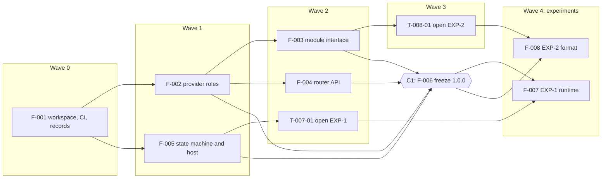
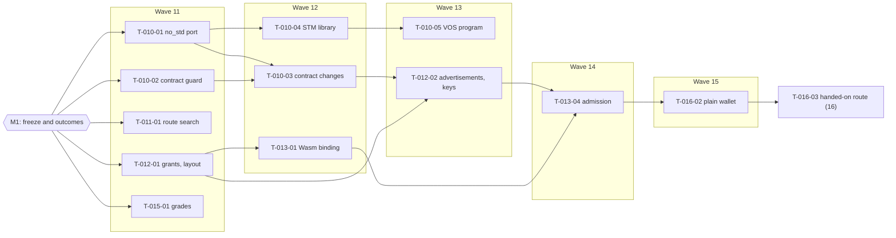

# rutent: implementation plan

This plan opens `STEP-3`, construction, under the Narthex method (Narthex `REQ-SKL-6`, `REQ-CHN-11`,
`REQ-CHN-12`). It turns the accepted SAD (`ARCHITECTURE.md`) and its fourteen ADRs into plan decisions,
milestones, features and tasks, each tracing to the `SPEC.md` and ADR identifiers it serves. It changes neither
`SPEC.md` nor the SAD. Where it goes further than the SAD, a plan decision says so.

`SPEC.md` defines v1. v0 is a first build ahead of it (owner ruling `v0-before-v1`, 2026-11-06). This plan builds
v0, then the work due before v1.

**v0 in one paragraph.** A Rust platform (`DEC-1`) that goes to production with real customer value (`DEC-19`),
every provider operated by Bloque, routing across public networks and more than one private rail (`DEC-24`), with
no order splitting (`DEC-8`) and with verifiers and judgements left to v1 (`DEC-16`).

---

## 1. How to read

Read §3 for the milestones, then §4 for the first milestone in detail. §2 holds the rules the build follows. §5
shows what runs in parallel. §6 lists the risks, the legal points, and the open
items. §7 shows that every requirement has a place.

### Identifiers

| Prefix | Meaning | Example |
|---|---|---|
| `DEC-*` | A plan decision | `DEC-3` |
| `M1`, `M2`, … | A milestone. Numbered from 1, so "milestone 1" in ADR-0002, ADR-0003 and SAD §9 means `M1` | `M1` |
| `F-NNN` | A feature: one goal, one agent at a time, one worktree | `F-005` |
| `T-NNN-NN` | A task of feature `F-NNN`: one commit, integrated into its milestone's branch; the pull request is the milestone's (`construction-autonomy`) | `T-005-02` |
| `EXP-n` | An experiment under Narthex's `experiments/` mechanism (Narthex `REQ-EXP-1`) | `EXP-1` |
| `C1` | The contract freeze inside `M1` | |

`REQ-*`, `INV-*`, `AC-*`, `NFR-*`, `GUA-*`, `OBL-*`, `ASM-*`, `DEF-*`, `THR-*` and `PS-*` are `SPEC.md`'s and
`PRODUCT.md`'s. `CMP-*` are the SAD's components. Narthex's own identifiers are always written with the prefix
"Narthex", as in Narthex `REQ-CHN-11`, so they are never read as rutent's. `REQ-AUZ-10` is withdrawn and is never
cited. Identifiers are stable; a withdrawn one is never reused.

### Rulings applied in v0.1.0

The owner answered these on the decision form on 2026-11-06 (archived in `decisions/responses/`), and gave the
Haiku ruling in chat the same day.

| Item | Ruling | Applied in |
|---|---|---|
| `plan-language` | Rust | `DEC-1`, `T-001-01` |
| `plan-v0-end-state` | Production, with real customer value | `DEC-19`, `M4`, `F-030` to `F-034`, §6.1 |
| `plan-v0-private-rails` | Yes, and "more than one" | `DEC-24`, `F-012`, `F-015`, `M3` |
| `plan-v0-verifiers` | Defer to v1, the role kept in the contract | `DEC-16`, `T-002-01`, `F-021`, `F-053` |
| `accept-plan` | Accept the plan | this document's status; every `proposed` decision below is accepted |
| `counsel-licences` | No counsel: "an open software solution with a mixed licensing model"; legal affairs are handled apart, as long as the build sticks to the spec | `DEC-6`, `T-001-04`, `T-007-03`, §6.1 |
| `counsel-v0-production` | No counsel, and no single jurisdiction: binding to one "deviates the open nature of the protocol"; "gates are artificial at this point" | `DEC-19`, `M4`, `F-034`, §6.1 |
| `plan-haiku-tier` | Haiku for lightweight verifications and purely mechanical code tasks, where contracts are fixed and no design decision is adjacent (ruled in chat) | `DEC-22`, §4 Model columns |

### Rulings applied in v0.2.0

The owner gave these on the form or in chat between 2026-11-06 and 2026-11-09 (archived in `decisions/responses/`).
Until v0.2.0, `HOUSE-RULES.md` carried them over this plan; from v0.2.0 the plan states them itself. On
2026-11-09 the owner told the agent in chat to make this amendment ("yes, amend the plan", item
`plan-amend-branch-model`). Since then agents have edited it only as §3 schedules and as reviews find: `M2`'s
task tables were written when `M1` ended, `M2`'s rows were added or amended on findings during `M2`'s tasks and reviews, and `M3`'s
task tables are written as `M2` ends.

| Item | Ruling | Applied in |
|---|---|---|
| `construction-autonomy` | One pull request per milestone, for an external reviewer; the orchestrating session integrates each task into the milestone branch; no cap on parallel agents (ruled in chat) | §1 Identifiers, `DEC-20`, `DEC-22`, §5 |
| `protect-main` | The agent protects `main`: the four required checks and a pull request with code-owner review | `DEC-20` |
| `branch-model` | Develop against `develop`, through `REVIEW-WORKFLOW.md`; `main` takes only releases, merged by the owner. Amended in chat the same day: a merge into `develop` needs no human, and `DEC-20`'s click moves to the release into `main` | `DEC-20`, `DEC-25`, `DEC-6`, `T-006-01`, `T-007-03`, `M1` exit |
| `default-branch` | Keep `main` as the repository's default branch, so each milestone pull request sets its base to `develop` | `DEC-20` |
| `exp2-adopt-format` | Wasm only for `M2`; PolkaVM dropped for v0 | `DEC-27`, §6.2 risk 3, §7.2 |
| `licence-llvm-exception` | The standing permission covers `Apache-2.0 WITH LLVM-exception` | `DEC-27` |
| `exp1-adopt-runtime` | VOS as the whole runtime, three replicas | `DEC-26`, §7.2 |
| `vault-busl` | Support Vault (`BUSL-1.1`) beside OpenBao, through its HTTP API only (answered 2026-11-09): no Vault code is linked, so no `BUSL-1.1` code ships | `DEC-9`, `F-014`, `T-014-01`, `licences/RECORD` |

### Status of plan decisions

`accepted` means an accepted ADR or an owner ruling backs it. `proposed` marked a plan-only choice that stood
unless the owner objected on reading this plan; the owner accepted the plan (`accept-plan`), so each now stands as
accepted. A later `pending <item>` means a decision item must be answered first; until then the stricter reading
applies and no task that depends on it starts.

### Task tables

Each task row names the work, the tasks it waits on, the identifiers it serves, the tests that prove it, and when
it is done. "Done when" is always something a script can decide (Narthex `REQ-SKL-14`). Test names are plain
sentences; the identifiers in square brackets after a test name go in a `verifies:` comment on that test, which the
tag check reads (`DEC-21`).

---

## 2. Plan decisions

### 2.1 From the SAD and the ADRs

| ID | Decision | Source | Status |
|---|---|---|---|
| `DEC-1` | **Rust** for the platform: core, router, state machine, provider system, evidence checker and the hosts, in one Cargo workspace. Provider modules stay in any language that compiles to the admitted format (`REQ-MDL-15`). The SAD left this open; it is a plan decision citing its item, not a new ADR | item `plan-language` | accepted (Pablo) |
| `DEC-2` | One package per SAD component, seven in all: `CMP-ROUTER`, `CMP-STM`, `CMP-PROV`, `CMP-CORE-ORCH`, `CMP-CORE-AUTHZ`, `CMP-CORE-AUDIT`, `CMP-EVIDENCE`, plus `contracts/` and `conformance/`. The three outer libraries import nothing of ours but `contracts/`; Core reaches them only through their public contracts. A boundary check in CI enforces both. Every component is code (SAD §8) | `REQ-MOD-1`, `REQ-MOD-3`, ADR-0001, SAD §2, §8 | accepted |
| `DEC-3` | Five contracts freeze at `C1`, inside `M1`: the provider role contract, the module interface split, the router API, the state-machine API, and the state machine's host contract. SAD §9 lists four; the host contract is the fifth because ADR-0002 defines it and the runtime experiment must be scored against a fixed one. It is frozen as part of the state-machine contract package | SAD §9, ADR-0002, Narthex `REQ-CHN-12` | accepted (`accept-plan`) |
| `DEC-4` | The module interface and the provider role contract are format-neutral and language-neutral: schemas of operations, shapes, capability, destination and secret declarations, and the sandboxed/outside split, each with valid and invalid fixtures. Bindings to a binary format (Wasm, PVM) are outside the frozen contract and belong to `EXP-2`. The router and state-machine APIs are library APIs in `DEC-1`'s language, and their records (decision records, recorded inputs) have serialised schemas and fixtures. Each contract carries a version and a changelog; a change after `C1` needs a version bump, a changelog entry naming a `DEC-*`, and the owner's click (`DEC-20`) | ADR-0003, ADR-0002, SAD §3 | accepted (`accept-plan`) |
| `DEC-5` | Shared conformance suites, one per contract: the module-boundary suite (the shapes of `AC-19`, `AC-20`, `AC-21`, plus hostile modules for `REQ-MDL-6`, `REQ-MDL-7`, `REQ-MDL-9`, `REQ-MDL-12`), run against every format binding and every language; the host-contract suite, with fault injection; the router suite (recompute from the record alone, purity); the role suite (a stand-in per category, a stand-in that breaks its role). The same suites score the two experiments | Narthex `REQ-CHN-12`, SAD §9, `AC-19` to `AC-21` | accepted (`accept-plan`) |
| `DEC-6` | `EXP-1`, the durable-store runtime: VOS against a purpose-built store, each behind the frozen host contract, scored by the host-contract suite and by the gap list of `research/2026-11-02-vos.md`. Its outcome amends ADR-0002 and does not reopen `runtime-host-seam`. Adopting VOS also records the owner's decision on its AGPL-3.0-or-later licence in the dependency licence record, as `REQ-MOD-5` requires of every dependency, case by case, with no counsel step (`counsel-licences`). The licence-record check (`T-001-04`) keeps any dependency without a decision in `licences/RECORD` off `develop` and `main`, where it is a required check (`branch-model`). For VOS today that decision is each locked crate's permission for the experiment (`DEC-6`, `counsel-licences`); VOS's adoption decision, its `vos` line, is `DEC-26`'s, due before v0 | ADR-0002, `REQ-OPS-3`, `NFR-6`, `REQ-MOD-5`, `PS-66`; item `counsel-licences` | accepted (Pablo) |
| `DEC-7` | `EXP-2`, the module format: Wasm against PVM, one stand-in module per provider category in two languages, scored by the module-boundary suite against `AC-20`. One OS process per provider whichever format wins, and the admitting compiler in its own isolation. A second format is kept only if it earns its upkeep. Its outcome amends ADR-0003 and re-runs the `THR-85` check of SAD §6 | ADR-0003, `REQ-MDL-15`, `REQ-MDL-18`, `THR-85` | accepted |
| `DEC-8` | The router is a pure function of request, catalogue snapshot and policy bounds: a hop-limited exhaustive search, each candidate evaluated at the actual amount and direction, fresh quotes, dry-runs and eligibility only for the shortlist. Its result and decision record carry a split of N parts from `C1` on; v0's router always returns one route, recorded as a split of one part. v1 adds the splitting rule without changing the contract | ADR-0006, `REQ-QTE-11`, `REQ-QTE-12`, `REQ-QTE-16`, `REQ-AUD-4` | accepted |
| `DEC-9` | v0 runs one shared credential proxy, answering each lookup only for the calling process's own provider, with vault buckets separated by process role at deployment. Credentials are keyed by provider from the start. The resolver interface is resolve-by-name at call time, implemented against both Vault and OpenBao | ADR-0004, `REQ-MDL-6`, `REQ-MDL-9`, `REQ-MDL-17` | accepted |
| `DEC-10` | **Admission gate.** A provider Bloque does not operate MUST NOT be admitted to the catalogue until (a) per-provider credential proxies are in force (`F-051`) and (b) counsel's read on third-party bond custody is recorded (ADR-0010). This holds whether that provider comes before v1 or with it, and the admission path checks it (`F-051`) | ADR-0004, ADR-0010, SAD §9 | accepted |
| `DEC-11` | v0 records each grant's reversal-capacity check and sizes each provider's ceiling to its bond (ceiling follows bond). While every provider is Bloque's own, the bond stands as a guarantee that reversals can be made | ADR-0010, `REQ-CAT-7`, `REQ-ORD-8`, `OBL-3` | accepted |
| `DEC-12` | The authenticated log is a Merkle log in `CMP-CORE-AUDIT`'s own store, apart from the execution store, with signed receipts per party on request. Checkpoints are fixed-tick, fixed-size, salted commitments to its root, with no raw size published | ADR-0005, `REQ-AUD-1`, `REQ-AUD-9`, `REQ-AUD-14` | accepted |
| `DEC-13` | Evidence uses the four-grade scale, declared per provider. `CMP-EVIDENCE` checks grade 1 and 2 claims per public network; each network gets its finality definition, reorg rule and movement-to-segment matching as its own task when it joins the catalogue. One destination per route is a load-bearing assumption | ADR-0007, `REQ-ORD-39` | accepted |
| `DEC-14` | Built as their ADRs decide: the origin reserve's own signed statement confirms a reversal (ADR-0008); cross-report comparison is a pure, detection-only function in `CMP-CORE-AUDIT` (ADR-0009); stuck orders need separate decide and move permissions, compared at the accountable party (ADR-0011); module releases are staged on a traffic share and machine code is re-derived after compiler fixes (ADR-0014) | ADR-0008, ADR-0009, ADR-0011, ADR-0014 | accepted |
| `DEC-15` | The balance-check allowance of ADR-0013 is the design of record and gets no task in this plan | ADR-0013 | accepted |
| `DEC-16` | **Verifiers and judgements wait for v1** (`F-053`, `M5`), built then as ADR-0012 decides. The verifier role is in the frozen provider role contract at `C1`, so v1 changes no contract. v0 keeps what doesn't need a verifier: each shortlisted provider checks eligibility itself (`REQ-CPL-6`), for the parties its rules name; who may ask about a person is identified and bounded (`REQ-CPL-2`, `REQ-CPL-5`); policy can refuse a provider's yes (`REQ-CPL-3`); a reserve's proof about its users and its presence rule (`REQ-CPL-8`, `REQ-CPL-9`); a third-party payer's details stay at the provider (`REQ-CPL-11`); the loss from a reserve's false judgement falls on the provider that relied on it (the reserve half of `REQ-CPL-12`); a missing input is a refusal (`REQ-AUZ-5`). Deferred: `REQ-CPL-1`, `REQ-CPL-4`, `REQ-CPL-7`, `REQ-CPL-10`, and the verifier half of `REQ-CPL-12`. This split is the plan's reading of the ruling | item `plan-v0-verifiers`, ADR-0012, `REQ-CAT-8` | accepted (Pablo); the split accepted with the plan |
| `DEC-26` | **VOS, as the whole runtime, is v0's runtime.** `CMP-STM` runs as a VOS program on three replicas, at a `vos-core` commit pinned by SHA and mirrored with its forks (`EXP-1` outcome: VOS adapted, the purpose-built store the fallback; `EXP-1-vos-rt1-20261107-2`, `EXP-1-vos-rt3-20261107-2`, `EXP-1-pb-20261107-5`). `F-010` builds it, once `contracts/` is ported to `no_std` + `alloc` under a `DEC-4` bump that the reviewer has approved onto `develop` (`DEC-20`); the owner's click on that bump follows on the next release into `main`, and `F-010` does not wait for it. The purpose-built store stays ADR-0002's ruled fallback behind its flag, and the host contract stays runtime-neutral. Before v0 ships on VOS: the licence ruled for a state machine that links `vos-sdk`; `G-54` tested by damaging the frame that holds the last acknowledged append, then fixed upstream or its residual accepted for both candidates; a total-loss recovery story (scheduled halted exports with their downtime and RPO written down, or upstream `vos node restore`); the JIT verified on the production host and a build without native codegen (`G-37`); journal growth bounded (`G-33`). `F-033` takes metrics (`G-41`) and load figures (`G-42`), measuring `R-05`, `R-08` and `R-09` again, and replaying `R-01` to `R-03`, over a synthetic network, since every scored run had all three replicas on one host; `F-022` the audit rows (`G-04`, `G-05`, `G-09` to `G-11`; ADR-0005); `F-025` `G-26`; `F-034` the release (`G-46`) | ADR-0002 as amended; `DEC-6`; `DEC-4`; `REQ-OPS-3`, `NFR-6`, `REQ-MOD-5`, `PS-66`, `DEC-19`; item `exp1-adopt-runtime` | accepted (Pablo, 2026-11-08) |
| `DEC-27` | **Wasm components are v0's one module format.** `F-013` builds module admission and runtime on Wasmtime 48.0.8, the LTS release, from `T-008-02`'s binding, out of its experimental workspace. The binding brings components with its WIT world, the format name `wasm-component`, an explicit compile target, no WASI interface, fuel and a memory limit per part. Rust and C are `AC-20`'s two languages. One OS process per provider and the admitting compiler in its own isolation stand, as `DEC-7` has them. PolkaVM is not adopted for v0 (`EXP-2` outcome: PolkaVM dropped, Wasm adapted), and no second format is kept. The module interface stays format-neutral (`DEC-4`), so a later `EXP-n` may score another format. Wasmtime's licence, `Apache-2.0 WITH LLVM-exception`, is covered by the standing permission (item `licence-llvm-exception`) and recorded in `licences/RECORD`. Before v0 reaches production, `F-013` closes `B-14`, `B-19`, `G-05`, `G-09`, `B-09`, `B-01`, and re-derivation on a CPU of another vendor (`B-11`, `G-04`, shown on two AMD models), and reads the pin against the advisories when it sets it (`G-02`). `F-014` closes `B-17` and `B-18`, `F-025` reads `G-02` again and probes each jail layer alone, and `F-030` and `F-033` take the AppArmor obligation | ADR-0003 as amended; `DEC-7`; `REQ-MDL-15`, `REQ-MDL-18`, `AC-20`, `THR-85`, `REQ-MOD-5`, `DEC-19`; items `exp2-adopt-format`, `licence-llvm-exception` | accepted (Pablo, 2026-11-07) |

### 2.2 Plan-only decisions

| ID | Decision | Serves | Status |
|---|---|---|---|
| `DEC-17` | **Always in v0, never offered as cuts:** every invariant (`INV-1` to `INV-10`); guarantees `GUA-1` to `GUA-5` and `GUA-7`; `REQ-AUZ-1` (no path skips rutent's own policy); the authenticated log (`REQ-AUD-1` to `REQ-AUD-9`); notices (`REQ-ORD-20`); statements bound to their deployment and protocol version (`REQ-PRT-1`). `GUA-6` and `REQ-PRT-3` (the protocol's specification published) are v1's by their own text, so they sit in `M5` | `oss-ledger-1`, `oss-ledger-2` | accepted (`accept-plan`) |
| `DEC-18` | **Construction method per milestone** (Narthex `REQ-CHN-11`): `M1` TDD, contract first, with two experiments under Narthex's experiment mechanism; `M2` TDD with property tests for each invariant a library carries (`oss-ledger-1`); `M3` BDD: every in-scope `AC-*` is an executable scenario, with property and simulation tests for the invariants and fault injection for `NFR-5`; `M4` BDD against the deployment, producing the `STEP-4` evidence; `M5` TDD | Narthex `REQ-CHN-11` | accepted (`accept-plan`) |
| `DEC-19` | **v0 ends in production, with real customer value.** So v0 passes the `STEP-4` and `STEP-5` gates; Bloque, as operator, meets the `OBL-*` that bear on a live deployment (`F-033`), a named checker (`OBL-4`) and published checkpoints (`OBL-8`) among them; and no single jurisdiction is assumed: the specification stays jurisdiction-neutral (`PS-65`), and `OBL-7` and `OBL-9` stay the operator's, handled apart from the build (`counsel-v0-production`). Bloque-run providers are admitted on test networks and sandboxes first, then on production rails | items `plan-v0-end-state`, `counsel-v0-production`; `REQ-OPS-4`, `INV-5`, `PS-65` | accepted (Pablo) |
| `DEC-20` | **Merge rule.** The orchestrating session integrates a task into its milestone's branch only when every check passes and a fresh reviewer agent, not the author, finds nothing. A milestone's pull request targets `develop` (its base set by hand, since `main` stays the default branch) and goes through `REVIEW-WORKFLOW.md`; once the reviewer approves and every check passes, the orchestrating session merges it with a merge commit, with no human step, and keeps the milestone and task branches. `main` takes only releases: a `develop` → `main` pull request that the owner merges, never an agent, listing every path below that it carries. These paths reach `main` only with the owner's click on that release, after a separate security review: `contracts/`, including each version bump; the credential proxy and resolvers; module admission and signature checking; `CMP-CORE-AUTHZ`'s policy engine; the log's and checkpoints' signing | Narthex `REQ-SKL-25`, `REQ-SKL-20`; items `construction-autonomy`, `branch-model`, `protect-main`, `default-branch` | accepted (`accept-plan`); amended by `construction-autonomy` and `branch-model` (Pablo) |
| `DEC-21` | **Test naming.** Plain sentences, with the identifiers each test verifies in a `verifies:` comment on it. A tag check reports a test with none and an identifier no document defines | Narthex `REQ-SKL-30` | accepted (`accept-plan`) |
| `DEC-22` | **Agents.** One agent per feature, each in its own worktree and build directory; the orchestrating session writes no code; no cap on parallel helpers (`construction-autonomy`); one CI watcher; every spawn names its model (the Model column of §4). **Haiku** takes lightweight verifications (the plan check, a suite run at a freeze, the CI watcher) and purely mechanical code tasks whose contracts are fixed and with no design decision next to them; Sonnet takes bounded coding with design nearby; Opus contracts, experiments and design still open. A task may name a lighter model than its feature | Narthex `REQ-SKL-7`, `REQ-SKL-29`; items `plan-haiku-tier`, `construction-autonomy` | accepted (Pablo); the cap removed by `construction-autonomy` |
| `DEC-23` | **Bloque's own provider modules live outside this repository.** This repository holds only the catalogue, the hosts and stand-in providers; every provider, Bloque's included, reaches the platform through the common interface | `PS-67`, `REQ-MOD-4`, `PS-61` | accepted (`accept-plan`) |
| `DEC-24` | **Private nodes are in v0, more than one of them.** `REQ-CAT-22`, `REQ-ORD-41`, and the private side of `REQ-ORD-3`, `REQ-ORD-33` and `REQ-AUD-15` are built in `M2` and `M3`, with replay in `CMP-EVIDENCE`. Scenarios cover a route crossing two private nodes | item `plan-v0-private-rails`, `REQ-ORD-33`, `REQ-ORD-41`, `REQ-CAT-22` | accepted (Pablo) |
| `DEC-25` | The project's house-rules file, `HOUSE-RULES.md`, takes Narthex's defaults and adds `DEC-20`'s paths and the branch model; `REVIEW-WORKFLOW.md` beside it says how a milestone pull request is reviewed and answered. Every brief carries the house rules in full | Narthex `REQ-SKL-17`, `REQ-SKL-18`; item `branch-model` | accepted (`accept-plan`); amended by `branch-model` |

---

## 3. Milestones

| Milestone | Goal | Method | Features |
|---|---|---|---|
| `M1` | Freeze the contracts, give each a conformance suite, and run the two experiments | TDD, contract first; experiments | `F-001` to `F-008` |
| `M2` | The three outer libraries and the evidence checker, each standalone, on the runtime and format the experiments chose | TDD with property tests | `F-010` to `F-016` |
| `M3` | Core binds them; v0's scope runs end to end against simulated providers | BDD and simulation tests | `F-020` to `F-025` |
| `M4` | v0 in production, with real customer value | BDD against the deployment | `F-030` to `F-034` |
| `M5` | Before v1, or before the first provider Bloque doesn't operate: splitting, per-provider proxies, counsel's read on the bond, the published protocol, verifiers and judgements | TDD | `F-050` to `F-054` |

### `M1`: contracts, conformance suites and the two experiments

**Goal.** Every later module and every later runtime is written against frozen contracts. The experiments are
scored by the same suites the platform will keep.

**Method.** TDD, contract first (`DEC-18`): fixtures and suites before implementations. The experiments follow
Narthex `REQ-EXP-1` to `REQ-EXP-7`: their questions go to their own logs, their changes stay drafts, and each ends
with a one-page outcome and one adoption item on the owner's form.

**Starts when** the owner accepts this plan. `DEC-1` is ruled, and no other item blocks `M1`.

**Exit criteria.** All must hold at one commit: the milestone's merge into `develop`. Its tags go on the release into `main` (`DEC-20`).

| # | Criterion | Ids |
|---|---|---|
| E1 | The five contracts are under `contracts/`, each at 1.0.0 or the later version a reviewed bump gave it, with a changelog, and the contract guard is green | `DEC-3`, `DEC-4`, Narthex `REQ-CHN-12` |
| E2 | The module-boundary suite passes for each kept format binding in two languages, and refuses every hostile fixture | `AC-19`, `AC-20`, `AC-21`, `REQ-MDL-15`, `REQ-MDL-9` |
| E3 | The host-contract suite passes on the reference host and has scored every runtime candidate | `REQ-OPS-3`, `NFR-6`, `INV-7` |
| E4 | Both experiments have outcome pages whose numbers each name a run; each adoption is an item on the form; the amendments to ADR-0002 and ADR-0003 are drafted. Whatever runtime is adopted has its licence decision in the dependency record | `DEC-6`, `DEC-7`, `REQ-MOD-5` |
| E5 | The boundary, documentation, licence-record and tag checks run in CI and are green | `REQ-MOD-1`, `REQ-MOD-2`, `REQ-MOD-3`, `REQ-MOD-5`, `NFR-7` |
| E6 | The milestone retrospective is written (Narthex `REQ-CHN-18`) | |

### `M2`: the libraries, standalone

**Goal.** `CMP-STM`, `CMP-ROUTER`, `CMP-PROV` and `CMP-EVIDENCE` each pass their own tests from a program that
uses only that component (`REQ-MOD-1`), on the runtime and format `M1` adopted. **Exit:** each library's suite and
the contract suites pass; every invariant a library carries has a property test; every public element is
documented (`NFR-7`). Tasks are written when `M1` ends, from the experiments' outcomes.

### `M3`: Core, and v0 end to end in simulation

**Goal.** `CMP-CORE-ORCH`, `CMP-CORE-AUTHZ` and `CMP-CORE-AUDIT` bind the libraries. Every `AC-*` in v0's scope
passes as a scenario against simulated providers, and every invariant passes its property or simulation test,
with fault injection. Scenarios include routes across two private nodes (`DEC-24`).
**Exit:** the requirement-to-evidence table for v0's scope has a passing verifier for each
row; the threat re-check of SAD §6 is re-run with `EXP-2`'s outcome. Tasks are written when `M2` ends.

Core's three parts talk to each other through interfaces `C1` does not freeze. They are settled, as one
contract task, before `F-020`, `F-021` and `F-022` run side by side, so their agents never edit one another's
interfaces.

### `M4`: v0 in production

**Goal.** v0 runs in production with real customer value (`DEC-19`). A standalone deployment (`REQ-OPS-4`);
Bloque-run provider modules, built outside this repository (`DEC-23`), admitted through the catalogue on test
networks and sandboxes, then on production rails; the `STEP-4` evidence; and `STEP-5`: runbooks, SLOs and their
signals, an incident contact, Bloque's operator obligations in force, and the release.

**Method.** BDD against the deployment (`DEC-18`).

**Exit.** The requirement-to-evidence table passes at the release candidate; the owner records validation on the
form (Narthex `REQ-CHN-13`); `F-025`'s security review and a review of the deployment have no open high or critical finding, and the `THR-85` re-check of `T-008-04` is recorded; the operator obligations of `F-033` are each met or recorded; and the owner answers the release item, an outward action
(Narthex `REQ-CHN-14`). The first real order follows that answer, not before it.

### `M5`: before v1

Due before v1, or before the first provider Bloque doesn't operate if one comes sooner (`DEC-10`). Splitting
(`REQ-QTE-16`'s rule, `REQ-ORD-42`, `AC-38`); per-provider credential proxies (ADR-0004); counsel's read on bond
custody (ADR-0010); the protocol's specification published (`REQ-PRT-3`, `GUA-6`); and verifiers and judgements
(`DEC-16`).

---

## 4. Features and tasks

### 4.1 `M1` features

| Feature | Title | Model | Depends on | Contracts | Tasks |
|---|---|---|---|---|---|
| `F-001` | Workspace, CI, house rules and records | Sonnet; Haiku for `T-001-04`, `T-001-05` | none | creates the contract guard | 5 |
| `F-002` | Contract: provider roles | Opus | `F-001` | implements provider role | 3 |
| `F-003` | Contract: module interface split | Opus | `F-002` | implements module interface; consumes provider role | 3 |
| `F-004` | Contract: router API | Opus | `F-002` | implements router API; consumes provider role | 2 |
| `F-005` | Contract: state machine and host | Opus | `F-001` | implements state machine and host | 4 |
| `F-006` | Contract freeze `C1` | Haiku | `F-002` to `F-005` | tags all five | 1 |
| `F-007` | `EXP-1`: durable-store runtime | Opus | `F-005`, `F-006` | consumes host | 4 |
| `F-008` | `EXP-2`: module format | Opus | `F-003`, `F-006` | consumes module interface, provider role | 4 |

`M1` has 26 tasks.

#### `F-001` Workspace, CI, house rules and records

- **Goal:** the empty workspace of `DEC-2`, CI, the house rules, and the records later checks read.
- **Serves:** `REQ-MOD-1`, `REQ-MOD-2`, `REQ-MOD-3`, `REQ-MOD-5`, `NFR-7`, `DEC-2`, `DEC-4`, `DEC-21`, `DEC-25`.

| Task | Work | Depends on | Serves | Tests | Done when |
|---|---|---|---|---|---|
| `T-001-01` | A Cargo workspace (`DEC-1`): one empty crate per component of `DEC-2`, plus `contracts/` and `conformance/`; a boundary check over the crate graph | none | `REQ-MOD-1`, `REQ-MOD-3`, `DEC-1`, `DEC-2` | `router imports nothing of ours but contracts`; `state machine imports nothing of ours but contracts`; `provider system imports nothing of ours but contracts`; `core reaches libraries only through their public contracts` [`REQ-MOD-1`, `REQ-MOD-3`] | the workspace builds and the boundary check passes locally |
| `T-001-02` | CI: build, test, lint, the boundary check, and a documentation check that fails on an undocumented public element | `T-001-01` | `REQ-MOD-2`, `NFR-7` | `undocumented public element fails the check` [`REQ-MOD-2`, `NFR-7`] | CI is green on the pull request |
| `T-001-03` | `HOUSE-RULES.md` (`DEC-25`, with `DEC-20`'s paths); a tag check reading `verifies:` comments against the identifiers `SPEC.md`, the ADRs and `PLAN.md` define; a plan check: every task traces to a defined identifier, no cycle, milestone order, and the waves of §5 | `T-001-01` | `DEC-21`, `DEC-25` | `test without a verifies comment is reported`; `verifies comment naming an unknown id is reported`; `withdrawn id is reported`; `task depending on a later milestone is reported`; `dependency cycle is reported` [`DEC-21`] | both checks run in CI, the tag check in report mode |
| `T-001-04` | A dependency licence record: each required dependency with its licence and the decision on it; CI fails on a dependency not in the record, or in it with its decision still pending. VOS's AGPL-3.0 and Vault's BSL-1.1 are entered with "decision pending", for the owner to rule when each is adopted | `T-001-01` | `REQ-MOD-5` | `unrecorded dependency fails the check`; `dependency with a pending decision fails the check`; `recorded dependency with a decision passes` [`REQ-MOD-5`] | the check runs in CI and fails on its fixture |
| `T-001-05` | Contract guard: a change under `contracts/` needs a version bump and a changelog entry naming a `DEC-*` | `T-001-02` | `DEC-4` | `contract change without a version bump fails`; `changelog entry without a plan decision fails` [`DEC-4`] | the guard runs in CI and fails on its fixtures |

#### `F-002` Contract: provider roles

- **Goal:** one common interface with four categories, each role's contract, and the declarations every provider
  makes, as format-neutral schemas with fixtures (`DEC-4`).
- **Serves:** `REQ-CAT-6`, `REQ-CAT-8` to `REQ-CAT-14`, `REQ-CAT-16`, `REQ-CAT-18`, `REQ-CAT-20` to `REQ-CAT-22`,
  `REQ-MOD-4`, `INV-9`, `REQ-ORD-39`, `REQ-PRT-1`, `REQ-EXT-2`.

| Task | Work | Depends on | Serves | Tests | Done when |
|---|---|---|---|---|---|
| `T-002-01` | Advertisement and declaration schemas: the four categories (verifier included, `DEC-16`), tuples, private nodes and their publisher, per-tuple bands, increments, units, gross or net, evidence availability and grade, safe retry, required inputs, a reserve's declarations | `T-001-05` | `REQ-CAT-8`, `REQ-CAT-10`, `REQ-CAT-11`, `REQ-CAT-12`, `REQ-CAT-13`, `REQ-CAT-6`, `REQ-CAT-20`, `REQ-CAT-22`, `REQ-ORD-39` | `exchange spanning two nodes is invalid`; `ramp within one node is invalid`; `verifier advertising a tuple is invalid`; `provider without an identifier or status query is invalid` [`REQ-CAT-13`, `REQ-CAT-16`] | the schemas validate every valid fixture and reject every invalid one |
| `T-002-02` | Operation and result schemas per role: withdrawal, deposit, balance verification, conversion with a detailed quote, transfer with fees, judgement; dry-run; outcome unknown as its own result; refusal classes. Every party statement carries an envelope naming its deployment and protocol version | `T-002-01` | `REQ-CAT-9`, `REQ-CAT-14`, `REQ-CAT-18`, `INV-9`, `REQ-ORD-1`, `REQ-PRT-1` | `balance answer carrying anything but yes or no is invalid`; `refusal without its class is invalid`; `outcome unknown is distinct from success and failure`; `statement without its deployment and protocol version is invalid` [`INV-9`, `REQ-CAT-18`, `REQ-ORD-1`, `REQ-PRT-1`] | as `T-002-01` |
| `T-002-03` | The role conformance suite and one in-memory stand-in per category | `T-002-02` | `REQ-CAT-8`, `REQ-CAT-21`, `REQ-MOD-4` | `stand-in of each category passes its role suite`; `stand-in that breaks its role is flagged`; `stand-in with internal steps passes` [`REQ-CAT-21`, `AC-30`] | the suite passes on the four stand-ins and flags the breaking one |

#### `F-003` Contract: module interface split

- **Goal:** the module boundary every later module is written against, format-neutral (`DEC-4`), and the shared
  suite that scores `EXP-2` (`DEC-5`).
- **Serves:** `REQ-MDL-1` to `REQ-MDL-3`, `REQ-MDL-6` to `REQ-MDL-9`, `REQ-MDL-12`, `REQ-MDL-15` to `REQ-MDL-19`,
  `REQ-MDL-21`, `AC-19`, `AC-20`, `AC-21`.

| Task | Work | Depends on | Serves | Tests | Done when |
|---|---|---|---|---|---|
| `T-003-01` | The split: the sandboxed part's operations and the outside part's; capability and destination declarations; secret resolve-by-name, outside part only; the record of an outbound call; declared cross-module calls | `T-002-02` | `REQ-MDL-6`, `REQ-MDL-7`, `REQ-MDL-8`, `REQ-MDL-16`, `REQ-MDL-17`, `REQ-MDL-19`, `REQ-MDL-21` | `sandboxed part declaring a secret lookup is invalid`; `outbound call record without a transaction is invalid` [`REQ-MDL-6`, `REQ-MDL-8`] | the schemas validate and reject their fixtures |
| `T-003-02` | The admission artefact: signed assertion, binary digest, capability declaration, platform build version, version history | `T-003-01` | `REQ-MDL-1`, `REQ-MDL-2`, `REQ-MDL-3`, `REQ-MDL-15` | `artefact without a signed assertion is invalid`; `release widening capabilities is marked for fresh acceptance` [`REQ-MDL-1`, `REQ-MDL-3`] | as `T-003-01` |
| `T-003-03` | The module-boundary suite: a harness any format binding plugs into, with the shapes of `AC-19`, `AC-20` and `AC-21` and hostile modules reading secrets, reaching undeclared destinations, following redirects, reaching another provider, and returning malformed or oversized output. Runs against an in-process reference double | `T-003-02`, `T-002-03` | `AC-19`, `AC-20`, `AC-21`, `REQ-MDL-7`, `REQ-MDL-9`, `REQ-MDL-12`, `DEC-5` | `hostile module cannot read another provider's secrets`; `redirect to an undeclared destination is refused`; `oversized output is refused`; `widened release needs fresh acceptance` [`REQ-MDL-9`, `REQ-MDL-7`, `REQ-MDL-12`, `AC-21`] | the suite passes on the reference double and every hostile fixture fails as expected |

#### `F-004` Contract: router API

- **Goal:** `route(request, snapshot, policy bounds) → {candidates, chosen, decision record}`, split-shaped from the
  start (`DEC-8`).
- **Serves:** `REQ-QTE-1`, `REQ-QTE-4`, `REQ-QTE-11`, `REQ-QTE-16`, `REQ-AUD-4`, `REQ-ORD-37`, `REQ-PRT-1`, `REQ-PRT-5`, `AC-2`.

| Task | Work | Depends on | Serves | Tests | Done when |
|---|---|---|---|---|---|
| `T-004-01` | Types and serialised schemas: request with objective and floor, catalogue snapshot with each figure's age and origin, policy bounds, candidates with drop reasons, the chosen split of N parts, each an ordered list of typed operations, and the decision record. Quotes and records carry the statement envelope of `T-002-02`; an operation of an unknown kind is refused | `T-002-01` | `REQ-QTE-1`, `REQ-QTE-4`, `REQ-QTE-16`, `REQ-AUD-4`, `REQ-ORD-37`, `REQ-PRT-1`, `REQ-PRT-5`, `DEC-8` | `figure without age or origin is invalid`; `split of one part is valid`; `split of three parts is valid`; `route with an untyped operation is invalid`; `operation of an unknown kind is refused` [`REQ-QTE-4`, `REQ-QTE-16`, `REQ-ORD-37`, `REQ-PRT-5`] | the schemas validate and reject their fixtures |
| `T-004-02` | The router suite: the choice is recomputed from the record alone; same inputs give the same output; a changed objective can change the choice | `T-004-01` | `AC-2`, `REQ-AUD-4`, `REQ-QTE-11`, `DEC-5` | `choice is recomputed from its record with no provider call`; `same request and snapshot give the same result` [`AC-2`, `REQ-AUD-4`] | the suite passes on a reference double |

#### `F-005` Contract: state machine and host

- **Goal:** the state-machine API and its host contract (ADR-0002), and the host-contract suite that scores
  `EXP-1`.
- **Serves:** `REQ-STM-1` to `REQ-STM-7`, `REQ-OPS-3`, `NFR-4`, `NFR-6`, `INV-7`, `INV-8`.

| Task | Work | Depends on | Serves | Tests | Done when |
|---|---|---|---|---|---|
| `T-005-01` | The published state list (every state of `REQ-STM-2`'s table, the handed-on order included); the recorded-input shape; `transition(state, input) → state`; an order as one or more parts | `T-001-05` | `REQ-STM-1`, `REQ-STM-2`, `REQ-STM-3`, `REQ-STM-7` | `state list covers every state SPEC requires`; `input from outside without a record is invalid` [`REQ-STM-2`, `REQ-STM-3`] | the schemas validate and reject their fixtures |
| `T-005-02` | The host contract: durable transition storage, exactly-once delivery of recorded inputs, replacing the execution environment without losing an order in flight | `T-005-01` | `REQ-OPS-3`, `NFR-6`, `REQ-STM-4` | `host contract states delivery and swap guarantees` [`REQ-OPS-3`] | the contract and its fixtures are reviewed and merged |
| `T-005-03` | The host-contract suite, with fault injection: a crash between record and effect, a repeated and a reordered delivery, a swap mid-order, replay of a recorded run | `T-005-02` | `INV-7`, `INV-8`, `REQ-STM-4`, `NFR-4`, `NFR-5`, `NFR-6`, `DEC-5` | `crash between record and effect leaves no effect`; `repeated input moves nothing twice`; `swap mid-order loses no order`; `replay reaches the same states` [`INV-7`, `REQ-STM-4`, `NFR-6`, `NFR-4`] | the suite runs and reports per fault |
| `T-005-04` | An in-memory reference host that passes the suite: the baseline both candidates are compared with | `T-005-03` | `REQ-OPS-3`, `DEC-6` | the suite of `T-005-03` | the suite passes on the reference host |

#### `F-006` Contract freeze `C1`

| Task | Work | Depends on | Serves | Tests | Done when |
|---|---|---|---|---|---|
| `T-006-01` | Freeze the five contracts at 1.0.0, with their changelogs; from here a change follows `DEC-4` and waits for the owner's click (`DEC-20`). Each is tagged at the version it then has on the merge commit of the first release into `main` (`branch-model`) | `T-002-03`, `T-003-03`, `T-004-02`, `T-005-04` | `DEC-3`, `DEC-4`, Narthex `REQ-CHN-12` | every contract suite | every suite passes at the tagged commit and the guard is green |

#### `F-007` `EXP-1`: durable-store runtime

- **Goal:** decide which runtime implements the host contract (`DEC-6`).
- **Serves:** ADR-0002, `REQ-OPS-3`, `NFR-6`, `REQ-MOD-5`, `PS-66`.

| Task | Work | Depends on | Serves | Tests | Done when |
|---|---|---|---|---|---|
| `T-007-01` | Open `experiments/<start date>-runtime-host/` with its id, question, scope, own decision log, draft changes and outcome placeholder (Narthex `REQ-EXP-1`); the scoring sheet: the host-contract suite plus the gap list of `research/2026-11-02-vos.md` | `T-005-03` | `DEC-6` | none: a record | the directory holds every field Narthex `REQ-EXP-1` names |
| `T-007-02` | A purpose-built store behind the host contract, behind a flag | `T-007-01`, `T-006-01` | `REQ-OPS-3`, `NFR-6` | the host-contract suite | the suite's results are recorded in the scoring sheet with a run id |
| `T-007-03` | VOS behind the host contract, fault-injected, the gap list scored. Merged to `develop`, and so to `main`, only behind a flag, and only once every VOS crate it locks has a decision in `licences/RECORD` (`DEC-6`); until then only measurement notes merge. Today that decision is the permission for the experiment (`DEC-6`, `counsel-licences`); VOS's adoption decision is `DEC-26`'s, before v0 | `T-007-01`, `T-006-01` | `REQ-OPS-3`, `NFR-6`, `REQ-MOD-5`, `PS-66` | the host-contract suite | the results and the gap list are recorded with a run id |
| `T-007-04` | The one-page outcome (adopt, adapt or drop, each number naming a run); one adoption item on the owner's form; the amendment to ADR-0002 drafted | `T-007-02`, `T-007-03` | `DEC-6`, ADR-0002 | none: a record | the outcome page exists and the item is published |

#### `F-008` `EXP-2`: module format

- **Goal:** decide the admitted binary format or formats (`DEC-7`).
- **Serves:** ADR-0003, `REQ-MDL-15`, `REQ-MDL-18`, `REQ-MDL-13`, `AC-20`, `THR-85`.

| Task | Work | Depends on | Serves | Tests | Done when |
|---|---|---|---|---|---|
| `T-008-01` | Open `experiments/<start date>-module-format/` with the fields of Narthex `REQ-EXP-1`; the scoring sheet: the module-boundary suite per format and language | `T-003-03` | `DEC-7` | none: a record | as `T-007-01` |
| `T-008-02` | A Wasm binding of the suite; one OS process per provider; the admitting compiler in its own isolation; one stand-in module per category in two languages | `T-008-01`, `T-006-01` | `REQ-MDL-15`, `REQ-MDL-18`, `AC-20`, `REQ-MDL-13` | the module-boundary suite; `restarting one provider's process leaves the others running` [`REQ-MDL-13`] | the results are recorded with a run id |
| `T-008-03` | A PVM binding with the same stand-ins; a second guest language found or built, or the gap against `AC-20` recorded | `T-008-01`, `T-006-01` | `REQ-MDL-15`, `REQ-MDL-18`, `AC-20` | the module-boundary suite | the results are recorded with a run id |
| `T-008-04` | The one-page outcome; one adoption item on the owner's form; the amendment to ADR-0003 drafted; the `THR-85` row of SAD §6 re-checked | `T-008-02`, `T-008-03` | `DEC-7`, ADR-0003, `THR-85` | none: a record | the outcome page exists and the item is published |

### 4.2 `M2` to `M5` features

Tasks for these are written when the milestone before ends, so they can use the experiments' outcomes and what
the milestone before measured. Each feature owns one component's files, so no two agents write the same files.

| Feature | Milestone | Title | Component | Model | Depends on | Serves |
|---|---|---|---|---|---|---|
| `F-010` | `M2` | State machine library | `CMP-STM` | Sonnet; Opus for `T-010-03` and `T-010-09`, contract work | `F-006`, `F-007` | `REQ-STM-1` to `REQ-STM-8`, `INV-3`, `INV-4`, `INV-8`, `NFR-4` |
| `F-011` | `M2` | Router library | `CMP-ROUTER` | Opus | `F-006` | `REQ-QTE-1` to `REQ-QTE-15`, the shape of `REQ-QTE-16`, `REQ-EXT-2`, `AC-2`, `AC-3`, `AC-13`, `AC-14`, ADR-0006 |
| `F-012` | `M2` | Catalogue and grants | `CMP-PROV` | Sonnet | `F-006` | `REQ-CAT-1` to `REQ-CAT-23`, `REQ-MOD-4`, `AC-15`, `AC-29`, `AC-30`, `AC-34`, `DEC-11`, `DEC-24` |
| `F-013` | `M2` | Module admission, runtime and lifecycle | `CMP-PROV` | Sonnet | `F-008`, `F-012` | `REQ-MDL-1` to `REQ-MDL-5`, `REQ-MDL-10` to `REQ-MDL-16`, `REQ-MDL-18` to `REQ-MDL-20`, `AC-19` to `AC-21`, `NFR-2`, `NFR-3`, ADR-0014 |
| `F-014` | `M2` | Shared credential proxy and resolvers | `CMP-PROV` | Opus | `F-013` | `REQ-MDL-6` to `REQ-MDL-9`, `REQ-MDL-17`, `REQ-MDL-21`, `DEC-9` |
| `F-015` | `M2` | Evidence checker | `CMP-EVIDENCE` | Sonnet | `F-006` | `REQ-ORD-39`, `REQ-ORD-41`, `AC-35`, `DEC-13`, `DEC-24` |
| `F-016` | `M2` | Holding-account modules at public nodes | `CMP-PROV` | Sonnet | `F-013` | `REQ-CAT-23`, `INV-5`, `INV-1` |
| `F-020` | `M3` | Order orchestration | `CMP-CORE-ORCH` | Opus | `F-010`, `F-011`, `F-012`, `F-015` | `REQ-ORD-1` to `REQ-ORD-40`, `REQ-ORD-43` in v0's scope; `INV-2`, `INV-4`, `INV-5`, `INV-10`; `REQ-OPS-1`, `REQ-OPS-2`, `REQ-OPS-5` |
| `F-021` | `M3` | Policy and authorisation | `CMP-CORE-AUTHZ` | Opus | `F-006` | `REQ-AUZ-1` to `REQ-AUZ-9`, ADR-0011, `AC-6`, `AC-17`, `AC-18`, `AC-25`; v0's part of `REQ-CPL` (`DEC-16`) |
| `F-022` | `M3` | Authenticated log, checkpoints and checks | `CMP-CORE-AUDIT` | Opus | `F-006` | `REQ-AUD-1` to `REQ-AUD-15`, `REQ-ORD-9`, `INV-1`, `INV-6`, `INV-7`, `AC-22`, `AC-36`, `AC-37`, `AC-39`, ADR-0005, ADR-0009 |
| `F-023` | `M3` | Notices | `CMP-CORE-ORCH` | Sonnet | `F-020` | `REQ-ORD-20`, `AC-41` |
| `F-024` | `M3` | Simulated providers and the scenario harness | `conformance/` | Sonnet | `F-013` | every in-scope `AC-*` as a scenario; `INV-1` to `INV-10` by property and simulation tests; `NFR-5` |
| `F-025` | `M3` | Threat re-check and security review | all | Opus | `F-020` to `F-022` | SAD §6, `THR-85`, `THR-79`; `DEC-20`'s paths |
| `F-030` | `M4` | Standalone deployment and protocol cutovers | deployment | Sonnet | `M3` | `REQ-OPS-3`, `REQ-OPS-4`, `REQ-OPS-5`, `AC-25`; running `REQ-PRT-2`'s and `REQ-PRT-4`'s cutovers in production, whose mechanism is `M3`'s (`T-020-54`); `REQ-PRT-1` across the test and production deployments |
| `F-031` | `M4` | Admitting Bloque-run providers | `CMP-PROV` | Sonnet | `F-030` | `REQ-CAT-2`, `REQ-CAT-22`, `REQ-MDL-1`, `DEC-23`; test networks first, then production rails (`DEC-19`); one task per public network for `DEC-13`; one per private rail for `DEC-24` |
| `F-032` | `M4` | Verification evidence (`STEP-4`) | all | Sonnet | `F-031` | the requirement-to-evidence table (Narthex `REQ-CHN-13`) |
| `F-033` | `M4` | Operations (`STEP-5`) and Bloque's operator obligations | deployment | Sonnet | `F-032` | runbooks, SLOs, signals, contact (Narthex `REQ-CHN-14`); `OBL-1` to `OBL-6`, `OBL-8`; `REQ-AUD-10`, `REQ-AUD-12`; `NFR-8`. `OBL-7` and `OBL-9` stay the operator's, outside the build (`DEC-19`) |
| `F-034` | `M4` | Release | all | Sonnet | `F-033` | the release record and its reserved item (Narthex `REQ-SKL-12`) |
| `F-050` | `M5` | Splitting | `CMP-ROUTER`, `CMP-CORE-ORCH` | Opus | `M4` | the rule of `REQ-QTE-16`, `REQ-ORD-42`, the split side of `REQ-ORD-8` and `REQ-ORD-33`, `AC-38` |
| `F-051` | `M5` | Per-provider credential proxies and the admission gate | `CMP-PROV` | Opus | `F-014` | ADR-0004, `DEC-10`, `THR-79` |
| `F-052` | `M5` | The protocol's specification, published | protocol | Opus | `M4` | `REQ-PRT-3`, `GUA-6`, `REQ-EXT-1` |
| `F-053` | `M5` | Verifiers and judgements | `CMP-CORE-AUTHZ`, `CMP-PROV` | Opus | `F-021` | the deferred part of `REQ-CPL` (`DEC-16`), ADR-0012, `AC-16` |
| `F-054` | `M5` | Outside providers' entry | `CMP-PROV` | Sonnet | `F-051` | `REQ-CAT-7`, `OBL-3`, `DEC-10`, `DEC-11`; waits on counsel's read on bond custody |

### 4.3 `M2` tasks

Written when `M1` ended (2026-11-09), from `EXP-1`'s and `EXP-2`'s outcomes and drafts (`DEC-26`, `DEC-27`), the
`M1` retrospective, and the features' notes. Each library is built against the frozen contracts (provider-role
2.1.0, module-interface 2.0.1, host 2.0.0, router-api 2.0.0, state-machine 2.0.0) and their conformance suites, and
is TDD with a property test for each invariant it carries (`DEC-18`). The outer libraries import nothing of ours but
`contracts/` (`DEC-2`). A row of an experiment's scoring sheet (`G-54`, `B-14`, …) is named in Work, never in Serves.

Files are owned so that no two features edit the same ones. In `M2`, `contracts/`, `conformance/` and
`tools/contract-guard/` are edited only by `F-010`'s tasks `T-010-01` to `T-010-03`, so every contract bump goes
through one feature and one `DEC-20` review. `CMP-PROV`'s package is split by module path: `T-012-01` owns
`components/prov/src/lib.rs` and declares the four modules; `F-012` owns `catalogue/`, `F-013` `module/`, `F-014`
`proxy/` and `egress/`, `F-016` `holding/`. A later feature adds only its own dependency lines to
`components/prov/Cargo.toml`, the root `Cargo.lock` and `licences/RECORD`, after `T-012-01`, and says so in its
commit body. A guest that builds for another target (the VOS program, the plain wallet) is its own package with
its own lock under its component's directory, owned by that component's feature: the plan's reading of `DEC-2`,
since one package can't build for two targets.

`M2` has 32 tasks.

#### `F-010` State machine library

- **Goal:** `CMP-STM` as a VOS program on three replicas (`DEC-26`), with its library, a thin `Host` client, and
  the contract work `M2` needs; owns `components/stm/`, and in `M2` the only edits to `contracts/`, `conformance/`
  and `tools/contract-guard/`.
- **Serves:** `REQ-STM-1` to `REQ-STM-8`, `INV-3`, `INV-4`, `INV-8`, `NFR-4`, `NFR-6`, `REQ-OPS-3`, `DEC-4`,
  `DEC-6`, `DEC-26`, ADR-0002.
- **Gate, not a task:** v0 does not ship on VOS until the owner records VOS's licence for a state machine that links
  `vos-sdk`, moving the `vos` line of `licences/RECORD` off `pending` (`DEC-6`, `REQ-MOD-5`). No task here records
  it. The `vos-sdk` crates' lines already read `permitted` for `EXP-1`, so the licence check alone does not hold
  this gate.

| Task | Work | Depends on | Serves | Tests | Done when |
|---|---|---|---|---|---|
| `T-010-01` | The `DEC-4` port of `contracts/` to `no_std` + `alloc`, behind a default-on `std` feature; a minor bump for each contract it touches, with changelog entries naming `DEC-26`; a CI step that builds the contracts without `std`; the VOS adapter's `contracts-nostd.patch` retired. Touches a `DEC-20` path | `T-006-01` | `DEC-4`, `DEC-20`, `DEC-6`, ADR-0002, `REQ-OPS-3` | the CI step that builds the contracts without `std` [`DEC-4`]; every contract suite, with `std` on | the CI `no_std` build step passes, every contract suite passes, the adapter's patch is gone, and the guard is green |
| `T-010-02` | The contract guard's three findings from the `M1` security review: a shared file under `contracts/` needs the crate changelog, not any contract's bump; a change to a contract's dependents or to the root `Cargo.lock` that moves a contract's dependency needs that contract's bump; a changelog entry naming a `DEC-*` that `PLAN.md` doesn't define fails | `T-001-05` | `DEC-4`, `DEC-20` | `shared contracts file changed with only a contract's bump fails`; `lockfile change moving a contract dependency without a bump fails`; `changelog entry naming an undefined plan decision fails` [`DEC-4`] | the guard's tests pass and the guard runs green in CI |
| `T-010-03` | The contract changes `M1` routed to `M2`, as one bump each, after the port: one canonical JSON encoder in `contracts/`, written to RFC 8785 as the host contract and the signing rule name it (`EXP-1` outcome, finding 7); module-interface's closer refusal reasons for a limit hit, a disallowed import and a re-admitted version, in place of `Unavailable` and `UnreadableBinary`; `validate_call_against` accepting the platform's `undeclared_kind` refusal of a call whose forwarded kind is declared and whose guest names another; a cross-module call recorded as delivered only when its callee answered; the role suite's `SignatureVerifier` given the statement's bytes as received. Touches a `DEC-20` path | `T-010-01`, `T-010-02` | `REQ-STM-4`, `INV-8`, `REQ-MDL-11`, `REQ-MDL-21`, `REQ-PRT-1`, `DEC-4`, `DEC-20` | `canonical encoding matches the RFC 8785 test vectors` [`REQ-STM-4`, `INV-8`, `REQ-PRT-1`]; `limit hit is refused with its own reason` [`REQ-MDL-11`]; `call refused as an undeclared kind passes validate call against` [`REQ-MDL-21`]; `call its callee never answered is not recorded as delivered` [`REQ-MDL-21`] | the contract tests and every suite pass, each bumped contract's changelog names its `DEC-*`, and the guard is green |
| `T-010-04` | The library, `no_std` + `alloc` so the VOS program can run it: `StateMachine`'s `open` and `transition` over the published lists; how an order's state follows from its parts' states (F-005's notes); the start rule across two orders, a handed-on route starting where the first order's deposit failed, as a function Core calls with both orders (F-005, finding 4); recalculation through `recalculation_starts_where_value_sits`. No transition reads an amount: which amount the next segment moves and the `exact_out` remainder stay `F-020`'s (F-005, finding 2; F-002's notes), and a transition that reads one would be a state-machine major. Property tests per invariant | `T-010-01` | `REQ-STM-1`, `REQ-STM-2`, `REQ-STM-3`, `REQ-STM-4`, `REQ-STM-5`, `REQ-STM-6`, `REQ-STM-7`, `REQ-STM-8`, `INV-3`, `INV-4`, `INV-8`, `NFR-4`, `REQ-ORD-43`, `INV-10`, `DEC-18` | `no sequence of inputs gives an order zero or two states` [`REQ-STM-1`]; `repeated and reordered inputs change no state twice` [`REQ-STM-4`, `INV-8`]; `every segment ends settled or reversed in full or its order stuck` [`INV-3`]; `no route restarts before the value is evidenced at a node` [`INV-4`]; `an ended order changes only when its starting segment is proven undone` [`REQ-STM-6`]; `a provider that never answers leaves its segment unresolved` [`REQ-STM-5`]; `handed on route starting away from the failed deposit is refused` [`REQ-ORD-43`, `INV-4`]; `no recalculation changes the destination or to asset` [`INV-10`]; `replaying a recorded run reaches the same states` [`NFR-4`, `REQ-STM-3`]; the host-contract suite on the reference host | the library's tests and the host-contract suite pass, and it builds without `std` |
| `T-010-05` | The VOS program out of `EXP-1`'s adapter, on `T-010-04`'s library, at `vos-core` `5c7897582688ea93f8d02506bee8ea25da6b1458` pinned by SHA with its forks (`lsm-tree`, `stwo`, `s4`) at their pinned revisions, its sources read from a list a mirror can replace (`G-48`); the thin `Host` client over the node API. The client, and the purpose-built store kept as the fallback behind its flag, retry an open refused while the platform spawns children (F-007's notes). The program is its own package, `components/stm/vos-program/`, building for VOS's guest target with its own lock; the client is its own package beside the program, `components/stm/vos-program/client/`, with its own lock, so the root lock never carries VOS (a `vos` feature of `rutent-stm` would); both packages are AGPL-3.0-or-later under `vos-licence-v0`, everything else MIT | `T-010-04`, `T-007-04` | `REQ-OPS-3`, `NFR-6`, `INV-7`, `DEC-6`, ADR-0002 | the host-contract suite on one node and on three; `open refused while children spawn is retried` [`REQ-OPS-3`]; `killing the leader mid-submit loses no acknowledged record` [`NFR-6`, `INV-7`] | the host-contract suite passes on one VOS node and on three in CI, its run id is in F-010's notes, and the licence check is green |
| `T-010-06` | The `G-54` test: damage the frame holding the last acknowledged append, on one VOS node and on the leader of three, and record whether VOS refuses it, recovers it, or cuts it silently. Fixing it upstream or accepting the residual for both candidates is the owner's; on a silent cut the task drafts that item in F-010's notes. The purpose-built store, the fallback, refuses a damaged acknowledged entry and bounds its memory (the `M1` retrospective) | `T-010-05` | `NFR-6`, `INV-7`, ADR-0002 | `damaged last append that ends an order on one vos node is refused or recovered and neither cut silently nor unreproduced` [`NFR-6`, `INV-7`]; `damaged last append that leaves an order running on one vos node is refused or recovered and neither cut silently nor unreproduced` [`NFR-6`, `INV-7`]; `damaged last append that ends an order on the vos leader of three is refused or recovered and neither cut silently nor unreproduced` [`NFR-6`, `INV-7`]; `damaged last append that leaves an order running on the vos leader of three is refused or recovered and neither cut silently nor unreproduced` [`NFR-6`, `INV-7`]; `purpose built store refuses a damaged acknowledged last frame` [`NFR-6`, `INV-7`]; `purpose built store memory stays bounded as its history grows` [`REQ-OPS-3`] | the VOS test runs in CI on both setups and its result, with a run id, is in F-010's notes, and need not pass; the store's two tests pass |
| `T-010-07` | Journal growth bounded (`G-33`): the program archives terminal orders, and an archived order stays replayable from its archive | `T-010-05` | `REQ-OPS-3`, `NFR-4`, `REQ-STM-3` | `live journal stays bounded under a stream of completed orders` [`REQ-OPS-3`]; `archived order replays to the same states` [`NFR-4`, `REQ-STM-3`] | both tests pass in CI on three nodes |
| `T-010-08` | The production-host check (`G-37`): a script that fails unless the kernel is 6.7 or later, userfaultfd write-protect is allowed and the JIT's perf map appears, run in CI on the runner (`F-030` runs it on the production host); a VOS node build without native codegen. The recovery runbook for total loss: scheduled halted exports, their downtime and RPO at the measured sizes (`R-08`), and a restore drill | `T-010-05` | `NFR-6`, `REQ-OPS-3`, ADR-0002 | `host check fails on a host without userfaultfd write protect` [`REQ-OPS-3`]; the host-contract suite on the build without native codegen; `halted export imported onto fresh nodes keeps every record acknowledged before it` [`NFR-6`, `INV-7`] | the script passes on the CI runner and fails on its fixture, the suite passes on that build, and the drill passes in CI |
| `T-010-09` | The refusal reasons `M2`'s tasks found missing, as one `DEC-4` bump each of the contracts they touch: a call refused by a limit or by too little of the caller's deadline left (`T-013-02`, recorded as `callee_unavailable` until now); an outbound call whose TLS check failed (`T-014-03`, recorded as `undeclared_destination`); a secret store that gave no answer (`T-014-02`, which `World::secret`'s `Option` would show as `not_found`); an `unknown` outbound record whose last hop connected to nothing (`T-014-03`); an admission refused while a widened release waits (`AdmissionPending`) and a release whose assertion doesn't verify (`AssertionUnverified`, both `T-013-04`). Each with fixtures, the guard green, and the `no_std` build | `T-013-02`, `T-014-02`, `T-014-03` | `DEC-4`, `REQ-MDL-9`, `REQ-MDL-6`, `REQ-AUD-1` | `call refused by a limit names its own reason` [`DEC-4`, `REQ-MDL-9`]; `outbound call that failed its tls check names its own reason` [`DEC-4`, `REQ-MDL-6`]; `secret store that gave no answer is not reported as not found` [`DEC-4`, `REQ-MDL-6`] | each new reason is in its contract with a fixture, the bumps are recorded, and the contract guard and the suites pass |
| `T-010-10` | The conformance suites sign for real: the boundary and role suites' statement key becomes a real Ed25519 key, their advertisements and release assertions are signed over `T-010-03`'s canonical bytes, and the binding runs them through the catalogue's verifier (`T-012-02`) instead of a judge that trusts every assertion (`T-013-04` found the gap) | `T-012-02`, `T-013-04` | `REQ-MDL-12`, `REQ-MDL-18`, `DEC-4` | `boundary suite refuses a release whose assertion is signed by another key` [`REQ-MDL-12`]; `role suite passes with every statement verified` [`REQ-MDL-18`] | the boundary and role suites run with no trusting judge and pass, and a forged assertion fails them |

#### `F-011` Router library

- **Goal:** `route(request, snapshot, policy bounds)` as router-api defines it (2.0.0, then 3.0.0 from `T-011-05`), a pure hop-limited exhaustive
  search (ADR-0006) returning one route as a split of one part (`DEC-8`); owns `components/router/`.
- **Serves:** `REQ-QTE-1` to `REQ-QTE-15`, the shape of `REQ-QTE-16`, `REQ-EXT-2`, `AC-2`, `AC-3`, `AC-13`, `AC-14`,
  ADR-0006.

| Task | Work | Depends on | Serves | Tests | Done when |
|---|---|---|---|---|---|
| `T-011-01` | The search over a snapshot: each candidate evaluated at the actual amount and direction, each segment's amount checked against its provider's band in its own asset after the fees before it; any reachable origin to any reachable destination, with no local money or exchange needed; no figure past its validity used; the route's price the sum of its segments'. Order books stay possible (`REQ-EXT-2`, reviewed in F-011's notes) | `T-006-01` | `REQ-QTE-4`, `REQ-QTE-8`, `REQ-QTE-11`, `REQ-QTE-12`, `REQ-QTE-14`, `REQ-EXT-2`, `DEC-8`, ADR-0006 | `amount that clears the first band and misses a later one is dropped` [`REQ-QTE-12`]; `expired figure is never used` [`REQ-QTE-4`]; `route price is the sum of its segments' prices` [`REQ-QTE-8`]; `any reachable origin reaches any reachable destination without an exchange` [`REQ-QTE-14`]; `same request and snapshot always give the same result` [`AC-2`, `REQ-AUD-4`] | the router suite of `T-004-02` and these tests pass on the library |
| `T-011-02` | The shortlist: fresh quotes, dry-runs and eligibility asked only of shortlisted providers, entering as recorded answers so the router stays pure; a dry-run's rejection drops that option for another provider of the tuple; a route with no path arriving with a positive balance is refused | `T-011-01` | `REQ-CAT-5`, `REQ-CAT-14`, `REQ-QTE-13`, `AC-3` | `provider whose dry run rejects is dropped for another serving the tuple` [`AC-3`, `REQ-CAT-14`]; `provider off the shortlist is never asked` [`REQ-CAT-5`]; `route with no positive arrival is refused` [`REQ-QTE-13`] | these tests pass |
| `T-011-03` | The quote rules as pure checks: a quote's fields; the difference between the quotes and the shown price, the operator's fee by formula; declared settlement time recorded; a fee formula's maximum, a charge above it flagged; a formula binding from segment start; quote versus price labels; slippage within three days; no firm rate past three days, naming the segment and needing acceptance; held quotes and their validity | `T-011-01` | `REQ-QTE-1`, `REQ-QTE-2`, `REQ-QTE-3`, `REQ-QTE-5`, `REQ-QTE-6`, `REQ-QTE-7`, `REQ-QTE-9`, `REQ-QTE-10`, `REQ-QTE-15`, `AC-13`, `AC-14` | `route with a segment over three days has no firm rate and names it` [`AC-13`, `REQ-QTE-10`]; `charge above the formula's maximum is flagged` [`AC-14`, `REQ-QTE-5`]; `formula changed after segment start does not apply to it` [`REQ-QTE-6`]; `held quote past its validity is refused` [`REQ-QTE-15`] | these tests pass |
| `T-011-04` | Objectives and the decision record: the customer's objective, lowest total cost by default; the record names every candidate with its drop reason and recomputes the choice alone; the result always a split of one part | `T-011-02`, `T-011-03` | `AC-2`, `REQ-AUD-4`, `REQ-QTE-11`, `REQ-QTE-16`, `DEC-8` | `changed objective can change the chosen route` [`AC-2`, `REQ-QTE-11`]; `decision record recomputes the choice with no provider call` [`AC-2`, `REQ-AUD-4`]; `every result is a split of one part` [`REQ-QTE-16`] | these tests and the router suite pass, and every public element is documented |
| `T-011-05` | Router-api 3.0.0 (`DEC-4`): drop reasons for the candidates `T-011-04` found the contract can't state: a path through a tuple with no price, an operation whose fee is above the amount that reaches it, and a step that delivers nothing before the destination (`nothing_delivered`), so the decision record names every candidate and why it was dropped. The router emits them; the router suite and fixtures carry them; the owner ruled it for `M2` (item `aud4-unstateable-candidates`, 2026-11-09) | `T-011-04` | `REQ-AUD-4`, `DEC-4`, `DEC-8`, ADR-0006 | `path through a tuple with no price is recorded with its drop reason` [`REQ-AUD-4`]; `operation whose fee is above what reaches it is recorded with its drop reason` [`REQ-AUD-4`] | router-api is at 3.0.0 with the three reasons and their fixtures, the record names every candidate, and the contract guard and the router suite pass |
| `T-011-06` | The calls a route makes, in router-api 3.0.0 before its release: each segment of a route names the cross-module calls it makes (callee, kind), so the platform's `RouteCalls` (`T-014-04`) is filled from the router's decision rather than by hand; the decision record carries them; fixtures and the router suite updated | `T-011-05`, `T-014-04` | `REQ-MDL-9`, `DEC-4`, `DEC-8` | `route names the calls each segment makes` [`REQ-MDL-9`]; `call a route doesn't name is refused when the route comes from the router` [`REQ-MDL-9`] | router-api 3.0.0 carries the calls with fixtures, the router fills them, and the guard and the suites pass |
| `T-011-07` | Ranking and the floor on what arrives (found on `T-020-07`'s review): where a provider's accepted answer binds an operation that keeps its asset (a withdrawal, deposit or transfer) at a tuple whose terms report `gross`, the operation states what arrives, the answer's `amount_out` less the charge it includes, restated in its out unit, by router-api's `Operation::stated_out`, as Core hands it on (`REQ-CAT-11`); so lowest total cost, the floor after the operator's fee, the next operation's amount in, the ceilings and the rate-cycle check all read it, and a conversion's output stays as its answer states it; a gross answer whose charge is above what it gives out is still cited, states its fee and `0` out, and its candidate is dropped as arriving or delivering nothing, which the router suite reads the same way. The contract half, the confirmation rule and the router suite reading the tuple's reporting, landed in round 3 of `T-020-01`'s contract, so this row is the router's half, built on `M3`'s router-api 4.0.0 (the floor after the operator's fee, `T-020-02`; `quote_voided`, `T-020-06`), which an `M2` row names here rather than waits on; the router's version moves to `rutent-router-0.6.0` and the router-api fixtures naming it follow | `T-011-06` | `REQ-QTE-11`, `REQ-QTE-12`, `REQ-QTE-13`, `REQ-CAT-11`, `REQ-ORD-27`, `AC-2`, `REQ-AUD-4` | `gross reported charge is taken out before ranking` [`REQ-QTE-11`, `REQ-CAT-11`]; `gross reported charge is taken out before the floor` [`REQ-ORD-27`, `REQ-CAT-11`]; `net and gross candidates with equal arrivals tie to the lowest candidate id` [`REQ-QTE-11`]; `gross answer charging more than it gives out delivers nothing` [`REQ-QTE-13`, `REQ-CAT-11`]; `decision record with a gross answer recomputes the choice with no provider call` [`AC-2`, `REQ-AUD-4`] | these tests, the router's other tests and the router suite pass, and the contract accepts every record the router makes |

#### `F-012` Catalogue and grants

- **Goal:** the catalogue, its grants and the duties the contracts hand it; owns `components/prov/src/lib.rs` and
  `components/prov/src/catalogue/`.
- **Serves:** `REQ-CAT-1` to `REQ-CAT-23`, `REQ-MOD-4`, `AC-15`, `AC-29`, `AC-30`, `AC-34`, `INV-9`, `NFR-8`,
  `DEC-11`, `DEC-24`.

| Task | Work | Depends on | Serves | Tests | Done when |
|---|---|---|---|---|---|
| `T-012-01` | `CMP-PROV`'s layout (`lib.rs` declaring `catalogue`, `module`, `proxy`, `egress` and `holding`); grants: attributable, scoped to a named legal party, categories and tuples, with an expiry, and losing standing stops routing; the operator's bounds per tuple; an identifier or status query to join; each declaration recorded once and shown before acceptance; the publisher behind each provider and node; the reversal-capacity check, with the ceiling following the bond | `T-006-01` | `REQ-CAT-1`, `REQ-CAT-2`, `REQ-CAT-6`, `REQ-CAT-7`, `REQ-CAT-16`, `REQ-CAT-20`, `DEC-11`, `REQ-MOD-4` | `restricted tuple is not usable` [`REQ-CAT-1`]; `expired grant stops the provider being routed` [`REQ-CAT-2`]; `ceiling above the bond is refused` [`DEC-11`]; `silence leaves an owed reversal owed` [`REQ-CAT-7`]; `declaration is recorded once and shown before acceptance` [`REQ-CAT-6`] | these tests pass and the boundary check is green |
| `T-012-02` | Advertisements, with the key history provider-role's README gives the catalogue: an Ed25519 verifier over `T-010-03`'s canonical bytes that refuses non-canonical base64 and non-canonical or small-order points (F-002's notes), which `F-013` reuses for release assertions; first trust by the operator's grant; a successor only through `validate_successor` against the last accepted; no replay; no dropped `statements` key re-listed; an advertisement dated more than a bounded skew ahead of the catalogue's clock refused; a key used for `statements` anywhere never accepted for `advertising` anywhere. The role suite runs with this verifier | `T-012-01`, `T-010-03` | `REQ-CAT-2`, `REQ-CAT-8`, `REQ-PRT-1`, `THR-4`, `THR-8` | `advertisement dated too far ahead of the catalogue's clock is refused`; `advertisement no newer than the last accepted is refused` [`REQ-CAT-2`]; `key once used for statements is never accepted for advertising in any deployment` [`REQ-CAT-2`, `THR-4`]; `small order public key is refused` [`REQ-PRT-1`]; the role suite with signatures verified | these tests pass and the role suite reports no deferred signature on the signed fixtures |
| `T-012-03` | Tuples and nodes, and the snapshot the router reads: every tuple advertised; the operator's list of public nodes and each provider's declared private nodes, every inner node on one or the other; outer nodes named for network and reserve; bands, increments, units and gross or net; evidence availability and safe retry; required inputs; the evidence floor per tuple; a node without a holding account kept off routes; each figure with its age and origin | `T-012-01` | `REQ-CAT-10`, `REQ-CAT-11`, `REQ-CAT-12`, `REQ-CAT-13`, `REQ-CAT-17`, `REQ-CAT-21`, `REQ-CAT-22`, `REQ-CAT-23`, `REQ-ORD-39`, `AC-29`, `AC-30`, `AC-34`, `DEC-24` | `node neither public nor declared private cannot be on a route` [`REQ-CAT-22`]; `provider below the tuple's evidence floor is left out of the snapshot` [`REQ-ORD-39`]; `one publisher with several providers and a private node is shown behind each` [`AC-29`, `REQ-CAT-20`]; `exchange spanning two networks is refused` [`AC-30`, `REQ-CAT-13`]; `node without a holding account cannot be on a route` [`REQ-CAT-23`] | these tests pass and the snapshot passes router-api's schema |
| `T-012-04` | Balance checks and eligibility: yes or no for a stated amount, only in the holder's session, bounded and logged per account; anything revealing sufficiency counted as a check; refusal classes; dry-runs that change nothing; a segment without a true undo declined; a silent reserve marked ineligible within a configured time, with an alert (`NFR-8` sets no bound, so the time is the operator's setting) | `T-012-03` | `REQ-CAT-3`, `REQ-CAT-4`, `REQ-CAT-9`, `REQ-CAT-14`, `REQ-CAT-15`, `REQ-CAT-18`, `REQ-CAT-19`, `INV-9`, `INV-2`, `AC-15`, `NFR-8` | `every balance answer reveals only whether funds suffice` [`INV-9`, `AC-15`]; `balance check outside the holder's session is refused` [`REQ-CAT-3`]; `dry run revealing sufficiency counts as a balance check` [`REQ-CAT-4`, `AC-15`]; `silent reserve is marked ineligible and an alert is raised` [`REQ-CAT-19`, `NFR-8`]; `failed segment's result leaves its value at its origin in full` [`INV-2`] | these tests, the first and last property tests, pass |

#### `F-013` Module admission, runtime and lifecycle

- **Goal:** module admission, runtime and lifecycle on Wasm components and Wasmtime 48.0.8 (`DEC-27`), from
  `T-008-02`'s binding, closing `EXP-2`'s follow-up rows; owns `components/prov/src/module/`.
- **Serves:** `REQ-MDL-1` to `REQ-MDL-5`, `REQ-MDL-10` to `REQ-MDL-16`, `REQ-MDL-18` to `REQ-MDL-20`, `AC-19` to
  `AC-21`, `NFR-2`, `NFR-3`, `DEC-7`, `DEC-27`, ADR-0003, ADR-0014.

| Task | Work | Depends on | Serves | Tests | Done when |
|---|---|---|---|---|---|
| `T-013-01` | The binding out of its experimental workspace into `module/`: components with its WIT world, the format name `wasm-component`, an explicit compile target, no WASI, fuel and a memory limit per part, one OS process per provider, the admitting compiler in its own isolation. The pin read against 2026's advisories when it is set (`G-02`). The role suite through the binding with `M1`'s four stand-ins as guests (`B-01`). Keeps the binding's tests for an outside part naming another operation and for the undeclared-kind probe (`M-10`) | `T-008-04`, `T-012-01` | `REQ-MDL-15`, `REQ-MDL-16`, `REQ-MDL-18`, `REQ-MDL-13`, `AC-20`, `DEC-7`, ADR-0003 | the module-boundary suite in Rust and C [`AC-20`]; `restarting one provider's process leaves the others running` [`REQ-MDL-13`]; `stand-in of each category passes its role suite through the binding` [`REQ-CAT-21`] | the suite passes in Rust and C on x86_64 Linux in CI, each advisory's verdict is in F-013's notes, and the licence check is green |
| `T-013-02` | Limits and calls: outbound calls, state and pending work limited per module and per provider (`B-14`); host-call bytes and counts bounded per operation and key lengths bounded on the platform side; a provider process's whole memory bounded (`G-05`; the cgroup is `F-030`'s); a wall-time deadline on the admitting compiler; a cross-module call refused when too little of the caller's deadline is left; a call recorded as delivered only when its callee answered; the restart stderr list bounded. Uses `T-010-03`'s refusal reasons | `T-013-01`, `T-010-03` | `REQ-MDL-11`, `REQ-MDL-21`, `NFR-3`, `THR-57` | `module hitting each limit leaves its transaction in a known state` [`REQ-MDL-11`]; `oversized state read key is refused before it is copied` [`REQ-MDL-11`, `THR-57`]; `call with too little deadline left is refused` [`REQ-MDL-11`]; `admitting compiler past its wall time deadline is stopped` [`REQ-MDL-11`]; `binding records a call its callee never answered as undelivered` [`REQ-MDL-21`]; `provider process memory is bounded as a whole` [`REQ-MDL-11`, `NFR-3`]; `restarts do not grow platform memory` [`REQ-MDL-11`] | these tests pass in CI |
| `T-013-03` | Output: each output checked against its schema's patterns and lengths, not only its shape (`B-19`); guest strings never echoed into refusal logs or reports; everything downstream treats provider output as untrusted | `T-013-01`, `T-010-03` | `REQ-MDL-12`, `REQ-MDL-9` | `output breaking its schema's pattern or length is refused` [`REQ-MDL-12`]; `guest string never appears in a refusal log` [`REQ-MDL-12`, `REQ-MDL-9`] | these tests and the module-boundary suite pass |
| `T-013-04` | Admission: integrity and the signed assertion checked with `T-012-02`'s verifier against the advertisement the catalogue accepted; acceptance recorded and bound to the assertion's digest; a new admission refused while one is pending; capability widening needing a fresh acceptance; the platform build version recorded with the machine code. Touches a `DEC-20` path | `T-013-01`, `T-012-02` | `REQ-MDL-1`, `REQ-MDL-2`, `REQ-MDL-3`, `AC-21`, `THR-4` | `release with an unverified assertion is refused` [`REQ-MDL-1`]; `acceptance of another assertion digest does not admit the release` [`REQ-MDL-1`]; `admission while one is pending is refused` [`REQ-MDL-1`]; `widened release needs fresh acceptance` [`AC-21`, `REQ-MDL-3`] | these tests pass in CI |
| `T-013-05` | Hardening the admitting compiler: fuzzer-made binaries and a fuzz corpus through admission (`B-09`); Spectre settings chosen on purpose and recorded (`G-09`); re-derivation on a CPU of another vendor than the two AMD models shown (`B-11`, `G-04`). Touches a `DEC-20` path | `T-013-04` | `REQ-MDL-2`, `THR-18`, `THR-85`, ADR-0014 | `re derived machine code matches on a CPU of another vendor` [`REQ-MDL-2`, `THR-18`]; `fuzz corpus never crashes the admitting compiler` [`THR-85`]; `engine is built with the chosen Spectre settings` [`THR-85`] | the fuzz job and the re-derivation run in CI with their run ids in F-013's notes; the re-derivation has run on a CPU of another vendor than the reference's, not AMD's, at least once, with its run id recorded, and skips with a notice on any other draw; the settings test passes |
| `T-013-06` | Lifecycle: releases staged on a traffic share with a minimum observation volume beside the time window (§6.2 risk 7), observed and rolled back; a failed upgrade leaves the previous version; an in-flight segment moves only to an accepted version, recorded per segment; stale versions; revoked versions finishing in flight unless actively exploited; per-transaction and shared state; a release waiting for the owner's acceptance can be withdrawn, and acceptance re-checks its assertion (`T-013-04`'s review) | `T-013-04` | `REQ-MDL-4`, `REQ-MDL-5`, `REQ-MDL-10`, `REQ-MDL-14`, `REQ-MDL-19`, `REQ-MDL-20`, `AC-19`, `NFR-2`, `INV-8`, ADR-0014 | `failed upgrade leaves the previous version in force` [`AC-19`, `REQ-MDL-4`]; `upgrade of one provider interrupts no order at another` [`AC-19`, `NFR-2`]; `low volume release stays staged until its minimum is observed` [`REQ-MDL-4`]; `segment on a revoked version finishes on it unless it is exploited` [`REQ-MDL-20`]; `transaction cannot read another transaction's state` [`REQ-MDL-10`]; `duplicate transaction identifier is refused` [`REQ-MDL-14`, `INV-8`] | these tests pass in CI |
| `T-013-07` | The WIT world says what `T-014-05` found it can't: a secret lookup answers `store-unavailable` apart from `not-found`, and an outbound call carries a full request (method, path, headers, body) that egress checks and records, so a guest can make more than a bare call to a declared destination. The binding's version, the guests and the stand-ins in both languages follow | `T-014-05` | `REQ-MDL-6`, `REQ-MDL-15`, `REQ-MDL-17` | `guest tells an unreachable secret store from a missing secret` [`REQ-MDL-17`]; `outbound request's method path and headers reach only its declared destination` [`REQ-MDL-6`] | both tests pass through the binding in Rust and C, and the module-boundary suite passes |
| `T-014-06` | The wall-clock bounds of the proxy's HTTPS transport and of egress made deterministic (`T-013-08`'s hand-off, in `F-013`'s notes: "an `F-014` row is owed"). `store_that_never_answers_times_out` and `store_dribbling_its_answer_is_cut_off_at_the_deadline` (`components/prov/tests/proxy_https.rs`) call `HttpsTransport` with a real `Instant` deadline and a read timeout, and assert elapsed bounds (700 ms for a 200 ms timeout over an 800 ms silence, 1.5 s for an 800 ms deadline) that are a machine's speed and fail on a runner that stalls: the class `T-013-08` removed from the platform's tests, which no platform clock reaches here. (1) The transport reads the time through the platform's own seam, `OperationClock` (`module/platform.rs`, `F-013`'s, used as it is): where `proxy/https.rs`'s `left` and `Bounded` read `Instant::now()` today, `HttpsTransport` takes a clock (`Monotonic` unless a test sets another, so production reads the same instants), and on a clock that does not follow wall time `Bounded` waits in short slices and looks at the clock between them, as the platform's wait does, so a step of the clock is seen. The two tests then run on a `SteppedClock` that stands still: a step past the timeout, or past the deadline, ends the exchange as timed out, and no assertion reads real elapsed time. (2) The same for four more tests that assert a real-time bound on a lookup or a dial: the three of `components/prov/tests/egress.rs` (`lookups_past_the_deadline_are_abandoned_and_bounded_per_provider`, `a_lookup_whose_resolver_panics_gives_its_place_back`, `peer_stalling_the_handshake_or_the_request_write_is_cut_off_at_the_deadline`) and the unit test `store_whose_name_lookup_hangs_is_unavailable_at_the_deadline` (under 1 s) of `components/prov/src/proxy/tests/deadline.rs`: `egress/resolve.rs` and `Egress` read their deadline on the same clock, and these four tests keep their names. The two tests of `tests/proxy_https.rs` are renamed to the names below, their old names going, and the third is added beside them. In `Bounded` the per-read `step` timeout becomes a deadline on the clock, `now() + timeout`, set once at the start of the exchange, so a step of the clock ends it wherever the exchange is; a read's socket timeout is only the slice it waits in. What each test asserts stays as it is. Edits `components/prov/src/proxy/` and `src/egress/` and the three test files (`tests/proxy_https.rs`, `tests/egress.rs`, `src/proxy/tests/deadline.rs`), and `module/platform.rs` not at all; the commit body says it edits files `T-014-05` made | `T-013-08`, `T-014-05` | `REQ-MDL-11`, `REQ-MDL-17`, `REQ-MDL-7` | `store that never answers is cut off at its timeout on the platform's clock` [`REQ-MDL-17`, `REQ-MDL-11`]; `store dribbling its answer is cut off when the clock is stepped to the deadline` [`REQ-MDL-11`, `REQ-MDL-17`]; `transport on the operating system's clock still cuts a silent store at its timeout` [`REQ-MDL-17`] | these tests and the converted ones of `egress.rs` and `deadline.rs` pass, the stepped ones 200 times in a row on one CI runner under CPU load with no retry (a script runs them and keeps the count), the margins are no wider than before, and none of the six converted tests reads an elapsed bound of real time |
| `T-013-08` | The flaky test `callee_past_its_deadline_is_unanswered_to_its_caller_never_refused` (`components/prov/tests/production_world.rs`, `T-014-05`'s) made deterministic. It failed once in CI and passed on the same commit. Its margins are a 2 s deadline and a 1 s call budget, and the platform starts a callee only while its caller's deadline has one and a half call budgets left, counted from `Instant::now()` at the call (`module/platform.rs`), so a caller whose process starts slowly on a loaded runner leaves too little, the call is refused instead of started, and the `unanswered` the test asserts becomes a `refused`; that is the likely cause, which the row confirms first by reproducing the failure (the test run under CPU load, and with the caller's start-up delayed) and naming the margin crossed. It then removes the race by a mechanism and not by wider margins: the platform reads the time its deadlines and a callee's remaining budget run on through a clock it holds (monotonic in production, `Instant`) that the test can step, so whether a callee starts never depends on how long the caller took to come up; or, if the reproduction shows another cause, the mechanism that removes that one. The outcomes the test asserts stay as they are: `unanswered` to the caller, never `refused`, the callee stopped at its deadline and started again for the next operation. `module/platform.rs` is `F-013`'s and the test file `T-014-05`'s; the commit body says it edits both. Found in CI after `M2` merged, so the row waits in an `M3` wave as `T-011-07` does | `T-013-07`, `T-014-05` | `REQ-MDL-21`, `REQ-MDL-11`, `REQ-ORD-1` | `callee past its deadline is unanswered to its caller, never refused, however slowly the caller started` [`REQ-ORD-1`, `REQ-MDL-21`, `REQ-MDL-11`]; `callee is started only while its caller's remaining time, on the platform's clock, covers its budget and reserve` [`REQ-MDL-21`] | these tests and the platform's others pass, the first of them 200 times in a row on one CI runner under CPU load with no retry (a script runs it and keeps the count), and its margins are no wider than before |
| `T-013-09` | The platform refuses a second operation under a transaction it already carried out, for a provider that declares no safe retry (`T-024-08`'s finding, confirmed by its review). `version_for` (`components/prov/src/module/lifecycle.rs`) refuses a repeated transaction only once its segment has ended or for another provider, and nothing under `components/` reads `safe_retry`, so a repeat while the segment is held moves value twice and `INV-8` rests on Core never repeating to such a provider (`REQ-CAT-10`). The platform refuses the repeat for a provider without safe retry and answers it from its record for one with it. `T-024-08`'s duplicate delivery is planted again on the joined route, so its `INV-8` test holds the platform and not only the provider. Edits `components/prov/src/module/` (a `DEC-20` path) and one support file of `T-024-08`'s, which the commit body says; the lead runs it once `T-024-08` is merged, as an `M2` row waiting in an `M3` wave | `T-013-06` | `INV-8`, `REQ-CAT-10`, `NFR-5` | `second operation under a carried out transaction is refused for a provider without safe retry` [`INV-8`, `REQ-CAT-10`]; `second operation under a carried out transaction is answered from the record for a provider with safe retry` [`INV-8`]; `repeated delivery on the joined route moves nothing twice` [`INV-8`] | these tests pass, and `T-024-08`'s invariants pass with the duplicate planted on both routes |
| `T-013-10` | The platform's carried-out record survives a restart (finding 3 of `M3`'s milestone review of 2026-11-24; `F-025`'s medium M1). What the platform carried out under each transaction (`carried`, `components/prov/src/module/platform.rs`), which transactions ended (`lifecycle.rs`) and the runs it counts live in its memory alone, so after the platform restarts mid-segment a repeat reaches the module again (`INV-8`). The platform writes each to a record it is given, before it hands the operation to the module, and reads it back when it opens: a port with a file-backed implementation in `module/`, and an in-memory one for the tests that need no disk. A reopened platform then answers a repeat from the record as `T-013-09` does. The review's Low on the same record: `begin_segment` consults it, so a segment begun on a transaction already carried out unsegmented is refused; an unsegmented operation's record is freed once its provider's declared evidence availability has passed (`REQ-CAT-10`), not kept for ever; and, at a provider that declares safe retry, an operation under a carried-out transaction with another envelope or other terms is refused as a second operation under one identifier, not handed to the module (`REQ-MDL-14`). Edits `components/prov/src/module/` (a `DEC-20` path); an `M2` row waiting in an `M3` wave, started from `T-020-45`'s commit in wave 39 | `T-013-09` | `INV-8`, `REQ-CAT-10`, `REQ-MDL-14`, `NFR-6`, `DEC-20` | `a repeat after the platform restarts moves nothing twice` [`INV-8`]; `ended transaction stays ended after the platform restarts` [`INV-8`]; `segment begun on a transaction already carried out is refused` [`INV-8`, `REQ-MDL-14`]; `unsegmented operation's record is freed after its evidence window` [`REQ-CAT-10`]; `repeat with other terms under a carried out transaction is refused even with safe retry` [`REQ-MDL-14`, `INV-8`] | these tests pass, and `T-013-09`'s pass unchanged beside them |
| `T-013-11` | Two platform items left open since `M2` (findings 4 and 7 of the milestone review of 2026-11-24). (1) The status query (`REQ-ORD-1`): `Modules::status` answers `NotHandled` on the production platform, so a status question never reaches a module. The platform hands a module whose `handles` list `T-020-45`'s status question the question about a transaction it carried out, under the asking transaction, and hands back the provider's signed answer as it hands back a result, moving nothing; a module that lists none is `NotHandled` as now. (2) Promotion counts refusals as observations (`M2`'s item 7; `lifecycle.rs`): a staged version is promoted on the operations it answered, `done` or `failed`, never on those it refused or left unanswered, and its staging summary reports its refusals apart, so a version that refuses everything never reaches its minimum (`REQ-MDL-4`). ADR-0014's staging is otherwise unchanged, and the module's docs state the count (a reading, on the form as `promotion-observations`, default taken). Edits `components/prov/src/module/` (a `DEC-20` path), after `T-013-10`; an `M2` row waiting in an `M3` wave | `T-013-10` | `REQ-ORD-1`, `REQ-MDL-4`, ADR-0014, `DEC-20` | `status question is handed to a module that handles it and moves nothing` [`REQ-ORD-1`]; `module that handles no status question is not asked one` [`REQ-ORD-1`]; `staged version that refuses every operation is never promoted` [`REQ-MDL-4`]; `staged version is promoted on the operations it answered` [`REQ-MDL-4`] | these tests pass, and the platform's lifecycle tests pass with their counts moved only where a refusal was counted |

#### `F-014` Shared credential proxy and resolvers

- **Goal:** v0's one shared credential proxy and its two resolvers (`DEC-9`, ADR-0004), and the outside part's
  egress; owns `components/prov/src/proxy/` and `components/prov/src/egress/`.
- **Serves:** `REQ-MDL-6` to `REQ-MDL-9`, `REQ-MDL-17`, `REQ-MDL-21`, `DEC-9`, `THR-79`.
- **Ruled, not a gate:** the owner ruled Vault's `BUSL-1.1` on 2026-11-09 (`vault-busl`): Vault is reached through its
  HTTP API only. No Vault code is linked, so its line in `licences/RECORD` is `permitted` and says so (`REQ-MOD-5`);
  the Vault resolver is tested against a server run apart and enters no lockfile.

| Task | Work | Depends on | Serves | Tests | Done when |
|---|---|---|---|---|---|
| `T-014-01` | The resolver interface, resolve-by-name at call time, with credentials keyed by provider; implemented against OpenBao and Vault; rotating a secret takes no new release | `T-012-01` | `REQ-MDL-17`, `REQ-MDL-6`, `DEC-9`, ADR-0004 | `secret is resolved by name through each resolver` [`REQ-MDL-17`]; `rotated secret is used with no new release` [`REQ-MDL-6`] | the tests pass against both servers in CI |
| `T-014-02` | The proxy: answers each lookup only for the calling process's own provider, and only for the transaction and operation of an outside request in flight for that module; resolves only the `statement_key` an admitted release declares, never a key listed for `advertising`; every use attributable per transaction; buckets by process role read from deployment settings. Touches a `DEC-20` path | `T-014-01`, `T-013-01` | `REQ-MDL-6`, `REQ-MDL-9`, `DEC-9`, `THR-79` | `lookup for another provider's secret is refused` [`REQ-MDL-9`]; `lookup for an operation with no request in flight is refused` [`REQ-MDL-6`]; `advertising key is never resolved` [`REQ-MDL-6`, `THR-4`]; `every use is recorded with its transaction` [`REQ-MDL-6`] | these tests and the module-boundary suite's secret probes pass |
| `T-014-03` | Egress: only declared destinations, every redirect checked; DNS rebinding refused (`B-17`); TLS verified, never downgraded (`B-18`); every outbound call recorded with destination, version and transaction | `T-013-01` | `REQ-MDL-7`, `REQ-MDL-8`, `THR-79` | `destination re resolved to an undeclared address is refused` [`REQ-MDL-7`]; `redirect to an undeclared destination is refused` [`REQ-MDL-7`]; `failed TLS check to a declared destination is refused` [`REQ-MDL-7`]; `every outbound call is recorded with destination version and transaction` [`REQ-MDL-8`] | these tests pass in CI |
| `T-014-04` | Cross-module calls on each module's own credentials: a call only where the route declares it, the callee resolving only its own secrets, checked with `T-010-03`'s `validate_call_against` | `T-014-02`, `T-013-02`, `T-010-03` | `REQ-MDL-21`, `REQ-MDL-9` | `undeclared cross module call is refused` [`REQ-MDL-21`]; `declared call runs on the callee's own credentials` [`REQ-MDL-21`, `REQ-MDL-9`] | these tests pass in CI |
| `T-014-05` | The production world: `CredentialProxy` as the platform's `World`, opened and closed per outside request (`begin_*` and `end_*`); `Egress` wired into `module/platform.rs` so a call resolves once and dials only the checked address; a rustls `Connector` built on `T-014-02`'s client configuration and handshake (dial an address, verify as a name, no proxy settings, no pooling by host name, redirects returned, no TLS 1.3 early data); `tls_probe` run against loopback certificates for a wrong name and for none; the statement key's wire message; and the refusal reasons of `T-010-09` used; a call back into a provider already running stays refused on purpose, not only because its process is busy (`T-014-04`); `store_unavailable` mapped explicitly at the lookup (`T-010-09`); the platform's no-route path records its own reason. Filling `Platform::routes` from live orders is Core's (`M3`); the platform's results signed with the statement key, held through the proxy and never by the module, so the role suite runs through the platform with nothing deferred (`T-010-10`'s review) | `T-010-09`, `T-013-02`, `T-014-02`, `T-014-03` | `REQ-MDL-6`, `REQ-MDL-7`, `REQ-MDL-9`, `REQ-MDL-17`, `DEC-9` | `running platform resolves a destination once and dials only the checked address` [`REQ-MDL-6`]; `tls check against a wrong name or no certificate is refused end to end` [`REQ-MDL-6`]; `secret is answered only inside the outside request in flight on the running platform` [`REQ-MDL-17`, `REQ-MDL-9`] | the three tests pass on the running platform in CI, and B-17 and B-18 hold on the platform's path |

#### `F-015` Evidence checker

- **Goal:** `CMP-EVIDENCE`, the read-only checker apart from every provider's module: grades (ADR-0007) and
  private-node replay (ADR-0005); owns `components/evidence/`.
- **Serves:** `REQ-ORD-39`, `REQ-ORD-41`, `AC-35`, `DEC-13`, `DEC-24`.

| Task | Work | Depends on | Serves | Tests | Done when |
|---|---|---|---|---|---|
| `T-015-01` | The four-grade scale, declared per provider; the per-network interface for grade 1 and 2 claims (finality, reorg rule, movement-to-segment matching), each real network joining as its own task in `F-031`; a statement alone graded as a statement; one destination per route checked as the assumption it is | `T-006-01` | `REQ-ORD-39`, `DEC-13`, ADR-0007 | `statement alone is graded as a statement and not as proof` [`REQ-ORD-39`]; `claim above the provider's declared grade is refused` [`REQ-ORD-39`, `DEC-13`] | these tests pass and the boundary check is green |
| `T-015-02` | A simulated public network behind that interface, with finality and reorgs, as the reference the real networks are tested against | `T-015-01` | `REQ-ORD-39`, `DEC-13` | `movement reorged out before finality evidences no segment` [`REQ-ORD-39`, `DEC-13`]; `movement to another destination matches no segment` [`DEC-13`] | these tests pass |
| `T-015-03` | Private-node replay: the recorded inner segments replayed and compared with the public movement out and the stated outcomes; a mismatch recorded; a match recorded as consistency only; a route ending inside the node left its publisher's word; a route crossing two private nodes | `T-015-01` | `REQ-ORD-41`, `AC-35`, `DEC-24`, ADR-0005, `THR-131` | `mismatch with the public movement out is recorded` [`REQ-ORD-41`, `AC-35`]; `match is recorded as consistency only` [`AC-35`]; `route ending inside the node records no replay check` [`AC-35`]; `replay is a pure function of the recorded segments` [`REQ-ORD-41`]; `route across two private nodes replays each` [`DEC-24`] | these tests, the purity one a property test, pass |

#### `F-016` Holding-account modules at public nodes

- **Goal:** each public node's holding account, by default a plain wallet, as a module outside the core;
  owns `components/prov/src/holding/` and the wallet's guest, `components/prov/guests/plain-wallet/`.
- **Serves:** `REQ-CAT-23`, `INV-5`, `INV-1`.

| Task | Work | Depends on | Serves | Tests | Done when |
|---|---|---|---|---|---|
| `T-016-01` | The holding-account interface: the balance, as the sum held for the orders at that node, attributed per order, for `CMP-CORE-AUDIT` to read | `T-012-01` | `REQ-CAT-23`, `INV-1`, `REQ-AUD-15` | `holding account balance equals the sum held for its orders` [`INV-1`, `REQ-CAT-23`] | this property test passes |
| `T-016-02` | The plain wallet, a Wasm component in Rust, admitted through `T-013-04` like any module and registered by the operator for a public node | `T-016-01`, `T-013-04` | `REQ-CAT-23`, `INV-5`, `REQ-MDL-1` | `operator registers a plain wallet as a node's holding account` [`REQ-CAT-23`]; `value between segments rests only in a node's holding account` [`INV-5`] | these tests pass in CI |
| `T-016-03` | A route handed on: the holding account's own record proves its withdrawal, and the holding account counts as the route's starting reserve | `T-016-02` | `REQ-ORD-40`, `INV-5` | `handed on route's withdrawal is proven by the holding account's record` [`REQ-ORD-40`, `INV-5`] | this test passes |
| `T-016-04` | Operator-published holding modules: a holding-account module the operator publishes is admitted on the operator's own signed release, without a provider advertisement, and only such a module can be registered as a node's holding account; a provider's module can't (`T-016-02`'s review). The catalogue records the operator as its publisher | `T-016-02` | `REQ-CAT-23`, `REQ-MDL-1`, `INV-5` | `operator published holding module is admitted on the operators own release` [`REQ-MDL-1`]; `provider module cannot be registered as a holding account` [`REQ-CAT-23`] | both tests pass with real signing, and no test registers a provider's module as a holding account |
| `T-016-05` | The plain wallet across a restart, and the handed-on start's one reading (findings 3 and 7 of the milestone review of 2026-11-24; `M2`'s items 4 and 2). (1) The wallet's `held` map is in its instance's memory alone (`guests/plain-wallet/src/lib.rs`), and a module's state is read-only through the host, so after the account's module restarts its `movement` refuses a release and a stuck order can't be handed on (`REQ-ORD-43`). The record is rebuilt from the log, by Core (`T-020-46`); the wallet's half is that its balance answer attributes every order it holds (`T-016-01`), so Core can tell what it lacks; that a landing of an order it already holds under the same landing transaction is answered done and adds nothing, so a re-landing can't double; and that a release it holds no record of answers not known, never refused, so Core re-lands before it releases. (2) `holding/wallet/handed_on.rs` says the account's withdrawal is, or settles, the route's first segment; state-machine's README says a route handed on has no withdrawal segment, and its schema enforces it. The contract's reading stands: a route handed on starts at the inner node with no withdrawal segment, and the account's record proves its start (`REQ-ORD-40`) and settles no segment. `HandedOnStart` and the module's docs say so, its `first_segment` is the segment that starts on the proof, and `holding_handed_on.rs` pins that the record settles no segment, beside the segment's id. No contract changes. Edits `components/prov/src/holding/` and `components/prov/guests/plain-wallet/`; an `M2` row waiting in an `M3` wave, started from `T-020-45`'s commit in wave 39 | `T-016-03`, `T-016-04` | `REQ-ORD-43`, `REQ-ORD-40`, `REQ-CAT-23`, `INV-1`, `INV-5` | `landing an order the wallet already holds adds nothing` [`INV-1`, `REQ-CAT-23`]; `release the wallet holds no record of is not known, never refused` [`REQ-ORD-43`]; `handed on route's start is proven by the holding record and settles no segment` [`REQ-ORD-40`, `INV-5`] | these tests pass, and the wallet's and `T-016-03`'s pass beside them |

### 4.4 `M3` tasks

Written when `M2` ended (2026-11-10), from `retrospectives/M2.md` and what it says `M3` inherits, the `M2` features'
notes, the contracts' READMEs, and `DEC-26` and `DEC-27`. Core's three parts bind the libraries through their public
contracts (`DEC-2`, `REQ-MOD-3`), starting from the contracts as `M2` left them (provider-role 3.0.0,
module-interface 4.0.0, router-api 3.0.0, state-machine 2.1.0, host 2.1.0). The method is BDD (`DEC-18`): every
in-scope `AC-*` is an executable scenario against simulated providers, every invariant has a property or simulation
test, and fault injection stands behind `NFR-5`. A row of an experiment's scoring sheet is named in Work, never in
Serves, and always with its experiment, since the two sheets share numbers: `EXP-1`'s `G-04` is a runtime row and
`EXP-2`'s `G-04` a Wasmtime one.

**Core's contract.** Core's three parts talk through interfaces `C1` does not freeze (§3). `T-020-01` settles them
before any other row of `F-020`, `F-021` or `F-022` starts. They live under `contracts/` as a sixth contract,
`core-internal`: its artefacts in `contracts/core-internal/`, its Rust module in `contracts/src/core_internal/`, and
a line in `contracts/CONTRACTS`. So they are a `DEC-20` path, versioned under `DEC-4` from 1.0.0, and each later
change is a bump, a changelog entry naming a `DEC-*` and the owner's click on the release into `main`. This is the
plan's reading: `rutent-contracts` is the one crate all three parts already reach, so the interfaces add no edge
between them, and the contract guard, not convention, keeps one feature's agent off another's interface. The
alternative, a Core-only crate, would spare Core's internal changes the click, but it would need a new edge in the
boundary check and would sit outside the guard. It is an item for the owner's form. One cost of the reading: in
`rutent-contracts`, Core's internal types are visible to the router, the state machine and the provider system, and
a crate-level boundary check can't stop that, so `T-020-01` adds a source check that no outer library names
`core_internal`. Core's three crates still import none of one another. They are put together by one assembly
package, `rutent-scenarios` at `conformance/scenarios/`, which runs `M3`'s scenarios, and nothing in the root
workspace imports it. The scenarios' run on VOS is a package of its own, `rutent-scenarios-vos` at
`components/stm/vos-program/scenarios/`, in the AGPL workspace of the VOS client (`rutent-stm-vos`), so VOS's crates
stay out of the root lock, as `vos-licence-v0`'s partial adoption has them; this placement is an item for the form.
The production assembly is `F-030`'s.

**Files are owned** so that no two features edit the same ones:

- **`contracts/` and `tools/boundary-check/`:** in `M3`, only `F-020`'s rows edit them, `T-020-01` and `T-020-02` first and, for the gaps found later, `T-020-18` (provider-role) and `T-020-21` (`core-internal`'s next round, run after it) and `T-020-30` (the round after `T-020-20`) and `T-020-36` and `T-020-38` (the rounds after it) and `T-020-39` (the round the owner's answers of 2026-11-18 need) and `T-020-45` (the round for `M3`'s milestone review of 2026-11-24, which also edits `tools/contract-guard/`), and, as the one exception, `T-022-05`'s fix round, which adds two `Difference` shapes, so every
  contract bump goes through one feature and one `DEC-20` review.
  - A contract gap found later becomes a new `F-020` row (retrospective lesson 5). Rows that adopt a new shape are rows of the feature that owns the adopting module (`T-022-07`, `T-023-03`), and wait for the round that adds it.
  - It folds into an unreleased major where one is pending against `develop` (lesson 7). Once `M2` is merged into
    `develop`, its majors count as released to the guard, and a change that breaks them is a major of its own.
- **Core's three crates are split by module path.** `T-020-01` writes each crate's `lib.rs`, declares one module per
  row, and leaves a stub in `components/core-authz/` and `components/core-audit/` that builds against
  `core-internal`. From then on only the owning row edits a module.
  - In `components/core-orch/`: `intake` (`T-020-03`), `arrival` (`T-020-04`), `snapshot` (`T-020-05`), `rounds`
    (`T-020-06`), `quote` (`T-020-07`), `segments` (`T-020-08`), `closing` (`T-020-09`), `recalc` (`T-020-10`),
    `stuck` (`T-020-11`), `reversal` (`T-020-12`), `hand_on` (`T-020-13`), and `notice`, which `F-023` owns.
  - In `components/core-authz/`: `engine`, `session`, `roles`, `funds`, `parties`, `stuck` and `cpl`, one each for
    `T-021-01` to `T-021-07`.
  - In `components/core-audit/`: `log`, `statements`, `receipts`, `checkpoint`, `compare` and `measures`, one each for
    `T-022-01` to `T-022-06`.
  - Where two rows of one wave must change a type outside their own modules, the lead runs them one after the other
    and says so in the feature's notes.
- **The shared tooling:** `F-024` owns `conformance/`, the assembly package included, `tools/records/` and
  `components/stm/vos-program/scenarios/`. Each scenario row writes its own test file. The exception is
  `T-020-02`, which edits the router suite, `conformance/src/router/`, beside router-api.
- **The root manifest:** `T-020-01` adds `conformance/scenarios` to the root `Cargo.toml`'s members, with the
  package's empty skeleton. `T-024-02` adds `rutent-scenarios-vos` to the VOS client's workspace.
- **`.github/workflows/`** is a `DEC-20` path. In `M3`, `F-024` owns it, and a row of another feature adds only its
  own job: `T-025-02` a Linux job for the jail probes, `T-025-03` a step in `stm-vos.yml`. Each row that edits a
  workflow says it touches a `DEC-20` path.
- **Outer libraries and the evidence checker:** an `M3` row edits their code only where its Work names it, and
  says so in its commit body. `T-020-01` adds the transaction to the platform's `StateEvent`; `T-020-02` edits the
  router's `quote` module; `T-020-43` its search, for reserves that batch payouts; `T-020-54` the catalogue's protocol versions in force; `T-025-02` adds the jail's layer builder to `components/prov/src/module/`, reachable
  only from test code. A gap found there later becomes a row of the `M3` feature that found it.
- **`F-025`** reviews and records. Its records sit under its feature directory, and its probes are test files of
  `components/prov/`. `T-025-01` and `T-025-02` share a wave and write separate files. Every other finding of its
  becomes a new row of the feature that owns the file.
- **Rows added after review** edit the module of the row whose gap they close. Where two are in different waves,
  the later depends on the earlier (`T-020-14` before `T-020-23` and `T-020-24`, `T-020-15` before `T-020-24`,
  `T-020-16` before `T-020-17` before `T-020-20` in `stuck/`); where two share a wave, the lead runs them in turn
  and says so in the feature's notes: `stuck/` and `segments/` in wave 27 (`T-020-20`, then `T-020-25`, then
  `T-020-27`); in `segments/`, `T-020-31` (wave 29), then `T-020-33` (wave 30), then `T-020-35` (wave 31), and `T-020-34` in `rounds/` (wave 29), each after `T-020-28`; `T-020-28`, in wave 27, depends on `T-020-23` and `T-020-24` and follows `T-020-19`, `T-020-25` and `T-020-27`, whose directories it also edits, each merged first; `T-022-08` before `T-022-07` in `audit-check` (waves 25 and 26), `T-020-39` merged before `T-021-11` and `T-024-20` start (wave 33), `T-021-12` then `T-021-13` in `core-authz`'s `roles` (wave 34), and `T-024-13` (wave 25) before `T-024-15` (wave 26) in the
  stand-in reserve. The rows for `M3`'s milestone review of 2026-11-24 keep the same rule: wave 38's `T-020-44` (`hand_on/`) and `T-021-14` (`core-authz`'s `roles`) before `T-020-46` and `T-021-15`; in `core-orch`, `T-020-46` (wave 40) before `T-020-47`, `T-020-51`, `T-020-52` and `T-020-53` (wave 41), `T-020-47` before `T-020-48` and `T-020-49` (wave 42, run in turn, `T-020-48` first, since both edit the assembly), and `T-020-49` before `T-020-54` (wave 43); in `arrival/`, `T-020-50` before `T-020-51`; in `module/`, `T-013-10` before `T-013-11`; in `core-authz`, `T-021-15` before `T-021-16`; in the stand-in reserve, `T-020-50` before `T-024-23`. Five also edit `F-024`'s files or a `DEC-20` path, and each commit body says so: `T-020-14` swaps the
  assembly's charge check for Core's own; `T-020-15` and `T-020-16` add a check to `conformance/scenarios/`;
  `T-020-19` makes the assembly's arrival port hand
  Core the signed notice and edits the seeded deposit; `T-020-21` and `T-020-18` edit `contracts/`, and `T-020-21` also one
  line of `components/core-orch/src/quote/charge.rs`. `T-014-06` edits
  files `T-014-05` made (`proxy/`, `egress/`), and `T-024-15`, `T-024-16` and `T-024-17` are `F-024`'s own.
- **Shared manifests:** a feature adds only its own dependency lines to a crate's `Cargo.toml`, the root
  `Cargo.lock` and `licences/RECORD`, and says so in its commit body.

**What `M3` inherits, and where it goes.** Each item of `retrospectives/M2.md`'s list, and each hand-off to Core in
the libraries' notes and the contracts' READMEs, has an owning row here, or is placed in `M4` with its reason.

| Inherited | Owner | Reading |
|---|---|---|
| `Platform::routes` filled from live orders | `T-020-08` | Core names each live segment's calls through `RouteCalls::name_segment` when it hands that segment's operation over |
| `quote_voided` | `T-020-06` | The router drops a candidate whose operation's fresh quote, at another amount, lists `amount_changes` as `quote_voided`, citing that quote, and Core asks again at the shifted amount; the router keeps `stale_figure` for the validity case |
| The inputs router-api lacks: the operator's fee formula, the slippage limits, the history of stated terms, the actual settlement times and the held quote | `T-020-02` for the contract, `T-020-07` for Core's use | The decision record names the fee formula and the slippage limits; the rest are Core's records over router-api's types |
| Whether ranking is net of the operator's fee | `T-020-02` | Default: ranking stays on the providers' amounts before the operator's fee, `F-011`'s reading, which holds while one formula applies at the destination to every candidate (it then differs only where the fee turns a difference into a tie). `REQ-QTE-2` lets the operator's formula depend on the tuple (`REQ-QTE-5`), and then gross ranking may not give `REQ-QTE-11`'s lowest total cost; that case is an item for the form, and `T-020-02` pins the reading with a test |
| How Core reaches the `quote` module's types under `DEC-2` | `T-020-02` | The types move into router-api; the checks stay public functions of the router |
| A malformed request aimed at an undeclared host | none | It stays `request_not_allowed`, read in `T-013-07`; no work |
| One amount per tuple (`cat5-single-amount-asks`), with questions kept unlinkable | `T-020-06` | Each question is its own transaction, with no order reference beyond its own. Timing correlation is left, a residual against `REQ-CAT-5`'s MUST that only the owner could accept. The evidence table showed `REQ-CAT-5` as partly met and `T-025-05` reviewed it without counting it closed, until the owner accepted it for v0 on 2026-11-18 (`cat5-timing-residual`: jitter of a few hundred milliseconds won't break a link between asks seconds apart at v0's volume; revisited when volume gives cover). `SPEC.md` 0.4.2 records it as an accepted limit of `THR-47`, and the scope file classes `REQ-CAT-5` as an `m3` row |
| Staging defaults, `Lifecycle::default()` | `M4`, `F-030` | They are the deployment's settings, and there is no deployment before `F-030`; `M3`'s scenarios set staging explicitly (`T-024-02`) |
| The cold store for what the journal archives, the rest of `EXP-1`'s `G-33` | `M4`, `F-030` | A deployment's storage, whose shape also waits on the owner's item `vos-storage-bound` |
| Core's guards from `F-012`: the clock passed as `at`, the session register, the `own_order` check, the owed reversals and the ceiling in flight | `T-020-05` (clock, ceiling), `T-021-02` (sessions), `T-020-06` (`own_order`), `T-020-12` (owed reversals) | |
| Delivery to the operator of a holding account's difference | `T-022-05` | . Its fix round adds the `core-internal` `Difference` shapes `ReportsNotComparable` and `HoldingNotComparable` itself, an exception to §4.4's rule that only `F-020`'s rows edit `contracts/`: the comparisons can't raise those cases otherwise (`REQ-ORD-9`, `THR-107`) |
| Statements tied to their makers' keys before a record is formed, and `refines` tied to its shortlist (router-api's "Unchecked by either") | `T-020-05`, `T-020-06` | |
| The snapshot's `calls` figure, written from each accepted release | `T-020-05` | |
| Which amount the next segment moves, and the `exact_out` remainder | `T-020-08` | |
| `check_amounts`, which provider-role's README gives `CMP-CORE-ORCH` when it matches a result to its operation | `T-020-08` | |
| `Platform::take_events`: the outbound call records, lookups, state reads and cross-module calls the platform reports | `T-020-08` drains them, `T-022-01` keeps them | `F-013`'s notes: dropping an outbound call record would break `REQ-MDL-8` |
| The proxy's `take_uses`, each secret use with its transaction | `T-020-08` drains them, `T-022-01` keeps them | `F-014`'s notes give where they are kept to `CMP-CORE-AUDIT` |
| `Platform::begin_segment` and `end_segment`, and the `SegmentRecord` that `end_segment` hands over | `T-020-08` begins and ends segments, `T-022-01` keeps the records | `F-013`'s notes: keeping the record per segment durably is Core's (`REQ-MDL-5`) |
| The start rule across two orders on a route handed on | `T-020-13` | |
| Simulated providers that carry state across operations | `T-024-01` | |
| The module-boundary suite's probes for a re-admitted version and a step limit | `T-024-01` | |
| The x86-64 AVX advisory the explicit baseline target does not emit | `T-025-01` | |
| An order's completion reports its executed price once, in production (`REQ-QTE-7`'s second sentence) | `T-020-47` | Moved from `M4` by `M3`'s milestone review of 2026-11-24 (finding 4): Core's closing reports it. Until it lands, the sentence rests on a unit test: the only caller of `Prices::report` (`quote/shown.rs`) is `components/core-orch/tests/quote.rs`. `T-024-04` adds the assembly's `Core::report_price` (`conformance/scenarios/src/assembly/price.rs`), and its `AC-1` scenario has the assembly report the price and asserts its content. No production path reports the price when an order completes (`T-020-09`'s closing does not); `F-030` was to owe it, as part of wiring Core's closing |
| A production caller for `Terms::take` (`Segments::take_terms`): a module's signed terms reaching Core | `T-020-47` (Core's side, moved from `F-030` by `M3`'s milestone review of 2026-11-24), `F-031` (the real modules that state terms) | `T-020-14`'s notes, gap 1: no module delivers a provider's terms, so in production a charge is held to the price and not to terms stated before its segment started (`REQ-QTE-6`); the check itself is tested over the assembly |
| The cgroup that bounds what a provider may use, and the operator's rate over time | `M4`, `F-030` | Settings of the production host, which `M3` does not have |
| The operator's runner obligation (user namespaces under AppArmor) | `M4`, `F-030`, `F-033` | `DEC-27` places it there: it binds the production host |
| Each network's finality rules | `M4`, `F-031` | Each real network joins as its own task when it joins the catalogue (`DEC-13`) |
| A name lookup's thread outlives an operation's deadline (`getaddrinfo` takes no timeout; the operation is bounded by its deadline since `T-014-05`'s follow-up, with at most 4 abandoned lookups per provider) | `T-025-04` | Named as a residual in the threat re-check (`THR-57`); on the owner's form as `name-lookup-threads` |

**`DEC-27`'s rows for `F-013` and `F-014`.** `M2` closed each one. Where something is left, it has an `M3` row or an
`M4` place.

| Item (`EXP-2`'s scoring sheet) | Closed in `M2` by | Left |
|---|---|---|
| The role suite through the binding (`B-01`) | `T-013-01` | none |
| Limits per module and per provider (`B-14`) | `T-013-02` | none |
| A provider process's whole memory (`EXP-2`'s `G-05`) | `T-013-02`: 16 MiB reserved per memory, no guard region, `RLIMIT_AS` of 4 GiB in the jail | the Linux assertions with a run id, `T-025-02`; the cgroup, `F-030` (`M4`) |
| Output checked against its schema's patterns and lengths (`B-19`) | `T-013-03` | none |
| Fuzzed binaries through admission (`B-09`) | `T-013-05`, CI runs 42754273532 and 42756806042 | the verdict on coverage-guided fuzzing, `T-025-05` |
| Spectre settings chosen and recorded (`EXP-2`'s `G-09`) | `T-013-05` | none |
| Re-derivation on a CPU of another vendor (`B-11`, `EXP-2`'s `G-04`) | `T-013-05`, CI run 42754273532, from AMD to Intel | none |
| The pin read against the advisories (`EXP-2`'s `G-02`) | `T-013-01`, read on 2026-11-09 | read again, `T-025-01` |
| DNS rebinding refused (`B-17`) | `T-014-03`, and on the platform's path in `T-014-05` | none |
| TLS to the endpoint the declared host certifies (`B-18`) | `T-014-03`, and end to end in `T-014-05` | none |
| Each jail layer probed alone | not in `M2` | `T-025-02` |
| The AppArmor obligation | not in `M2` | `F-030`, `F-033` (`M4`) |

**The response to `M3`'s milestone review of 2026-11-24** (PR #143, review 6043265441). The owner has ruled that `M0` to `M3` is v0's whole product and `M4` only takes it to production (`F-030` to `F-034`), and before production a contract gap is fixed in the milestone that finds it. So what the review found parked "for `M4`" or as "`F-030`'s" is built here, in waves 38 to 43, and the exit runs a third time after it (waves 44 and 45). Three readings are the plan's. (1) Core keeps no durable store beside the log: when it reopens it rebuilds what it held from the log (`T-020-46`, `T-020-51`), as `Closing::recorded` and `Holds::recorded` already do, and the platform keeps its carried-out record itself (`T-013-10`). (2) Every caller of v0 behaviour is Core's own, in `core-orch`: a step of the run (`T-020-47`), Core's schedule, `tick` (`T-020-48`), or an operator's decided command (`T-020-49`). The assembly wires ports and calls Core's entry points; `F-030`'s production assembly wires the same ports to the deployment and calls `tick` on a timer, so none of the review's callers is left to the deployment and no evidence row becomes partly met. (3) `REQ-PRT-2` and `REQ-PRT-4` are protocol behaviour, built in `M3` (`T-020-54`); `F-030` runs the cutovers in production. Findings 1 and 2 are wave 38's (`T-021-14`, `T-020-44`), written on their own branches: when they merge, each joins wave 38 and the `Depends on` of `T-025-05` and `T-024-10`.

`M3` has 43 tasks as first written, and 72 rows added after its reviews and integration (`T-020-14` to `T-020-54`, `T-021-08` to `T-021-16`, `T-022-07` to `T-022-11`, `T-023-03`, `T-023-04`, `T-024-11` to `T-024-24` and `T-025-06`), 115 in all, two of which (`T-020-44` and `T-021-14`, wave 38) are written on their own branches; `T-011-07`, `T-013-08` to `T-013-11`, `T-014-06` and `T-016-05` are `M2` rows that wait in `M3` waves. The rows `T-020-39` to `T-020-43`, `T-021-11` to `T-021-13`, `T-022-09`, `T-022-10` and `T-024-20` are the owner's answers of 2026-11-18 (waves 33 to 35); `T-020-44` to `T-020-54`, `T-021-14` to `T-021-16`, `T-022-11`, `T-023-04`, `T-024-21` to `T-024-24`, `T-013-10`, `T-013-11` and `T-016-05` the response to `M3`'s milestone review of 2026-11-24 (waves 38 to 43); and `T-031-01`, an `M4` row written ahead, is in §4.5.

#### `F-020` Order orchestration

- **Goal:** `CMP-CORE-ORCH` takes an order from request to close. It binds the router, the state machine, the provider
  system and the evidence checker through their public contracts, with Core's own contract settled first. It owns
  `components/core-orch/` except `src/notice/`, and in `M3` it makes the only edits to `contracts/` and
  `tools/boundary-check/`.
- **Serves:** `REQ-ORD-1` to `REQ-ORD-6`, `REQ-ORD-8`, `REQ-ORD-10` to `REQ-ORD-19`, `REQ-ORD-21` to `REQ-ORD-41`,
  `REQ-ORD-43`, `INV-2`, `INV-4`, `INV-5`, `INV-8`, `INV-10`, `REQ-OPS-1`, `REQ-OPS-2`, `REQ-OPS-5`, `REQ-AUD-4`,
  `REQ-AUD-11`, `REQ-QTE-2`, `REQ-QTE-3`, `REQ-QTE-5`, `REQ-QTE-6`, `REQ-QTE-9`, `REQ-QTE-15`, `REQ-CPL-12`
  (the reserve half), `DEC-2`, `DEC-24`, ADR-0001,
  ADR-0008.
- **Model:** Opus for the contract work (`T-020-01`, `T-020-02`, `T-020-18`, `T-020-21`, `T-020-39`, `T-020-45`), Core's rebuild on reopening (`T-020-46`) and the protocol's cutovers (`T-020-54`), the router's search under batching reserves (`T-020-43`, an `F-011` library, Opus there), the statement keys
  (`T-020-05`), the production mover that moves value on a resolution (`T-020-16`, `T-020-17`), the routing rounds
  and unlinkable questions (`T-020-06`), the platform's route calls (`T-020-08`) and recalculation's invariants
  (`T-020-10`). Sonnet for the rest: bounded coding against the settled contract (`DEC-22`).
- **Readings, for the owner's form:** where `core-internal` lives, and the assembly package, as above; ranking
  before the operator's fee, and its tuple-dependent case, and the `quote` types moved into router-api
  (`T-020-02`); unlinkable questions as separate transactions, with timing correlation a residual only the owner could
  accept (`T-020-06`), which the owner accepted for v0 on 2026-11-18 (`cat5-timing-residual`). Added with the rows after review: the evidence floor as a logged catalogue change stays on the form and has no row; and `redeemed_by` rebuilt from the log on reopening, with a durable store left to `F-030` (`T-020-15`). Added with the owner's answers of 2026-11-18, each the most conservative reading, for the form: a reserve that declares no `payouts` is read as paying one movement per order, as built (`T-020-39`, `T-020-43`); and the parties a stuck order's evidence may come from are the providers of every route it was given, the holders of holding accounts its value rested at and the publishers of nodes it crossed, never the customer (`T-020-40`). Added with the response to `M3`'s milestone review of 2026-11-24: provider-role's 3.1.0 taken as the major 4.0.0, not `check_context` matching a major under a new `DEC-*`, since the round's versions in force with cutover dates (`REQ-PRT-4`) give a deployment its migration window (`T-020-45`); a deposit's wait with a lifetime of its own, accepted in the customer's own session, its deposit freed when it ends unaccepted and no re-offer by Core (`T-020-51`; form item `deposit-wait-end`, default taken); pre-order holds left out of v0, since `REQ-QTE-15`'s hold is a MAY that a hold of an order's own quote meets (form item `pre-order-holds`, default taken, no row); and the handed-on start read as state-machine's contract has it, no withdrawal segment (`T-016-05`).

| Task | Work | Depends on | Serves | Tests | Done when |
|---|---|---|---|---|---|
| `T-020-01` | Core's contract (§3). A sixth contract, `core-internal`, under `contracts/` (`contracts/core-internal/`, `contracts/src/core_internal/`, a line in `contracts/CONTRACTS`), at 1.0.0 with a changelog naming `DEC-2`, as schemas with valid and invalid fixtures (`DEC-4`). From orchestration to policy: one decision call for every action that moves value, posts a route or changes the catalogue, answering permit, refuse with its class, or not known; the authorisation that names one order, its destination, its to asset and its floor; a stuck order's decide and move steps as two calls (ADR-0011); sessions; a charge of fanned-out work to the caller's accountable party, answered within or over its bound (`REQ-OPS-1`, `REQ-AUZ-8`); a question about a person, naming the asker, the person's reference, its authority (the person or a shortlisted route) and the providers already asked about that order across its recalculations, answered allowed, refused or past the bound (`REQ-CPL-2`, `REQ-CPL-5`); a read check, naming the reader, its role (customer, provider, regulator or checker) and the order or segment read, answered allowed or refused and recorded either way (`REQ-AUZ-7`, `REQ-AUD-12`). From orchestration to the log's checks: each segment's pair of reports, what one party says it sent and the next says it received, the holding accounts' readings, and the records the bulk measures read (quotes against executed prices, dry-runs against outcomes, refusals, reversals and rates of no) (`REQ-ORD-9`, `REQ-AUD-15`, `REQ-AUD-7`); the platform's drained events, the proxy's uses and each `SegmentRecord`, handed over as entries (`REQ-MDL-8`, `REQ-MDL-5`). From orchestration and policy to the log: an append that answers with a receipt before the effect it records; entries with who, what, when, the source of when and the outcome, a party's statement apart from what rutent verified. From the log to the operator: a raise that carries a difference and nothing that can move value (ADR-0009). From orchestration to notices: `F-023`'s module. The shared files it touches (`contracts/CONTRACTS`, `contracts/src/lib.rs`) take an entry in the crate changelog, `contracts/CHANGELOG.md`, as the guard requires since `T-010-02`, and `contracts/README.md`'s table of contracts gains the sixth; the guard takes a contract absent from the base as new, so it needs no change. `components/core-orch/src/lib.rs` declares its modules, `notice` among them. The boundary check: Core's three crates still import none of one another, only the contracts and the four libraries; `rutent-scenarios` at `conformance/scenarios/` may import every crate of ours, and nothing in the root workspace imports it; a source check fails when an outer library names `core_internal`, which a crate-level check can't see. The root `Cargo.toml` gains `conformance/scenarios` with the package's skeleton. The platform's `StateEvent` (`components/prov/src/module/types.rs`) gains the transaction of the operation it was made for, which the platform already holds, so every state read handed to the log names its transaction (`REQ-MDL-8`; added on review). The log takes entries through two handles: orchestration's and the checks', `Log`, takes a `GeneralEntry`, which holds no decision kind (a decide, an authorisation, a stuck decide or move, a session, a read check, a permission granted or revoked, a charge or a question about a person), and policy's, `PolicyLog`, takes a `DecisionEntry`, which holds nothing else, so no part but the policy engine can write a decision, however it builds or reads the entry; the log's admission refuses a decision kind on the general path as well; `rutent-scenarios` holds the log and hands policy's handle to the policy engine alone; and the boundary check reads the crate graph from `cargo metadata`, so no crate but the assembly reaches `core-audit`, which builds the log, or `core-authz`, which holds policy's handle (`REQ-AUZ-1`, `INV-7`; added after the row merged, since orchestration could append a permitting decide of its own and admit an effect on it). The handles hold while Core's parts share one process, a residual `T-025-05` reviews. Touches a `DEC-20` path, `tools/boundary-check/` and `components/prov/` | `T-010-07`, `T-011-06`, `T-013-07`, `T-014-05`, `T-016-04` | `DEC-2`, `DEC-4`, `DEC-20`, ADR-0001, ADR-0009, ADR-0011, `REQ-MOD-3`, `REQ-AUZ-1`, `REQ-AUZ-3`, `REQ-AUZ-7`, `REQ-AUZ-8`, `REQ-OPS-1`, `REQ-CPL-2`, `REQ-CPL-5`, `REQ-AUD-1`, `REQ-AUD-2`, `REQ-AUD-7`, `REQ-AUD-12`, `REQ-AUD-15`, `REQ-ORD-9`, `REQ-MDL-5`, `REQ-MDL-8`, `INV-7` | `value moving action without a policy decision is invalid` [`REQ-AUZ-1`]; `log entry without the source of its time is invalid` [`REQ-AUD-1`]; `stated entry and verified entry are distinct shapes` [`REQ-AUD-2`]; `authorisation naming two orders is invalid` [`REQ-AUZ-3`]; `raise carrying an order state change is invalid` [`REQ-ORD-9`]; `effect without a log receipt is invalid` [`INV-7`]; `fanned out work charged to no party is invalid` [`REQ-OPS-1`, `REQ-AUZ-8`]; `question about a person without its authority is invalid` [`REQ-CPL-2`]; `question without the providers already asked about its order is invalid` [`REQ-CPL-5`]; `read check without the reader's role is invalid` [`REQ-AUZ-7`, `REQ-AUD-12`]; `segment report pair without both parties' reports is invalid` [`REQ-ORD-9`]; `holding account reading without its order attribution is invalid` [`REQ-AUD-15`]; `measure record without its provider is invalid` [`REQ-AUD-7`]; `platform event handed to the log without its transaction is invalid` [`REQ-MDL-8`]; `segment record without the version it began on is invalid` [`REQ-MDL-5`]; `core crate importing another core crate fails the boundary check` [`REQ-MOD-3`, `DEC-2`]; `only the scenario assembly may import core crates` [`DEC-2`]; `outer library naming core internal fails the boundary check` [`DEC-2`]; `each state read names the transaction it was made for` [`REQ-MDL-8`]; `a decision entry reaches the log only through policy's handle` [`REQ-AUZ-1`, `INV-7`]; `the assembly hands policy's handle to the policy engine alone` [`REQ-AUZ-1`, `INV-7`, `DEC-2`]; `only the assembly reaches the log and the policy engine` [`DEC-2`, `REQ-AUZ-1`] | `core-internal` is at 1.0.0 with its fixtures and changelog, Core's three crates build against it with stub implementations, the boundary check's tests pass, every state read the platform reports names its transaction, a decision entry reaches the log only through policy's handle, which only the policy engine holds, CI's `no_std` build of the contracts passes, and the contract guard is green |
| `T-020-02` | The inputs router-api doesn't carry (`F-011`'s notes), as one `DEC-4` bump of router-api. If `develop` doesn't yet hold router-api 3.0.0 when this row lands, the change folds into that unreleased major; if `M2` has been merged into `develop`, the guard reads 3.0.0 as released, and the new required `PolicyBounds` fields make router-api 4.0.0. The `quote` module's argument types (the operator's fee formula, the slippage limit, stated terms with their times, the held quote, and the declared and actual settlement-time pair) move into router-api, so Core reaches them through the contract and `rutent_router::quote` takes them from there. `PolicyBounds` carries the operator's fee formula and each tuple's slippage limit, so a decision record names the bounds it ran under. Ranking stays on the providers' amounts before the operator's fee, and router-api's README says so, with the case where the operator's formula depends on the tuple named as an item for the form. Fixtures, the router suite (`conformance/src/router/`) and the router follow. Touches a `DEC-20` path | `T-020-01` | `REQ-QTE-2`, `REQ-QTE-3`, `REQ-QTE-6`, `REQ-QTE-9`, `REQ-QTE-11`, `REQ-QTE-15`, `REQ-AUD-4`, `REQ-MOD-3`, `AC-2`, `DEC-2`, `DEC-4`, `DEC-8` | `decision record names the fee formula and slippage limits it ran under` [`REQ-AUD-4`, `REQ-QTE-2`, `REQ-QTE-9`]; `policy bounds without a slippage limit for a tuple settling within three days are invalid` [`REQ-QTE-9`]; `held quote without a validity is invalid` [`REQ-QTE-15`]; `stated terms without the time they were stated are invalid` [`REQ-QTE-6`]; `settlement time pair without its declared time is invalid` [`REQ-QTE-3`]; `same request and snapshot still give the same result` [`AC-2`, `REQ-AUD-4`]; `one operator formula at the destination ranks candidates the same before and after its fee` [`REQ-QTE-11`, `REQ-QTE-2`]; `decision record says its ranking is before the operator's fee` [`REQ-AUD-4`, `REQ-QTE-11`]; `router's quote checks take their argument types from router api` [`REQ-MOD-3`, `DEC-2`] | router-api carries the five inputs with their fixtures, `rutent_router::quote` takes them from router-api, the router's tests and the router suite pass, and the contract guard is green |
| `T-020-03` | Order intake and acceptance: requester, beneficiary and payer recorded apart, a settlement-account beneficiary's payees left to its reserve and the record saying so (`REQ-ORD-17`); one order per request identifier, the caller told "refused, nothing exists" from "exists, outcome to come" (`REQ-ORD-19`, `INV-8`); a stable class of cause when an order can't proceed, "no route for this amount" apart from "no route right now", and no provider text reaching the customer (`REQ-ORD-18`); the quote shown and the acceptance recorded, an agent's as an agent's, and no order started without it (`REQ-ORD-10`, `REQ-ORD-34`); the destination resolved at acceptance, "not yet" apart from "no", and a change of owner making the order wait (`REQ-ORD-24`); a deposit to an address the requester gives, inside what the authorisation protects (`REQ-ORD-35`); humans and agents on one contract (`REQ-OPS-5`); each question to a provider, a reserve's request for its yes among them, is asked under a fresh transaction for its order and appended to the log, signed with the operator's key and about that order and transaction, before it is sent, and its answer is appended with that transaction in its `about`, so the log binds the answer to that order before it exists (`REQ-ORD-32`, `REQ-ORD-38`; added on `T-020-01`'s review) | `T-020-01` | `REQ-ORD-10`, `REQ-ORD-17`, `REQ-ORD-18`, `REQ-ORD-19`, `REQ-ORD-24`, `REQ-ORD-34`, `REQ-ORD-35`, `REQ-OPS-5`, `INV-8` | `repeated request under one identifier creates one order` [`REQ-ORD-19`, `INV-8`]; `caller tells refused from exists with outcome to come` [`REQ-ORD-19`]; `no route for this amount differs from no route right now` [`REQ-ORD-18`]; `provider failure text never reaches the customer` [`REQ-ORD-18`]; `order is not started without acceptance` [`REQ-ORD-34`]; `agent's acceptance is recorded as an agent's` [`REQ-ORD-10`]; `requester beneficiary and payer are recorded apart` [`REQ-ORD-17`]; `destination's change of owner makes the order wait` [`REQ-ORD-24`]; `deposit to the requester's address is part of the authorised destination` [`REQ-ORD-35`]; `human and agent callers use the same contract` [`REQ-OPS-5`] | these tests pass, the repeated-request one a property test |
| `T-020-04` | Arrivals and automatic deposits: value arriving with no order opens none and counts nothing against the operator (`REQ-ORD-14`); an arrival that differs from an open order's amount settles nothing by itself, the reserve's report is recorded, and only the operator or an authorised reserve files it anew (`REQ-ORD-23`); a reserve that declared it may start a route on an automatic deposit, which counts as acceptance and is recorded as such (`REQ-ORD-13`, `REQ-ORD-15`); each question to a provider, a reserve's request for its yes among them, is asked under a fresh transaction for its order and appended to the log, signed with the operator's key and about that order and transaction, before it is sent, and its answer is appended with that transaction in its `about`, so the log binds the answer to that order before it exists (`REQ-ORD-32`, `REQ-ORD-38`; added on `T-020-01`'s review) | `T-020-03` | `REQ-ORD-13`, `REQ-ORD-14`, `REQ-ORD-15`, `REQ-ORD-23` | `unattributed arrival creates no order` [`REQ-ORD-14`]; `short excess and split arrivals settle no first segment by themselves` [`REQ-ORD-23`]; `automatic deposit is recorded as acceptance apart from an explicit one` [`REQ-ORD-15`]; `automatic deposit at a reserve that never declared it starts nothing` [`REQ-ORD-13`] | these tests pass |
| `T-020-05` | The snapshot Core hands the router: the catalogue's tuples and figures read at Core's own clock, passed as `at` (`F-012`'s notes); exposures from Core's records, so the ceilings on value in flight per provider and per publisher hold, a split order's parts counting together, and exposure on stuck orders readable at any time (`REQ-ORD-8`); the `calls` figure written from each accepted release's declaration (`F-011`'s notes); before a record is formed, each provider statement it carries, nested ones included, tied to a `statements` key of its provider's advertisement current at the statement's `made_at`, and the operator's own to the deployment's `operator_key` (router-api's "Unchecked by either"); a route that doesn't start with a withdrawal from a reserve and end with a deposit into one, changes asset outside an exchange, or isn't an ordered list of typed operations, refused (`REQ-ORD-16`, `REQ-ORD-36`, `REQ-ORD-37`); `PolicyBounds` as `T-020-02` leaves it | `T-020-01`, `T-020-02` | `REQ-ORD-8`, `REQ-ORD-16`, `REQ-ORD-36`, `REQ-ORD-37`, `REQ-AUD-4`, `REQ-PRT-1`, `REQ-CAT-2`, `THR-3` | `route over a provider's ceiling in flight is not offered` [`REQ-ORD-8`]; `orders at one publisher's providers count together against its ceiling` [`REQ-ORD-8`]; `exposure on stuck orders is readable at any time` [`REQ-ORD-8`]; `statement signed by a key not current at its making is refused before the record` [`REQ-AUD-4`, `THR-3`]; `statement of another deployment is refused before the record` [`REQ-PRT-1`]; `route without a withdrawal and a deposit at a reserve is refused` [`REQ-ORD-16`]; `asset change outside an exchange is refused` [`REQ-ORD-36`]; `route that isn't an ordered list of typed operations is refused` [`REQ-ORD-37`]; `snapshot read at core's clock honours no expired grant` [`REQ-CAT-2`] | these tests pass and every snapshot Core forms passes router-api's schema |
| `T-020-06` | The routing rounds: `route` twice per routing, the shortlist round then the choice round, with `refines.taken_at` tied to the shortlist record Core keeps (router-api's README); fresh quotes, dry-runs and eligibility asked only of the shortlist, eligibility by each shortlisted provider for the parties its rules name, through `F-021`; a route offered only on the reserve's yes, asked in the user's session, never one the user carries, except on an automatic deposit (`REQ-ORD-32`); `own_order` set only for a check that is the holder's own order (`F-012`'s notes); one amount per tuple (`cat5-single-amount-asks`): the other paths' operations at that tuple are asked again at their own amounts in a later round, each question its own transaction, and an operation whose fresh quote at another amount lists `amount_changes` is dropped as `quote_voided`, citing that quote (`F-011`'s notes), which the router's `judge` and `search` modules emit, since `RouteFinder` didn't and Core may not rewrite the router's record (added on `T-020-06`'s review; the row edits the router there and in its `lib.rs`, its `shortlist` docs and its shortlist test); the questions fanned out counted against the caller's bound (`REQ-OPS-1`); each call's decision record chained to the order's history (`REQ-AUD-4`); each question to a provider, a reserve's request for its yes among them, is asked under a fresh transaction for its order and appended to the log, signed with the operator's key and about that order and transaction, before it is sent, and its answer is appended with that transaction in its `about`, so the log binds the answer to that order before it exists (`REQ-ORD-32`, `REQ-ORD-38`; added on `T-020-01`'s review); each round's snapshot formed through `T-020-05`'s `snapshot::Snapshots`, and every statement its `Formed::refused` lists recorded through `snapshot::record_refused` before the round's record is formed, appended unverified so the log sets its attribution (`REQ-AUD-2`; added on `T-020-05`'s review); only the order's origin reserve asked for a withdrawal and its yes alone counted, the other reserves' withdrawal tuples excluded from the routing's bounds; a judgement admitted only from the verifier a need names, about its subject and class, and a tuple offered only with a cited judgement for each of its needs (`REQ-AUZ-5`); the router's record refused unless its request, snapshot and bounds are the round's own (`REQ-AUD-4`; all three added on `T-020-06`'s review) | `T-020-05` | `REQ-ORD-32`, `REQ-ORD-38`, `REQ-OPS-1`, `REQ-AUD-2`, `REQ-AUD-4`, `REQ-AUZ-5`, `REQ-CPL-6`, `REQ-CAT-3`, `REQ-CAT-5`, `REQ-QTE-1` | `route is not offered without the reserve's yes in the user's session` [`REQ-ORD-32`]; `yes carried by the user is refused` [`REQ-ORD-32`]; `own order is claimed only for a check that belongs to the holder's order` [`REQ-CAT-3`]; `operation asked at another amount is dropped as quote voided citing that quote` [`REQ-QTE-1`]; `questions at one tuple at two amounts share no transaction identifier` [`REQ-CAT-5`]; `provider off the shortlist is asked nothing` [`REQ-CPL-6`, `REQ-CAT-5`]; `questions fanned out count against the caller's bound` [`REQ-OPS-1`]; `every routing call's decision record is chained to the order's history` [`REQ-AUD-4`]; `refines names the shortlist record it was taken from` [`REQ-AUD-4`]; `statement refused before the record reaches the log before the record is formed` [`REQ-AUD-2`, `REQ-AUD-4`]; `tuple needing two judgements is refused while one verifier is silent` [`REQ-CPL-6`, `REQ-AUZ-5`]; `record of another routing is refused before it is recorded` [`REQ-AUD-4`]; `no for one class beside a yes for another drops the candidate citing the no` [`REQ-CPL-6`, `REQ-AUD-4`] | these tests pass |
| `T-020-07` | The quote shown: any difference between the quotes' sum and the price shown explicit, the operator's fee by its formula and shown apart (`REQ-QTE-2`); each segment's slippage limit under three days recorded and shown (`REQ-QTE-9`); a route with a segment over three days given no firm rate, naming that segment, and accepted first (`REQ-QTE-10`); a price before execution labelled a quote, the final executed one reported as the price (`REQ-QTE-7`); a provider's stated terms kept with their times, binding from its segment's start (`REQ-QTE-6`); a reserve's held quote with its validity, a quote until each segment starts (`REQ-QTE-15`); a charge above its formula's maximum flagged to the operator (`REQ-QTE-5`) | `T-020-02`, `T-020-03`, `T-020-06` | `REQ-QTE-2`, `REQ-QTE-5`, `REQ-QTE-6`, `REQ-QTE-7`, `REQ-QTE-9`, `REQ-QTE-10`, `REQ-QTE-15`, `AC-13`, `AC-14` | `operator's fee is shown apart from the quotes' sum` [`REQ-QTE-2`]; `segment's slippage limit is recorded and shown` [`REQ-QTE-9`]; `route with a segment over three days starts only after acceptance` [`AC-13`, `REQ-QTE-10`]; `price before execution is labelled a quote and the executed one the price` [`REQ-QTE-7`]; `terms stated after a segment started do not apply to it` [`REQ-QTE-6`]; `held quote past its validity starts nothing` [`REQ-QTE-15`]; `charge above the formula's maximum is flagged` [`AC-14`, `REQ-QTE-5`] | these tests pass |
| `T-020-08` | Handing segments to the platform and taking their results: Core begins each segment with `Platform::begin_segment` and ends it with `end_segment`, handing the `SegmentRecord` to the log (`REQ-MDL-5`); after each operation it drains the platform's events (`take_events`: outbound call records, lookups, state reads, cross-module calls) and the proxy's uses (`take_uses`) and hands them to the log, dropping none (`REQ-MDL-8`, `REQ-MDL-6`); it matches each result to its operation with provider-role's `check_amounts`, a result that breaks it counting as no result; Core assigns each segment's id and fills `Platform::routes` from the live order through `RouteCalls::name_segment` when it hands a segment's operation over, so a cross-module call runs only where the live route names it (`T-014-04`, `T-014-05`); the withdrawal first, the route started on the reserve's proof, and a failed withdrawal cancelling the order (`REQ-ORD-40`); the amount given to the next segment from what is evidenced at the node, never from the quote, and an `exact_out` segment's remainder from the quote it was priced on (`F-010`'s notes and provider-role's README), a shortfall not counted as the next provider's failure (`REQ-ORD-21`); one final outcome per segment, outcome unknown left only on stated evidence, and a result counting only when it is attributable to that segment's provider and transaction (`REQ-ORD-1`); a place a provider sends a person to approve labelled as its statement and checked as output (`REQ-ORD-26`); each segment's actual settlement time recorded beside the declared one (`REQ-QTE-3`); an order's state and age readable by its customer and the operator (`REQ-ORD-5`); each effect acted on once for its receipt, however often its append was retried, since the log admits an identical effect again (`INV-8`, `core-internal`'s README; added on `T-020-01`'s review); each part of the chosen split checked by `T-020-05`'s `snapshot::check_part` before any segment of it is handed over, a refusal recorded through `snapshot::record_route_refusal` as `no_route_right_now` (`REQ-ORD-16`, `REQ-ORD-36`, `REQ-ORD-37`); each segment's value held in `snapshot::Exposures` from when its operation is handed over until the segment is accounted for, and a stuck order's holds kept until its resolution, so the ceilings in flight count what is live (`REQ-ORD-8`; both added on `T-020-05`'s review); a promotion carried out only on its permit's version: the platform's `promote` puts in force whatever is staged, so Core compares `lifecycle().staged(provider)` with the version its `change_catalogue: promote` permit names before it calls `promote`, and refuses on a mismatch (`REQ-AUZ-6`; added on `T-021-03`'s review); each segment ended on the platform and its `SegmentRecord` handed to the log before that segment's final result is appended, since a release revoked mid-flight keeps its statement key only for segments whose record shows they ran on it, and a result appended first is attributed to no one (`REQ-MDL-20`; added on `T-020-08`'s review) | `T-020-06`, `T-024-01` | `REQ-ORD-1`, `REQ-ORD-8`, `REQ-ORD-16`, `REQ-ORD-36`, `REQ-ORD-37`, `REQ-ORD-5`, `REQ-ORD-21`, `REQ-ORD-26`, `REQ-ORD-40`, `REQ-QTE-3`, `REQ-MDL-5`, `REQ-MDL-6`, `REQ-MDL-8`, `REQ-MDL-21`, `REQ-MDL-9`, `INV-1`, `INV-8`, `REQ-AUZ-6`, `REQ-MDL-20` | `call the live segment doesn't name is refused` [`REQ-MDL-21`, `REQ-MDL-9`]; `segment's record of its versions and moves reaches the log when it ends` [`REQ-MDL-5`]; `every outbound call record the platform reports reaches the log` [`REQ-MDL-8`]; `every secret use reaches the log with its transaction` [`REQ-MDL-6`]; `result whose amounts break check amounts does not count` [`REQ-ORD-1`, `INV-1`]; `failed withdrawal cancels the order with nothing moved` [`REQ-ORD-40`]; `next segment moves what is evidenced at the node and not what was quoted` [`REQ-ORD-21`]; `shortfall at a node is not the next provider's failure` [`REQ-ORD-21`]; `result from another provider or transaction does not count` [`REQ-ORD-1`]; `outcome unknown is left only on stated evidence` [`REQ-ORD-1`]; `approval place is labelled as the provider's statement` [`REQ-ORD-26`]; `segment's actual settlement time is recorded beside the declared one` [`REQ-QTE-3`]; `order's state and age are readable by its customer and the operator` [`REQ-ORD-5`]; `retried effect append is acted on once` [`INV-8`, `INV-7`]; `segment handed over is held in flight until it is accounted for` [`REQ-ORD-8`]; `part breaking the route guard is refused before any segment is handed over` [`REQ-ORD-16`, `REQ-ORD-37`]; `promotion whose staged version differs from its permit is refused` [`REQ-AUZ-6`]; `segment on a release revoked mid flight settles on its result` [`REQ-MDL-20`] | these tests pass on the running platform with simulated providers, in CI |
| `T-020-09` | Evidence and closing: each segment's evidence graded through `CMP-EVIDENCE` and recorded, a statement alone as a statement, and no provider below the tuple's floor routed through (`REQ-ORD-39`); an order closed at its final deposit on a public record of the movement plus the reserve's signed statement for its book, or, within a private node, on the public movements into and out of it, the record saying whose evidence each is (`REQ-ORD-33`); value leaving a private node replayed through `CMP-EVIDENCE` against the public movement out, each of two private nodes on one route in turn (`REQ-ORD-41`, `DEC-24`); one movement shared among orders kept as one segment per order, recorded as the provider's word unless its evidence grades higher (`REQ-ORD-38`); value between segments only in a node's holding account (`INV-5`); a fee record per settled segment, attributed to a provider or the operator, with no balance kept (`REQ-AUD-11`) | `T-020-08` | `REQ-ORD-33`, `REQ-ORD-38`, `REQ-ORD-39`, `REQ-ORD-41`, `REQ-AUD-11`, `INV-5`, `DEC-13`, `DEC-24` | `statement alone does not close an order` [`REQ-ORD-33`, `REQ-ORD-39`]; `provider below the tuple's floor is not routed through` [`REQ-ORD-39`]; `segment within a private node closes on the public movements in and out` [`REQ-ORD-33`]; `route across two private nodes replays each on its way out` [`REQ-ORD-41`, `DEC-24`]; `shared movement keeps one segment per order as the provider's word` [`REQ-ORD-38`]; `value between segments rests only in a holding account` [`INV-5`]; `every settled segment has its fee record and no balance is kept` [`REQ-AUD-11`] | these tests pass on the running platform with simulated providers, in CI |
| `T-020-10` | Failure and recalculation: a route recalculated only from a node where the value is evidenced, never released by silence, a stopped advertisement or a stale version (`REQ-ORD-2`, `INV-4`); recalculations bounded in count and kept above the customer's floor, a provider passed again without progress made visible, and past the bound no route left (`REQ-ORD-4`); recalculation automatic and at the user's cost, the failed provider covering only the return to its segment's origin (`REQ-ORD-22`, `INV-2`); the floor checked at each settled segment against the value evidenced and the quotes still ahead, the order waiting for the customer past it (`REQ-ORD-27`); every recalculation inside the order's authorisation, through `F-021`, never changing destination or to asset (`REQ-AUZ-3`, `INV-10`) | `T-020-08` | `REQ-ORD-2`, `REQ-ORD-4`, `REQ-ORD-22`, `REQ-ORD-27`, `INV-2`, `INV-4`, `INV-10`, `REQ-AUZ-3` | `silence never releases a route` [`REQ-ORD-2`, `INV-4`]; `late delivery after a recalculation moves nothing twice` [`INV-4`]; `recalculation past its bound leaves no route` [`REQ-ORD-4`]; `provider passed again without progress is visible` [`REQ-ORD-4`]; `failed provider pays only the return to its origin` [`REQ-ORD-22`, `INV-2`]; `settled segment that crosses the floor makes the order wait` [`REQ-ORD-27`]; `no recalculation changes destination or to asset` [`INV-10`, `REQ-AUZ-3`] | these tests pass, the `INV-4` and `INV-10` ones property tests |
| `T-020-11` | Stuck orders: with no route left the order is stuck and its processing recorded, never rolled back in normal conditions (`REQ-ORD-28`); funds past twice the p99 at that provider, or twice its advertised time until it has history, make the order stuck and warn the operator (`REQ-ORD-29`); the figures behind a stuck call recorded when used, a material change in a provider's p99 raised, and the stuck state visible to the customer and the provider (`REQ-ORD-6`); stuck orders seen by value and age (`REQ-OPS-2`); a resolution's move step, run only on `F-021`'s decision by another actor and naming its evidence (`REQ-AUZ-4`, ADR-0011) | `T-020-10` | `REQ-ORD-6`, `REQ-ORD-28`, `REQ-ORD-29`, `REQ-OPS-2`, `REQ-AUZ-4`, ADR-0011 | `no route left makes the order stuck and nothing is rolled back` [`REQ-ORD-28`]; `segment past twice the p99 makes the order stuck and warns the operator` [`REQ-ORD-29`]; `provider with no history is timed on twice its advertised time` [`REQ-ORD-29`]; `figures behind a stuck call are on record` [`REQ-ORD-6`]; `material change in a provider's p99 is raised` [`REQ-ORD-6`]; `one large stuck order is seen among many small` [`REQ-OPS-2`]; `move step without another actor's decision is refused` [`REQ-AUZ-4`] | these tests pass, the timing ones as simulation tests |
| `T-020-12` | Reversals and ending: a reversal complete only on a statement from a party other than the failed provider and its publisher showing the value back at the origin, in full and in its asset, or on the origin reserve's own, labelled its word (`REQ-ORD-3`, ADR-0008); the failed provider carrying it unless it shows the fault was the customer's or the operator's, and a dispute making the order stuck (`REQ-ORD-11`); owed reversals fed to the catalogue's list and discharged only by a confirmation (`REQ-CAT-7`, `F-012`'s notes); evidence of an undone starting segment kept as it arrives, even in pieces (`REQ-ORD-30`); an order ending without completing only until its first segment settles, and after that only when its start is proven undone, then marked failed (`REQ-ORD-12`); a complete order later returned recorded and notified, and still complete (`REQ-ORD-31`); a late origin approval starting nothing, recorded and visible (`REQ-ORD-25`) | `T-020-10` | `REQ-ORD-3`, `REQ-ORD-11`, `REQ-ORD-12`, `REQ-ORD-25`, `REQ-ORD-30`, `REQ-ORD-31`, `REQ-CAT-7`, `REQ-STM-6`, ADR-0008 | `failed provider's own statement does not complete its reversal` [`REQ-ORD-3`]; `origin reserve's statement completes a reversal as its word` [`REQ-ORD-3`]; `dispute over a fault makes the order stuck` [`REQ-ORD-11`]; `owed reversal stays owed until it is confirmed` [`REQ-CAT-7`]; `partial evidence of an undone start is kept` [`REQ-ORD-30`]; `order ends without completing only before its first segment settles` [`REQ-ORD-12`]; `complete order whose start is proven undone is marked failed` [`REQ-ORD-12`, `REQ-STM-6`]; `return after complete is recorded and the order stays complete` [`REQ-ORD-31`]; `late origin approval starts nothing and is visible` [`REQ-ORD-25`] | these tests pass |
| `T-020-13` | A failed final deposit and a route handed on: a failed final deposit never rolls the order back; recalculation to the same destination comes first, then the order waits for the customer, who may choose another route and destination from where the value sits, or the operator hands the value on to a linked order (`REQ-ORD-43`); the start rule across the two orders, `handed_on_route_starts_where_value_sits`, called with both (`F-010`'s notes); the holding account's record proving the handed-on route's withdrawal and counting as its starting reserve (`REQ-ORD-40`, `T-016-03`), the original customer kept as requester (`REQ-ORD-13`); only the customer's own choice changing the destination (`INV-10`) | `T-020-10` | `REQ-ORD-43`, `REQ-ORD-40`, `REQ-ORD-13`, `INV-4`, `INV-5`, `INV-10` | `failed final deposit is recalculated to the same destination first` [`REQ-ORD-43`]; `with no route to it the order waits for the customer` [`REQ-ORD-43`]; `customer's new destination starts from where the value sits` [`REQ-ORD-43`, `INV-10`]; `handed on route starting away from the value is refused` [`REQ-ORD-43`, `INV-4`]; `handed on route's withdrawal is proven by the holding account's record` [`REQ-ORD-40`, `INV-5`]; `handed on route keeps the original customer as requester` [`REQ-ORD-13`] | these tests pass |
| `T-020-14` | The segments wire Core's charge check, in place of the assembly's stand-in (`T-024-03`'s gap). Where a segment settles, `quote::Charges::check` takes its charge with the receipt of the result that counted (`REQ-QTE-5`, `AC-14`); `Segments` exposes what the check needs, a settled result's charge, amount in, start time and result receipt (the accessor `T-020-07`'s notes ask for). A charge above its formula's maximum is raised to the operator through an operator channel built on `T-023-02`'s notices, recorded as the quote module records a raise (`done` where it reached the operator, `failed` where it didn't), and each segment is checked once, also after a restart rebuilt from the log. `Terms` is fed from the signed terms a provider's module hands Core (provider-role 3.1.0's `terms` statement, kept and appended as a stated entry, then `Terms::state`), so a charge is held to the terms stated before its segment started and not to terms stated after (`REQ-QTE-6`); before it keeps terms, the call fetches the statement kept behind the stated entry's commitment and compares it with the statement handed in, since `Terms::state` checks the entry's shape, attribution, maker and times and never the commitment (`T-020-01`'s round 3 integration notes). A charge is judged as `segments::judge` judges it, with no regard to `billed_separately` (`F-020`'s reading, kept). When the row lands, `T-024-03`'s scenario for `AC-14` calls Core's own check and the stand-in (`Core::check_charges`, `conformance/scenarios/src/assembly/charges.rs`) is deleted; that edit to `F-024`'s files is this row's exception, as the `policy.rs` one was, and the commit body says so | `T-020-07`, `T-020-08`, `T-023-02`, `T-024-03` | `REQ-QTE-5`, `REQ-QTE-6`, `AC-14`, `REQ-AUD-2` | `charge above the formula's maximum is raised to the operator by core's own segments` [`AC-14`, `REQ-QTE-5`]; `charge within the formula's maximum raises nothing` [`REQ-QTE-5`]; `terms stated after a segment started do not bind it` [`REQ-QTE-6`]; `terms whose kept statement does not match the entry's commitment are not kept` [`REQ-QTE-6`, `REQ-AUD-2`]; `each segment's charge is checked once, also after a restart` [`REQ-QTE-5`]; `the assembly no longer checks charges itself` [`AC-14`] | these tests pass on the running platform with simulated providers, in CI, `T-024-03`'s `AC-14` scenario passes with Core's own check and the assembly's stand-in is gone, and the operator's channel carries the raise |
| `T-020-15` | Signed holds wired into intake. A reserve's hold (provider-role 3.1.0's `hold`) is redeemed in acceptance: intake redeems the hold of the quote the customer accepts through `Holds::redeem`, which is one order per hold, and puts its receipt into `What::Acceptance.held`, which intake sets to `None` today (`REQ-QTE-15`). Before it redeems: the statement kept behind the hold's stated entry is compared with the entry's commitment, since `Holds::hold` checks the entry's shape, attribution, maker and times against the statement and never the commitment against the bytes; the session handed to `redeem` is the one intake verified for the acceptance, never the caller's word, so a hold made for one session is not redeemed in another's (`check_redemption`); and a second order redeeming the same hold is refused. `redeemed_by` is persisted: rebuilt from the log's acceptances when Core is reopened, as `Closing::recorded` rebuilds its movements, so a restarted Core does not lean on the log's `hold-is-redeemed-by-one-order` to refuse a second order after the fact; a deployment's own durable store for it stays `F-030`'s (a reading). A hold past its validity redeems nothing, and an acceptance that names no hold leaves every hold unredeemed | `T-020-03`, `T-020-07`, `T-021-02` | `REQ-QTE-15`, `REQ-ORD-10`, `REQ-AUD-2` | `accepting a quote held by a reserve redeems the hold into the acceptance` [`REQ-QTE-15`]; `a hold is redeemed by one order only` [`REQ-QTE-15`]; `hold redeemed in another session than the one it was made for is refused` [`REQ-QTE-15`]; `hold whose kept statement does not match its entry's commitment is not redeemed` [`REQ-QTE-15`, `REQ-AUD-2`]; `redemption is rebuilt from the log when core is reopened` [`REQ-QTE-15`]; `acceptance on a hold past its validity redeems nothing` [`REQ-QTE-15`] | these tests pass, and the acceptance an assembled Core records names the redeemed hold's receipt |
| `T-020-16` | The production stuck-resolution mover. A `Resolutions` that carries out a decided stuck resolution on the platform, in place of `stuck::Unbuilt` (which fails every resolution) and of the tests' `Moves` (`T-020-11`'s gap). For a `deliver`, to the order's authorised destination or back to its origin account, it hands the `resolve_stuck` effect the log admitted to the provider the decision names (`resolution.by`) as an operation under the resolution's own transaction (`stuck-resolution-transaction-is-its-own`), through the platform as any segment goes, and answers `Done`, `Failed` or `Unknown` from the provider's result, which is appended as the effect's with the platform's events and the proxy's uses handed to the log as the segments hand them (`REQ-MDL-8`). A move left unknown takes its real outcome from evidence Core checks, the provider's stated result for the effect's transaction made after the move, which `Stuck::known_outcome` and `Stuck::confirm_outcome` take as the reporter's and the confirmer's evidence. It runs only on a stuck move policy permitted (`REQ-AUZ-4`): in the assembled Core, `F-021`'s engine (`T-021-06`) is in the loop and not the tests' `PermitsEveryStep`, the mover is a different actor from the decider (`AC-6`), and neither the customer nor the desk of the provider holding the funds confirms (`THR-70`); this row adds no policy rule. A resolution acted on once is not acted on again however often its append was retried (`INV-8`). The hand-on arm is `T-020-17`'s. Edits `components/core-orch/src/stuck/`, owned by `T-020-11`, which `T-020-17` and `T-020-20` edit after it | `T-020-08`, `T-020-11`, `T-021-06` | `REQ-AUZ-4`, `REQ-ORD-28`, `REQ-ORD-1`, `REQ-MDL-8`, `INV-2`, `INV-8`, `AC-6`, `ADR-0011` | `decided delivery to the destination is carried out on the platform` [`REQ-AUZ-4`, `REQ-ORD-28`]; `decided delivery back to the origin account is carried out on the platform` [`REQ-AUZ-4`, `INV-2`]; `resolution is carried out only on a move policy permitted` [`REQ-AUZ-4`, `AC-6`]; `move left unknown takes its known outcome from the provider's stated result` [`REQ-ORD-1`]; `resolution acted on once is not acted on again after a retried append` [`INV-8`]; `failed move leaves the value held and the part stuck` [`INV-2`] | these tests pass on the running platform with simulated providers, in CI, and a test in `conformance/scenarios/` resolves a stuck order of the assembled Core through this mover and the real engine |
| `T-020-17` | The hand-on `Resolutions`: the same mover's arm for a part handed on (`T-020-13`'s gap, `T-020-11`'s). A `resolve_stuck` hand-on's move is the holding account's withdrawal for the linked order (`Holdings::start_handed_on`, `T-016-03`), but the effect names no route, which `start_handed_on` takes. The row joins them: the route is the linked order's own accepted route, its first operation proven by the holding account's record and counting as the starting reserve (`REQ-ORD-40`), the original customer kept as requester and the operator recorded as acting under `REQ-AUZ-4` (`REQ-ORD-13`, `REQ-ORD-43`). The mover dispatches on the resolution, asks policy nothing more than `T-020-16`'s does, and leaves the tests' `Moves` for tests only. A route handed on whose start is unproven stays refused (`SegmentsError::StartUnproven`). Edits `components/core-orch/src/stuck/` and `hand_on/`, after `T-020-16` | `T-016-03`, `T-020-13`, `T-020-16` | `REQ-ORD-43`, `REQ-ORD-40`, `REQ-ORD-13`, `REQ-AUZ-4`, `INV-5`, `INV-8` | `operator's hand on is carried out by the holding account's withdrawal for the linked order` [`REQ-ORD-43`, `REQ-ORD-40`]; `hand on of a route other than the linked order's accepted one is refused` [`REQ-ORD-43`]; `hand on keeps the original customer as requester and records the operator acting` [`REQ-ORD-13`, `REQ-AUZ-4`]; `hand on with an unproven start is refused` [`REQ-ORD-40`, `INV-5`]; `hand on is carried out once` [`INV-8`] | these tests pass on the running platform with the plain wallet and simulated providers, in CI |
| `T-020-18` | Provider-role: a reserve's statement of what arrived, a contract change in a round of its own (`T-020-04`'s gap). The contract has no statement a reserve makes of value arriving and no question asking it what arrived for an order, so Core takes the figures from the assembly's port and can't hold them to signed bytes. One `DEC-4` change of provider-role, folded into 3.1.0 (unreleased on `develop`; the changelog says so) adds an arrival notice, the reserve's own statement: its outer node, asset, amount, the account and its holder, and a per-credit reference the reserve assigns, so two notices of one credit signed at different times are known as one (`REQ-ORD-14`, `REQ-ORD-23`); and a question asking a reserve what arrived for an order, answered by the same notice under the order's transaction (`REQ-ORD-1`: a result names its transaction). The same bump carries the publisher's record of its inner segments, which `CMP-EVIDENCE`'s replay reads and which has no provider-role shape today (`Books` is a seam the assembly fills, `F-015`'s and `T-020-09`'s notes): each segment inside a private node with the asset and amount in and out and the fee (`REQ-ORD-41`), labelled the publisher's word (`REQ-ORD-3`); `T-024-14` is its consumer. Schemas with valid and invalid fixtures; the role suite's check of a reserve's notice and the stand-in reserve of `T-024-01` signing one are `T-024-15`'s (`F-024`'s files, which this row did not touch), so the issue this row tracks (#150) stays open until that row lands. Signing input, canonical bytes and the strict verifier are the existing ones. Waits for the owner's click on the release into `main` (`DEC-20`). Touches a `DEC-20` path | `T-020-04`, `T-020-09`, `T-024-01` | `REQ-ORD-14`, `REQ-ORD-23`, `REQ-ORD-15`, `REQ-AUD-2`, `DEC-4`, `DEC-20`, `REQ-ORD-1`, `REQ-ORD-3`, `REQ-ORD-41` | `arrival notice without its per credit reference is invalid` [`REQ-ORD-23`]; `arrival notice without its outer node, asset, amount or account is invalid` [`REQ-ORD-14`]; `question of what arrived without the order's transaction is invalid` [`REQ-ORD-1`]; `inner segment record without its amounts in and out or its fee is invalid` [`REQ-ORD-41`]; `publisher's record of inner segments is labelled the publisher's word` [`REQ-ORD-3`] | provider-role is at its new version with fixtures and a changelog naming `DEC-4`, the new shapes' fixtures and schemas pass, CI's `no_std` build of the contracts passes, and the contract guard is green |
| `T-020-19` | The deposit's arrival links to the reserve's signed notice (`T-020-18`'s). Arrival's `Report` carries the signed arrival notice as received in place of the port's figures: Core keeps it, appends it as the reserve's stated entry about nothing, and reads node, asset, amount, account and holder from the signed bytes once the log has attributed it, so the figures are the reserve's own (`REQ-ORD-14`, `REQ-ORD-23`); the question to a reserve about what arrived is asked under a fresh transaction for its order and appended before it is sent, as every question is (`REQ-ORD-23`, `REQ-ORD-1`). Two notices of one credit, by its per-credit reference, are one arrival. Each `arrival` entry cites its notice and names the earlier arrival it holds against the order (the field `T-020-21` adds), so a checker sees one deposit and not several. Matching, refiling and `Arrived::Waiting` stay as `T-020-04` left them. Core requires the notice's shape positively: `notice_transaction` checks for `ARRIVAL_NOTICE_SHAPE` and reads the body as `ArrivalNotice`, in place of its `NOT_A_NOTICE` deny list, which admits a signed hold and an arrival answer (each the reserve's, each with a body `transaction`) and holds only because the log refuses them (`T-020-18`'s hand-off); the scenarios' seeded deposit (`segments_support::seed_arrival`) takes the reserve's own per-credit reference as its transaction, in place of the `tx-deposit-<order>` it makes up. Edits `components/core-orch/src/arrival/` and that test support, an `F-024` file, which the commit body says | `T-020-04`, `T-020-18`, `T-020-21` | `REQ-ORD-14`, `REQ-ORD-23`, `REQ-ORD-15`, `REQ-AUD-2`, `REQ-ORD-1` | `arrival's figures are read from the reserve's signed notice` [`REQ-ORD-23`]; `two notices of one credit are one arrival` [`REQ-ORD-23`]; `deposit filed again against another order names its earlier arrival` [`REQ-ORD-23`]; `notice the log could not attribute to its reserve creates no arrival` [`REQ-ORD-14`, `REQ-AUD-2`]; `unattributed arrival still creates no order` [`REQ-ORD-14`]; `signed hold or arrival answer is not taken for an arrival notice` [`REQ-ORD-14`, `REQ-AUD-2`] | these tests pass, the deny list is gone, and `T-020-04`'s tests pass unchanged beside them |
| `T-020-20` | Correcting a stuck report, and taking a segment's move confirmed done. (1) A move's outcome is reported once (`one-report-per-effect`, `ResolveError::AlreadyReported`), so a report that is wrong can't be corrected: the confirmer can only decline it, and the part stays held, failing closed. A mover can't withdraw its own report, since one actor would then swap its own word after the fact (`THR-70`); so the row lets the confirmer's decline be recorded, naming the report and its own evidence, through the entry `T-020-21` adds, decided by policy as a confirmation is (`T-021-06`'s roles; a confirmer of another party and login), and only after a recorded decline is a new report of the same effect admitted, replacing the declined one, each report counting a version as `Moved::AwaitsConfirmation { report }` does, a confirmation still naming the version it confirms. Both paths: a stuck resolution's move (`Stuck::known_outcome`) and a segment's silent `move_value` (`Stuck::report_segment_outcome`). A declined report settles nothing and frees nothing. The row updates the stale Gaps paragraph of `stuck/mod.rs`, which still says a follow-up row would let a report be withdrawn. (2) A segment's move confirmed done is taken (`confirm_segment_outcome` refuses it today, since done would settle the segment on nothing graded): the confirmed result is graded through `CMP-EVIDENCE` as any settlement is (`T-020-09`), and only then do the segments record the final result and the segment's input; a done that grades to nothing waits, held. (3) A stuck resolution's evidence has an entry behind it: where a part's resolution is done and `stuck_resolved` is recorded, the evidence id the input cites is appended as the evidence entry `T-020-21` adds for a part with no segment (`T-020-16`'s gap 1). Edits `components/core-orch/src/stuck/`, after `T-020-17`, and a seam of `segments/` (N) `T-020-16`'s gap 5, routed here: `Stuck::known_outcome` and `confirm_outcome` don't check that the evidence they are given states the outcome claimed, which only `Delivering::statement`'s `Stated::outcome` knows (and, for a hand-on, `T-020-26`'s). The report and the confirmation are held to it: the outcome claimed is the one the statement's `Stated::outcome` gives, and a statement that states none (another maker's) backs a confirmation only of an outcome the report named. | `T-020-09`, `T-020-11`, `T-020-17`, `T-020-21`, `T-021-06`, `T-021-09` | `REQ-AUZ-4`, `REQ-ORD-1`, `REQ-ORD-33`, `INV-2`, `AC-6`, `ADR-0011` | `report declined by its confirmer is followed by a new report that stands until it is confirmed` [`REQ-AUZ-4`]; `second report with no decline between is refused` [`REQ-AUZ-4`]; `mover cannot withdraw its own report` [`REQ-AUZ-4`]; `confirmation of a declined report is refused` [`REQ-AUZ-4`, `REQ-ORD-1`]; `decline by the reporter's own party is refused` [`REQ-AUZ-4`]; `part stays held while its report is declined` [`INV-2`]; `segment's move confirmed done is graded and then settles the segment` [`REQ-ORD-1`, `REQ-ORD-33`]; `segment's move confirmed done with no graded evidence settles nothing` [`REQ-ORD-1`]; `stuck resolved cites an evidence entry the log holds` [`REQ-AUZ-4`, `REQ-ORD-39`]; `report whose evidence states another outcome than the one reported is refused` [`REQ-ORD-1`, `REQ-AUZ-4`] | these tests pass, for a stuck resolution's move and for a segment's silent move, and the Gaps paragraph of `stuck/mod.rs` matches what the code does |
| `T-020-21` | The next `core-internal` contract round, with the changes the rows so far gathered, as one `DEC-4` bump whose changelog names each. It runs after `T-020-18`'s provider-role bump so one review and one click cover both rounds; no schema of this one depends on that bump, so it does not wait on it. (1) A summary log entry for each notice delivered or abandoned: receiver party and role, order and sequence or a raise's id, the last try and the outcome, which replaces the notice module's `Ledger` for what a restart needs and ends the `failed` outcome of a raise's entry that is never updated (`T-023-02`'s proposal; adopted by `T-023-03`). (2) The doc of router-api's `Operation::stated_out`, saying that `None` means nothing arrives and the candidate is dropped as delivering nothing (a doc-only patch of router-api, no shape). (3) The mismatch record for a non-final public end, for `WrongAmount`, `WrongDestination` and `WrongAsset` (written by `T-020-22`). (4) A shape under `contracts/` for a checkpoint and its opening, as a receipt has one, so a party reading one outside rutent's crates has a schema (`T-022-04`'s hand-off; adopted by `T-022-07`). (5) A decline of an outcome report (`T-020-20`). (6) An `arrival` naming the earlier arrival it holds against an order (`T-020-04`'s gap; used by `T-020-19`). (7) An empty shortlist's decision-record entry, so a `no_route` citing it finds one (`T-020-06`'s gap), and (8) a `HandedOver` item for an operation that ended with no answer (`T-020-08`'s gap, in the README's hand-offs); both are written by `T-020-25`. (9) A kind for the holding account's withdrawal record and a relation holding a route handed on's first move to it (`REQ-ORD-40`, `T-020-13`'s gap; written by `T-020-26`). (10) A relation holding a part's last deposit to settle only on grade-1 evidence naming its movement and the reserve's verified result (`REQ-ORD-33`, `AC-32`, `T-020-09`'s gap; written by `T-020-22`). (11) An action for asking a provider for a late status, and the confirming party of a reversal at a later inner node, so `reversal-rests-on-its-evidence` no longer keys only on the order's origin reserve (`T-020-12`'s gaps; written by `T-020-27`). (12) A decision is for its caller: a `decide` entry whose actor is not the request's `caller` is refused (`decision-is-for-its-caller`; `T-022-02` probed that it is admitted today). (13) A role check in `attribute()`: a verified stated entry is recorded only in a role its maker holds, where `role` is the writer's label that no relation reads (`T-022-02` probed a verified provider statement recorded in the customer's role). (14) A marker on a charge `difference` saying the fee is in an asset no formula covers (a formula carries no asset and counts only in the segment's `from` asset), in place of the maximum of nothing it is raised with today, which reads as a formula that allows nothing (`T-020-14`'s closed gap 3); `T-020-29` writes it. The new optional field forces one line of `components/core-orch/src/quote/charge.rs`, the struct literal of the difference, which this row sets to none and says in its commit body. (15) An evidence entry for a part with no segment: `What::Evidence` requires a segment, so a stuck resolution's evidence, the id `stuck_resolved` carries, has no entry behind it (`T-020-16`'s gap 1); the entry names the part when it has no segment, and a relation holds `stuck_resolved` to cite one that names its part (written by `T-020-20`). (16) `answer-follows-its-question` extended to `arrival-answer` and `arrival-question`, which it keys past today (`T-020-18`'s hand-off). The evidence floor as a logged catalogue change is not in this round: it stays on the owner's form and has no row. Each new rule is a row of the citation table with admitted and refused fixtures, the README's hand-offs are brought up to date, and `contracts/CHANGELOG.md` takes its entry. Waits for the owner's click on the release into `main` (`DEC-20`). Touches a `DEC-20` path | `T-020-04`, `T-020-06`, `T-020-08`, `T-020-09`, `T-020-11`, `T-020-12`, `T-020-13`, `T-022-04`, `T-023-02`, `T-020-14`, `T-020-16`, `T-022-02` | `DEC-4`, `DEC-20`, `REQ-ORD-20`, `REQ-ORD-33`, `REQ-ORD-40`, `REQ-ORD-3`, `AC-32`, `REQ-AUD-14`, `REQ-AUZ-4`, `REQ-AUD-4`, `REQ-MDL-8`, `REQ-ORD-1`, `REQ-AUZ-1`, `REQ-AUD-2`, `REQ-QTE-5`, `REQ-ORD-39` | `notice summary entry without its outcome is invalid` [`REQ-ORD-20`]; `mismatch record of a non final public end without its segment is invalid` [`REQ-ORD-33`]; `checkpoint carrying a size or a salt is invalid` [`REQ-AUD-14`]; `checkpoint opening without its salt is invalid` [`REQ-AUD-14`]; `decline of a report naming no report is invalid` [`REQ-AUZ-4`]; `arrival naming an earlier arrival of another reserve is invalid` [`REQ-ORD-23`]; `empty shortlist is recorded and a no route can cite it` [`REQ-AUD-4`]; `handed over operation that ended with no answer cites the platform's record` [`REQ-MDL-8`]; `holding account withdrawal record without its node is invalid` [`REQ-ORD-40`]; `route handed on whose first move rests on no holding account record is refused` [`REQ-ORD-40`]; `final deposit settled on a statement alone is refused by the log` [`REQ-ORD-33`, `AC-32`]; `reversal at a later inner node rests on that node's confirming party` [`REQ-ORD-3`]; `request for a provider's late status without its segment is invalid` [`REQ-ORD-1`]; `decision whose actor is not the request's caller is refused` [`REQ-AUZ-1`]; `verified statement recorded in a role its maker does not hold is refused` [`REQ-AUD-2`]; `charge raise marked as having no formula whose fee is in the segment's own asset is refused` [`REQ-QTE-5`]; `evidence entry of a stuck resolution without its part is invalid` [`REQ-ORD-39`]; `stuck resolved citing an evidence entry that names another part is refused` [`REQ-AUZ-4`]; `arrival answer with no arrival question before it is refused` [`REQ-ORD-1`] | core-internal and router-api are at their new versions with fixtures and changelogs, the consumers' rows (`T-020-19`, `T-020-20`, `T-020-22`, `T-020-25`, `T-020-26`, `T-020-27`, `T-022-07`, `T-023-03`) can build on them, CI's `no_std` build of the contracts passes, and the contract guard is green |
| `T-020-22` | Closing records a mismatch at a non-final public end. A non-final segment whose public record contradicts the provider's (`Unmatched::WrongAmount`, `WrongDestination` or `WrongAsset` from the movement's check) keeps settling on the provider's declared grade, as `T-020-09` leaves it, since only a final deposit is held to a public record (`REQ-ORD-33`); but the contradiction is dropped without a trace today. The row records it as the entry `T-020-21` adds, naming the segment, its node, the movement, and what the network moved against what the provider said, and raises the difference to the operator through `T-022-05`'s comparison (a difference and nothing that can move value, ADR-0009). The segment still settles and no order state changes. A record that matches records no mismatch. The row also writes the final-deposit settlement relation's side (`T-020-21`): a part's last deposit settles only on grade-1 evidence naming its movement and the reserve's verified result, which the log now holds Core to, as Core's own check already does (`REQ-ORD-33`, `AC-32`). Edits `components/core-orch/src/closing/` | `T-020-09`, `T-020-21`, `T-022-05` | `REQ-ORD-33`, `REQ-ORD-9`, `REQ-AUD-1`, `ADR-0009`, `AC-32` | `non final segment whose public record contradicts the provider is recorded as a mismatch and still settles` [`REQ-ORD-33`, `REQ-AUD-1`]; `a wrong amount, a wrong destination and a wrong asset are each recorded` [`REQ-ORD-33`]; `non final segment whose public record matches records no mismatch` [`REQ-ORD-33`]; `mismatch at a non final end raises the operator and changes nothing else` [`REQ-ORD-9`]; `final deposit settled on a statement alone is refused by the log and by core` [`REQ-ORD-33`, `AC-32`]; `final deposit settled on a public record and the reserve's statement is admitted` [`REQ-ORD-33`, `AC-32`] | these tests pass on the running platform with simulated providers, in CI |
| `T-020-23` | A writer of `reliance` entries, the reserve half of `REQ-CPL-12` (`T-021-07`'s partial: the contract's world admits the entry naming its judge and the provider that relied on it, and refuses one naming another judge, but nothing in Core writes one, and it is a general entry so `core-authz` can't). Where Core hands a provider an input that rests on a reserve's judgement, a reserve's yes, a proof that its users may enact a set of transactions (`REQ-CPL-8`) or its answer to a check, Core appends a `reliance` entry before the operation is sent: the order, the receipt of the stated entry holding the judgement (verified by the log as its judge's, appended about no order), the judge and the provider that relies on it. The record then shows whose judgement it was and who relied on it, and the loss of a false one falls on the relying provider, never on the operator or a customer. One entry per judgement and relying provider, and a judgement the log did not verify as its judge's is relied on by no one. By inspection, no path in Core charges that loss to the operator or a customer. Edits `components/core-orch/src/segments/` where inputs are handed to a provider (`required_inputs`) and a new `reliance/` module, after `T-020-14`, which edits `segments/` too. The verifier half is `T-024-12`'s at the assembly with the verifier stand-in, and `F-053`'s (`M5`, `DEC-16`) for the production verifier | `T-020-06`, `T-020-08`, `T-020-14`, `T-021-07`  | `REQ-CPL-12`, `REQ-CPL-8`, `REQ-AUD-2`, `INV-7`, `INV-8`, `DEC-16` | `provider relying on a reserve's judgement leaves a reliance entry naming both` [`REQ-CPL-12`]; `reliance on a judgement the log did not verify as its judge's is not written` [`REQ-CPL-12`, `REQ-AUD-2`]; `reliance is written before the operation that relies on it is sent` [`REQ-CPL-12`, `INV-7`]; `one judgement relied on by one provider is written once` [`REQ-CPL-12`, `INV-8`] | these tests pass, and a review of Core's loss paths, in the row's notes, finds none that charges the operator or a customer |
| `T-020-24` | Small integration items found in review. Intake ends the order when a carry-on authorisation is refused as `OutsideAuthorisation` (`intake`'s carry-on path; arrival's filing already ends so): a route the authorisation does not cover has nothing to wait for, so the order ends with that refusal class shown to the customer and nothing started (`REQ-AUZ-3`, `REQ-ORD-18`). The unused `StatusError::Refused(ReadAnswer)` in `segments/mod.rs` is removed: `stuck::seen_by_provider` and the reversal's afterward read answer `NotReadable` alone since `T-020-08`'s hand-off was closed, so nothing builds it. Core reads the customer's `AcceptFault` decision from its own history, the permitted decide of the request in the log for the order and its showing, and not from the decision the caller hands in (`Accepting::Customer`), so a reopened Core and a caller's stale copy decide the same; the log already backstops it (`reversal-carrier-rests-on-its-acceptance`, `REQ-ORD-11`). Edits `intake/`, `segments/` and `reversal/`, after `T-020-14` and `T-020-15`, which edit `segments/` and intake; the policy item that belongs with these, an unreachable order-record source, is `T-021-08`'s because it is in `core-authz` | `T-020-03`, `T-020-08`, `T-020-12`, `T-020-14`, `T-020-15`  | `REQ-AUZ-3`, `REQ-ORD-18`, `REQ-ORD-11`, `REQ-AUZ-7` | `carry on refused as outside the authorisation ends the order with that class` [`REQ-AUZ-3`, `REQ-ORD-18`]; `stranger is still refused alike for a real order and a missing one` [`REQ-AUZ-7`]; `customer's acceptance of a fault is read from the log and not from the caller's copy` [`REQ-ORD-11`]; `caller's decision that the log does not hold as permitted does not carry the reversal` [`REQ-ORD-11`] | these tests pass, `StatusError` has no `Refused`, and the existing intake, segments and reversal tests pass |
| `T-020-25` | The writers of two shapes `T-020-21` adds. (1) An empty shortlist is recorded: when a shortlist round keeps nothing, `rounds` appends the shortlist's decision-record entry (today the record is returned signed with `receipt: None` and the order's chain does not grow), so a `no_route` input citing it finds a `decision_record` (`input-cites-its-decision-record`) (`REQ-AUD-4`). (2) An operation that ended with no answer is cited: `segments/` hands the log the new `HandedOver` item for the platform's `Events::unknown`, in place of carrying it only into the segment's `UnknownBy::Platform` outcome, and an outcome unknown cites that platform record; `stuck::seen_by_provider` and the stuck part's view read it likewise (`REQ-MDL-8`, `REQ-ORD-1`). Edits `rounds/`, `segments/` and a function of `stuck/`; the lead runs it after `T-020-20` and before `T-020-27`, which edit the same modules | `T-020-06`, `T-020-08`, `T-020-21` | `REQ-AUD-4`, `REQ-MDL-8`, `REQ-ORD-1`, `REQ-ORD-28` | `empty shortlist is appended and the order's chain grows` [`REQ-AUD-4`]; `no route input citing an empty shortlist is admitted` [`REQ-ORD-28`, `REQ-AUD-4`]; `operation that ended with no answer reaches the log as a handed over item` [`REQ-MDL-8`]; `outcome unknown cites the platform's own record` [`REQ-ORD-1`] | these tests pass on the running platform with simulated providers, in CI |
| `T-020-26` | The holding account's withdrawal record, written (`REQ-ORD-40`; `T-020-13`'s gap). Where the operator hands value on, `hand_on/` appends the holding account's record of the withdrawal as the kind `T-020-21` adds, as its publisher's word at a private node, before the linked order's first move, which the log's new relation holds to it. `Segments`' proven starts are rebuilt from the record after a restart, so a fresh Core no longer refuses the linked order's segments until it is held again. (2) A hand-on left unknown has a way out (`T-020-17`'s gap 1). `HandedOnStart` carries no statement of the wallet's, and the wallet names its own withdrawal's transaction (`{provider}-withdrawal-{n}`), not the decided one, so `Mover::statement` answers `NoMove` for a hand-on and the part stays held with no path to a known outcome. The row adds a field to `HandedOnStart` in `components/prov/src/holding/wallet/handed_on.rs` (the wallet's signed answer, as received, and its transaction), appends it as the holder's stated entry, and has the mover take it, as `Delivering::statement` takes a deliver's, as the evidence a report and a confirmation of the hand-on's outcome name (`REQ-ORD-1`); a failed outcome frees the part only on another party's confirmation. (3) The assembly runs the hand-on: `Core` calls `Delivering::handing_on` with `Wallets` over the operator's `Holdings`, the linked orders' accepted routes and the log itself (the log's own handle, never a copy), and writes the hand-on and the linked order's start once the move is done (`T-024-06`'s kit is its base; its row is not edited). The scenario that runs the real plain wallet with the assembled Core moved to `T-024-17`: the assembly has no public node on a route's path, no way to accept an operator-published module's release in the log, and no intake of a linked order, which the scenario needs; this row's assembled-Core test is the fail-closed one, where the log refuses a hand-on to a linked order it holds no acceptance of. (4) A contract arm, folded into `core-internal`'s unreleased 1.0.0 (`DEC-4`, `DEC-20`): the wallet names its own withdrawal's transaction, which the operator's question binds to the linked order, so no statement of the wallet could be the evidence of a hand-on's outcome that `outcome-confirmation-cites-verified-evidence` holds to the decision's own transaction; for a hand-on the row's `about` also accepts a statement about the linked order the decision named, through a transaction first bound to it and to no segment, with fixtures that each break one rule and a changelog entry; the contract guard must pass. Edits `components/core-orch/src/hand_on/` and `stuck/`, the one prov seam above (the wallet's `movement` hands its signed answer to it), `conformance/scenarios/src/assembly/` and `contracts/core-internal/` (a `DEC-20` path), after `T-020-17` | `T-016-03`, `T-020-17`, `T-020-21` | `REQ-ORD-40`, `REQ-ORD-43`, `REQ-ORD-1`, `INV-5` | `handed on route's first move rests on the holding account's recorded withdrawal` [`REQ-ORD-40`]; `first move of a route handed on with no recorded withdrawal is refused by the log` [`REQ-ORD-40`, `INV-5`]; `record at a private node is labelled its publisher's word` [`REQ-ORD-40`]; `proven start is rebuilt from the log after a restart` [`REQ-ORD-43`]; `hand-on left unknown takes its known outcome from the holding account's stated answer` [`REQ-ORD-1`]; `hand-on failure stated by the holding account frees the part only on another party's confirmation` [`REQ-ORD-1`, `REQ-AUZ-4`]; `hand-on outcome report rests on a statement about its linked order` [`REQ-ORD-1`, `REQ-AUZ-4`]; `stuck order of the assembled Core is handed on only where a holding account holds it` [`REQ-ORD-43`, `REQ-AUZ-4`] | these tests pass in CI and the contract guard is green |
| `T-020-27` | Two gaps in `T-020-12`'s reversals, both still open. (1) Asking a provider for a late status (`Modules::status`): Core asks a failed or silent provider where a segment stands, under a fresh transaction for its order, through the action `T-020-21` adds and appended before it is sent; the answer is kept as its maker's statement through `Reversals::later` and moves nothing, since the segments stay the one writer of a segment's results and a stuck part's value moves only on its resolution (`AC-5`'s late delivery; `T-024-06` owns the scenario). (2) A reversal at a later inner node: a failed segment starting at an inner node after the first has no party to confirm its reversal, and `reversal-rests-on-its-evidence` keyed on the order's origin reserve fails open there, which `DEC-24`'s routes across two private nodes make live. Core asks the holding account of that node, or at a private node its publisher, to confirm, as `T-020-21`'s rule admits; the statement completes the reversal labelled its word, inside a private node the publisher's (`REQ-ORD-3`); with no such party the reversal stays owed and held for the stuck orders, failing closed. Who confirms is ADR-0008's follow-up, a reading for the owner's form. Edits `reversal/` and a call in `segments/`, after `T-020-24` | `T-020-08`, `T-020-12`, `T-020-21`, `T-020-24`, `T-021-09` | `REQ-ORD-3`, `REQ-CAT-7`, `INV-2`, `INV-4`, `DEC-24`, `ADR-0008` | `late status of a segment is asked under a fresh transaction and kept as the provider's statement` [`INV-4`]; `late status moves nothing` [`INV-4`]; `failed segment at a later inner node is confirmed by that node's holding account` [`REQ-ORD-3`, `DEC-24`]; `reversal at a later inner node with no confirming party stays owed and held` [`REQ-ORD-3`, `INV-2`] | these tests pass on the running platform with simulated providers, in CI |
| `T-020-28` | `relayed_by` set where Core appends a stated entry (`T-022-02`'s finding 2, in `F-022`'s notes; `F-020`'s, with `T-024-02`). Core's five writers of a stated entry write `relayed_by: None` whatever the evidence store's `Kept::restates` says: `snapshot/statements.rs`, `reversal/journal.rs`, `segments/journal.rs`, `arrival/journal.rs` and `rounds/journal.rs`, so a relay's copy of another party's signed statement is recorded as if its claimed maker had presented it, and `REQ-AUD-2`'s detectable restatement is lost on every path but `core-audit`'s own `Statements`. Each site takes who presented the statement and sets `relayed_by` as `Statements` does: to the presenter where that is not the claimed maker. The five share one helper, so a sixth site can't skip it. Where the assembly can route statements through `Statements` (`T-024-02`'s), it does. Edits `snapshot/`, `reversal/`, `segments/`, `arrival/` and `rounds/` of `components/core-orch/`, after `T-020-23` and `T-020-24` (`segments/`, `reversal/`), then `T-020-19`, `T-020-25` and `T-020-27` share its wave, so the lead runs it after them, each merged first, and says so in the feature's notes | `T-020-05`, `T-020-06`, `T-020-08`, `T-020-12`, `T-020-23`, `T-020-24`, `T-022-02`, `T-024-02` | `REQ-AUD-2` | `quote restated by a relay is recorded naming the relay` [`REQ-AUD-2`]; `segment result restated by a relay is recorded naming the relay` [`REQ-AUD-2`]; `arrival notice restated by a relay is recorded naming the relay` [`REQ-AUD-2`]; `reversal statement restated by a relay is recorded naming the relay` [`REQ-AUD-2`]; `statement the snapshot takes, restated by a relay, is recorded naming the relay` [`REQ-AUD-2`]; `statement presented by its own maker is recorded with no relay named` [`REQ-AUD-2`] | these tests pass, `T-020-04`'s, `T-020-06`'s, `T-020-08`'s and `T-020-12`'s tests pass unchanged beside them, and no `relayed_by: None` is left in `components/core-orch/src/` outside the one helper |
| `T-020-29` | The charge raise says when a fee is in an asset no formula covers (`T-020-14`'s closed gap 3, with the marker `T-020-21` adds). A fee formula carries no asset, and a tuple's formula counts only in the segment's `from` asset, so a charge stated in another asset (`charged_in` set, `segments/charges.rs`) is never held to a formula. `Charges::check` (`components/core-orch/src/quote/charge.rs`) raises it today as a `charge` difference with a maximum of nothing, which reads as a formula that allows nothing; it now sets the marker whenever `charged_in` is set, and never for a charge in the segment's own asset. Edits `quote/`, after `T-020-14` and `T-020-21` | `T-020-14`, `T-020-21` | `REQ-QTE-5`, `AC-14` | `charge in another asset than the segment's is raised marked as having no formula` [`REQ-QTE-5`]; `charge in the segment's own asset is not marked` [`REQ-QTE-5`, `AC-14`] | these tests pass and `T-020-14`'s pass unchanged beside them |
| `T-020-30` | The next `core-internal` contract round, after `T-020-21`'s, with the items left owned by no row: two from its review, one from `T-022-06`'s, and one from `T-020-18`'s hand-off. (1) `stuck-resolved-cites-its-parts-evidence` holds a `stuck_resolved` to an evidence entry that exists: today it refuses a citation of another order's or part's evidence and admits one with no entry behind it, since no writer appended one before `T-020-20`; once `T-020-20` writes each stuck resolution's `part_evidence`, the row requires one, of its order and part (`REQ-AUZ-4`, `REQ-ORD-39`). (2) A report pair compared within its tuple's tolerance (`T-022-05`'s gap 4): `ReportPair` carries the tuple's declared increment (`REQ-CAT-11`) and its gross or net convention, so `core-audit`'s `compare` raises no difference within one increment and compares like with like, in place of comparing exactly (ADR-0009); orchestration fills both from the tuple's terms where it builds the pair (`segments/`), and `compare` applies them (an `F-022` file, which the commit body says). (3) A measure record names the role of the party it measures (`T-022-06`'s review): `MeasureRecord`'s one `provider` key merges a verifier's measures with a provider's, where `REQ-AUD-7` keeps them per provider and per verifier; a role field (provider or verifier) tells them apart, and orchestration's measure caller sets it (the row `T-022-06`'s review adds for that caller). (4) `What::Replay`'s one receipt, `rests_on`, becomes a list (`T-020-18`'s hand-off of `REQ-AUD-9`): the exit segment's result and, for each private node replayed, the receipt of the publisher's `inner-segments` record the replay read, so a checker finds what the replay compared; `T-020-32` writes it. A `DEC-4` change, folded into an unreleased major where one is pending against `develop` (lesson 7), with its changelog naming each. Touches a `DEC-20` path (5) The deliver arm's evidence maker, read by kind as `T-020-26` reads a hand-on's: `outcome-confirmation-cites-verified-evidence` holds a stuck resolution's report to the move's own provider's statement (the `deliver`'s `by`), as it now holds a hand-on's to the holding account's, and a confirmation or a decline to another maker's, so a mover can't report a failure on an unrelated maker's word and have it confirmed on the provider's own `succeeded`. (6) A verifier's grant can be logged (`T-024-12`'s gap 1): a catalogue change names a tuple exactly when it is about one, and a verifier advertises classes, not tuples (`REQ-CAT-13`), so no grant of a verifier's could be logged, the log, which trusts a maker's keys only by a logged grant, attributed its judgements to no one, and `reliance-names-its-judges-statement` refused a reliance on them; a `grant` and its `revoke_grant` name a verifier's `class` in a tuple's place, and the keys a grant of classes alone trusts attribute only its maker's judgements of those classes, in the verifier's role, never a statement about a tuple's segments (`core-audit`'s key register reads the class grant, an `F-022` file the commit body names). The scenarios' placeholder tuple (`T-024-12`'s) can move to it once both merge | `T-020-20`, `T-020-21`, `T-022-05`, `T-022-06` | `DEC-4`, `DEC-20`, `REQ-AUZ-4`, `REQ-ORD-39`, `REQ-ORD-9`, `REQ-CAT-11`, `REQ-AUD-7`, `REQ-AUD-9`, `REQ-ORD-1`, `REQ-AUD-2`, `REQ-CPL-12`, `REQ-CAT-13` | `stuck resolved citing an evidence id the log holds no entry for is refused` [`REQ-AUZ-4`, `REQ-ORD-39`]; `report pair without its tuple's increment and convention is invalid` [`REQ-ORD-9`]; `reports differing by less than one increment raise nothing` [`REQ-ORD-9`, `REQ-CAT-11`]; `gross and net reports of one segment are compared like with like` [`REQ-ORD-9`]; `measure record without the role of the party it measures is invalid` [`REQ-AUD-7`]; `replay's receipts that name no record for a node it replayed are invalid` [`REQ-AUD-9`]; `deliver reported on an unrelated makers statement is refused` [`REQ-ORD-1`, `REQ-AUZ-4`]; `verifier's category grant naming no tuple attributes its statements for that category only` [`REQ-AUD-2`, `REQ-CPL-12`, `REQ-CAT-13`] | these tests pass, `T-020-20`'s, `T-022-05`'s and `T-022-06`'s pass unchanged beside them, and the contract guard is green |
| `T-020-31` | Orchestration calls `Measures::measure` (`T-022-06`'s gap 1; `REQ-AUD-7`). Nothing in Core writes a measure record today, so `core-audit`'s bulk measures count only what a test writes. When a segment ends, `segments/` hands `Measures` the record that ending gives, citing the receipts of the entries it rests on: a quote against the executed price (the route's operation `amount_out` against the settled `amount_out`, in the operation's asset), a dry run against how the segment ended, a failure (its `market` absent: no part holds a market figure in `M3`, and the row that first gives one owns feeding it, none in this plan), a refusal and an answer counted towards the rate of no. `reversal/` hands the record of a completed reversal. A measure that can't be written changes nothing: the segment's outcome, its entries and what it moved are as without it (a measure is a detection, `ADR-0009`), and an unavailable log is retried by the caller as any other append. The caller sets the role (provider or verifier) of the party each record measures, the field `T-020-30` adds to `MeasureRecord`, so a party in both roles is measured apart in each. Edits `segments/` and `reversal/` after `T-020-27` and `T-020-30`, and adds the one handle to the assembly's wiring (`conformance/scenarios/src/assembly/`, which `T-022-06` opened with `Core::measure_writer`) | `T-022-06`, `T-020-12`, `T-020-27`, `T-024-02`, `T-020-30` | `REQ-AUD-7` | `segment ending leaves no measure record when its writer is not called` [`REQ-AUD-7`], which fails without the caller; `a verifier's answer and the same party's quote as provider are measured apart` [`REQ-AUD-7`], which fails if the caller leaves the role unset; `bulk measures over assembled runs with no hand-written record count a failed segment, a refusal and a quote against its executed price` [`REQ-AUD-7`], the end-to-end scenario: orders run through the assembly with a failing and a refusing reserve, the log read back, the failures above 0; `a measure that cannot be written leaves the segment's outcome unchanged` [`REQ-AUD-7`]; `completed reversal is measured` [`REQ-AUD-7`] | these tests pass and `T-022-06`'s pass unchanged beside them |
| `T-020-32` | The simulated world binds each private node to its publisher, in `CMP-ORCH`'s closing (`T-024-14`'s gap; `T-024-06`'s `AC-4` and `AC-6`). `Books` returns the publisher's signed `inner-segments` record whole, not only its segments; closing appends it as a stated entry about the order, its party the publisher, and cites its receipt where it binds the node: in an `evidence` naming the node, or in the replay's `rests_on` (a list since `T-020-30`), so the log binds the node (`Reversals::follow`) and a failed provider's own answer inside its publisher's node counts, labelled the publisher's word, while the reserve's confirmation of its own publisher's provider stays refused (`REQ-ORD-3`). It then removes the `#[ignore]` from `T-024-06`'s `true_undo_is_shown_back_at_the_origin_by_another_party` and `failed_segment_with_no_route_left_is_resolved_under_policy_by_two_actors`, with their rule-offs, `AC-6`'s two-actor rule switched off in both layers (policy and the log). Edits `components/core-orch/src/closing/` and the assembly's `grading.rs`; waits on the owner's click only through `T-020-30`'s `DEC-20` change | `T-020-30`, `T-024-14`, `T-024-06`, `T-020-36` | `REQ-ORD-3`, `REQ-ORD-41`, `REQ-AUD-9`, `AC-4`, `AC-6`, `DEC-24` | `publisher's inner-segments record is appended as a stated entry and cited by what binds its node` [`REQ-ORD-3`, `REQ-ORD-41`]; `replay cites the receipt of each inner-segments record it read` [`REQ-AUD-9`, `REQ-ORD-41`]; `failed provider's own answer inside a node the log binds completes its reversal as its publisher's word` [`REQ-ORD-3`]; `reserve's confirmation of its own publisher's provider's reversal stays refused` [`REQ-ORD-3`] | these tests pass, `T-024-06`'s two tests run with no `#[ignore]` and pass in CI, and their rule-offs are in `F-020`'s notes |
| `T-020-33` | A hand-on through a holding account that runs no route (`T-024-17`'s gap, confirmed by its review). Today `stuck::within` needs the decision's `by` to be a provider of the part's route, and `Mover::plan_hand` needs `by` to be both the node's holding account and the linked route's first-segment provider, so an operator-published plain wallet, which advertises no tuple and runs no segment, can never be a hand-on's holder. The row separates the two: `by` names the node's holding account; the linked route's first provider runs the first move; the holding account's `holding_withdrawal` record proves the start (`REQ-ORD-40`), as `proves_start` and `recover_starts` read it. A hand-on whose start no record of that holding account proves stays refused. Value that settles at a public inner node held by a holding account lands in it (`Holdings::land`), which Core never calls today, so where the value rests is Core's own record and not the scenario's. The owner's form holds the choice (`hand-on-wallet-holder`); the row builds the applied default, account named and provider runs it. It removes the `#[ignore]` from `T-024-17`'s `stuck_order_of_the_assembled_core_is_handed_on_through_the_real_plain_wallet` and rewrites its refusal test for the fixed rules (an `F-024` file, which the commit body says). Edits `stuck/`, `hand_on/` and `segments/` of `components/core-orch/`, after `T-020-28` and `T-020-31` | `T-020-17`, `T-020-26`, `T-020-28`, `T-020-31`, `T-024-17` | `REQ-ORD-43`, `REQ-ORD-40`, `INV-5` | `hand on names the node's holding account while the linked route's first provider runs the move` [`REQ-ORD-43`, `REQ-ORD-40`]; `hand on whose start no record of the holding account proves stays refused` [`REQ-ORD-40`]; `value settled at a public node held by a holding account lands in it` [`REQ-ORD-40`, `INV-5`] | these tests pass, `T-024-17`'s hand-on scenario runs with no `#[ignore]` and passes in CI, and `T-020-17`'s and `T-020-26`'s tests pass unchanged beside them |
| `T-020-34` | A verifier's no is not a yes (`T-024-12`'s finding, confirmed by its review with a probe). `rounds`' `judged` checks a judgement's tuple, maker, subject and class but never its answer, so a tuple whose need a verifier answered no is offered as if it answered yes, and the route cites the refusal as its judgement. The row holds a need met only by a judgement whose answer is yes, and a route or a reliance citing a refusal is refused (`REQ-AUZ-5`, `REQ-CPL-12`). Edits `rounds/` of `components/core-orch/`, after `T-020-28` | `T-020-06`, `T-020-23`, `T-020-28`, `T-024-12` | `REQ-AUZ-5`, `REQ-CPL-12` | `tuple whose verifier answered no is not offered` [`REQ-AUZ-5`]; `route citing a verifier's refusal as its judgement is refused` [`REQ-AUZ-5`, `REQ-CPL-12`] | these tests pass, and `T-024-12`'s tests pass unchanged beside them |
| `T-020-35` | Orchestration builds the report pair (`T-020-30`'s gap 1). Nothing in orchestration calls `Comparisons::report_pair`, so `REQ-ORD-9`'s comparison of a segment's two reports runs only in tests, and the terms `T-020-30` adds (the tuple's increment and its gross or net convention) are filled by no caller. Where a segment's end gives two reports of one movement, segment n's result as sent and segment n+1's as received (the shape `T-020-38` adds), `segments/` builds the pair with the tuple's terms and hands it to `core-audit`'s comparison; a pair that can't be built is raised, never skipped. It also closes `T-020-25`'s two lows: the wait while the log can't take the platform's record gets its test (`On::HandOver` in the kit), and an operation that ended with no answer and no transaction is refused by name in place of leaving its drain uncarried. Edits `segments/` of `components/core-orch/`, after `T-020-31` and `T-020-33` | `T-020-25`, `T-020-30`, `T-022-05`, `T-020-31`, `T-020-33`, `T-020-38` | `REQ-ORD-9`, `REQ-CAT-11`, `REQ-MDL-8` | `segment ending with two reports hands core audit a pair with its tuple's terms` [`REQ-ORD-9`, `REQ-CAT-11`]; `reports differing by less than one increment on the running platform raise nothing` [`REQ-ORD-9`, `REQ-CAT-11`]; `outcome unknown waits while the log can't take the platform's record and is recorded after` [`REQ-MDL-8`] | these tests pass on the running platform with simulated providers, in CI, and `T-022-05`'s and `T-020-25`'s pass unchanged beside them |
| `T-020-36` | The next `core-internal` contract round, after `T-020-30`'s, for three gaps later rows found. (1) A publisher's `inner-segments` record is verified about an order (`T-020-32`'s blocker): attribution's step 6 verifies an entry about an order or a segment only through a transaction the body names at its top level, and an `inner-segments` body names its transactions only inside `segments[]`, so the record is never verified about the order it binds and closing's rows refuse it; the step verifies that shape about an order when every one of its `segments[]` transactions is of that order. (2) `replay-cites-its-nodes-records` holds each cited record to the publisher of a node the replay replayed, and to one record per node: the record names its node, so the log can read which node it is of (`T-020-30`'s review). (3) `Action::AskStatus` names the fresh transaction it is asked under, so a late status is traceable from the log (`T-020-27`'s review, `REQ-ORD-1`). (4) `handed-on-route-starts-on-its-holding-record` holds a route handed on's first move to a holding record whose `holder` is the move's `origin_reserve`, so a plain wallet holding the value while the linked route's first provider runs the move is refused (`T-020-33`'s finding, the owner's form `hand-on-wallet-holder`): the record stays required, its holder the holding account the hand-on named, at the node the first segment moves from (as `holding-withdrawal-starts-a-handed-on-route` holds the node), and the first move run by the provider the linked route's own plan names. A `DEC-4` change, folded into the unreleased major (lesson 7), with fixtures for the real log's path and its changelog naming each. Touches a `DEC-20` path | `T-020-30`, `T-020-27` | `DEC-4`, `DEC-20`, `REQ-ORD-3`, `REQ-ORD-41`, `REQ-AUD-9`, `REQ-ORD-1`, `REQ-ORD-40`, `REQ-ORD-43` | `inner segments record about an order whose transactions are all of that order is verified` [`REQ-ORD-41`]; `inner segments record naming a transaction of another order is not verified about this one` [`REQ-ORD-41`]; `replay citing a node record by another than that node's publisher is refused` [`REQ-AUD-9`, `REQ-ORD-3`]; `replay citing two records of one node is refused` [`REQ-AUD-9`]; `late status asked without its transaction is invalid` [`REQ-ORD-1`]; `handed on route whose first move another provider runs from the holding record's node is admitted` [`REQ-ORD-40`, `REQ-ORD-43`] | these tests pass, `T-020-30`'s and `T-020-27`'s pass unchanged beside them, and the contract guard against `develop` is green |
| `T-020-37` | Core carries out an erasure (`T-024-07`'s gap, confirmed by its review; `AC-36`). Nothing in `components/core-orch/` erases: no effect, no `done` result, no call of `core-audit`'s `BoundStore::erase` and no `erasure` entry, so `AC-36` can't run through the assembled Core. Once policy permits it (`T-021-10`), orchestration appends the decision's effect, has the evidence store erase the statement's bytes while its commitment and reference stay, appends the `erasure` entry and the effect's result, and a refused or failed erase changes nothing. It then writes `T-024-07`'s `AC-36` scenario, `erasure leaves the reference and history checks`, through the assembly (an `F-024` file, which the commit body says). Edits a new module of `components/core-orch/` and the assembly's wiring | `T-021-10`, `T-024-07`, `T-022-03` | `AC-36`, `REQ-AUD-14`, `DEC-18` | `erasure leaves the reference and history checks` [`AC-36`]; `erasure without a permitting decision erases nothing` [`DEC-18`]; `erase that fails leaves the statement and records the failure` [`REQ-AUD-14`] | these tests pass in CI, and `T-022-03`'s erasure tests pass unchanged beside them |
| `T-020-38` | The next `core-internal` contract round, after `T-020-36`'s, for the shape `T-020-35` found missing. A `ReportPair` holds one `segment`, and both `sent-report-is-its-partys-statement` and `received-report-is-its-partys-statement` read each report's `about` against it, so a pair needs two parties' verified statements about one segment; at a segment's end Core holds only that segment's provider's own result, and the next party's report of receiving is its own result, about the next segment (`T-020-35`'s finding, confirmed by its review). Each report of the pair names its own segment (`sent.segment`, `received.segment`), the pair's `segment` is the sent one, both rows read `about` against the report's own segment, and a relation holds the received report's segment to be the route's next segment after the sent one, read from the decision record's route; the last segment of a route has no pair (`REQ-ORD-9`). A `DEC-4` change, folded into the unreleased major (lesson 7), with its changelog. Touches a `DEC-20` path | `T-020-36`, `T-022-05` | `DEC-4`, `DEC-20`, `REQ-ORD-9` | `report pair whose received report is about the next segment of the route is admitted` [`REQ-ORD-9`]; `report pair whose received report is about a segment not next on the route is refused` [`REQ-ORD-9`]; `report pair whose two reports are one party's is invalid` [`REQ-ORD-9`] | these tests pass, `T-020-36`'s and `T-022-05`'s pass unchanged beside them, and the contract guard against `develop` is green |
| `T-020-39` | The next contract round, after `T-020-38`'s, for the shapes the owner's answers of 2026-11-18 need, one `DEC-4` change per contract, each changelog entry naming its item. (1) `core-internal`: `CatalogueChange::RollBack`, a release's staging ended with the version in force kept (ADR-0014), so `roll_back` is a decided change of its own (item `rollback-permission`; `T-021-12`). (2) `core-internal`: the rows that hold a stuck decision's, a report's and a confirmation's evidence to a verified statement (`outcome-confirmation-cites-verified-evidence`, and the decision's own) also hold its maker to a party the order involves: a provider of a segment on any route the order was given, across its recalculations and hand-ons, the holder of a holding account its value rested at, or the publisher of a node it crossed; an outside provider's word isn't evidence about the segment (item `confirmer-evidence-party`; `T-020-40`). (3) `core-internal`: `Action::EraseStatement` gains `overrides_citations`, false unless set, and `erasure-waits-while-anything-rests-on-the-statement` admits the erasure of a statement a later entry cites only where its permitting decision's action sets it, erasure being a decided action already (`T-021-10`, `T-020-37`) (item `erasure-of-cited-evidence`; `T-021-13`, `T-022-10`, `T-020-42`). (4) `core-internal`: an acceptance of an order filed on an automatic deposit, given by its customer for a route with no firm rate (`REQ-QTE-10`): an `AcceptanceBasis` of its own, naming the customer's session as `given` does and resting on the reserve's automatic deposit in place of each part's yes (item `deposit-no-firm-rate`; `T-020-41`). (5) provider-role: a deposit tuple's optional `payouts` declaration, `per_order` or `batched`, read as `per_order` where absent, as built; folded into provider-role's unreleased 3.1.0 while `develop` holds 3.0.0, otherwise a minor of its own (item `shared-movement-reading`; `T-020-43`). (6) router-api: the snapshot carries each tuple's `payouts`, and a drop reason, `batched_payout`, names a candidate whose part would end on a deposit at a `batched` tuple; folded into router-api's unreleased 4.0.0 on the same terms. (7) `core-internal`: attribution holds a statement the log receives after the revocation of every grant that would attribute it as unattributed, whatever its `made_at`: `StatementKeys::signs_for` takes the statement's received time beside its `made_at` and `attribute`'s step 8 reads it, so a checker outside the operator recomputes the rule from the history alone, and the trait's sentence that calls the backdating a residual (`THR-3`) says the rule instead (item `thr3-backdated-after-revocation`; `T-022-09`). Each with valid fixtures and an invalid one per rule broken. The round also makes the edits its shapes force on their consumers, so the workspace builds at its commit with no behaviour changed: `overrides_citations: false` in the struct literals of `components/core-orch/src/erasure.rs` and `conformance/scenarios/tests/authz_scenarios.rs`; `CatalogueChange::RollBack` in the matches that list every change on purpose (`components/core-authz/src/engine/mod.rs`, `roles/tests.rs`), with `roles/mod.rs` answering it with no rule, so policy refuses it until `T-021-12`; the new `AcceptanceBasis` in `core-orch`'s and the assembly's matches; provider-role's `payouts` (`None`) in every advertisement literal of the workspace and the guests; router-api's snapshot `payouts` (read as `per_order` until `T-020-43`) in `core-orch`'s `snapshot/`, and `batched_payout` in the exhaustive matches on drop reasons in `core-orch` (`intake/class.rs`, `rounds/`, `recalc/`, `arrival/filing.rs`), `components/router/` and the router suite; and `signs_for`'s new argument in `core-audit`'s `log/keys.rs`, which ignores it until `T-022-09`, and in the test fakes of `components/core-orch/tests/` and `conformance/scenarios/tests/`. The commit body names each consumer file. Edits `contracts/`, `components/core-authz/` and `components/core-audit/` (`DEC-20` paths), after `T-020-38`; in wave 33 it merges first, and `T-021-11` and `T-024-20`, which edit crates it touches, start from it. It also gives the scenario kit a world whose order involves a second party (`World::two_parties`, two reserves of two publishers on one public ledger, which `T-020-40` reuses), ports the stuck scenarios that confirm or decline on another party's word to it (`conformance/scenarios/tests/stuck.rs`, `stuck_mover.rs`, `stuck_hand_on.rs`, an `F-024` file the commit body names), and pins a one-party order's silent move staying held for want of a confirming party | `T-020-38` | `DEC-4`, `DEC-20`, `REQ-AUZ-6`, `REQ-AUZ-4`, `REQ-AUD-13`, `REQ-QTE-10`, `REQ-ORD-33`, `REQ-AUD-4`, `THR-3` | `roll back is a catalogue change of its own` [`REQ-AUZ-6`]; `roll back without its permission is refused` [`REQ-AUZ-6`]; `stuck resolution evidence made outside the order is refused by the log` [`REQ-AUZ-4`]; `erasure of a cited statement is admitted only on a decision that overrides the citations` [`REQ-AUD-13`]; `customer's acceptance of a filed order's slow route has a basis of its own` [`REQ-QTE-10`]; `deposit tuple's payouts are read as per order where undeclared` [`REQ-ORD-33`]; `deposit tuple declaring batched payouts is valid` [`REQ-ORD-33`]; `candidate dropped for a batched payout names its reason` [`REQ-AUD-4`]; `statement received after its grant's revocation is unattributed by the contract's rule` [`THR-3`], each over the contract's fixtures | these tests pass, the contract guard is green, and the workspace's tests pass unchanged beside them in CI at the round's commit |
| `T-020-40` | A stuck order's evidence comes from a party to the order (item `confirmer-evidence-party`, "A party to the order"). A stuck resolution needs another party's confirmation (`T-020-20`, and for a hand-on `T-020-26`), but nothing holds the evidence's maker to the order: a statement any granted provider signed, an outside provider's word, backs a decision, a report or a confirmation. `stuck/` holds the statement each of them names to a maker the order involves, as `T-020-39`'s rows read it: a provider of a segment on any route the order was given, the holder of a holding account its value rested at, or the publisher of a node it crossed. Any other maker's statement is refused as evidence about the segment, and the part stays held. Edits `components/core-orch/src/stuck/` and `hand_on/`, after `T-020-39` | `T-020-20`, `T-020-26`, `T-020-39` | `REQ-AUZ-4`, `REQ-ORD-1`, `INV-2`, `AC-6` | `stuck resolution resting on a statement by a provider outside the order is refused` [`REQ-AUZ-4`]; `statement by a provider of the order's one route backs a resolution` [`REQ-AUZ-4`, `REQ-ORD-1`]; `confirmation naming an outside provider's word frees nothing` [`INV-2`, `AC-6`] | these tests pass in CI |
| `T-020-41` | An automatic deposit whose only route has no firm rate waits for its customer (item `deposit-no-firm-rate`, "Wait for the customer"). Today arrival's filing ends such an order `no_route_right_now` (`arrival/filing.rs`), since an automatic deposit isn't the customer's acceptance `REQ-QTE-10` asks for. Instead the filing shows the quote with its slow segments named (`T-020-07`), records the order as waiting for its customer (`Filed::Waiting`, with a wait of its own), and the customer is told through its order's notice (`F-023`). The customer's acceptance, given in a session as intake's is and recorded on `T-020-39`'s basis, starts the route; a quote past its validity is asked again before it is accepted. Until then nothing is authorised to move, and the funds stay in the holder's account at the reserve (`GUA-1`). Edits `components/core-orch/src/arrival/` and intake's acceptance seam, and adds a scenario through the assembly (an `F-024` file, which the commit body says), after `T-020-39` | `T-020-04`, `T-020-07`, `T-020-39`, `T-023-01` | `REQ-QTE-10`, `REQ-QTE-15`, `REQ-ORD-15`, `AC-13`, `GUA-1` | `automatic deposit whose only route has no firm rate waits for its customer` [`REQ-QTE-10`, `AC-13`]; `customer's acceptance of the slow route starts it` [`REQ-QTE-10`, `REQ-ORD-15`]; `nothing moves while the filed order waits and the funds stay with the holder` [`GUA-1`]; `slow route's quote past its validity is asked again before it is accepted` [`REQ-QTE-15`] | these tests pass in CI |
| `T-020-42` | Core carries out an erasure that overrides citations (item `erasure-of-cited-evidence`). As built, a statement a later entry cites isn't erased (`BoundStore::erasable` answers `EVIDENCE_RESTED_ON`), and that stays the default. Since `REQ-AUD-13` leaves how long anything is kept to the operator, the operator may override it through a decided erasure: `T-020-37`'s erasure asks policy for `EraseStatement` with `T-020-39`'s `overrides_citations` set only where the operator asked for it, and carries it out on that permit as on any other (`T-022-10`'s store); the entries that cite the statement stay as they are and read it as erased. Edits `components/core-orch/src/erasure.rs` and the assembly's wiring (an `F-024` file, which the commit body says), which also wires `Segments::roll_back` (`T-021-12`) as `promote` is wired, so an operator's roll back ends a staging through policy and the log | `T-020-37`, `T-020-39`, `T-021-13`, `T-022-10` | `REQ-AUD-13`, `AC-36`, `REQ-AUZ-1` | `cited statement is not erased without an override` [`REQ-AUD-13`]; `operator's decided override erases a cited statement and history still checks` [`REQ-AUD-13`, `AC-36`]; `override without a permitting decision erases nothing` [`REQ-AUZ-1`] | these tests pass in CI, and `T-020-37`'s pass unchanged beside them |
| `T-020-43` | Routing ends no route on a reserve that batches payouts (item `shared-movement-reading`, "First keeps it", as built). A final movement relied on by one order's close is that order's (`movement-evidences-one-segment`, `T-020-09`): the first order graded on it keeps it, and the other orders on that movement wait and can't close (`REQ-ORD-33`), so a reserve that pays several orders with one movement could never end a route. The reserve says so in its advertisement (`T-020-39`'s `payouts`); Core's snapshot (`snapshot/`) hands each tuple's declaration to the router through router-api's snapshot; the router's search drops a candidate whose part would end on a deposit at a `batched` tuple, recording it with router-api's `batched_payout` reason, which the router suite reads; and Core's route guard (`closing`'s `Unadmitted`) refuses a part whose final deposit is at a `batched` tuple before anything is handed over, as it refuses one with no public record. Edits `components/core-orch/src/snapshot/` and `closing/`, and, as an outer library's code this Work names, `components/router/`'s search and the router suite (`conformance/src/router/`), which the commit body says | `T-011-07`, `T-020-09`, `T-020-39` | `REQ-ORD-33`, `REQ-QTE-11`, `REQ-AUD-4` | `route is never ended on a reserve that batches payouts` [`REQ-ORD-33`]; `candidate ending on a batching reserve is recorded with its drop reason` [`REQ-AUD-4`]; `route ended on a reserve that pays per order is still chosen` [`REQ-QTE-11`]; `route chosen to end on a reserve that batches payouts is refused before anything is handed over` [`REQ-ORD-33`]; `second order on a shared final movement waits while the first keeps it` [`REQ-ORD-33`] | these tests and the router suite pass in CI |
| `T-020-45` | The contract round for `M3`'s milestone review of 2026-11-24 (PR #143, review 6043265441), after `T-020-39`'s and after wave 38's rows (`T-021-14`, `T-020-44`), whose shapes it starts from; one `DEC-4` change per contract, each changelog entry naming its finding. (1) provider-role: the unreleased 3.1.0 becomes 4.0.0 (finding 9). `check_context` matches the protocol version exactly, so 3.1.0's optional fields, under a new protocol version, make every provider re-sign its statements, its advertisement among them: not a compatible addition. The changelog's heading and every `protocol` literal of the workspace, the guests and the fixtures move with it, and the guard is green on a major. (2) provider-role 4.0.0: the arrival notice's optional automatic-deposit destination, naming the destination its reserve set from the customer's parameters and who set them for whom (finding 5; `T-020-50`). (3) provider-role 4.0.0: the carriers Core's own callers need where 3.1.0 has none (finding 4; `T-020-47`, `T-013-11`): a status question about a transaction, for a provider that declares `status_query`, as an operation kind of its own with its answer, which module-interface's `handles` may list; and a module's signed terms and a reserve's signed hold handed back in its answer to the operation Core sends. The author reads the schemas first, and the commit body names each carrier that already existed. (4) provider-role 4.0.0, for `REQ-PRT-2` and `REQ-PRT-4` (finding 11; `T-020-54`): each changelog entry states whether a party may ignore the change, one that adds a protection never ignorable, and the contract guard refuses an entry that says neither (`tools/contract-guard/`, a `DEC-20` path); and `check_context` takes the protocol versions in force, each older one with the cutover date after which a statement under it is void, in place of one exact version. (5) `core-internal`, folded into its unreleased 1.0.0: an `automatic_deposit` acceptance's quote is no `shown` without a firm rate (`F-025`'s L7); `shown.awaiting`'s requester is the arrival's holder and its slow places the quote's (R-AWAITING); a revocation counts from its admitted `revoke_grant` effect until a `failed` result undoes it (L5; `T-022-11`'s register follows); a filed wait's end, a kind of its own naming the order and why it ended, after which a deposit whose wait ended unaccepted is free for another order under `one-order-per-deposit` (finding 8; `T-020-51`); the summary of a `wait_ended` notice sent, so a restart sends none twice (`T-023-04`); an operator's setting (the fee formula, a tuple's slippage limit, the evidence floor, a public node's settings, a ceiling on value in flight, a schedule's cadence, a protocol version's cutover date) and each lifecycle action (`accept`, `withdraw`, `revoke`, `declare_exploited`, `mark_stale`) as a `CatalogueChange` of its own, as `RollBack` is (finding 4, `M2`'s item 6; `T-021-15`, `T-020-49`); a read check of an order whose parties the log doesn't hold yet, naming the filed request's requester (`T-021-16`); and the log kinds the rebuild on reopening needs where the log holds no summary of what Core kept (`T-020-46`; the commit body names each). (6) The review's contract Lows: core-internal's README lists by name the fixtures that exist and none that don't (`--a-waiting-part-on-the-customers-acceptance`, `--where`, `--unless`, `--beneficiary`, `--as` and `--never` among the stale, about two dozen real ones unlisted); a fixture for the rule that a verifier's `class` is named only by a grant or a revoke-grant; each invalid fixture a Rust check reads names the one rule it breaks, and the test asserts that rule is its only refusal, so a fixture breaking two rules no longer passes; provider-role's README and schema descriptions say what a provider states and no more of Core's internal log (`hold.schema.json` among them), which core-internal's README says instead; and router-api's six valid fixtures with stale signatures re-signed. Each shape with valid fixtures and an invalid one per rule broken. The round makes the edits its shapes force on their consumers, so the workspace builds at its commit with no behaviour changed, and the commit body names each consumer file. Edits `contracts/` and `tools/contract-guard/` (`DEC-20` paths) and, for the consumers, `components/` and `conformance/`; in wave 39 it merges first, and the rows that share the wave start from it | `T-020-39` | `DEC-4`, `DEC-20`, `REQ-PRT-1`, `REQ-PRT-2`, `REQ-PRT-4`, `REQ-QTE-10`, `REQ-ORD-13`, `REQ-ORD-1`, `REQ-AUZ-6`, `REQ-AUZ-7`, `REQ-ORD-20`, `THR-3`, `GUA-1` | `statement under provider role 3.0.0 is taken under 4.0.0 only while 3.0.0 is in force` [`REQ-PRT-1`, `REQ-PRT-4`]; `statement under a version past its cutover date is void` [`REQ-PRT-4`]; `changelog entry that says neither ignorable nor not fails the contract guard` [`REQ-PRT-2`]; `change adding a protection marked ignorable fails the contract guard` [`REQ-PRT-2`]; `arrival notice naming its destination and who set it is valid` [`REQ-ORD-13`]; `automatic deposit acceptance of a quote shown without a firm rate is refused by the log` [`REQ-QTE-10`]; `waiting notice whose requester is not the arrival's holder is refused by the log` [`REQ-AUZ-7`]; `statement received between a revocation's effect and its result is unattributed by the contract's rule` [`THR-3`]; `second order on a deposit whose wait ended unaccepted is admitted` [`GUA-1`]; `operator setting is a catalogue change of its own` [`REQ-AUZ-6`]; `each lifecycle action is a catalogue change of its own` [`REQ-AUZ-6`]; `each invalid fixture breaks only the rule it names` [`DEC-4`]; `every fixture core internal's readme names exists and every fixture is named` [`DEC-4`] | these tests pass, the contract guard is green with provider-role at 4.0.0, and the workspace's tests pass unchanged beside them in CI at the round's commit |
| `T-020-46` | Core rebuilds its state from the log when it reopens (finding 3 of the milestone review of 2026-11-24). About twenty pieces of Core's state are in memory and were left to a durable store of `F-030`'s (`F-020`'s notes; `F-024`'s, "Restarts"), which `F-030` doesn't name. The log is Core's durable record, so Core rebuilds from it, as `Closing::recorded`, `Holds::recorded` and `T-020-26`'s proven starts already do. On reopening: `Segments` (the parts it follows, each segment's state, the effects acted on, so no second `move_value` follows a restart, and the resolved mark); `Stuck` (declarations, kept decisions, what moved); `HandOn` (pending changes, resumes, hand-ons, stranded refusals, linked starts and spent records, after wave 38's `T-020-44`); `Issued` (the routing rounds' questions); intake's orders and acceptances; the held quotes; the unsettled erasures (`Unsettled::settle`'s resume); and `Exposures`, so a provider with a segment left unknown still shows its value in flight and new orders respect the ceiling (`REQ-ORD-8`, `THR-74`). `Arrivals`' filings and waits are `T-020-51`'s. Where the log holds no summary of what Core kept, `T-020-45`'s kinds give one. After reopening, and when the platform reports that a holding account's module restarted, Core reads each account's attributions and re-lands what the log holds for an order and the account lacks (`T-016-05`), before any release. Each piece rebuilt is tested by a Core reopened mid-order agreeing with the one that ran on. Edits `components/core-orch/` (`segments/`, `stuck/`, `hand_on/`, `rounds/`, `intake/`, `quote/`, `snapshot/`, `erasure.rs`) and the assembly's `reopened` (an `F-024` file, which the commit body says) | `T-020-45`, `T-016-05`, `T-020-26`, `T-020-15` | `NFR-6`, `INV-8`, `INV-4`, `INV-1`, `REQ-ORD-8`, `THR-74`, `REQ-ORD-43` | `core reopened mid order carries on as the core that ran on` [`NFR-6`]; `no value moves twice after core reopens` [`INV-8`]; `exposures are rebuilt from the log so routes respect the ceiling after a restart` [`REQ-ORD-8`, `THR-74`]; `stuck part's kept decision and move are rebuilt from the log` [`INV-4`]; `pending hand on is rebuilt from the log` [`REQ-ORD-43`]; `holding account whose module restarted is re-landed from the log before a release` [`REQ-ORD-43`, `INV-1`]; `stuck order is handed on after the holding account's module restarts` [`REQ-ORD-43`] | these tests pass in CI, and `T-020-15`'s and `T-020-26`'s rebuild tests pass unchanged beside them |
| `T-020-47` | Core's own callers in the run (finding 4 of the milestone review of 2026-11-24), so no scenario makes a call Core doesn't. (1) The executed price: closing reports it once when an order completes, through `Prices::report` (`REQ-QTE-7`); the assembly's `report_price` goes, and `AC-1`'s scenario reads Core's report. (2) Terms and holds: Core takes a module's signed terms and a reserve's signed hold from what the platform hands back, through `T-020-45`'s carriers, into `Segments::take_terms` and `Holds::take`, so a charge is held to terms stated before its segment started (`REQ-QTE-6`) and an accepted quote redeems a hold its reserve gave (`REQ-QTE-15`); the simulated providers state both. (3) The status query: for a segment left unknown at a provider that declares `status_query`, Core asks through `Modules::status` (`T-013-11`) under a transaction of its own, as `Reversals::ask_status` and `T-020-27`'s late-status ask do, keeps the answer as the provider's statement and moves nothing on it (`REQ-ORD-1`, `INV-4`); a simulated unknown may now resolve to failed, and a scenario runs unknown then failed. (4) Two `F-020` gaps with no owner: a reversal of the segment out of a held node lands the value at the node's holding account again (`Landing::reverse` wired end to end), and Core's kept record of a private node's segments lists the reversal operations it ran there, so a record listing one is read, not skipped (`REQ-ORD-41`). Edits `components/core-orch/` (`closing/`, `quote/`, `segments/`, `reversal/`), the assembly and the simulated providers (`F-024` files, which the commit body says), after `T-020-46` | `T-020-46`, `T-013-11`, `T-020-27` | `REQ-QTE-7`, `AC-1`, `REQ-QTE-6`, `REQ-QTE-15`, `REQ-ORD-1`, `INV-4`, `INV-1`, `REQ-ORD-41` | `completed order's executed price is reported once by core` [`REQ-QTE-7`, `AC-1`]; `terms a module stated before its segment started bind its charge` [`REQ-QTE-6`]; `hold a reserve gave in its answer is redeemed on acceptance` [`REQ-QTE-15`]; `segment left unknown is asked its status and ends failed on the provider's answer` [`REQ-ORD-1`]; `status answer moves nothing` [`INV-4`]; `reversal out of a held node lands the value there again` [`INV-1`]; `private node record listing a reversal is read` [`REQ-ORD-41`] | these tests pass in CI, and no scenario calls `report_price`, `take_terms` or `Holds::take` itself |
| `T-020-48` | Core's schedule (finding 4 of the milestone review of 2026-11-24): one entry point, `tick`, which the deployment calls on a timer, the one thing left to it, and the scenarios call on Core's clock. Each tick runs what is due: the holding-account check of each account (`REQ-AUD-15`, `AC-39`, `INV-1`'s second half), its reading taken through the platform, the account's module's `holding_balance` at a public node and its publisher's signed reading at a private node, never a hand-edited one, and handed to the log's checks; `land_settled` and `write_measures` (`REQ-AUD-7`); the publishers' signed records of their private nodes' segments, read through the platform into closing's `Books` (`REQ-ORD-41`); a status question again for each segment still unknown, at its provider's declared cadence (`T-020-47`); and `T-020-51`'s `Arrivals::end_expired`, for the filed waits past their lifetime. Each job's cadence is an operator setting with a default (`T-020-49` makes it a decided one). The assembly's `holding_reading`, `check_holding`, `land_settled`, `write_measures` and `publishers_records` go, and every scenario that called them calls `tick`. Edits `components/core-orch/` (a module `schedule`, declared in its `lib.rs`) and the assembly (an `F-024` file, which the commit body says), after `T-020-47` and `T-020-51`; in wave 42 the lead runs it before `T-020-49`, the two sharing the assembly | `T-020-47`, `T-020-51`, `T-022-05` | `REQ-AUD-15`, `AC-39`, `INV-1`, `REQ-AUD-7`, `REQ-ORD-41`, `REQ-ORD-1` | `holding account check runs on core's schedule and a difference raises the operator` [`REQ-AUD-15`, `AC-39`]; `private node's holding reading is its publisher's signed word` [`REQ-AUD-15`, `AC-39`]; `settled segments land and measures are written on core's schedule` [`REQ-AUD-7`, `INV-1`]; `publishers' records are read through the platform for a replay` [`REQ-ORD-41`]; `unknown segment is asked again at its provider's cadence` [`REQ-ORD-1`] | these tests pass in CI, and the assembly exposes no holding reading, landing or measure call of its own |
| `T-020-49` | The operator's settings and a module's lifecycle actions, each through policy (finding 4's slippage and public-node settings, `M2`'s item 6, and `F-025`'s L6 and its note on `carry_out_roll_back`, all of the milestone review of 2026-11-24). (1) The fee formula, each tuple's slippage limit, the evidence floor, each public node's settings, the ceilings on value in flight, the schedule's cadences and a protocol version's cutover date are set by an operator's command that asks policy for `T-020-45`'s setting change, appends its effect before it applies and its result after, and is rebuilt from the log on reopening; the snapshot's `PolicyBounds` and Core's schedule read them from there, and the assembly's `set_operator_fee`, `set_evidence_floor` and its constructor's settings go through it. The values stay the deployment's to choose. (2) `accept`, `withdraw`, `revoke`, `declare_exploited` and `mark_stale` are carried out as `promote` and `roll_back` are, on a permitted decision's effect with its result after, so an operator who must declare a version exploited has a permitted way (`REQ-MDL-20`) and a publisher can't mark its own version stale (`REQ-MDL-5`). (3) L6: `promote`, `roll_back` and the five ask policy before they read the staging, with one answer for nothing to do and not permitted, so a refused caller learns nothing of what is staged and its attempt is recorded. (4) `carry_out_roll_back` and its siblings narrowed to the crate. Edits `components/core-orch/` (`segments/`, `snapshot/`) and the assembly (an `F-024` file, which the commit body says), after `T-020-47`; in wave 42 the lead runs it after `T-020-48` | `T-020-47`, `T-021-15`, `T-020-42` | `REQ-AUZ-6`, `REQ-AUZ-1`, `REQ-QTE-2`, `REQ-QTE-9`, `REQ-ORD-8`, `REQ-MDL-4`, `REQ-MDL-5`, `REQ-MDL-19`, `REQ-MDL-20` | `operator setting takes effect only on a permitted decision and is rebuilt from the log` [`REQ-AUZ-6`, `REQ-AUZ-1`]; `slippage limit set by the operator bounds the router` [`REQ-QTE-9`]; `operator declares a version exploited through policy and its segments stop on it` [`REQ-MDL-20`]; `publisher cannot mark its own version stale` [`REQ-MDL-5`]; `segment on a version marked stale through policy moves to the newest` [`REQ-MDL-19`]; `refused caller is told the same whether or not anything is staged and its attempt is recorded` [`REQ-AUZ-1`, `REQ-MDL-4`] | these tests pass in CI, and `T-020-42`'s and `T-021-12`'s roll-back tests pass unchanged beside them |
| `T-020-50` | An automatic deposit's destination as its reserve names it, Core's half (finding 5 of the milestone review of 2026-11-24; item `automatic-deposit-destination`, answered with the owner's note on `hand-on-given-acceptance`). Split from `T-031-01`, which keeps the real reserve module and the test-network run. Until this row an automatic deposit goes to its holder alone (`components/core-orch/src/arrival/filing.rs`, step 2). Core's filing takes the destination named in the reserve's arrival notice (`T-020-45`'s field) in place of the holder rule, still through `REQ-ORD-24`'s resolution and inside the authorisation's terms, and the order's record names the reserve's statement it came from; a notice naming none goes to the holder as now; a destination named by a reserve that never declared automatic deposits is refused. The stand-in reserve (`T-024-15`'s) takes the customer's parameters, recorded with who set them for whom (`REQ-AUZ-9`), and names the destination. Edits `components/core-orch/src/arrival/`, the stand-in reserve and a scenario (`F-024` files, which the commit body says) | `T-020-45`, `T-020-41`, `T-024-15` | `REQ-ORD-13`, `REQ-ORD-15`, `REQ-ORD-24`, `REQ-AUZ-9` | `automatic deposit goes where its reserve sets it from the customer's parameters` [`REQ-ORD-13`]; `automatic deposit whose reserve names no destination goes to its holder` [`REQ-ORD-24`]; `destination named by a reserve that never declared automatic deposits is refused` [`REQ-AUZ-9`]; `order's record names the reserve's statement its destination came from` [`REQ-ORD-15`] | these tests pass in CI against the stand-in reserve |
| `T-020-51` | A deposit waiting for its customer outlives the filer's session, and its wait ends (finding 8 of the milestone review of 2026-11-24; `T-020-41`'s "a wait of its own"). The wait holds only while the reserve's filing session is open (`arrival/filing.rs`, `session_open`): a customer who comes back after it can't accept while the quote is still valid, the order ends `no_route_right_now`, `one-order-per-deposit` keeps the funds from being routed again until a new arrival notice comes, and no timer ends the wait. The wait gets a lifetime of its own, the shown quote's validity bounded by the operator's wait setting; the customer's acceptance is taken in any session the log opened for the customer and still open, not the filing session; and a wait past its lifetime ends with `T-020-45`'s kind, through `Arrivals::end_expired` (which Core's schedule calls, `T-020-48`) or the next call that reads it, and frees the deposit, so the funds, which never left the holder's account at the reserve (`GUA-1`), may be filed again on the reserve's next filing. Core proposes no re-offer itself (the choice in `F-020`'s notes; on the form as `deposit-wait-end`). `Arrivals`' filings and waits are rebuilt from the log on reopening, as `T-020-46` rebuilds the rest. Edits `components/core-orch/src/arrival/` and a scenario (an `F-024` file, which the commit body says), after `T-020-46` and `T-020-50` | `T-020-46`, `T-020-50`, `T-020-41` | `REQ-QTE-10`, `REQ-QTE-15`, `AC-13`, `REQ-ORD-15`, `GUA-1` | `customer accepts a waiting deposit in a later session of its own` [`REQ-QTE-10`, `AC-13`]; `wait past its lifetime ends and frees its deposit` [`GUA-1`]; `freed deposit is filed again and routed once` [`REQ-ORD-15`]; `filed order waiting for its customer still waits after core reopens` [`REQ-QTE-10`]; `acceptance on a waiting quote past its validity asks again` [`REQ-QTE-15`] | these tests pass in CI, and `T-020-41`'s pass beside them, the session-end test changed to expect the wait held |
| `T-020-52` | Intake's status reads held to an agent's read scope (`REQ-AUZ-8`; `F-020`'s notes, "due before `M4`"; finding 6 of the milestone review of 2026-11-24). Intake answers an order's status (`Told`) from `open`, `quote`, `accept` and `Intake::told`, and finds an order for its caller through `kept_for`, holding the caller only to the register of actors, so an agent its party didn't scope for `check_read` still learns the status of its party's orders. Intake asks policy's read check for every status it tells an agent, through `T-021-16`'s answer for an order whose parties the log doesn't hold yet, and tells a refused agent no more than a refused reader is told (`T-023-01`); a customer's own login and the operator's listed login read as now. Edits `components/core-orch/src/intake/`, after `T-020-46` | `T-020-46`, `T-021-16` | `REQ-AUZ-8`, `REQ-AUZ-7`, `REQ-ORD-5`, `REQ-AUD-12` | `agent its party did not scope to read learns no order status through intake` [`REQ-AUZ-8`, `REQ-AUZ-7`]; `agent scoped to read is told its party's order status and the check is recorded` [`REQ-AUZ-8`, `REQ-ORD-5`, `REQ-AUD-12`] | these tests pass in CI, and intake's tests pass beside them |
| `T-020-53` | A stuck decision's evidence fails closed (the milestone review's Low of 2026-11-24; supersedes the form item `stuck-decision-digest-scope` and `F-025`'s R-DIGEST). `digests_from_a_party` (`components/core-orch/src/stuck/mod.rs`) lets a digest the history holds no statement for pass, and about thirty scenario sites decide on a placeholder digest (`conformance/scenarios/tests/stuck.rs`), stopped only by policy's `Source::Kept`, which the assembly answers from the log. A stuck decision needs at least one digest naming a verified statement in the log by a party to the order, and every digest it names must name a logged statement, else orchestration refuses it before policy is asked; the scenarios decide on real statements. So the rule holds whatever a production assembly answers for `Kept`. Edits `components/core-orch/src/stuck/` and the stuck scenarios (`F-024` files, which the commit body says), after `T-020-46` | `T-020-46`, `T-020-40` | `REQ-AUZ-4`, `REQ-AUZ-5` | `stuck decision whose digest names no logged statement is refused` [`REQ-AUZ-5`]; `stuck decision needs one digest naming a verified statement by a party to the order` [`REQ-AUZ-4`] | these tests pass in CI, and no scenario decides a stuck order on a placeholder digest |
| `T-020-54` | Protocol changes and cutovers, as protocol behaviour (finding 11 of the milestone review of 2026-11-24; `REQ-PRT-2`, `REQ-PRT-4`, placed in `M4` until now; `F-030` keeps running the cutovers in production). On `T-020-45`'s shapes: the catalogue holds the protocol versions in force, each older one with its cutover date, set by an operator's decided setting (`T-020-49`), and `check_context` reads them, so during a cutover a provider's statement under either version is taken and, past the date, one under the old version is void (a holdout, `THR-64`); a segment begun before the cutover resolves by the version it began under, recorded per segment, whichever side of the date its result lands on; and a change the changelog marks not ignorable binds every provider from its cutover. `conformance/evidence/v0-scope`'s `REQ-PRT-2` and `REQ-PRT-4` rows move from `m4` to `m3`. Edits `components/prov/src/catalogue/` (an outer library's code this Work names, which the commit body says), `components/core-orch/` (`segments/`, `snapshot/`), the scope file and a scenario (`F-024` files), after `T-020-49` | `T-020-45`, `T-020-49` | `REQ-PRT-2`, `REQ-PRT-4`, `REQ-PRT-1`, `THR-64` | `a holdout at a cutover is refused after its date` [`REQ-PRT-4`, `THR-64`]; `provider's statements under both versions are taken before the cutover date` [`REQ-PRT-4`]; `segment begun before a cutover resolves the same whether its result lands before or after it` [`REQ-PRT-2`]; `change adding a protection binds every provider from its cutover` [`REQ-PRT-2`, `THR-64`] | these tests pass in CI, and the strict evidence table counts `REQ-PRT-2` and `REQ-PRT-4` verified |

#### `F-021` Policy and authorisation

- **Goal:** `CMP-CORE-AUTHZ`'s policy engine, behind `core-internal`'s decision call. It owns
  `components/core-authz/`, a `DEC-20` path.
- **Serves:** `REQ-AUZ-1` to `REQ-AUZ-9`, ADR-0011, `AC-6`, `AC-17`, `AC-18`, `AC-25`, and `REQ-CAT-3`'s sessions.
  Of `REQ-CPL`, v0's part (`DEC-16`): `REQ-CPL-2`, `REQ-CPL-3`, `REQ-CPL-5`, `REQ-CPL-6`, `REQ-CPL-8`, `REQ-CPL-9`,
  `REQ-CPL-11` and the reserve half of `REQ-CPL-12`.
- **Model:** Opus for every row, since each touches the policy engine.
- **Settled, not a reading:** the origin account stays as the first authorisation set it in v0, the payer's later authorisation included (`T-021-11`), as the owner's notes on `origin-account-change` and `third-party-payer-authorises` say.
- **Reading, for the owner's form** (added with the owner's answers of 2026-11-18, the most conservative): an erasure that overrides citations is a permission of its own, apart from the erase permission (`T-021-13`).

| Task | Work | Depends on | Serves | Tests | Done when |
|---|---|---|---|---|---|
| `T-021-01` | The policy engine: external authentication says who is calling and nothing more, and every action that moves value, posts a route or changes the catalogue reaches one decision, with no path around it (`REQ-AUZ-1`); a decision missing an input is a refusal, an unreachable policy service or verifier gives "not known", and nothing moves on it (`REQ-AUZ-5`); a judgement or a provider's yes is an input that policy can refuse (`REQ-CPL-3`); each decision appended to the log before it answers. Touches a `DEC-20` path | `T-020-01` | `REQ-AUZ-1`, `REQ-AUZ-5`, `REQ-CPL-3`, `AC-17`, `AC-25` | `every value moving action is refused when policy denies` [`REQ-AUZ-1`]; `authenticated caller is still decided by policy` [`AC-25`, `REQ-AUZ-1`]; `decision missing an input is a refusal` [`REQ-AUZ-5`]; `unreachable policy service gives not known and nothing moves` [`AC-17`, `REQ-AUZ-5`]; `policy refuses on a provider's yes` [`REQ-CPL-3`]; `no public entry point of core reaches an effect without a decision` [`REQ-AUZ-1`] | these tests pass, the last over every public entry point of Core's three crates |
| `T-021-02` | Sessions and reads: the session register the catalogue reads (`open_session`), a session issued only to an account's holder or its delegate and bounded in time (`F-012`'s notes); a customer reads only its own orders and a provider only its own segments; a regulator's or a checker's access is an identified permission and each read is recorded (`REQ-AUZ-7`). Touches a `DEC-20` path | `T-021-01` | `REQ-AUZ-7`, `REQ-CAT-3`, `REQ-AUD-12` | `session is issued only to the account's holder or delegate` [`REQ-CAT-3`]; `expired session answers no balance check` [`REQ-CAT-3`]; `customer cannot read another customer's order` [`REQ-AUZ-7`]; `provider cannot read another provider's segment` [`REQ-AUZ-7`]; `regulator's read without its permission is refused and recorded` [`REQ-AUZ-7`, `REQ-AUD-12`] | these tests pass |
| `T-021-03` | Roles and permissions: only the operator posts a route, and a suggested route has no standing until posted, its suggester named (`REQ-AUZ-2`); granting, accepting a module, revoking, marking stale, declaring a version exploited, setting a tuple's slippage and promoting a staged release are separate permissions, each recorded with its actor (`REQ-AUZ-6`; promotion, which no row named, is core-internal's `promote`, folded into 1.0.0, and the platform's `promote` carries it out only on a decision); a user authorises at the origin and providers carry that onward, the operator acts for a user only at a reserve that declared it can't require the user's own withdrawal, and the record says who acted (`REQ-AUZ-9`); every actor a request names acts only for the party the deployment's register says it acts for, held before any other rule on every policy call, since external authentication establishes only who acts (`REQ-AUZ-8`, added on `T-021-03`'s review; `T-021-05` builds on it). Touches a `DEC-20` path | `T-021-01` | `REQ-AUZ-2`, `REQ-AUZ-6`, `REQ-AUZ-9`, `REQ-AUD-8`, `REQ-AUZ-8` | `provider posting a route is refused` [`REQ-AUZ-2`]; `suggested route has no standing until posted and names its suggester` [`REQ-AUZ-2`]; `each permission alone allows only its own action` [`REQ-AUZ-6`, `REQ-AUD-8`], over every catalogue change, promotion included; `operator acting for a user at a reserve that never declared it is refused` [`REQ-AUZ-9`]; `record says who acted for the user` [`REQ-AUZ-9`]; `actor stating another party acts for no one` [`REQ-AUZ-8`, `REQ-AUZ-9`]; `session opened by an actor stating another party is refused` [`REQ-AUZ-8`, `REQ-CAT-3`]; `read by an actor stating another party is refused` [`REQ-AUZ-8`, `REQ-AUZ-7`] | these tests pass |
| `T-021-04` | The authorisation to move funds: it names one order, its destination, its to asset and any floor the customer set, a recalculated route acts only inside it, and anything else needs a new one (`REQ-AUZ-3`); the customer's own choice after a failed final deposit is such a new authorisation (`REQ-ORD-43`). Touches a `DEC-20` path | `T-021-01` | `REQ-AUZ-3`, `INV-10`, `REQ-ORD-43` | `no recalculation changes destination or to asset under one authorisation` [`REQ-AUZ-3`, `INV-10`]; `route outside the authorisation needs a new one` [`REQ-AUZ-3`]; `customer's new destination after a failed deposit is authorised anew` [`REQ-ORD-43`] | these tests pass, the first a property test |
| `T-021-05` | Agents and accountable parties: every agent acts for an identified accountable party, within the scope that party set, and the limits on work and on asking about people bind at that party, the requests an order fans out to providers included (`REQ-AUZ-8`, `REQ-OPS-1`). Touches a `DEC-20` path | `T-021-01` | `REQ-AUZ-8`, `REQ-OPS-1`, `AC-18` | `agent without an accountable party is refused` [`REQ-AUZ-8`]; `thousand agents under one party hit one limit` [`AC-18`, `REQ-AUZ-8`]; `requests fanned out to providers count against the caller's party` [`REQ-OPS-1`] | these tests pass |
| `T-021-06` | Resolving a stuck order: decide and move are separate permissions, with their actors compared at the accountable party, so no single party both decides the outcome and moves value, and the decision names the evidence it relied on (`REQ-AUZ-4`, ADR-0011). Touches a `DEC-20` path | `T-021-05` | `REQ-AUZ-4`, `REQ-AUZ-8`, `AC-6`, ADR-0011 | `one actor attempting both decide and move is refused` [`REQ-AUZ-4`, `AC-6`]; `two agents of one party count as one actor` [`REQ-AUZ-4`, `REQ-AUZ-8`]; `resolution naming no evidence is refused` [`REQ-AUZ-4`] | these tests pass |
| `T-021-07` | v0's part of `REQ-CPL` (`DEC-16`): a party asking about a person identified, bounded, and holding authority from that person or a shortlisted route (`REQ-CPL-2`); the set of providers asked about one order across recalculations recorded and bounded, past the bound no route left (`REQ-CPL-5`); only shortlisted providers asked about eligibility, a no bringing a recalculation (`REQ-CPL-6`); a reserve's proof that its users may enact a set of transactions, attributed, and one in another's name refused (`REQ-CPL-8`); where a reserve demands a person's presence, the reserve decides and rutent reports the outcome (`REQ-CPL-9`); a third-party payer's details kept at the provider, the record holding a reference at most (`REQ-CPL-11`); the record showing whose judgement it was and who relied on it, the loss falling on the provider that relied on a reserve's (`REQ-CPL-12`, its reserve half). Touches a `DEC-20` path | `T-021-05` | `REQ-CPL-2`, `REQ-CPL-5`, `REQ-CPL-6`, `REQ-CPL-8`, `REQ-CPL-9`, `REQ-CPL-11`, `REQ-CPL-12`, `DEC-16` | `question about a person with no authority is refused` [`REQ-CPL-2`]; `providers asked past the bound leave no route` [`REQ-CPL-5`]; `provider off the shortlist is never asked about eligibility` [`REQ-CPL-6`]; `eligibility no brings a recalculation` [`REQ-CPL-6`]; `reserve's proof in another's name is refused` [`REQ-CPL-8`]; `presence demanded of an agent is reported as the reserve's outcome` [`REQ-CPL-9`]; `records after a third party payment hold a reference at most` [`REQ-CPL-11`]; `record names whose judgement was relied on and by whom` [`REQ-CPL-12`] | these tests pass |
| `T-021-08` | Policy answers an unreachable order-record source as "not known". The authorisation's register check (`core-authz`'s `funds`) takes an order's parties from the log's acceptance and, for an order filed on an automatic deposit that the log holds none of yet, from the order's record (`Sources::order_record`). An unreachable record is read today as no record, and the order is refused as another's. An unreachable source gives not known, with the cause every unreachable input gives, and nothing moves on it (`REQ-AUZ-5`); a record the source says nothing of stays a refusal. Touches a `DEC-20` path | `T-021-04` | `REQ-AUZ-5`, `REQ-AUZ-3`, `AC-17` | `unreachable order record gives not known and nothing moves` [`REQ-AUZ-5`]; `order record the source knows nothing of is refused as another's` [`REQ-AUZ-3`]; `order filed on an automatic deposit is still authorised when its record is reachable` [`REQ-AUZ-3`] | these tests pass |
| `T-021-09` | Policy's answers to the two calls `T-020-21` added. (1) A decline of an outcome report (`OutcomeDeclines::decline_outcome`, `decline_outcome`): the engine answers it as it answers a confirmation (`T-021-06`'s roles), permitting only an actor of another accountable party and another login than the reporter, whose `ActsFor` chain reaches no common party with the reporter's, on its own evidence, and records it on the policy handle before it answers; nothing implements the call before this row, so no report is declined. `core-authz`'s guard that every policy trait is built (`every_policy_call_reaches_the_one_consultation_or_is_marked_unbuilt`) holds `OutcomeDeclines` again (`true`), and the assembly's `PolicySide` forwards it (an `F-024` file, which the commit body says). (2) A late status asked of a segment's provider (`Action::AskStatus`): `roles` answers no rule for it today, so policy refuses it; the row lets Core's own actors carrying an order on, and an operator's login the register lists for it, ask it, as `ask_reversal` is asked, and no other role. Edits `components/core-authz/src/stuck/`, `roles/` and `parties/`. Touches a `DEC-20` path | `T-021-06`, `T-020-21` | `REQ-AUZ-4`, `REQ-AUZ-1`, `REQ-ORD-1`, `ADR-0011` | `decline of an outcome report by another party and login is permitted and recorded first` [`REQ-AUZ-4`]; `decline by the reporter's own party or login is refused` [`REQ-AUZ-4`]; `decline by an actor whose acts for chain reaches the reporter's party is refused` [`REQ-AUZ-4`]; `late status asked by core for a segment is permitted` [`REQ-ORD-1`]; `late status asked by a customer or a provider is refused` [`REQ-AUZ-1`] | these tests pass, and `T-020-20` and `T-020-27` can be permitted the calls they make |
| `T-021-10` | Policy's rule for erasing a statement (`T-024-07`'s gap; `AC-36`). `Action::EraseStatement` answers no need today (`roles/mod.rs`), so every erasure is refused and no operator permission exists for it. The row adds the operator's permission to erase, as `change_catalogue` has, and the agent's scope already in `parties/` joins it; a caller without it is refused, and the decision names what is erased. Edits `components/core-authz/` | `T-021-01`, `T-024-07` | `AC-36`, `DEC-18`, `REQ-AUZ-1` | `operator with the erase permission is permitted to erase a statement` [`AC-36`, `DEC-18`]; `caller without the erase permission is refused` [`REQ-AUZ-1`] | these tests pass, and `T-021-01`'s pass unchanged beside them |
| `T-021-11` | The origin account stays as the first authorisation set it, in v0 (items `origin-account-change`, "Payer only", and `third-party-payer-authorises`, "Requester only", whose notes settle it: the origin is fixed at the first authorisation and nobody changes it in v0, both to be widened together later; `F-020`'s notes, "The origin check of 2026-11-23"). Orchestration never moves it: its one path for new terms refuses any change of the origin reserve or account (`hand_on/rule.rs`, `Refused::ChangesOrigin`). Policy still permits a later authorisation that moves a part's origin account when the payer gives it (`funds/mod.rs`, `origin_in_force` and the payer check), and while a third-party payer gives no authorisation, that payer can only be the requester; so a requester who is the payer could move it through any other caller of the decision call. Policy refuses an authorisation that names another origin account than the one in force for a part it covers, whoever gives it, as `not_permitted`. A part whose authorisation in force names no origin account (`origin_in_force` answers `Some(None)`) may have one named once, by an authorisation policy otherwise permits, and from then it is held. `core-internal`'s `only-the-payer-moves-the-origin-account` stays as it is: it is the widened rule the owner's notes keep for later, which policy holds within until both are widened together. Touches a `DEC-20` path, after `T-020-39` in wave 33 | `T-021-04`, `T-021-08` | `REQ-AUZ-9`, `REQ-AUZ-3`, `REQ-AUZ-1` | `authorisation moving the origin account once one is in force is refused even from the payer` [`REQ-AUZ-9`]; `origin account named for the first time is set once and then held` [`REQ-AUZ-9`]; `authorisation restating the origin account in force is still permitted` [`REQ-AUZ-3`] | these tests pass, and `T-021-04`'s pass beside them, `only the payer moves the origin account` changed to expect the payer refused too |
| `T-021-12` | `roll_back` gets its own permission (item `rollback-permission`, "Its own permission"). The platform's `roll_back` ends a release's staging and keeps the version in force (ADR-0014), and no permission names it: `core-authz`'s scan lists it among the entry points that carry out nothing (`engine/entry_points.rs`; `F-021`'s notes on `T-021-03`), so any caller may end a staging. Policy decides `T-020-39`'s `CatalogueChange::RollBack` under a permission of its own, apart from promotion and every other catalogue change, recorded with its actor (`REQ-AUZ-6`); the scan moves `roll_back` to the entry points reached only holding a permitted effect; and orchestration carries it out on that effect as it carries out `promote` (a seam of `F-020`'s `segments/`, which the commit body says). The row also updates `engine/mod.rs`'s note that `AC-17`'s reading is pending: the owner settled it as "not known" (`spec-ac17-not-known`, 2026-11-18). Touches a `DEC-20` path | `T-021-03`, `T-020-39` | `REQ-AUZ-6`, `REQ-AUZ-1`, `REQ-AUD-8`, ADR-0014 | `each permission alone allows only its own action` [`REQ-AUZ-6`, `REQ-AUD-8`], over every catalogue change, roll back included; `roll back without its permission is refused` [`REQ-AUZ-6`]; `staging is rolled back only on a permitted decision's effect` [`REQ-AUZ-1`] | these tests pass, and `T-021-01`'s pass with their counts moved by the one action |
| `T-021-13` | Policy's rule for an erasure that overrides citations (item `erasure-of-cited-evidence`). `T-021-10` permits erasing a statement to an operator holding the erase permission, and the log and the store refuse it while a later entry cites the statement (`erasure-waits-while-anything-rests-on-the-statement`, as built). An erasure whose action sets `T-020-39`'s `overrides_citations` is permitted only to an operator holding a permission of its own, apart from the erase permission and never carried onward, and the decision names the statement and the override; without it the default holds. Edits `components/core-authz/`, after `T-021-12` in `roles`, the two run in turn in one wave | `T-021-10`, `T-020-39` | `REQ-AUD-13`, `REQ-AUZ-6`, `REQ-AUZ-1` | `erasure overriding citations is permitted only with its own permission` [`REQ-AUD-13`, `REQ-AUZ-6`]; `operator with the erase permission alone is refused an override` [`REQ-AUZ-1`] | these tests pass, and `T-021-10`'s pass unchanged beside them |
| `T-021-15` | Policy's rules for the operator's settings and a module's lifecycle actions (finding 4 and `M2`'s item 6 of the milestone review of 2026-11-24). `T-020-45`'s setting change and its five lifecycle `CatalogueChange`s each get a permission of their own, held to the operator (`OfOperator`) and recorded with its actor, as `RollBack` has (`T-021-12`); `mark_stale` is never the publisher's (`REQ-MDL-5`), and `declare_exploited` names the version and is never carried onward. `engine/entry_points.rs`'s scan moves `accept`, `withdraw`, `revoke`, `declare_exploited` and `mark_stale` to the entry points reached only holding a permitted effect, and wave 38's widened sweep (`T-021-14`) takes the new permissions. Edits `components/core-authz/` (a `DEC-20` path), after `T-021-14` in `roles` | `T-020-45`, `T-021-12` | `REQ-AUZ-6`, `REQ-AUZ-1`, `REQ-MDL-5`, `REQ-MDL-20`, `DEC-20` | `each permission alone allows only its own action` [`REQ-AUZ-6`], over every setting and the five lifecycle actions; `publisher is refused marking its own version stale` [`REQ-MDL-5`]; `lifecycle action without its permission is refused` [`REQ-AUZ-1`, `REQ-MDL-20`]; `the scan lists every lifecycle action as carried out only on an effect` [`REQ-AUZ-1`] | these tests pass, and `T-021-01`'s pass with their counts moved by the new actions |
| `T-021-16` | Two policy items of the milestone review of 2026-11-24 (finding 6). (1) R-MOVER (`F-025`'s second pass): a stuck decide step's mover (`resolution.by`) becomes a party to the order once policy permits the step, and policy holds only that the decider isn't it or its chain (`core-authz/src/stuck/`), so the operator's decider could make an outside provider's word evidence for a later report or confirmation. Policy refuses a decide step whose mover is not a holder the order involves: its origin reserve, a provider of a segment on a route it was given, or the holder of a holding account its value rested at (`T-020-40`'s parties). (2) A read check of an order whose parties the log doesn't hold yet (`T-020-45`'s shape; `T-020-52`): intake answers status before the order's acceptance is logged, so `Source::OrderParties` can't answer; policy answers an agent's read of such an order from its scope (`Scope::CheckRead`) and its party's being the filed request's requester, and records the check either way. Edits `components/core-authz/` (a `DEC-20` path), after `T-021-15` | `T-021-15`, `T-021-06`, `T-021-05` | `REQ-AUZ-4`, `REQ-AUZ-8`, `REQ-AUZ-7`, `REQ-AUD-12`, `DEC-20` | `decide step naming a mover the order does not involve is refused` [`REQ-AUZ-4`]; `agent without read scope is refused a filed order's status and the check is recorded` [`REQ-AUZ-8`, `REQ-AUD-12`]; `agent with read scope reads its party's filed order` [`REQ-AUZ-7`] | these tests pass, and `T-021-05`'s and `T-021-06`'s pass beside them |

#### `F-022` Authenticated log, checkpoints and checks

- **Goal:** `CMP-CORE-AUDIT`: ADR-0005's Merkle log in its own store, apart from the execution store, with its
  receipts and checkpoints, whose signing is a `DEC-20` path, and ADR-0009's detection-only comparisons. It owns
  `components/core-audit/`. It closes `DEC-26`'s audit rows from `EXP-1`'s scoring sheet (`G-04`, `G-05`, `G-09`,
  `G-10`, `G-11`) against rutent's own log, since the VOS journal fails each of them.
- **Serves:** `REQ-AUD-1` to `REQ-AUD-15`, `REQ-ORD-9`, `INV-1`, `INV-6`, `INV-7`, `AC-22`, `AC-36`, `AC-37`,
  `AC-39`, ADR-0005, ADR-0009, `DEC-12`, `DEC-26`. Of `REQ-AUD-10` and `REQ-AUD-12` it builds the means; appointing
  the checker and naming a regulator are `F-033`'s, and `REQ-AUD-11`'s fee record is written by `T-020-09`.
- **Model:** Opus for `T-022-01` to `T-022-04` (signing, and the log's design), `T-022-08` (what the log holds to be verified) and `T-022-09` and `T-022-11` (the key register); Sonnet for `T-022-05`, `T-022-06`, `T-022-07` and `T-022-10`.
- **Reading, for the owner's form** (`T-022-09`, the most conservative): a result its provider made before its grant's revocation and the log receives after it is refused too, like a backdated one, since the log can't tell them apart.

| Task | Work | Depends on | Serves | Tests | Done when |
|---|---|---|---|---|---|
| `T-022-01` | The log: a Merkle log in `CMP-CORE-AUDIT`'s own store, apart from the state machine's and the provider system's (ADR-0005); who, what, when, the source of when and the outcome for every action `PS-21` names, every manual action, every refusal and every request left unanswered (`REQ-AUD-1`); every kind of record Core writes in the log, with no opt-in (`EXP-1`'s `G-11`); `core-internal`'s append answering before the effect it records, so a failure injected between record and effect leaves no effect (`INV-7`, `NFR-5`); no secret plaintext and no balance in any entry, identity only as a reference (`REQ-AUD-6`); the platform's events, the proxy's uses and the segment records that `T-020-08` hands over kept whole and durably, none dropped when an append fails and is retried (`REQ-MDL-8`, `REQ-MDL-5`). The log sets a stated entry's attribution on append, never its writer: a stated entry reaches the general handle unverified, naming its claimed maker and its bytes' commitment, and the log runs `core-internal`'s `attribute` over the bytes it fetches by that commitment from the evidence store (`KeptStatements`), the maker's statement keys at the bytes' `made_at` and this deployment, which it takes only from advertisements the log itself recorded under permitted `change_catalogue` effects, since the catalogue the state machine holds is state orchestration drives, and never from orchestration (`StatementKeys`), and a strict Ed25519 check of the signature over provider-role's signing input (`Signatures`), recording it verified only where the bytes bear the claim out and refusing it where no bytes are kept (`REQ-AUD-2`; added after `T-020-01` merged, since orchestration could log a verified yes the origin reserve never gave). `core-audit`'s own checks (`T-022-05`, `T-022-06`) append through a general handle, never the log's concrete type, so they can't write a decision entry or attribute a statement. Touches a `DEC-20` path | `T-020-01` | `REQ-AUD-1`, `REQ-AUD-2`, `REQ-AUD-6`, `REQ-MDL-5`, `REQ-MDL-8`, `INV-7`, `NFR-5`, `DEC-12`, `DEC-26`, ADR-0005 | `every action leaves its record` [`REQ-AUD-1`]; `refusal and unanswered request each leave a record` [`REQ-AUD-1`]; `every record kind core writes is in the log` [`REQ-AUD-1`]; `failure between record and effect leaves no effect` [`INV-7`, `NFR-5`]; `log holds no secret plaintext and no balance after a full run` [`REQ-AUD-6`]; `no platform event handed to the log is missing from it` [`REQ-MDL-8`]; `segment record is kept durably with its versions and moves` [`REQ-MDL-5`]; `handed over events survive a failed append that is retried` [`REQ-MDL-8`, `NFR-5`]; `a stated entry claiming a verified signature it doesn't have is recorded unverified` [`REQ-AUD-2`] | these tests pass, the failure ones under fault injection |
| `T-022-02` | Party statements: what a party stated kept apart from what rutent verified, attributed to its maker, and a restatement by anyone else detectable (`REQ-AUD-2`); each signature kept with the bytes it signed (`EXP-1`'s `G-04`); a statement's signature verified against its maker's key before it is logged as attributed, and one that doesn't verify logged as unverified, so the operator can't log an origin nobody checked (`EXP-1`'s `G-09`); every operator command's entry naming its operator (`EXP-1`'s `G-05`); each role recorded apart, even where one party holds several (`REQ-AUD-8`). Touches a `DEC-20` path | `T-022-01` | `REQ-AUD-1`, `REQ-AUD-2`, `REQ-AUD-8`, `DEC-26` | `restated quote is detected` [`REQ-AUD-2`]; `signature is kept with the bytes it signed` [`REQ-AUD-2`]; `statement whose signature doesn't verify is not logged as attributed` [`REQ-AUD-2`]; `operator command's entry names its operator` [`REQ-AUD-1`]; `one party with several roles is recorded per role` [`REQ-AUD-8`] | these tests pass |
| `T-022-03` | Receipts, and evidence apart from the log: signed receipts per party on request, in the style of RFC 9943, so each party keeps evidence of what it stated and was told about its part (ADR-0005, `REQ-AUD-5`); the evidence behind entries kept in a store apart from the log and named from it by digest (`EXP-1`'s `G-10`); erasure reaching only what a reference names, outside the log, the reference staying and history still checking, with retention left to the operator (`REQ-AUD-13`). Touches a `DEC-20` path | `T-022-01` | `REQ-AUD-5`, `REQ-AUD-13`, `AC-36`, ADR-0005, `DEC-26` | `party's receipt shows a changed record` [`REQ-AUD-5`]; `evidence is named from the log by digest and stored apart` [`REQ-AUD-5`]; `erasure leaves the reference and history still checks` [`AC-36`, `REQ-AUD-13`] | these tests pass |
| `T-022-04` | Checkpoints and the outside checker: fixed-tick, fixed-size, salted commitments to the log's root, on a schedule fixed in advance, with no raw size, ticking in idle periods too (`REQ-AUD-14`, `DEC-12`, `EXP-1`'s `G-11` in a quiet space); a checker outside the operator, holding the history and the checkpoints, detects a rewrite or a removal made with full operator access (`REQ-AUD-9`, `REQ-AUD-3`, `INV-6`); the checker's tool, so an appointed checker can run its check (the means of `REQ-AUD-10`; the appointment is `F-033`'s). Touches a `DEC-20` path | `T-022-01` | `REQ-AUD-3`, `REQ-AUD-9`, `REQ-AUD-10`, `REQ-AUD-14`, `INV-6`, `AC-22`, `AC-37`, `GUA-7`, `DEC-12` | `checkpoints of busy and idle periods can't be told apart` [`AC-37`, `REQ-AUD-14`, `GUA-7`]; `altered history fails against a checkpoint` [`AC-37`, `REQ-AUD-14`]; `rewrite with full operator access is detected by the checker` [`AC-22`, `REQ-AUD-9`, `INV-6`]; `removed record is noticed by the operator's own review` [`REQ-AUD-3`]; `checker's tool runs from the history and checkpoints alone` [`REQ-AUD-10`] | these tests pass |
| `T-022-05` | Comparisons that only detect: what one provider reports sending compared with what the next party reports receiving, a difference raising the order to the operator and changing nothing else, the comparison a pure function with no reach to anything that moves value (`REQ-ORD-9`, ADR-0009); each holding account's balance (`holding_balance`) against the sum held there for its orders, a short or an over raised to the operator and nothing else changed, a private node's balance labelled its publisher's word (`REQ-AUD-15`, `F-016`'s notes); across orders, the value evidenced at nodes equal to the holding accounts' balances (`INV-1`). Touches a `DEC-20` path, `components/core-audit/` | `T-022-01` | `REQ-ORD-9`, `REQ-AUD-15`, `INV-1`, `AC-39`, ADR-0009 | `difference between reports raises and changes nothing else` [`REQ-ORD-9`]; `comparison is a pure function of the two reports` [`REQ-ORD-9`]; `holding account short or over raises the operator and changes nothing` [`AC-39`, `REQ-AUD-15`]; `private node's balance is labelled its publisher's word` [`AC-39`, `REQ-AUD-15`]; `value evidenced at nodes equals the holding accounts' balances` [`INV-1`] | these tests pass, the purity and `INV-1` ones property tests |
| `T-022-06` | Bulk measures and the regulator's read: per provider and per verifier, quotes against executed prices, dry-runs against outcomes, failures against market direction, refusals, reversals and rates of no, measurable in bulk (`REQ-AUD-7`); a regulator holding `T-021-02`'s permission reads the trail, and the read is recorded (the means of `REQ-AUD-12`). Touches a `DEC-20` path, `components/core-audit/` | `T-022-01` | `REQ-AUD-7`, `REQ-AUD-12` | `each measure is computed from simulated runs` [`REQ-AUD-7`]; `regulator's permitted read is recorded` [`REQ-AUD-12`] | these tests pass |
| `T-022-07` | `core-audit`'s checkpoints and openings take the shapes `T-020-21` adds under `contracts/`, in place of their own JSON (`urn:rutent:core-audit:checkpoint` and `:checkpoint-opening`, `T-022-04`): the checkpointer issues and the checker reads values of the contract's types, validated against its schemas, and `audit-check` accepts the same bytes. A checkpoint still holds no size, root, salt or count, and the opening is still kept apart. The contract's fixtures are the checker's test inputs, so a party reading a checkpoint outside rutent's crates and the checker agree on its bytes. Touches a `DEC-20` path (checkpoint signing). Edits `audit-check` after `T-022-08` has, wave 25 before this one | `T-022-04`, `T-020-21`, `T-022-08` | `REQ-AUD-14`, `REQ-AUD-10`, `AC-37` | `checkpoint issued is valid against the contract's schema` [`REQ-AUD-14`]; `opening issued is valid against the contract's schema` [`REQ-AUD-14`]; `checker reads the contract's checkpoint and opening fixtures` [`REQ-AUD-10`]; `checkpoints of busy and idle periods still can't be told apart` [`AC-37`, `REQ-AUD-14`] | these tests pass and `T-022-04`'s tests pass unchanged beside them |
| `T-022-08` | The log's opening re-attributes what it reads back, and `audit-check` can read the evidence (`T-022-02`'s finding 1, in `F-022`'s notes). `AuditLog::open` re-attributes nothing today: a store holding entries marked `verified` that no kept statement bears out opens without complaint (`T-022-02` probed it), so on the reopen path `EXP-1`'s `G-09` rests on `unproven` being run by a checker with evidence access. (1) On opening, the log holds each stated entry it reads back that is marked `verified` to the statement kept behind its commitment, by the checks `unproven` makes (commitment, maker, shape, time, key, strict signature, the deployment and the transaction) and, since the log holds the register, that the key is the maker's; a kept statement that contradicts the entry refuses the opening, naming the entry, and nothing is repaired or dropped; a statement erased since (the store answers none, which `unproven` counts as `unread`) is no loss and the log opens, since history must check after an erasure (`REQ-AUD-13`, `AC-36`; the log already treats an erased advertisement-free statement so). An entry marked unverified is not held to this. (2) `audit-check` takes an optional `--evidence DIR`, the kept statements of the operator's evidence store as they are on the disk, and with it runs `unproven` over the history and prints each entry a kept statement contradicts as a finding, and an entry whose statement is erased apart as unread, not as a finding; without it nothing changes except that its output says the evidence was not read, so a clean run is not taken for more than it checked. It still reads no environment, no network and no key but the log's public one, and its exit codes are as before. Edits `components/core-audit/src/log/` and `src/bin/audit-check.rs` | `T-022-01`, `T-022-02`, `T-022-04` | `REQ-AUD-2`, `REQ-AUD-9`, `REQ-AUD-10` | `store holding a verified entry no kept statement bears out is refused on opening` [`REQ-AUD-2`]; `store holding a verified entry whose kept statement names another maker is refused on opening` [`REQ-AUD-2`]; `store whose verified entries are all borne out opens as before` [`REQ-AUD-2`]; `audit check with the evidence reports a verified entry no kept statement bears out` [`REQ-AUD-9`, `REQ-AUD-10`]; `audit check without the evidence says it did not read it and finds what it did before` [`REQ-AUD-10`]; `store whose verified entry's statement was erased still opens` [`REQ-AUD-13`]; `audit check with the evidence reports an erased statement as unread and not as a finding` [`REQ-AUD-13`] | these tests pass, `T-022-01`'s, `T-022-02`'s and `T-022-04`'s tests pass unchanged beside them, and `F-022`'s notes record the open path's residual closed |
| `T-022-09` | A statement received after its grant's revocation is refused (`THR-3`; item `thr3-backdated-after-revocation`, "F-022 row"). The key register attributes a statement where a grant of its maker is in force at its `made_at` (`log/keys.rs`), which the maker chooses, so a key whose grant was revoked can still sign a statement backdated to before the revocation, a residual `T-025-05` recorded. The rule is the contract's (`T-020-39`'s item (7)); this row makes the log's register hold it: `signs_for` reads each revocation's effect, done, against the statement's received time, and answers no for a statement received after the revocation of every grant that would attribute it, whatever its `made_at`. A result made before the revocation that arrives after it is refused too, and its segment is left as any result Core can't attribute leaves it. Edits `components/core-audit/src/log/keys.rs` only. Touches a `DEC-20` path | `T-022-02`, `T-022-08`, `T-020-39` | `THR-3`, `REQ-AUD-2`, `REQ-ORD-1` | `a statement received after its grant's revocation is refused whatever its making time` [`THR-3`]; `a statement received before the revocation stays attributed` [`REQ-AUD-2`]; `a statement after a grant made again is attributed only from the new grant` [`THR-3`] | these tests pass, and `T-022-02`'s key tests pass unchanged beside them |
| `T-022-10` | The evidence store erases a cited statement on a decided override (item `erasure-of-cited-evidence`; `T-020-42` is Core's half). `BoundStore::erasable` refuses a statement a later entry rests on (`EVIDENCE_RESTED_ON`, `receipts/store.rs`), and that stays the default. Where the `done` result `BoundStore::erase` reads back is of an `erase_statement` effect whose permitting decision sets `T-020-39`'s `overrides_citations`, the store erases it anyway: its commitment and reference stay, an entry citing it reads it as erased, and the binding reports no `ERASED_YET_CITED` for a citation made before the decision, while one made after it is still reported. Touches a `DEC-20` path | `T-022-03`, `T-020-39` | `REQ-AUD-13`, `AC-36`, `INV-7` | `store refuses a cited statement's erasure without an override` [`REQ-AUD-13`]; `store erases a cited statement on a decided override and history still checks` [`REQ-AUD-13`, `AC-36`]; `citation made after an override's decision is still reported` [`INV-7`] | these tests pass, and `T-022-03`'s erasure tests pass unchanged beside them |
| `T-022-11` | Three log and store items of the milestone review of 2026-11-24 (`F-025`'s L5 and its owed test; the review's Low on the override erase). (1) L5: the key register takes a grant's revocation from its `done` result (`log/keys.rs`), so a statement appended between a `revoke_grant` effect and its result, made inside the grant's window and received after the effect's time, is attributed `verified`. On `T-020-45`'s rule the register counts the revocation from its admitted effect until a `failed` result undoes it. (2) The store's override erase (`receipts/store.rs`) calls `erasable_overriding`, which ignores every citation, where `erasable_overriding_since` exists: it calls the latter, so a statement cited after the override's decision is refused, not erased and reported `ERASED_YET_CITED`; `T-022-10`'s test of that case changes to expect the refusal. (3) The contract's `revoked_before_receipt` and the register's reading are run side by side over the attribution fixtures, so the port can't drift. Edits `components/core-audit/` (a `DEC-20` path) | `T-020-45`, `T-022-09`, `T-022-10` | `THR-3`, `REQ-AUD-13`, `AC-36`, `INV-7`, `DEC-20` | `statement received between a revocation's effect and its result is unattributed` [`THR-3`]; `revocation whose result failed attributes again` [`THR-3`]; `store refuses an override erasure of a statement cited after its decision` [`REQ-AUD-13`, `INV-7`]; `contract's revoked before receipt and the register agree over the attribution fixtures` [`THR-3`] | these tests pass, and `T-022-09`'s and `T-022-10`'s pass beside them, the one changed as Work says |

#### `F-023` Notices

- **Goal:** `REQ-ORD-20`'s notices, Core's half of the SAD's notice contract (§3). It owns
  `components/core-orch/src/notice/`, which `T-020-01` declares.
- **Serves:** `REQ-ORD-20`, `REQ-ORD-7`, `AC-41`.
- **Model:** Opus for `T-023-01`, whose notices are authenticated per receiver; Sonnet for `T-023-02`, `T-023-03` and `T-023-04`.

| Task | Work | Depends on | Serves | Tests | Done when |
|---|---|---|---|---|---|
| `T-023-01` | Every change of an order's state, failure included, notified to its originating user and the operator; each notice authenticated for its receiver and carrying a sequence, so a repeated or reordered one changes nothing, and the receiver able to ask for the current state (`REQ-ORD-20`) | `T-020-01` | `REQ-ORD-20`, `AC-41` | `each state change is notified to the user and the operator` [`AC-41`, `REQ-ORD-20`]; `notice for another receiver fails its check` [`REQ-ORD-20`]; `repeated or reordered notices leave the receiver's view right` [`REQ-ORD-20`]; `receiver can ask for the current state` [`REQ-ORD-20`] | these tests pass, the reordering one a property test |
| `T-023-02` | Delivery and its watch: an undelivered notice retried within a bound and recorded; the path that warns the operator watched by a heartbeat of its own, so a cut path is noticed on a second path (`REQ-ORD-7`) | `T-023-01` | `REQ-ORD-7`, `REQ-ORD-20` | `cut warning path is noticed` [`REQ-ORD-7`]; `undelivered notice is retried and recorded` [`REQ-ORD-20`] | these tests pass |
| `T-023-03` | The notice module writes the summary entry `T-020-21` adds for each notice delivered or abandoned (receiver party and role, order and sequence or a raise's id, last try, outcome), in place of its own `Ledger` for what a restart needs: a restart reads delivered and abandoned notices from the log, a raise's entry no longer stays `failed`, and the abandoned ones are listed for the assembly to escalate to the operator (`T-023-02`'s hand-off). The in-process count of tries stays where it is; whether `Ledger` remains for it is a reading | `T-023-02`, `T-020-21` | `REQ-ORD-20`, `REQ-ORD-7` | `delivered notice leaves one summary entry` [`REQ-ORD-20`]; `abandoned notice leaves its summary entry and is sent no more` [`REQ-ORD-20`]; `restart sends only the notices the log shows neither delivered nor abandoned` [`REQ-ORD-20`]; `raise delivered after a failed first try no longer reads failed` [`REQ-ORD-7`] | these tests pass and `T-023-02`'s tests pass unchanged beside them |
| `T-023-04` | `wait_ended` and the waiting notice (`T-020-41`'s two lows, `F-025`'s owed items; finding 6 of the milestone review of 2026-11-24). (1) A `wait_ended` notice has no summary in the log, so a restart with no ledger sends it again: the notice module appends `T-020-45`'s summary when it sends one and reads it on reopening, so it is sent once. (2) A `shown` and its refusal in one unread batch send `wait_ended` with no waiting notice before it (`notice/mod.rs`): the waiting notice goes first, so a customer is never told a wait ended that it wasn't told of. Edits `components/core-orch/src/notice/` | `T-020-45`, `T-020-41`, `T-023-03` | `REQ-ORD-20`, `AC-41` | `wait ended is sent once across a restart` [`REQ-ORD-20`]; `waiting notice comes before its end in one batch` [`REQ-ORD-20`, `AC-41`] | these tests pass, and `T-023-01`'s to `T-023-03`'s pass beside them |

#### `F-024` Simulated providers and the scenario harness

- **Goal:** `DEC-18`'s BDD. It builds the simulated providers and networks, the assembly that runs Core end to end,
  every in-scope `AC-*` as a scenario, `INV-1` to `INV-10` by property and simulation tests with fault injection,
  and the requirement-to-evidence table that `M3`'s exit reads. It owns `conformance/`, the assembly package
  `conformance/scenarios/` included, and `tools/records/`.
- **Serves:** every in-scope `AC-*`: `AC-1` to `AC-15`, `AC-17` to `AC-37` and `AC-39` to `AC-43`. `AC-16` is
  `M5`'s (`F-053`), `AC-38`'s rule is v1's (`F-050`), and `AC-25` against the deployment is `F-030`'s. Also `INV-1`
  to `INV-10`, `NFR-5`, `DEC-18` and `DEC-24`.
- **Model:** Sonnet. Haiku for `T-024-10`, a lightweight verification at a milestone's end (`DEC-22`).
- **Readings, for the owner's form:** the scope file's place, `conformance/evidence/v0-scope`, and how CI hands the
  table its results (`T-024-09`). The scenarios set staging explicitly, and `Lifecycle::default()` (a 10 % share, a
  one-day window, a minimum of 100 operations) stays `F-030`'s to set.
- **Reading of `M3`'s exit, for the owner's form:** §3 asks for a passing verifier on each row of the table for v0's
  scope. Every identifier §7.1 places in `M1` to `M3` is an `M3` row there, and `T-024-10` holds each to it.
  - `REQ-AUD-10`, `REQ-AUD-12` and `AC-25` stay `M3` rows, since §4.4 gives each an `M3` verifier (`T-022-04`,
    `T-021-02` and `T-022-06`, `T-024-07`). Their `M4` halves, the appointed checker, the named regulator (§4.2's
    `F-033`) and `AC-25` against the deployment (§4.2's `F-030`), are carried as notes for `F-032`.
  - `REQ-OPS-4` is an `M4` row (§7.1, and §4.2's `F-030`), listed with its owner. `REQ-PRT-2` and `REQ-PRT-4` were
    too, until `M3`'s milestone review of 2026-11-24 (finding 11) placed their mechanism in `M3`: `T-020-54` moves
    them to `m3` rows.
  - `REQ-CAT-5` showed as partly met while its timing residual waited on the form (`T-020-06`); the owner accepted the
    residual for v0 on 2026-11-18 (`cat5-timing-residual`), and it is an `m3` row since.
  - `T-024-10` ran strictly on 2026-11-18 at `74249d38`, and runs again at the tip once the rows of the owner's answers of 2026-11-18 (waves 33 to 35) are in, and a third time once the response to `M3`'s milestone review of 2026-11-24 (waves 38 to 43) is in.

| Task | Work | Depends on | Serves | Tests | Done when |
|---|---|---|---|---|---|
| `T-024-01` | Simulated providers: one per value-moving category, reserve, exchange and ramp, as Wasm components in Rust, admitted through the platform like any module (`REQ-MOD-4`, `DEC-23`), carrying their books across operations in the platform's shared state (the `M2` hand-off), each scriptable to answer, refuse, stay silent, answer late, crash mid-operation, report outcome unknown, deliver short or in pieces, and confirm a reversal or not; a verifier stand-in, for the role only (`DEC-16`); simulated public networks on `T-015-02`'s reference; two private nodes, each with its publisher and its recorded inner segments (`DEC-24`); the module-boundary suite's probes for a re-admitted version and for a step limit (`F-010`'s notes). The guests are a member of the module guests' workspace, `components/prov/module-guests/sim/`, with that workspace's `Cargo.toml` and `Cargo.lock` edited, and not a package of their own under `conformance/`, because the licence check reads the locks under `experiments/` and `components/` only; the Wasm test binding in `components/prov/tests/module_support/mod.rs` and `components/prov/tests/module_boundary.rs` take the step limit and run the new probes; and the guests' lint is a line of `ci.yml` (a `DEC-20` path) | `T-020-01` | `REQ-MOD-4`, `REQ-CAT-21`, `REQ-STM-5`, `REQ-MDL-1`, `REQ-MDL-11`, `REQ-ORD-41`, `NFR-5`, `DEC-24` | `simulated reserve keeps its book across operations` [`REQ-MOD-4`]; `each simulated provider passes its role suite through the platform` [`REQ-CAT-21`]; `scripted silence leaves its segment unresolved` [`REQ-STM-5`]; `provider crashing mid operation leaves the operation's outbound calls recorded` [`NFR-5`]; `re admitted version is refused with its own reason` [`REQ-MDL-1`]; `module past its step limit is refused` [`REQ-MDL-11`]; `two private nodes each record their inner segments` [`DEC-24`, `REQ-ORD-41`] | these tests pass in CI |
| `T-024-02` | The assembly and the harness: `rutent-scenarios` builds Core from its three crates over `core-internal`, with the platform and the simulated providers, the evidence checker, and the state machine on the reference host; `rutent-scenarios-vos`, in the VOS client's AGPL workspace beside `rutent-stm-vos`, runs the same scenarios with the state machine on three VOS replicas in the `STM on VOS` workflow, so no VOS crate enters the root lock; scenarios written as given, when and then, each tagged with the `AC-*` it accepts; faults injected: a crash between record and effect, a repeated and a reordered delivery, a provider's silence, and the execution environment swapped mid-order; runs seeded and replayable; staging set explicitly. Touches `.github/workflows/` (`ci.yml`, `stm-vos.yml`), a `DEC-20` path | `T-024-01`, `T-020-08`, `T-022-01` | `DEC-18`, `NFR-4`, `NFR-5`, `NFR-6`, `REQ-OPS-3`, `INV-7` | `crash between record and effect leaves no effect in the assembled core` [`NFR-5`, `INV-7`]; `execution environment swapped mid order loses no order` [`NFR-6`, `REQ-OPS-3`]; `replaying a scenario's recorded inputs reaches the same states` [`NFR-4`]; `scenario run twice with one seed gives one run` [`DEC-18`] | these tests pass on the reference host in the `ci` job and on three VOS replicas in the `STM on VOS` workflow, the licence check is green, and the run ids are in `F-024`'s notes |
| `T-024-03` | Routing, quoting and acceptance scenarios: `AC-2`, `AC-3`, `AC-13`, `AC-14`, `AC-15`, `AC-23`, `AC-24`, `AC-33`, `AC-43` | `T-024-02`, `T-020-07`, `T-021-02` | `AC-2`, `AC-3`, `AC-13`, `AC-14`, `AC-15`, `AC-23`, `AC-24`, `AC-33`, `AC-43`, `GUA-2`, `REQ-QTE-13` | `changed objective can change the route and the record explains it with no provider call` [`AC-2`]; `rejected dry run falls to another provider of the tuple` [`AC-3`]; `segment over three days has no firm rate and waits for acceptance` [`AC-13`]; `charge above the formula's maximum is flagged` [`AC-14`]; `balance check answers yes or no and is logged and counted` [`AC-15`]; `repeated order request leaves one order` [`AC-23`]; `requester beneficiary and payer are recorded apart and checked by their providers' rules` [`AC-24`]; `provider below the floor is not routed through` [`AC-33`]; `dry run changes nothing and refuses an undepositable destination` [`AC-43`]; `route with no positive arrival is not offered` [`GUA-2`, `REQ-QTE-13`] | each scenario passes in CI |
| `T-024-04` | Execution and closing scenarios: `AC-1`, `AC-10`, `AC-11`, `AC-26`, `AC-27`, `AC-28`, `AC-30`, `AC-31`, `AC-32`. `AC-2`'s full route across a reserve, an exchange and a ramp is this row's: `T-024-03` could show it only on the one step that has two providers, since a private node is its publisher's alone and the stand-in exchange and ramp sit on public nodes no reserve reaches. The simulated providers that join the reserves, an exchange and a ramp reaching both ledgers, are added here, and the scenario changes the objective over that route | `T-024-02`, `T-020-04`, `T-020-09` | `AC-1`, `AC-10`, `AC-11`, `AC-26`, `AC-27`, `AC-28`, `AC-30`, `AC-31`, `AC-32`, `AC-2` | `order across three providers completes with who did what when and the executed price` [`AC-1`]; `value arriving with no order opens none` [`AC-10`]; `automatic deposit filed by an authorised reserve counts as acceptance` [`AC-11`]; `on chain origin with an automatic deposit and two ramps runs with no exchange` [`AC-26`]; `deposit to the requester's address shows the outer node and the address` [`AC-27`]; `one reserve's withdrawal and deposit make a route of two segments` [`AC-28`]; `module with internal steps leaves the route's segments unchanged` [`AC-30`]; `shared movement keeps each order's own segment` [`AC-31`]; `final deposit closes on the public record and the reserve's statement and not on a statement alone` [`AC-32`]; `changed objective changes the route across a reserve, an exchange and a ramp and the record explains it with no provider call` [`AC-2`] | each scenario passes in CI |
| `T-024-05` | Private-node scenarios (`DEC-24`): `AC-29`, `AC-34`, `AC-35`, `AC-39`, and routes across two private nodes: one that closes with each node replayed, and one with a mismatch at the second node | `T-024-02`, `T-020-09`, `T-022-05` | `AC-29`, `AC-34`, `AC-35`, `AC-39`, `DEC-24`, `REQ-ORD-41`, `REQ-CAT-22` | `route through one publisher's providers and private node is expressed and run` [`AC-29`]; `deposit at a private node closes on the movement in and the reserve's statement` [`AC-34`]; `mismatch out of a private node is recorded and a match is consistency only` [`AC-35`]; `route ending inside a private node records no replay check` [`AC-35`]; `shared holding account raises on a difference and only then` [`AC-39`]; `route across two private nodes closes and replays each` [`DEC-24`, `REQ-ORD-41`]; `mismatch at the second of two private nodes is recorded against it` [`DEC-24`, `REQ-ORD-41`]; `node neither public nor declared private is on no scenario's route` [`REQ-CAT-22`] | each scenario passes in CI |
| `T-024-06` | Failure, stuck, reversal and ending scenarios: `AC-4`, `AC-5`, `AC-6`, `AC-7`, `AC-8`, `AC-9`, `AC-12`, `AC-40`, `AC-41`, `AC-42` | `T-024-02`, `T-020-11`, `T-020-12`, `T-020-13`, `T-021-06`, `T-023-02` | `AC-4`, `AC-5`, `AC-6`, `AC-7`, `AC-8`, `AC-9`, `AC-12`, `AC-40`, `AC-41`, `AC-42` | `true undo is shown back at the origin by another party` [`AC-4`]; `provider silent past twice its p99 makes the order stuck and a late delivery moves nothing twice` [`AC-5`]; `failed segment with no route left is resolved under policy by two actors` [`AC-6`]; `order ends without completing before its first segment settles and not after` [`AC-7`]; `complete order whose start is proven undone is marked failed and notified` [`AC-8`]; `payment returned after complete is recorded and notified` [`AC-9`]; `recalculation past the floor makes the order wait visibly with its age` [`AC-12`]; `refused final deposit is recalculated first and then waits for the customer` [`AC-40`]; `each state change is notified to the user and the operator` [`AC-41`]; `settled segment below the floor makes the order wait there` [`AC-42`] | each scenario passes in CI |
| `T-024-07` | Authorisation, audit and module scenarios over the assembled Core: `AC-17`, `AC-18`, `AC-19`, `AC-20`, `AC-21`, `AC-22`, `AC-25` (in simulation, behind a stand-in for external authentication; `F-030` runs it against the deployment), `AC-36`, `AC-37`. `AC-20`'s two languages are Rust and `M2`'s C stand-in | `T-024-02`, `T-020-08`, `T-021-01`, `T-021-05`, `T-022-03`, `T-022-04` | `AC-17`, `AC-18`, `AC-19`, `AC-20`, `AC-21`, `AC-22`, `AC-25`, `AC-36`, `AC-37`, `GUA-5` | `unreachable verifier gives not known and nothing moves` [`AC-17`] (renamed on `spec-ac17-not-known`, 2026-11-18, from "gives a refusal"); `thousand agents under one party share one limit` [`AC-18`]; `upgrade of one provider interrupts no order at another and a failed one leaves the previous version` [`AC-19`]; `modules in rust and in c run sandboxed and read no other provider's state or secrets` [`AC-20`, `GUA-5`]; `widened release needs fresh acceptance before it serves an order` [`AC-21`]; `rewrite with full operator access is detected by the outside checker` [`AC-22`]; `externally authenticated caller is still decided by policy` [`AC-25`]; `erasure leaves the reference and history checks` [`AC-36`]; `busy and idle periods give indistinguishable checkpoints` [`AC-37`] | each scenario passes in CI |
| `T-024-08` | Invariants over the assembled Core: `INV-1` to `INV-10`, each by a property or simulation test over seeded runs with `T-024-02`'s faults injected; across the runs, the count of actions with an effect and no record is 0 (`NFR-5`) | `T-024-02`, `T-020-09`, `T-020-11`, `T-020-12`, `T-020-13`, `T-022-02`, `T-022-04`, `T-022-05` | `INV-1`, `INV-2`, `INV-3`, `INV-4`, `INV-5`, `INV-6`, `INV-7`, `INV-8`, `INV-9`, `INV-10`, `NFR-5`, `GUA-1`, `GUA-3`, `GUA-4` | `value in equals value delivered plus fees remainder and value held across every run` [`INV-1`]; `every failure path leaves the value at its origin in full` [`INV-2`]; `every segment ends settled reversed in full or its order stuck` [`INV-3`]; `silence and late delivery never move one value from two places` [`INV-4`]; `no value rests outside a reserve or a holding account` [`INV-5`, `GUA-1`]; `history rewritten with operator access is detected` [`INV-6`, `GUA-3`]; `no action takes effect without its record under injected faults` [`INV-7`, `NFR-5`, `GUA-3`]; `repeated transaction identifiers move nothing twice` [`INV-8`]; `no balance answer reveals more than sufficiency across all reserves` [`INV-9`, `GUA-4`]; `no recalculation changes destination or to asset` [`INV-10`] | each test passes in CI over the seeded runs CI sets, with the run id in `F-024`'s notes |
| `T-024-09` | The requirement-to-evidence table's tool: a `rutent-records` binary, `evidence-table`. It reads a scope file, `conformance/evidence/v0-scope`, that lists every requirement, invariant, acceptance criterion, non-functional requirement and guarantee `SPEC.md` defines, each in one class: `M3`'s (what §7.1 places in `M1` to `M3`); `M4`'s, with its feature (`REQ-OPS-4`, `REQ-PRT-2`, `REQ-PRT-4`, by §7.1 and §4.2's `F-030`); or deferred, with the decision that defers it (`REQ-QTE-16`'s rule, `REQ-ORD-42` and `AC-38` by `DEC-8`; `REQ-CPL-1`, `REQ-CPL-4`, `REQ-CPL-7`, `REQ-CPL-10` and `AC-16` by `DEC-16`; `REQ-PRT-3` and `GUA-6` by `DEC-17`; `REQ-EXT-1` to `M5`'s `F-052` by §7.1; `NFR-1` by `ASM-1` and §6.2 risk 9). An identifier with an `M3` part and an `M4` part is `M3`'s, with a note naming its `M4` owner for `F-032`. A row may be marked partly met with the form item it waits on (`REQ-CAT-5`); it is listed as partly met, not verified. Since the owner accepted `REQ-CAT-5`'s timing residual on 2026-11-18 its row is `m3`, and the allowance stays: the allowed sets only narrow against `develop`, and a move from `m3` back to partly met is refused on its own unless a changed row places it. For an identifier verified by inspection (`REQ-MOD-2`, `REQ-MOD-3`, `REQ-MOD-5`, `NFR-7`, `REQ-EXT-2`), the file names the check (the documentation, boundary and licence checks) or the recorded review (`F-011`'s notes, for `REQ-EXT-2`) that verifies it. The tool also reads the `verifies:` tags and a results file the CI test step writes. It prints the table, and with `--strict` it fails on an `M3` row with no passing verifier, an identifier in no row, a deferred row without its decision, or a partly met row without its item. It adds two CI steps: the report-mode run, and the strict run, switched off by a line in the scope file (`strict: off`) so that `T-024-10` turns it on without editing a workflow. Only that CI step reads the switch; `--strict` on the command line always runs strictly. The switch is a one-way ratchet, compared against `develop` as the contract guard compares contracts: when `develop`'s scope file reads `strict: on`, a head that reads `off` fails. The same comparison reports an identifier that `develop` classes as `M3`'s and the head classes as `M4`'s or deferred, unless the scope file's new entry cites its reason: the plan decision that defers it, or, for `M4`, the §7.1 placement row and the §4.2 feature. The cited row must itself be changed against `develop` and must place the identifier in its new class; an edit elsewhere in a row that names the identifier excuses nothing. The comparison starts once the scope file is on `develop`. Until then, which is all of `M3`, `T-024-10`'s restriction to the `strict:` line and `T-025-05`'s review of the file cover it. Touches `.github/workflows/ci.yml`, a `DEC-20` path | `T-020-01` | `DEC-17`, `DEC-21` | `scope file missing a spec identifier is reported` [`DEC-21`]; `m3 row whose only tests failed is reported` [`DEC-21`]; `m3 row with no tagged test is reported` [`DEC-21`]; `deferred row without its plan decision is reported` [`DEC-17`]; `partly met row without its form item is reported` [`DEC-17`]; `inspection row naming no check or review is reported` [`DEC-21`]; `strict switch turned off after develop has it on fails` [`DEC-17`]; `m3 row reclassified against develop is reported` [`DEC-17`]; `reclassification is excused only by a changed placement that it cites` [`DEC-17`]; `unrelated edit to a row naming the id does not excuse a reclassification` [`DEC-17`] | the binary's tests pass, it runs in CI in report mode, and the strict step is in CI and reads the scope file's switch as off |
| `T-024-10` | `M3`'s exit: the table for v0's scope, with a passing verifier for every `M3` row, run strictly in CI at the milestone's tip; the `M4` and deferred rows listed with their owners and decisions; the table and its run id in `F-024`'s notes. It turns the strict step on by setting the scope file's switch to `strict: on`, and edits no workflow. Its run of 2026-11-18 at `74249d38` stands for the rows before wave 33; once the owner's answers of 2026-11-18 are in (waves 33 to 35), it runs again at the tip, its new run id in `F-024`'s notes, and that run changes no line of the scope file. Once the response to `M3`'s milestone review of 2026-11-24 is in (waves 38 to 43), it runs a third time at the tip, with `plan-names --strict` (`T-024-24`) beside it over the rows of `M1` to `M3`, both run ids in `F-024`'s notes, and that run changes no line of the scope file | `T-020-07`, `T-021-03`, `T-021-04`, `T-021-07`, `T-022-06`, `T-024-03`, `T-024-04`, `T-024-05`, `T-024-06`, `T-024-07`, `T-024-08`, `T-024-09`, `T-013-08`, `T-020-14`, `T-020-15`, `T-020-17`, `T-020-19`, `T-020-20`, `T-020-22`, `T-020-23`, `T-020-24`, `T-021-08`, `T-022-07`, `T-023-03`, `T-024-11`, `T-024-12`, `T-024-13`, `T-020-25`, `T-020-26`, `T-020-27`, `T-024-14`, `T-014-06`, `T-022-08`, `T-024-15`, `T-024-16`, `T-020-29`, `T-020-28`, `T-021-09`, `T-020-30`, `T-020-31`, `T-020-32`, `T-024-17`, `T-020-33`, `T-020-34`, `T-020-35`, `T-024-18`, `T-020-36`, `T-020-37`, `T-021-10`, `T-013-09`, `T-020-38`, `T-024-19`, `T-020-39`, `T-020-40`, `T-020-41`, `T-020-42`, `T-020-43`, `T-021-11`, `T-021-12`, `T-021-13`, `T-022-09`, `T-022-10`, `T-024-20`, `T-025-05`, `T-013-10`, `T-013-11`, `T-016-05`, `T-020-45`, `T-020-46`, `T-020-47`, `T-020-48`, `T-020-49`, `T-020-50`, `T-020-51`, `T-020-52`, `T-020-53`, `T-020-54`, `T-021-15`, `T-021-16`, `T-022-11`, `T-023-04`, `T-024-21`, `T-024-22`, `T-024-23`, `T-024-24` | `DEC-17`, `DEC-18` | the strict evidence-table run, a passing verifier for every `m3` row [`DEC-17`, `DEC-18`] | `cargo run -p rutent-records --bin evidence-table -- --strict` exits 0 in CI at the milestone's tip, and its run id is recorded; the scope file reads `strict: on` at the milestone's tip, and the strict step's log at that commit shows it ran strictly; its commit changes no line of the scope file but the `strict:` line, which a script checks from the diff; at the third run, `cargo run -p rutent-records --bin plan-names -- --strict` exits 0 at the same commit |
| `T-024-11` | `REQ-CPL-9` through the assembly with an agent acting (`T-021-07`'s partial: its test runs over the segments kit, with Core as the caller and a person as the customer, so it can't show that the outcome is the same whoever acts). The simulator gains a `Fault` that scripts a reserve's act, here a `waits_on_person` refusal in place of `Fault::Silence`'s silence, and `Core::fleet()` lends the fleet to the script and not only shared. The scenario has the customer's agent, listed and scoped in `Registers` and acting for an accountable party, request, quote, accept and run an order to the reserve's demand of a person's presence. Asserted: the reserve decides and Core only reports the outcome, as the reserve's attributed statement; no input of Core's follows the segment's start and no decision follows the move's; and the same scenario with a person acting gives the same outcome | `T-020-08`, `T-021-07`, `T-024-02` | `REQ-CPL-9`, `REQ-OPS-5`, `REQ-AUZ-8` | `presence demanded of an agent through the assembly is reported as the reserve's outcome` [`REQ-CPL-9`, `REQ-OPS-5`]; `presence demanded of a person gives the same outcome as of an agent` [`REQ-CPL-9`, `REQ-OPS-5`]; `core takes no step after a reserve's demand of presence` [`REQ-CPL-9`] | each scenario passes in CI |
| `T-024-12` | The verifier half of `REQ-CPL-12` at the assembly, and `AC-24`'s verifier half, which `T-024-03` could not run since no simulated provider advertises a need. The name-chosen shapes `T-024-03` added to the simulator gain a provider whose tuple needs a judgement about a party, answered by the verifier stand-in (`T-024-01`, the role only, `DEC-16`). The scenarios: a requester, beneficiary and payer checked by the judgements their providers' rules name (`AC-24`), a tuple offered only with a cited judgement for each need (`REQ-AUZ-5`), and a provider relying on the verifier's judgement leaving the `reliance` entry `T-020-23`'s writer makes, naming the judge and the relying provider, with the loss falling on neither the operator nor a customer in any record (`REQ-CPL-12`). A false judgement is scripted, the stand-in answering yes wrongly, and the record still names its maker and who relied on it. The production verifier is `F-053`'s (`M5`, `DEC-16`); this row exercises the role with the stand-in | `T-020-06`, `T-020-23`, `T-021-07`, `T-024-03` | `REQ-CPL-12`, `AC-24`, `REQ-AUZ-5` | `provider relying on a verifier's judgement leaves a reliance entry naming the verifier and the provider` [`REQ-CPL-12`]; `false judgement is recorded as its verifier's word and its relier's reliance` [`REQ-CPL-12`]; `requester beneficiary and payer are checked by the judgements their providers' rules name` [`AC-24`, `REQ-AUZ-5`]; `tuple needing a judgement is not offered without one` [`REQ-AUZ-5`] | each scenario passes in CI |
| `T-024-13` | A gross, charged segment end to end through the scenarios kit. The stand-in reserve gains a gross tuple with a fee, as a name-chosen shape of `T-024-03`'s (`Shape`, `sim::shape_of`), so a segment's answer states its `amount_out` with the charge it includes (`REQ-CAT-11`, `T-011-07`'s reading) and the simulated bank moves what arrives; a route across it is quoted, accepted, run and closed on the assembled Core. The scenarios hold that the next segment moves what arrives, not what was quoted or stated gross (`REQ-ORD-21`); that the operator's fee is figured on what arrives (`REQ-QTE-2`); that Core's own charge check, `T-020-14`'s, flags a charge above the formula's maximum on a gross segment (`AC-14`); and that the closing checks the public movement at each end against the figures `T-020-07`'s integration settled: onto a public node what arrives, the charge staying with the reserve, and from a public node what entered, the charge included (the result's `amount_in`), with the simulated network recording the same (`REQ-ORD-33`). `T-024-04`'s `AC-1` and `AC-32` are the net case; this row adds the gross and charged one and replaces none | `T-011-07`, `T-020-09`, `T-020-14`, `T-024-03` | `REQ-CAT-11`, `REQ-ORD-21`, `REQ-ORD-33`, `REQ-QTE-2`, `AC-14` | `gross charged segment hands the next segment what arrives` [`REQ-ORD-21`, `REQ-CAT-11`]; `operator's fee is figured on what arrives of a gross segment` [`REQ-QTE-2`]; `final deposit closes on the public movement at what arrives, the charge staying with the reserve` [`REQ-ORD-33`]; `withdrawal's public movement is checked at what entered, the charge included` [`REQ-ORD-33`]; `charge above the formula's maximum on a gross segment is flagged by core` [`AC-14`] | each scenario passes in CI |
| `T-024-14` | Simulated publishers emit the inner-segment record `T-020-18` adds, and the assembly reads it. The two private nodes of `T-024-01` each record their inner segments (asset and amount in and out, the fee) as the publisher's signed record, and the assembly's `Books` reads that record in place of the kit's hand-built one, so `T-024-05`'s two-private-node scenarios run on the contract's shape. A scripted mismatch still reaches the replay and is recorded (`REQ-ORD-41`, `AC-35`), and a record on a route ending inside a node is labelled the publisher's word (`REQ-ORD-3`). It does not bind a private node to its publisher in the log or lift `T-024-06`'s `#[ignore]`s: both are `T-020-32`'s, which edits `closing/`. A route across two private nodes can't run on the platform (the router joins segments by exactly equal endpoints, and a reserve enters a node from an outer one while a ramp leaves it for an inner one); it is `T-024-05`'s to own, with a router or catalogue change, so the second test here shows the second node's mismatch over two reserves' nodes and the platform's at one | `T-020-09`, `T-020-18`, `T-024-05` | `REQ-ORD-41`, `REQ-ORD-3`, `AC-35`, `DEC-24` | `publisher's emitted record is read by the assembly's books` [`REQ-ORD-41`]; `mismatching record is replayed and recorded at the second of two private nodes` [`REQ-ORD-41`, `DEC-24`]; `record of a route ending inside the node is labelled the publisher's word` [`REQ-ORD-3`, `AC-35`] | each scenario passes in CI |
| `T-024-15` | The stand-in reserve states what arrived (`T-020-18`'s hand-off to `F-024`, with the test that row named: the issue it tracks, #150, stays open until this row lands). The stand-in reserve of `T-024-01` (`conformance/src/role/stand_in.rs`) signs the arrival notice `T-020-18` adds, in its shape (`ARRIVAL_NOTICE_SHAPE`) and under the per-credit reference it assigns, and answers the arrival question with it under the question's transaction, or says nothing arrived; the role suite (`conformance/src/role/suite.rs`) holds what a reserve signs to the schemas and to `check_answer` and `check_one_credit`, so a reserve of another kind is held to the same. The notice's node, asset, amount, account and holder come from the simulated bank's credit and not from the scenario. Edits `F-024`'s files only; `T-024-13` edits the same stand-in, so this row depends on it and the contract's fixtures are the only part of `T-020-18` it reads | `T-020-18`, `T-024-01`, `T-024-13` | `REQ-ORD-14`, `REQ-ORD-23`, `REQ-ORD-1` | `stand in reserve signs an arrival notice that passes the role suite` [`REQ-ORD-14`, `REQ-ORD-23`]; `stand in reserve answers the arrival question under the question's transaction` [`REQ-ORD-1`]; `two notices of one credit from the stand in reserve are one credit` [`REQ-ORD-23`] | these tests pass, the role suite's existing tests pass unchanged beside them, and the commit that lands them closes issue #150 |
| `T-024-16` | Two reads of `rutent-records` made exact (`T-024-09`'s review; low). (1) The tag check finds a test whose attribute is not the first thing on its line: `scan_tests` (`tools/records/src/tags.rs`) reads only lines that begin with a test attribute, so `mod t { #[test] fn x() {} }`, an attribute after another on one line (`#[allow(..)] #[test]`) and a second test on a line are not found and need no tag. (2) The evidence table's scan for the tests the root run can reach (`find_member_rust_files`, `tools/records/src/evidence.rs`) skips a directory only when its own `Cargo.toml` holds a `[workspace]` line, so a crate the root manifest `exclude`s and that has no such line would count as run (the one fixture there now, `tools/boundary-check/tests/fixtures/undocumented`, has the line and is already skipped, so the row's test builds a crate without it); it reads the root manifest's `exclude` list too. The tag check keeps walking the excluded crates, since every test must be tagged. Edits `tools/records/`, no workflow | `T-024-09` | `DEC-21` | `test whose attribute follows other code on its line is found and needs its tag` [`DEC-21`]; `crate the root manifest excludes is not counted as run by the table` [`DEC-21`]; `tests of an excluded crate still need their tags` [`DEC-21`] | these tests pass and the tag check and the table's strict run are still green on the repository |
| `T-024-17` | The assembled Core hands a stuck order on through the real plain wallet (`T-020-26`'s scenario, moved here). The scenario needs three things the assembly lacks. (1) A public node for the wallet: the simulated reserve declares its ledger private, and a node a publisher declares private can't be on the operator's public list (`REQ-CAT-22`), so a route's value must come to rest at a public inner node the wallet holds, by a simulated provider with a tuple onto one. (2) An accepted release for the operator-published wallet in the log: the log verifies a module the operator publishes by a statement key that a release of it the log accepted names, so the wallet's release is admitted on the platform and accepted through the log's own catalogue change (`REQ-CAT-23`, `REQ-AUD-2`), and the wallet's guest is built the way the simulated providers' are. (3) A linked-order intake path: a linked order starts at an inner node, which no request through intake does, so the assembly takes the customer's acceptance of a linked order, with its decision record and the route the router chose from the wallet's node, as the rows of `T-020-17` and `T-020-13` read them (`REQ-ORD-43`, `REQ-ORD-34`). With them, a stuck order's value is handed on through the real wallet: the operator's question, the wallet's own answer kept as its stated entry, the `holding_withdrawal` and the linked order's first move are in the real log, and the log admits all of it. Edits `conformance/scenarios/` only (`F-024`'s files, and `assembly/holding.rs`, which `T-020-26` made); not `T-024-06`'s `failure*.rs`, `ending.rs`, `reversing.rs` or `lifecycle.rs` | `T-020-26`, `T-024-01`, `T-024-02`, `T-024-06` | `REQ-ORD-43`, `REQ-ORD-40`, `REQ-CAT-23`, `REQ-AUD-2`, `REQ-ORD-34` | `stuck order of the assembled Core is handed on through the real plain wallet` [`REQ-ORD-43`, `REQ-ORD-40`]; `release of an operator-published wallet is accepted in the log and its answers are verified` [`REQ-CAT-23`, `REQ-AUD-2`]; `linked order is accepted through the assembled Core and starts at an inner node` [`REQ-ORD-43`, `REQ-ORD-34`]; `real plain wallet's re-serialised answer verifies under its published key` [`REQ-AUD-2`, `REQ-ORD-40`] | each scenario passes in CI |
| `T-024-18` | The kit's owed items from `T-024-12`, `T-024-15` and `T-025-02`. (1) The simulated verifier module answers a judgement: a judgement names no transaction, so the guest builds its provider with no deployment and refuses every question; it reads the deployment key for an operation that names no transaction (`components/prov/module-guests/sim/`, which `T-024-01` made; the commit body says so; the platform names such an operation's outside requests by the identifier it already knows it by, `components/prov/src/module/platform.rs`), and `T-024-12`'s scenario is answered by the module, not in process. (2) `T-024-12`'s placeholder tuple is replaced by `T-020-30`'s class grant. (3) The role suite reports a reserve never asked the arrival question as uncovered, in place of passing it, and requires a final refusal of a question under another key or in another session (`T-024-15`'s review). (4) The evidence table reads the `jail-probes` job's results, so the rows `T-025-02`'s probes verify read as tested though `cargo test --workspace` skips them. (5) `ci.yml`'s seeded step runs `T-024-08`'s invariants beside the assembly's scenarios, and the jail probes' run is appended to the results the table reads; both `DEC-20` paths. Edits `F-024`'s files, the tooling of `rutent-records` and `.github/workflows/ci.yml` | `T-024-12`, `T-024-15`, `T-020-30`, `T-025-02`, `T-024-09`, `T-024-08` | `REQ-AUZ-5`, `REQ-AUD-2`, `REQ-ORD-23`, `GUA-5`, `DEC-18` | `simulated verifier module answers a judgement that names no transaction` [`REQ-AUZ-5`]; `verifier judged through the assembly is attributed by its class grant` [`REQ-AUD-2`]; `reserve never asked the arrival question is reported uncovered` [`REQ-ORD-23`]; `arrival question under another key or in another session must be refused finally` [`REQ-ORD-23`]; `evidence table counts the jail probes job's results` [`GUA-5`]; `seeded ci step runs the invariants beside the assembly` [`DEC-18`] | these tests pass in CI, and `T-024-12`'s and `T-024-15`'s pass unchanged beside them |
| `T-024-19` | Three lows `T-025-05`'s security review found in the kit and its tooling. (1) The evidence table's scope file takes the last of two `strict:` lines silently (`tools/records/src/evidence.rs`), so a file showing `strict: on` at its top can run off: a second `strict:` line is refused. (2) The assembly's policy side answers `decline_outcome` as unavailable though the engine has decided it since `T-021-09` (`conformance/scenarios/src/assembly/policy.rs`): it forwards the call to the engine. (3) `ci.yml`'s jail step sets `RUTENT_RELEASE_PROVIDER`, as `jail-probes.yml` does, so the release scan's probe counts towards `GUA-5` in the evidence table (a `DEC-20` path: `T-025-05`'s reviewer reviews this one-line change as an addendum, so its review still covers every `M3` workflow edit) | `T-024-18`, `T-021-09` | `DEC-17`, `REQ-AUZ-4`, `GUA-5` | `scope file with a second strict line is refused` [`DEC-17`]; `assembled decline of a stuck outcome is decided by the policy engine` [`REQ-AUZ-4`]; `evidence table counts the release scan probe run in ci` [`GUA-5`] | these tests pass in CI, and `T-025-05`'s reviewer approves the `ci.yml` line |
| `T-024-20` | `REQ-AUD-6`'s "no balance" half, scanned (item `balance-scan-coverage`, "Add a balance scan row"; `T-025-03`'s gap 6, `F-025`'s `R-BALANCE-SCAN`). `T-025-03`'s scan seeks credentials, keys and module state only. Beside it, the same full simulated run is scanned for the balances its simulated reserves and holding accounts held, set to values no other figure of the run takes, in each form a record writes a figure: the host's journal, Core's log, the platform's records and, on three VOS replicas, the nodes' files. None is found outside the evidence store, the one place a holding account's balance reading is kept (`REQ-AUD-6` as `SPEC.md` 0.4.2 has it, `holding-balance-evidence`); the scan finds it there, and finds a balance planted in the log. The reference host's half goes in `conformance/scenarios/tests/secrets_scan.rs`, which `ci`'s `cargo test --workspace` runs; the VOS half in `components/stm/vos-program/scenarios/tests/secrets.rs`, the target `stm-vos.yml` already runs (`--test secrets`), on the push of `m3` that integrates the row (its `m*` branch trigger). So no workflow is edited and no `DEC-20` path is touched. Edits `conformance/scenarios/` (the scan's module and that test file) and that VOS test file, after `T-020-39` in wave 33 | `T-025-03`, `T-024-02` | `REQ-AUD-6`, `THR-49` | `full run's records hold no simulated balance outside the evidence store` [`REQ-AUD-6`]; `balance planted in the log is found by the scan` [`REQ-AUD-6`]; `holding account's balance reading is found only in the evidence store` [`REQ-AUD-6`] | these tests pass in `ci` and in `stm-vos.yml`'s secrets step on the push of `m3` that integrates the row, with both run ids in `F-024`'s notes |
| `T-024-21` | A real restart mid-order in the invariant runs (finding 3 of the milestone review of 2026-11-24; `INV-8`, `NFR-6`). Today `INV-8` and `NFR-6` count as verified by a test that swaps the state machine's host while Core's process stays alive (`conformance/scenarios/src/checks.rs`, `swapped_mid_order`), and a crashed run is read as it stands and not restarted (`F-024`'s notes). The seeded runs plant restarts of Core and of the platform at seeded points mid-order (`Step::Restart` after a crash: every value they held in memory dropped, both reopened from their disks, the log, the evidence store, the platform's record and the journal), carry on from the log, and run the end-state checks on the restarted runs; a restart of a holding account's module is planted on a stuck order handed on. The host-swap test stays beside them. CI's seeded step runs `--test invariants` beside `--test assembly` (`.github/workflows/ci.yml`, a `DEC-20` path, which the commit body says). Edits `conformance/scenarios/`, after `T-020-46`, `T-020-48` and `T-013-10` | `T-020-46`, `T-020-48`, `T-013-10`, `T-016-05`, `T-024-08` | `INV-8`, `NFR-6`, `INV-1`, `INV-3`, `NFR-5`, `REQ-ORD-43`, `DEC-20` | `repeated transaction identifiers move nothing twice across restarts of core and the platform` [`INV-8`]; `core and the platform restarted mid order lose no order` [`NFR-6`]; `value in equals value delivered plus fees remainder and value held across restarted runs` [`INV-1`, `NFR-5`]; `every segment of a restarted run ends settled reversed in full or its order stuck` [`INV-3`]; `stuck order is handed on after the holding account restarts mid run` [`REQ-ORD-43`] | each test passes in CI over the seeded runs CI sets, with the run id in `F-024`'s notes |
| `T-024-22` | `REQ-AUD-6`'s balance scan reads what its name claims (finding 10 of the milestone review of 2026-11-24). `T-024-20`'s scan (`conformance/scenarios/src/secrets.rs`) doesn't read the decision records Core signs (`Signer.records`; the log holds only their digests); it seeks only start and end balances, so a record writing a running balance mid-route would pass; and the reserve's opening balance is a figure others take. The scan reads `decision_records()` too, seeks every balance each simulated reserve and holding account held after each step of the run, each a value no other figure takes, and the reserves' opening balances are made distinctive. Edits `conformance/scenarios/` and the VOS half's test file, as `T-024-20` did, so no workflow is edited | `T-024-20` | `REQ-AUD-6`, `THR-49` | `decision records hold no simulated balance` [`REQ-AUD-6`]; `balance held after any step is found nowhere outside the evidence store` [`REQ-AUD-6`]; `balance planted in a decision record is found by the scan` [`REQ-AUD-6`] | these tests pass in `ci` and in `stm-vos.yml`'s secrets step on the push of `m3` that integrates the row, with both run ids in `F-024`'s notes |
| `T-024-23` | What the simulated providers never exercise (finding 13 of the milestone review of 2026-11-24, and its Low on delay). (1) Fault attribution: the simulated providers hardcode `fault: None`; they set it on a failed result (the customer's, the operator's), so `REQ-ORD-11`'s attribution runs end to end, each attribution and a dispute making the order stuck, and not only over core-orch's fakes. (2) Reversals fault-injected: a reversal refused, left unknown, and short. (3) `AC-4`'s success branch: the value shown back at the segment's origin by a party other than the provider and its publisher. (4) A late delivery the platform receives (`AC-5`): the simulated provider answers past its deadline and the platform hands the late answer on, in place of the test driving it; delay stays a jump of Core's clock where no answer is involved. Edits `conformance/` (the simulated providers and the scenarios), after `T-020-50`, which edits the stand-in reserve | `T-020-50`, `T-024-06`, `T-020-12` | `REQ-ORD-11`, `AC-4`, `AC-5`, `NFR-5`, `INV-4` | `failed segment's provider carries the reversal unless it shows the fault was the customer's or the operator's` [`REQ-ORD-11`]; `dispute over a fault makes the order stuck` [`REQ-ORD-11`]; `refused unknown and short reversals each leave the order stuck with nothing moved twice` [`NFR-5`, `INV-4`]; `value undone at its provider's cost is shown back by another party` [`AC-4`]; `late answer the platform receives moves nothing twice` [`AC-5`, `INV-4`] | these tests pass in CI |
| `T-024-24` | The records and tests the milestone review of 2026-11-24 found claiming more than they check (its Lows). (1) `nothing_moves_while_the_filed_order_waits_and_the_funds_stay_with_the_holder` (`components/core-orch/tests/arrival.rs`, `T-020-41`'s) reads the reserve's balance; `statement_by_a_provider_on_an_earlier_route_of_the_order_backs_a_resolution` (`conformance/scenarios/tests/stuck.rs`) gave the order one route only: it is renamed `statement_by_a_provider_of_the_orders_one_route_backs_a_resolution` for what it checks, the kit's two-segment routes leaving no provider of a first route off a second to the same destination (`F-024`'s notes); the source-text scan tagged `AC-14` is tagged with what it checks. (2) The evidence table requires an `AC-*` row's verifier to be a scenario, a test under `conformance/scenarios/tests/`, not any tagged test. (3) A plan-names check, `plan-names` in `rutent-records`: each test `PLAN.md` names for a row of `M1` to `M3`, snake-cased, is a test function of the workspace. It reports the drift the review found (`T-020-07`, `T-020-32`, `T-022-09`'s names in `core-audit/tests/log.rs`, and `T-020-39`) and any other, and the row fixes each, in the code or in `PLAN.md` (a plan edit its commit body names), so a count of named tests is derived and not stated; it reports until `M3`'s exit, when `T-024-10` runs it strictly. (4) `F-024`'s notes no longer say policy calls are answered by stand-ins where the engine answers them. (5) The documentation lint covers the VOS and module-guest sub-workspaces (`.github/workflows/`, a `DEC-20` path, which the commit body says). Edits `tools/records/`, `conformance/`, the core-orch test file above, `F-024`'s notes and the workflow | `T-024-09`, `T-020-41` | `DEC-21`, `DEC-18`, `NFR-7`, `DEC-20`, `GUA-1` | `every test the plan names is a test of the workspace` [`DEC-21`]; `acceptance criterion verified only by a test outside the scenarios is not met` [`DEC-18`]; `documentation lint covers every sub workspace` [`NFR-7`]; `nothing moves while the filed order waits and the funds stay with the holder`, reading the reserve's balance [`GUA-1`] | these tests pass, `cargo run -p rutent-records --bin plan-names` reports no drift for a row built before this one, and the lint's CI step lists each sub-workspace |

#### `F-025` Threat re-check and security review

- **Goal:** `M3`'s threat re-check of SAD §6, with `EXP-2`'s outcome, and the security review of what `M3` changed on
  `DEC-20`'s paths. It closes `DEC-27`'s `F-025` items (`EXP-2`'s `G-02` read again; each jail layer probed alone)
  and `DEC-26`'s `EXP-1` `G-26`. Its records sit under its feature directory, and every finding becomes a row of the
  feature that owns the file.
- **Serves:** SAD §6, `THR-85`, `THR-79`, `DEC-20`'s paths, `DEC-26`, `DEC-27`.
- **Model:** Opus.
- **Readings, for the owner's form:** shipped code carries no switch that turns a jail layer off; the probes compose
  the layers one at a time through a builder only test code can reach, and a test inspects the shipped binary
  (`T-025-02`). A hit in `T-025-03`'s scan fails that row.

| Task | Work | Depends on | Serves | Tests | Done when |
|---|---|---|---|---|---|
| `T-025-01` | `EXP-2`'s `G-02`, read again: the Wasmtime pin against every advisory published up to the day of the read, each verdict by its vulnerable range and patched versions, in `F-025`'s notes, and a bump, as a new row of this feature, where one affects the pin; the x86-64 AVX advisory (`GHSA-vc8c-j3xm-xj73`) checked against the engine's explicit baseline target | `T-020-01` | `THR-85`, `DEC-27` | `engine's compile target enables no avx feature` [`THR-85`, `DEC-27`] | each advisory's verdict is in `F-025`'s notes with the date it was read, and the test passes in CI |
| `T-025-02` | Each jail layer probed alone (`DEC-27`), for each layer SAD §6's `THR-85` row names: the user, network, IPC, UTS, mount and PID namespaces; `no_new_privs`; the empty read-only root; every capability dropped; Landlock with no rule; the seccomp allow-list; inherited descriptors closed before `exec` and in the jail; and `RLIMIT_AS` (`EXP-2`'s `G-05`). For each, a hostile probe that only that layer stops, run on Linux in a jail composed with that layer alone. Shipped code has no switch that turns a layer off: the tests compose the layers one at a time through a builder in `components/prov/src/module/` that only test code can reach, and a test reads the release build of the provider binary to show that no such entry point is in it. A layer that can't be isolated is named with its reason: an unprivileged process needs the user namespace to make the others, so the mount, network, IPC, UTS and PID namespaces are each probed over the user namespace alone, and the root pivot needs the mount namespace beneath it. `EXP-2`'s `G-05` assertions are shown on Linux with a run id, which `T-013-02`'s notes left to CI. Touches `components/prov/src/module/` and adds a Linux job to `.github/workflows/`, both `DEC-20` paths | `T-020-01` | `THR-85`, `THR-79`, `GUA-5`, `REQ-MDL-11`, `DEC-27` | `probe for the host's users is refused by the user namespace alone` [`THR-85`]; `network probe is refused by the network namespace alone` [`THR-85`, `THR-79`]; `shared memory probe is refused by the ipc namespace alone` [`THR-85`]; `hostname change is refused by the uts namespace alone` [`THR-85`]; `signal to a host process is refused by the pid namespace alone` [`THR-85`]; `probe in the mount namespace sees only the empty root` [`THR-85`]; `privilege gain is refused by no new privs alone` [`THR-85`]; `capability use is refused by the dropped capabilities alone` [`THR-85`]; `filesystem probe is refused by landlock alone` [`THR-85`]; `forbidden system call is refused by seccomp alone` [`THR-85`]; `inherited descriptor is closed inside the jail` [`THR-85`]; `mapping past the address space limit is refused` [`REQ-MDL-11`, `THR-85`]; `release build of the provider binary has no way to turn a jail layer off` [`GUA-5`] | each probe passes on Linux in CI, with the run id in `F-025`'s notes; a layer that stops nothing alone is an item on the owner's form |
| `T-025-03` | `EXP-1`'s `G-26`: no provider credential and no module state is readable by a VOS space's operators. After full simulated runs on three VOS replicas (`rutent-scenarios-vos`), the journal and the nodes' state are scanned for any credential, secret plaintext or module state, and where module state sits (`CMP-PROV`) is recorded. A hit fails this row: it is done only when the hit is fixed by a new row of the owning feature and the scan passes again. Adds a step to `.github/workflows/stm-vos.yml`, a `DEC-20` path | `T-024-04` | `THR-79`, `REQ-AUD-6`, ADR-0004, `DEC-26` | `vos journal after a full run holds no credential or module state` [`THR-79`, `REQ-AUD-6`] | the scan passes in the `STM on VOS` workflow, with its run id in `F-025`'s notes |
| `T-025-04` | The threat re-check of SAD §6 with `EXP-2`'s outcome, built on `T-008-04`'s `experiments/2026-11-07-module-format/drafts/thr-85-recheck.md`: each threat area of SAD §6's table (`THR-85` and `THR-18`; `THR-132` and `THR-130`; `THR-10`, `THR-135` and `THR-136`; `THR-79`, `THR-80` and `THR-86`; `THR-2`, `THR-66` and `THR-67`) restated with its status after `M2` and `M3`, citing `T-025-01` to `T-025-03`, `T-025-06` and the name-resolution residual (`getaddrinfo` takes no deadline, `T-014-05`); amendments to SAD §6 and to `SPEC.md` §8's coverage table drafted for the owner, never applied; each residual an item on the owner's form | `T-025-01`, `T-025-02`, `T-025-03`, `T-025-06` | `THR-85`, `THR-79`, ADR-0003, ADR-0004, `DEC-7`, `DEC-27` | `network probe is refused by the network namespace alone` and the other probes of `T-025-02`, re-run at the re-check's commit [`THR-85`, `THR-79`]; `vos journal after a full run holds no credential or module state`, re-run there [`THR-79`] | the record gives each threat area its status and the run ids it rests on, the probes and the scan pass at its commit, and the drafted amendments and items exist |
| `T-025-05` | The security review of what `M3` changed on `DEC-20`'s paths, by a fresh reviewer, not an author, against `develop` at the milestone branch's merge base (`git merge-base develop m3`), once `M2` is merged into `develop`, so the diff holds `M3`'s changes alone: `core-internal` and the router-api bump, `CMP-CORE-AUTHZ`'s policy engine, the log's and the checkpoints' signing, `T-020-05`'s binding of statements to keys, the jail's test-only builder (`T-025-02`), every workflow edit of `M3`, the last of them `T-024-02`'s and `T-025-03`'s, and `conformance/evidence/v0-scope`, an input that switches a gate (`T-024-09`'s strict switch and the classes it holds the table to); the unlinkable questions of `T-020-06`, whose timing residual it reviewed without counting it closed, until the owner accepted it for v0 on 2026-11-18 (`cat5-timing-residual`); the verdict on coverage-guided fuzzing of the admitting compiler, which `T-013-05` left to this review; the contract rounds added after `T-020-01` (provider-role's arrival notice, `T-020-18`, and `core-internal`'s round, `T-020-21`), the production stuck mover and its hand-on arm (`T-020-16`, `T-020-17`), which move value on a decided resolution, signed holds redeemed in intake and `redeemed_by` rebuilt from the log (`T-020-15`), the arrival read from the reserve's signed notice (`T-020-19`), the writer of `reliance` entries (`T-020-23`), the carry-on and `AcceptFault` reads (`T-020-24`), the final-deposit relation's writer (`T-020-22`), the holding account's withdrawal record (`T-020-26`), the late-status ask and the later-node reversal (`T-020-27`), the correction of a report (`T-020-20`), policy's order-record answer (`T-021-08`), policy's answer to a decline and its rule for a late status (`T-021-09`), the next contract round (`T-020-30`, `T-020-32`) and the checkpoints' contract shapes (`T-022-07`); the log's two handles (`T-020-01`), which keep decision entries to the policy engine only while Core's parts share one process: were they split across processes, a decision entry would need the engine's signature for the log to tell it from a forgery, a residual this review records, as is the log's statement keys, which hold only while the log takes them from advertisements it recorded under permitted `change_catalogue` effects and not from orchestration, which drives the catalogue; a statement key checked as current at the statement's own `made_at`, so a key revoked since can still sign a statement backdated before its revocation (`THR-3`); a question asked under a false label, which the log binds to the order it names though orchestration could ask it for another, caught only by comparing its signed account and amount with the labelled order's (`core-internal`'s README); the residuals the log's rows sent here: the log's opening, which re-attributes nothing until `T-022-08` lands (the review reads that row's diff); a maker's resend of its own statement and a relay's copy, which read alike under one presenter identity and are told apart only by `Presented::presented_by` (`T-022-02`); the checkpoint store's cursor records, which carry no signature (`T-022-04`), so whoever can write the store can move the published-through mark past a checkpoint never published; and the hold case in `core-orch`'s `NOT_A_NOTICE`, closed by `T-020-19`'s positive check of the notice's shape, which the review reads; each finding with its severity, routed as a new row of its owning feature. Its review of 2026-11-18 stands for the rows before wave 33; it runs again, by a fresh reviewer, over what the owner's answers of 2026-11-18 change on `DEC-20`'s paths (`T-020-39`'s contract round with the consumer edits it names in `core-authz` and `core-audit`, `T-021-11` to `T-021-13`, `T-022-09`, `T-022-10` and the seam of `T-021-12` in `segments/`), and `conformance/evidence/v0-scope`'s `REQ-CAT-5` row as this plan change left it, moved from `partly` to `m3` so the strict table counts it verified, against the commit of its first review, and adds their verdicts to the record. It runs a third time, by a fresh reviewer, over what the response to `M3`'s milestone review of 2026-11-24 (PR #143) changes on `DEC-20`'s paths, against the commit of its second pass: wave 38's rows for the review's findings 1 and 2 (`T-021-14`, `T-020-44`); `T-020-45`'s round (provider-role 4.0.0, `check_context`'s versions in force with their cutover dates, the contract guard's rule on ignorable changes, and `core-internal`'s shapes, with the consumer edits it names); the platform's record and status query (`T-013-10`, `T-013-11`); policy's rules (`T-021-15`, `T-021-16`); the register and the store (`T-022-11`); the workflow edits of `T-024-21` and `T-024-24`; and `conformance/evidence/v0-scope`'s `REQ-PRT-2` and `REQ-PRT-4` rows as `T-020-54` moves them. It also records why neither earlier pass found the review's finding 1 (read grants; the sweep left them out), and adds its verdicts to the record | `T-020-02`, `T-020-05`, `T-020-06`, `T-021-02`, `T-021-03`, `T-021-04`, `T-021-05`, `T-021-06`, `T-021-07`, `T-022-02`, `T-022-03`, `T-022-04`, `T-022-05`, `T-022-06`, `T-024-02`, `T-025-02`, `T-025-03`, `T-020-15`, `T-020-16`, `T-020-17`, `T-020-18`, `T-020-20`, `T-020-19`, `T-020-21`, `T-020-22`, `T-020-23`, `T-020-24`, `T-020-26`, `T-020-27`, `T-021-08`, `T-022-07`, `T-022-08`, `T-020-28`, `T-021-09`, `T-020-30`, `T-020-31`, `T-020-32`, `T-020-39`, `T-020-40`, `T-020-41`, `T-020-42`, `T-020-43`, `T-021-11`, `T-021-12`, `T-021-13`, `T-022-09`, `T-022-10`, `T-013-10`, `T-013-11`, `T-016-05`, `T-020-45`, `T-020-46`, `T-020-47`, `T-020-48`, `T-020-49`, `T-020-50`, `T-020-51`, `T-020-52`, `T-020-53`, `T-020-54`, `T-021-15`, `T-021-16`, `T-022-11`, `T-023-04`, `T-024-21`, `T-024-22`, `T-024-23`, `T-024-24` | `DEC-20`, `REQ-AUZ-1`, `REQ-AUD-9`, `THR-3` | `every value moving action is refused when policy denies` [`REQ-AUZ-1`], `rewrite with full operator access is detected by the checker` [`REQ-AUD-9`] and `statement signed by a key not current at its making is refused before the record` [`THR-3`], re-run at the reviewed commit; a test for each high or critical finding, written first and seen red [`DEC-20`] | every path under a `DEC-20` prefix that `git diff --name-only $(git merge-base develop m3)` lists, run once `M2` is merged into `develop`, and `conformance/evidence/v0-scope`, are in the review record with their verdicts, and no high or critical finding is open |
| `T-025-06` | The Wasmtime pin bumped from `48.0.8` to `48.0.9`, the next patch release of `DEC-27`'s LTS line (crates.io, 2026-11-16), found by `T-025-01`'s read of 2026-11-17. Six advisories published on 2026-11-16 have ranges that include `48.0.8` (`GHSA-43j2-gcp4-m22g`, `GHSA-wvgq-g5hf-6gm6`, `GHSA-rc4p-x33f-vpr2`, `GHSA-2674-w29h-wqvj`, `GHSA-hj27-mpw9-ff4c`, `GHSA-xrvr-8678-5wp8`), all fixed in `48.0.9`. None is reachable under the engine's features (each verdict, with its reason, is in `F-025`'s notes), so this bump is made to keep the pin clear of every advisory that names it, and not to close an open hole: a scanner reading `Cargo.lock` would list the pin as vulnerable. Edits `components/prov/Cargo.toml` and `Cargo.lock` (every `wasmtime` crate of the closure moves together), `engine::WASMTIME_VERSION` and `engine::BINDING_VERSION` (`platform_version()` names both and the machine code carries it), and re-derives the sixteen stand-ins' machine-code digests on both CPU vendors (`B-11`, `G-04`). Reads the release notes of `48.0.9` for a change of a default or of a compiler setting, and records it in `F-025`'s notes; a change of the compatibility hash is a reason to bump `BINDING_VERSION`, not to stop. `T-025-01` reads the 2026 advisories again at this row's commit, for any published since | `T-025-01` | `THR-85`, `DEC-27` | `pinned runtime is the patched release` [`THR-85`, `DEC-27`]: `engine::WASMTIME_VERSION`, the `=` requirement in `components/prov/Cargo.toml` and the `wasmtime` version in `Cargo.lock` are one version, `48.0.9` | the test passes, the module suites and `engines_compile_target_enables_no_avx_feature` pass unchanged beside it, the digests are re-derived and the notes record the re-read of the advisories at the commit |

### 4.5 `M4` rows written ahead

`M4`'s tasks are written when `M3` ends (§4.2). One is written ahead, from the owner's answers of 2026-11-18, so the reading `M3` builds
to stays tied to the row that lifts it.

#### `F-031` Admitting Bloque-run providers

- **Model:** Sonnet (§4.2).
- **Why `F-031`:** the owner's note on `hand-on-given-acceptance` puts the destination with the automatic-deposit
  providers, which are Bloque-run reserve modules this feature admits (`DEC-23`); `F-030`'s deployment and cutovers hold no
  part of it. Core's half, taking the destination the reserve names, is `M3`'s `T-020-50` since `M3`'s milestone review of 2026-11-24 (finding 5).

| Task | Work | Depends on | Serves | Tests | Done when |
|---|---|---|---|---|---|
| `T-031-01` | The real reserve module that takes automatic deposits names their destination (item `automatic-deposit-destination`, answered with the owner's note on `hand-on-given-acceptance`). Finding 5 of `M3`'s milestone review of 2026-11-24 split this row: Core's half, the filing taking the destination the reserve names, the provider-role field and a scenario against the stand-in reserve, is `T-020-50`, in `M3`. Here the reserve module, outside this repository (`DEC-23`), reads the customer's parameters, set at the reserve through the integrator or the operator and recorded with who set them for whom (`REQ-AUZ-9`), and names the destination in its arrival notice (provider-role 4.0.0's field, `T-020-45`); `T-020-50`'s behaviour runs against it, on a test network first. Edits the reserve module's code outside this repository, and in this one only `F-031`'s notes | `T-020-50` | `REQ-ORD-13`, `REQ-ORD-15`, `REQ-ORD-24`, `REQ-AUZ-9` | `automatic deposit goes where the real reserve sets it from the customer's parameters` [`REQ-ORD-13`]; `automatic deposit the real reserve names no destination for goes to its holder` [`REQ-ORD-24`]; `real reserve that never declared automatic deposits names no destination` [`REQ-AUZ-9`] | these tests pass against the deployment, on a test network first |

---

## 5. Dependencies and waves

Generated from the task table of §4.1 (Narthex `REQ-SKL-6`). There is no cap on parallel helpers (`DEC-22`), so a
wave runs at once.

| Wave | Tasks |
|---|---|
| 0 | `T-001-01` |
| 1 | `T-001-02`, `T-001-03`, `T-001-04` |
| 2 | `T-001-05` |
| 3 | `T-002-01`, `T-005-01` |
| 4 | `T-002-02`, `T-004-01`, `T-005-02` |
| 5 | `T-002-03`, `T-003-01`, `T-004-02`, `T-005-03` |
| 6 | `T-003-02`, `T-005-04`, `T-007-01` |
| 7 | `T-003-03` |
| 8 | `T-006-01`, `T-008-01` |
| 9 | `T-007-02`, `T-007-03`, `T-008-02`, `T-008-03` |
| 10 | `T-007-04`, `T-008-04` |

**Critical path:** `T-001-01` → `T-001-02` → `T-001-05` → `T-002-01` → `T-002-02` → `T-003-01` → `T-003-02` →
`T-003-03` → `T-006-01` (the freeze, beside `T-008-01`) → `T-008-02` or `T-008-03` → `T-008-04`: eleven tasks.
The module contract is the longest chain, so `F-002` and `F-003` take the first helper slot; `F-004` and `F-005` take the second.

**Checks on this table** (Narthex `REQ-SKL-6`): every task serves at least one identifier that `SPEC.md`, an ADR or
this plan defines; the graph has no cycle; no task waits on a task of a later milestone. The orchestrating session
runs these checks on each plan change until `T-001-03` puts them in CI.

### `M2` waves

Generated from the task tables of §4.3. The plan check reads one graph across milestones, and `M2`'s first tasks
wait on `M1`'s freeze (`T-006-01`, wave 8) and outcomes (`T-007-04`, `T-008-04`, wave 10), so `M2`'s waves are
numbered on from 11.

| Wave | Tasks |
|---|---|
| 11 | `T-010-01`, `T-010-02`, `T-011-01`, `T-012-01`, `T-015-01` |
| 12 | `T-010-03`, `T-010-04`, `T-011-02`, `T-011-03`, `T-012-03`, `T-013-01`, `T-014-01`, `T-015-02`, `T-015-03`, `T-016-01` |
| 13 | `T-010-05`, `T-011-04`, `T-012-02`, `T-012-04`, `T-013-02`, `T-013-03`, `T-014-02`, `T-014-03` |
| 14 | `T-010-06`, `T-010-07`, `T-010-08`, `T-010-09`, `T-013-04`, `T-014-04` |
| 15 | `T-010-10`, `T-011-05`, `T-013-05`, `T-013-06`, `T-014-05`, `T-016-02` |
| 16 | `T-011-06`, `T-013-07`, `T-016-03`, `T-016-04` |

**Critical path:** `T-010-01` → `T-010-03` → `T-012-02` → `T-013-04` → `T-016-02` → `T-016-03`: six tasks. The
contract changes carry the Ed25519 verifier's canonical bytes, which admission and the holding account's
admission wait on, so `T-010-01` and `T-010-02` start first, beside `F-011`, `F-012` and `F-015`, which wait on
nothing else.

### `M3` waves

Generated from the task tables of §4.4. `M3`'s contract task waits on `M2`'s last rows (waves 14 to 16), so `M3`'s
waves are numbered on from 17. A wave may run at once (`DEC-22`), but the `M2` retrospective's memory budget holds: the
lead starts only as many builds as the machine's memory allows, each with `CARGO_BUILD_JOBS` set and its own
`CARGO_TARGET_DIR`, so a wide wave such as 18 or 19 runs in batches.

```mermaid
flowchart LR
  M2{{"M2: the libraries"}}
  subgraph W17["Wave 17"]
    C["T-020-01 Core contract"]
    FL["T-013-08 flaky deadline test"]
  end
  subgraph W18["Wave 18"]
    Q["T-020-02 router-api inputs"]
    Z["T-021-01 policy engine"]
    L["T-022-01 log"]
    P["T-024-01 simulated providers"]
  end
  subgraph W19["Wave 19"]
    S["T-020-05 snapshot"]
  end
  subgraph W20["Wave 20"]
    R["T-020-06 routing rounds"]
  end
  subgraph W21["Wave 21"]
    X["T-020-08 segments on the platform"]
  end
  subgraph W22["Wave 22"]
    E["T-020-09 evidence, closing"]
    RC["T-020-10 recalculation"]
    H["T-024-02 assembly, harness"]
  end
  subgraph W23["Wave 23"]
    ST["T-020-11 to T-020-13 stuck, reversals, hand-on"]
    S4["T-024-03 to T-024-05, T-024-07 scenarios"]
  end
  subgraph W24["Wave 24"]
    NR["T-011-07 ranking on what arrives"]
    S6["T-024-06 failure scenarios"]
    I["T-024-08 invariants"]
    V["T-025-03 G-26 scan"]
    OW["T-020-14 to T-020-16, T-020-18, T-021-08, T-024-11 owed rows"]
  end
  subgraph W25["Wave 25"]
    HO["T-020-17 hand-on mover"]
    CR["T-020-21 core-internal round"]
    O2["T-020-23, T-020-24 reliance writer, small items"]
    GR["T-024-13 gross scenario"]
    TR["T-025-04 threat re-check"]
    NA["T-022-08 audit-check evidence"]
    NO["T-014-06, T-024-16 owed rows"]
  end
  subgraph W26["Wave 26"]
    NS["T-024-15 stand-in notice"]
    AL["T-020-19 arrival link"]
    SR2["T-020-20, T-020-22, T-020-25 to T-020-29 writers of the new shapes"]
    MS["T-020-30, T-020-31 measure role and its caller"]
    AD["T-022-07, T-023-03 adopters, T-024-14 consumer"]
    VS["T-024-12 verifier scenario"]
  end
  subgraph W27["Waves 27 to 32"]
    LR["T-013-09, T-020-30 to T-020-38, T-021-10, T-024-17 to T-024-19 later rows"]
  end
  subgraph W33["Waves 33 to 35: the owner's answers of 2026-11-18"]
    AR["T-020-39 contract round"]
    AB["T-021-11, T-024-20 after it, in wave 33"]
    AN["T-020-40 to T-020-43, T-021-12, T-021-13, T-022-09, T-022-10 on the round"]
  end
  subgraph W38["Wave 38: the milestone review's findings 1 and 2"]
    RV["T-021-14, T-020-44, on their own branches"]
  end
  subgraph W39["Waves 39 to 43: the milestone review of 2026-11-24"]
    RR["T-020-45 contract round"]
    RA["T-013-10, T-016-05, T-024-22, T-024-24 beside it, in wave 39"]
    RB["T-020-46 rebuild on reopening, then T-020-47 to T-020-49 Core's callers, T-020-54 cutovers"]
    RO["T-013-11, T-020-50 to T-020-53, T-021-15, T-021-16, T-022-11, T-023-04, T-024-23 on the round"]
    RS["T-024-21 restarts in the invariant runs"]
  end
  subgraph W44["Waves 44 and 45: exit, a third time"]
    SR["T-025-05 security review"]
    T["T-024-10 evidence table"]
  end
  M2 --> C
  C --> Q & Z & L & P
  Q --> S --> R --> X
  P --> X
  X --> E & RC & H
  L --> H
  RC --> ST --> S6 & I
  R --> NR
  H --> S4 & S6 & I
  E --> S4 --> V --> TR
  ST --> OW --> HO & O2
  CR --> AL & SR2 & AD
  SR2 --> MS
  HO --> SR2
  O2 --> VS
  OW & NR --> GR
  NA --> AD
  GR --> NS
  S6 & I & OW & O2 & HO & GR & AL & SR2 & MS & AD & VS & NA & NS & NO --> T
  H & V & OW & O2 & HO & CR & AL & SR2 & AD & NA --> SR
  SR2 & MS & AD & VS --> LR
  LR --> AR --> AN
  AR --> AB
  LR & AB & AN --> RV --> RR
  RR --> RA & RB & RO
  RA --> RB
  RO --> RB
  RA & RB --> RS
  RA & RB & RO & RS --> SR & T
  SR --> T
```

| Wave | Tasks |
|---|---|
| 17 | `T-013-08`, `T-020-01` |
| 18 | `T-020-02`, `T-020-03`, `T-021-01`, `T-022-01`, `T-023-01`, `T-024-01`, `T-024-09`, `T-025-01`, `T-025-02` |
| 19 | `T-020-04`, `T-020-05`, `T-021-02`, `T-021-03`, `T-021-04`, `T-021-05`, `T-022-02`, `T-022-03`, `T-022-04`, `T-022-05`, `T-022-06`, `T-023-02`, `T-025-06` |
| 20 | `T-020-06`, `T-021-06`, `T-021-07` |
| 21 | `T-020-07`, `T-020-08` |
| 22 | `T-020-09`, `T-020-10`, `T-024-02` |
| 23 | `T-020-11`, `T-020-12`, `T-020-13`, `T-024-03`, `T-024-04`, `T-024-05`, `T-024-07` |
| 24 | `T-011-07`, `T-020-14`, `T-020-15`, `T-020-16`, `T-020-18`, `T-021-08`, `T-024-06`, `T-024-08`, `T-024-11`, `T-025-03` |
| 25 | `T-014-06`, `T-020-17`, `T-020-21`, `T-020-23`, `T-020-24`, `T-022-08`, `T-024-13`, `T-024-16`, `T-025-04` |
| 26 | `T-020-19`, `T-020-22`, `T-020-26`, `T-020-29`, `T-021-09`, `T-022-07`, `T-023-03`, `T-024-12`, `T-024-14`, `T-024-15` |
| 27 | `T-020-20`, `T-020-25`, `T-020-27`, `T-020-28` |
| 28 | `T-020-30` |
| 29 | `T-013-09`, `T-020-31`, `T-020-34`, `T-020-36`, `T-021-10`, `T-024-17`, `T-024-18` |
| 30 | `T-020-32`, `T-020-33`, `T-020-37`, `T-020-38` |
| 31 | `T-020-35` |
| 32 | `T-024-19` |
| 33 | `T-020-39`, `T-021-11`, `T-024-20` |
| 34 | `T-020-40`, `T-020-41`, `T-020-43`, `T-021-12`, `T-021-13`, `T-022-09`, `T-022-10` |
| 35 | `T-020-42` |
| 39 | `T-013-10`, `T-016-05`, `T-020-45`, `T-024-22`, `T-024-24` |
| 40 | `T-013-11`, `T-020-46`, `T-020-50`, `T-021-15`, `T-022-11`, `T-023-04` |
| 41 | `T-020-47`, `T-020-51`, `T-020-53`, `T-021-16`, `T-024-23` |
| 42 | `T-020-48`, `T-020-49`, `T-020-52` |
| 43 | `T-020-54`, `T-024-21` |
| 44 | `T-025-05` |
| 45 | `T-024-10` |

**Critical path:** `T-020-01` → `T-020-02` → `T-020-05` → `T-020-06` → `T-020-08` → `T-020-10` → `T-020-11` →
`T-020-16` → `T-020-17` → `T-020-20` → `T-020-30` → `T-020-36` → `T-020-38` → `T-020-39` → `T-021-13` → `T-020-42` →
wave 38 (`T-020-44`) → `T-020-45` → `T-020-46` → `T-020-47` → `T-020-49` → `T-020-54` → `T-025-05` → `T-024-10`: twenty-four tasks since `M3`'s milestone review of 2026-11-24 added waves 38 to 43 (before it, eighteen, ending `T-020-42` → `T-025-05` → `T-024-10`, since the owner's answers of 2026-11-18 added waves 33 to 35; before them, fifteen, ending `T-020-31` → `T-020-33` → `T-020-35` → `T-024-10`), nine of them rows added after review
(the production mover, its hand-on arm, the correction of a report, which waits on the contract round and on
policy's answer to a decline, `T-021-09`, the three contract rounds after it, the round for the answers, policy's rule for overriding a cited
statement's erasure and Core's carrying it out). The chain
`T-020-11` → `T-024-06` → `T-024-10` is nine tasks, and a second chain runs `T-020-08` → `T-020-09` → `T-024-04` →
`T-025-03` → `T-025-04`. The contract task runs alone in wave 17, because every other row of `F-020`, `F-021` and
`F-022` builds on it. After it, `F-021`, `F-022`, `F-023`, the simulated providers, the evidence table's tool and the
first two `F-025` rows run beside `F-020`. The snapshot waits on router-api's `PolicyBounds` (`T-020-02`), and the
harness waits on segments reaching the platform and the log (`T-020-08`, `T-022-01`). The order's path through the
platform is the longest chain, so `F-020` takes the first build slot in each wave. The rows added after review make
two contract edits in turn: provider-role's arrival notice (`T-020-18`, wave 24) and then `core-internal`'s round
(`T-020-21`, wave 25), run in turn so one review and one click cover both; no schema of the second depends on the first. The rows
that write, adopt or use those shapes (`T-020-19`, `T-020-20`, `T-020-22`, `T-020-25` to `T-020-27`,
`T-022-07`, `T-023-03`, `T-024-14`) follow in wave 26, save those `T-020-21`'s review moved: policy's answer to a decline and its rule for a late status (`T-021-09`) run in wave 26, so `T-020-20` and `T-020-27`, which make those calls, move to wave 27 with `T-020-25` and `T-020-28`, which keep their order with them; the next contract round, `T-020-30`, follows `T-020-20` in wave 28, and `T-020-32` (the binding of a private node to its publisher in closing) follows it in wave 29. Of these, `T-020-20`, `T-020-25` and `T-020-27` share `stuck/`, `segments/` and `reversal/`, so their order is fixed: `T-020-20`, then `T-020-25`, then `T-020-27`, each merged into the milestone branch before the next starts; `T-020-28`, which sets `relayed_by` in the same directories and in `arrival/`, comes after them and `T-020-19` in the same wave, and `T-024-10` and `T-025-05` list it; `T-020-29` (the charge raise's no-formula marker) follows `T-020-21` in wave 26; `T-020-31` (orchestration's calls of `Measures`, setting the role `T-020-30` adds) edits `segments/` and `reversal/` after `T-020-27` and `T-020-30`, in wave 29, and `T-024-10` and `T-025-05` list it. Four more rows added for owed work run in waves 25 and 26, each independent of the rest save the two orders named: `T-014-06` (the proxy's and egress's wall-clock tests on `T-013-08`'s stepped clock), `T-022-08` (the log's opening and `audit-check`, before `T-022-07` in wave 26 edits the same tool), `T-024-15` (the stand-in reserve's arrival notice, wave 26, after `T-024-13` in the same file) and `T-024-16` (the records tool's two reads). The security review
(`T-025-05`) ran in wave 32 and the exit in wave 33, after the last row that edited a workflow or a `DEC-20` path. The owner's answers of 2026-11-18 add waves 33 to 35: the contract round `T-020-39` first, and in the same wave, once it is merged, the rows that need none of its shapes but edit crates its consumer edits touch (`T-021-11` in `core-authz`, `T-024-20` in `conformance/scenarios/`); then the rows on its shapes, `T-022-09` among them, `T-021-12` before `T-021-13` in `roles`, and last `T-020-42`, which waits on `T-021-13` and `T-022-10` of wave 34. The review and the exit, run once on 2026-11-18, run again in waves 36 and 37, so the review's
diff holds every `M3` edit of `.github/workflows/` and of the contracts; `T-024-10` turned on a strict step that
`T-024-09` added, and its second run only records a strict run at the new tip. `M3`'s milestone review of 2026-11-24 adds waves 38 to 43 and runs the exit a third time in waves 44 and 45, so the review's diff and the strict table hold every edit of the response; waves 36 and 37, where the exit ran twice, hold no row now. Wave 38 holds findings 1 and 2 (`T-021-14`, `T-020-44`), written on their own branches and added to this table and to the exit rows' `Depends on` when they merge. Wave 39 holds the contract round `T-020-45`, merged first, and the rows that need none of its shapes but start from its consumer edits (`T-013-10`, `T-016-05`, `T-024-22`, `T-024-24`); waves 40 to 43 the rows on its shapes, in the order §4.4 fixes for rows sharing a directory, with `T-024-21`'s restarts last, after the rebuild, the schedule and the platform's record.

### `M4` waves

`M4`'s waves are generated when its tasks are written (§4.2), numbered on from `M3`'s. The row written ahead (§4.5)
waits on `T-020-50` and runs after `M3`'s exit.

| Wave | Tasks |
|---|---|
| 46 | `T-031-01` |

---

## 6. Risks, gates and open items

### 6.1 Legal points

The owner rules that legal affairs are handled apart from the build, as long as it sticks to the specification,
and that v0 has no counsel gate (`counsel-licences`, `counsel-v0-production`). Dependency licences are the owner's
decisions, recorded case by case (`REQ-MOD-5`, `T-001-04`). No jurisdiction is assumed (`PS-65`). `ASM-5` and
`ASM-6` stay as the specification states them.

Two points the accepted ADRs place after v0 are kept, as the owner ruled them there:

| Point | Bears on | Source |
|---|---|---|
| A third party holding a provider's bond: counsel's read, which the owner placed at "V1 and further" | Admitting the first provider Bloque doesn't operate (`DEC-10`, `F-054`) | ADR-0010, item `reversal-bonding-model` |
| FATF's current text and Mexico's "facilitation" reading, a named risk | Building judgements (`F-053`, `M5`) | ADR-0012 |

### 6.2 Risks

| # | Risk | Mitigation |
|---|---|---|
| 1 | **The freeze collides with the format experiment.** A Wasm or PVM finding needs a contract change | The module contract is format-neutral (`DEC-4`); bindings stay outside it; a change after `C1` is a `DEC-*`, a version bump and the owner's click |
| 2 | **Neither runtime candidate passes the host-contract suite** | The reference host of `T-005-04` is the floor; the purpose-built store is the ruled fallback (ADR-0002) |
| 3 | **Retired in v0.2.0.** ~~PVM has one guest language, against `AC-20`'s two~~ | Both formats ran Rust and C guests, and Wasm, the format kept (`DEC-27`), claims `AC-20` in both (`EXP-2`: `G-10`, `G-22`, `M-16`) |
| 4 | **A sandbox escape** (`THR-85`) is still open | One process per provider bounds it; `T-008-04` re-checked the `THR-85` row with `EXP-2`'s outcome (`experiments/2026-11-07-module-format/drafts/thr-85-recheck.md`), and `F-025` re-runs it |
| 5 | **The shared proxy concentrates every provider's secrets** (`THR-79`) | Accepted while the roster is Bloque's own (`credential-proxy-scope`); vault buckets by process role; `DEC-10` gates outside providers on `F-051` |
| 6 | **Split-shaped contracts drift from v1's needs** before splitting is built | `T-004-01` validates a split of three parts at `C1`; `F-050` changes the rule, not the contract |
| 7 | **Low-volume providers never fill a staging window** (ADR-0014) | `F-013` adds a minimum observation volume next to the time window |
| 8 | **A node with several reserves** has no settlement path for a return to another reserve (ADR-0008) | A decision item before any multi-reserve node is admitted |
| 9 | **No load figure** (`NFR-1`, `ASM-1`), and no bound on marking a silent reserve (`NFR-8`), while production SLOs need both | No throughput target is claimed before `M4`; the owner sets both bounds when `M4`'s tasks are written, from the latencies `M3` and the test networks measure |

### 6.3 Open items

None blocks `M1`. The scope items, the acceptance and the two legal items are ruled (§1). The bounds `NFR-8` and
`NFR-1` leave unset, which `STEP-5`'s SLOs need, are asked when `M4`'s tasks are written (§6.2).

---

## 7. Traceability

### 7.1 Placement by family

"Shape in v0, rule in v1" means the frozen contract and the records carry the capability from `C1`, and the
behaviour arrives in `M5`.

| Family | Placed in | Deferred |
|---|---|---|
| `REQ-MOD` | `M1`: `REQ-MOD-1` to `REQ-MOD-3`, `REQ-MOD-5` (`F-001`); `REQ-MOD-4` (`F-002`, `F-012`) | none |
| `REQ-STM` | `M1`: contract (`F-005`); `M2`: library (`F-010`) | none |
| `REQ-QTE` | `M1`: contract (`F-004`); `M2`: `REQ-QTE-1` to `REQ-QTE-15` (`F-011`) | `REQ-QTE-16`: shape in v0, rule in v1 (`F-050`) |
| `REQ-CAT` | `M1`: schemas (`F-002`); `M2`: `F-012` (`REQ-CAT-22` included, `DEC-24`), `F-016`; `M4`: `F-031` | none |
| `REQ-MDL` | `M1`: contract and suite (`F-003`), format (`F-008`); `M2`: `F-013`, `F-014` | per-provider proxies: `M5` (`F-051`) |
| `REQ-ORD` | `M3`: `F-020`, `F-023`; `REQ-ORD-9` in `F-022`; `REQ-ORD-39` and `REQ-ORD-41` in `F-015` | `REQ-ORD-42`: shape in v0, rule in v1 (`F-050`) |
| `REQ-AUD` | `M3`: `F-022` | none |
| `REQ-CPL` | `M3`: `REQ-CPL-2`, `REQ-CPL-3`, `REQ-CPL-5`, `REQ-CPL-6`, `REQ-CPL-8`, `REQ-CPL-9`, `REQ-CPL-11`, the reserve half of `REQ-CPL-12` (`F-021`, `DEC-16`) | `M5`: `REQ-CPL-1`, `REQ-CPL-4`, `REQ-CPL-7`, `REQ-CPL-10`, the verifier half of `REQ-CPL-12` (`F-053`) |
| `REQ-AUZ` | `M3`: `REQ-AUZ-1` to `REQ-AUZ-9` (`F-021`) | none |
| `REQ-OPS` | `M1`: `REQ-OPS-3` contract (`F-005`); `M3`: `REQ-OPS-1`, `REQ-OPS-2`, `REQ-OPS-5` (`F-020`); `M4`: `REQ-OPS-4` (`F-030`) | none |
| `REQ-PRT` | `M1`: `REQ-PRT-1` and `REQ-PRT-5` in the frozen contracts (`T-002-02`, `T-004-01`); `M3`: the mechanism of `REQ-PRT-2` and `REQ-PRT-4` (`T-020-54`); `M4`: their cutovers run in production (`F-030`) | `REQ-PRT-3`: `M5` (`F-052`), v1 by its own text |
| `REQ-EXT` | `REQ-EXT-2` reviewed against the router (`F-011`); `REQ-EXT-1` against the protocol (`F-052`) | none |
| `INV` | `INV-1` to `INV-10`, always in v0 (`DEC-17`): `M2` and `M3` | none |
| `GUA` | `GUA-1` to `GUA-5`, `GUA-7` in v0 (`DEC-17`) | `GUA-6`: `M5` (`F-052`) |
| `NFR` | `NFR-4`, `NFR-6`, `NFR-7` from `M1`; `NFR-2`, `NFR-3` in `F-013`; `NFR-5` in `F-024`; `NFR-8` in `F-012` | `NFR-1`: no bound set (`ASM-1`) |
| `AC` | `AC-2`, `AC-19` to `AC-21`, `AC-30` shapes in `M1`; every in-scope `AC-*` as a scenario in `M3` (`F-024`) | `AC-38`: shape in v0, rule in v1; `AC-16`: `M5` (`F-053`) |
| `OBL` | Not allocated to a component (SAD §6): they bind the operator. v0 goes to production with Bloque as operator, so `F-033` puts `OBL-1` to `OBL-6` and `OBL-8` in force before the release. `OBL-7` and `OBL-9` stay the operator's, handled outside the build (`DEC-19`) | |

### 7.2 ADRs to plan decisions

| ADR | Plan decisions | Features |
|---|---|---|
| ADR-0001 | `DEC-2` | `F-001`, `F-020` to `F-022` |
| ADR-0002 | `DEC-3`, `DEC-6`, `DEC-26` | `F-005`, `F-007`, `F-010` |
| ADR-0003 | `DEC-7`, `DEC-27` | `F-003`, `F-008`, `F-013` |
| ADR-0004 | `DEC-9`, `DEC-10` | `F-014`, `F-051` |
| ADR-0005 | `DEC-12` | `F-022` |
| ADR-0006 | `DEC-8` | `F-004`, `F-011`, `F-050` |
| ADR-0007 | `DEC-13` | `F-015`, `F-031` |
| ADR-0008 | `DEC-14` | `F-020` |
| ADR-0009 | `DEC-14` | `F-022` |
| ADR-0010 | `DEC-10`, `DEC-11` | `F-012`, `F-054` |
| ADR-0011 | `DEC-14` | `F-021` |
| ADR-0012 | `DEC-16` | `F-053` |
| ADR-0013 | `DEC-15` | none |
| ADR-0014 | `DEC-14` | `F-013` |
