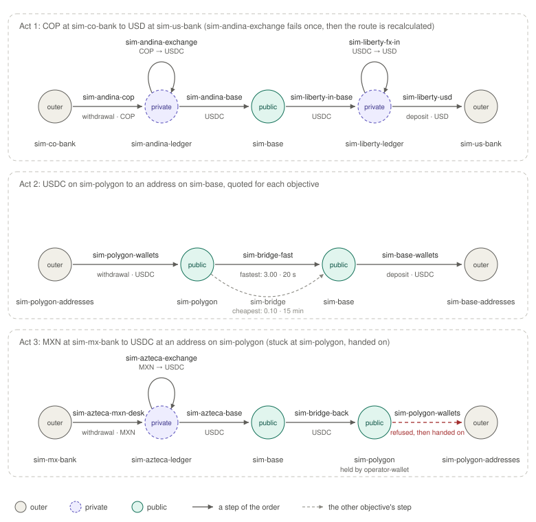

# rutent demo: a funds router on a synthetic network

A scripted, narrated run of rutent that an operator can show a customer in about fifteen minutes. It runs on your
laptop, in one process, against simulated providers on a private network. **Nothing in it holds or moves real
value.**

```sh
cargo run -p rutent-scenarios --bin rutent-demo
```

Or, from the repository's root, `conformance/demo/run.sh`, which passes its arguments on. The first run builds the
workspace, the simulated providers' Wasm modules and `audit-check`, which takes several minutes. Later runs take
seconds.

| Option | What it does |
|---|---|
| `--step` | Waits for Enter between acts. Use it when presenting live |
| `--out DIR` | Where the log and the evidence are written. The default is `rutent-demo/` in cargo's target directory (`target/rutent-demo/`, or under `CARGO_TARGET_DIR`), so a run leaves nothing in the checkout. The demo prints the folder it wrote |
| `--seed N` | The run's seed. Every identifier Core draws follows from it, so one seed always gives the same run. The default is 1 |

The program exits 0 when the whole story ran as told, ending with the outside check passing on the real log and
failing on the tampered copy.

## Why it is a binary of `rutent-scenarios`

The demo reuses the scenario assembly: Core's three crates put together with the policy engine, the log, the evidence
store and the module platform. The workspace's boundary check (`DEC-2`, `tools/boundary-check`) lets no crate depend
on `rutent-scenarios`, so the demo can't be a package of its own without changing that rule. It is a binary target
inside that package (`conformance/scenarios/src/bin/rutent-demo/`), made only of new files.

## What each act shows

The graph above is the network. Each act's order takes one path through it, drawn here as a lane:



The demo prints a timeline as it goes. Each act ends with the log entries it added, one line each: its place in the
log, whether Core *verified* it (Core's own record of a call between its parts, or of what the platform did) or a
party *stated* it (a provider's signed statement, kept as signed), what it is, and who.

### Act 0: the network

rutent moves value between **nodes**, and there are three kinds:

| Kind | What it is | Who can see a movement there | In the demo |
|---|---|---|---|
| **Outer node** | Where the customer's money starts or ends, outside rutent: a bank rail, or an external chain the customer uses | That rail's own records, read through its reserve | `sim-join-in-bank` (COP), `sim-join-out-bank` (USD), `sim-chain-a` (where the USDC order starts), `sim-chain-e` (where it's paid to an address) |
| **Private node** | A ledger held by one publisher, which only that publisher's providers work inside | Only that publisher. Inside it, rutent can rely only on the publisher's word, and the log labels it that way | `sim-join-ledger` (sim-join-publisher's), `sim-chain-ledger` (sim-chain-publisher's) |
| **Public node** | A shared ledger on the operator's list, like a public blockchain | Anyone, so Core checks the movements there itself | `sim-join-chain`, `sim-chain-b` |

The network is a graph: the nodes are its vertices, and each provider tuple is a directed edge from the node it takes
value from to the node it gives it to. A reserve has two edges, its withdrawal from its outer network and its deposit
back. A ramp has one. An exchange is an edge from a node to itself, since it changes the asset and not the place.


This network has two connected components: no provider joins the peso and dollar side to the USDC side. A
single order follows one path through this graph, and the graph is what the router searches. Every provider that
joins adds an edge, often between nodes that already have one, so the same order can have several paths, and the
router picks one for the order's objective (lowest total cost here). The demo writes this graph next to the log as
`network.dot`, in Graphviz form.

Seven providers, each with a role, each between two nodes:

| Provider | Role | From | To | Asset |
|---|---|---|---|---|
| `sim-join-in` | reserve | its bank (outer) | `sim-join-ledger` (private) | COP |
| `sim-join-exchange` | exchange | inside `sim-join-ledger` (private) | the same node | COP → USD |
| `sim-join-ramp-quick` | ramp | `sim-join-ledger` (private) | `sim-join-chain` (public) | USD |
| `sim-join-out` | reserve | `sim-join-chain` (public) | its bank (outer) | USD |
| `sim-chain-in` | reserve | `sim-chain-a` (outer) | `sim-chain-ledger` (private) | USDC |
| `sim-chain-ramp-b` | ramp | `sim-chain-ledger` (private) | `sim-chain-b` (public) | USDC |
| `sim-chain-out-b` | reserve | `sim-chain-b` (public) | `sim-chain-e` (outer), to an address | USDC |

The first three belong to one publisher, `sim-join-publisher`, which is why they share the private node
`sim-join-ledger`. Likewise, `sim-chain-in` and `sim-chain-ramp-b` share `sim-chain-ledger`.

**What to say:** every provider is admitted by a decision recorded in the log, and its advertisement (what it does,
at what price, how fast) is a signed statement the log keeps. The log knows each provider's key from those records,
not from a setting. The log publishes its first *checkpoint*: a commitment to its contents, signed by the log's own
key, which the operator doesn't hold.

### Act 1: an order across four providers, one failing mid-route

The customer sends 10,000.00 COP from their peso account to a dollar account at another bank. On this order the
exchange has been scripted to fail the conversion after the withdrawal has settled.

1. **Quote.** The router finds the route: withdrawal at `sim-join-in`, exchange at `sim-join-exchange`, a transfer
   onto the public chain by `sim-join-ramp-quick`, and a deposit by `sim-join-out`. Core signs a *decision record*
   explaining the choice. The customer is shown a quote, segment by segment, with each provider's fee.
2. **Accept.** The customer accepts the quote by its digest, so what they accepted can't change afterwards.
3. **Route.** Core hands each segment to its provider in turn. Each line printed is a segment, how it ended, and the
   receipt of Core's record of handing it over. The withdrawal settles; the exchange fails, and nothing more is
   handed over.
4. **Reversal.** Core records the **reversal owed**: the exchange owes back what it took, in full, in the asset it
   took in. Core asks for it, and the value is **shown back** at the node it came from. A provider's own word never
   undoes its own failure. Here the value is inside its publisher's private node, so the word that counts is the
   publisher's, and the log labels it that way.
5. **Recovery.** Core **recalculates** a route from where the value now is, to the same destination, and runs it. The
   customer isn't asked again, because the new route ends where they accepted. The order completes.
6. **Executed price.** Once every segment has settled, Core reports the price the order *actually* ran at, built
   from what each provider said it did, and records it once.

**What to say:** a failure doesn't lose track of the money. The customer's yes, the route, every hand-over, every
provider's answer and the reversal are in the log, in order, each with a receipt. The log shows where the value was
at each step, who said so, and why the new route was allowed to run.

### Act 2: the next order, straight through

A second order on the same route, and nothing goes wrong: four segments settle, and Core reports the executed price.
Set it beside the quote to show they agree, segment by segment.

(The failure comes first on purpose. A second order through `sim-join-in` doesn't get the private ledger's evidence
the reversal needs, so a failure on it can't be shown back. That is reported to M3 as a gap in the assembly or the
simulated world.)

### Act 3: a stuck order, handed on

A USDC order to an address on `sim-chain-e`. The operator's own wallet, a real module and not a simulation, holds the
public node `sim-chain-b`. The last step, the deposit out of `sim-chain-b`, is refused its start, and no other
route is left: the order is **stuck**, its value resting in the operator's wallet.

1. The customer accepts a **linked order** that starts where the value rests.
2. **alice** (operator desk A) decides to hand the value on to that linked order, citing a provider's kept statement
   as evidence. Policy permits it.
3. alice tries to carry out her own decision, and is refused. **Two people** are needed: one decides, another moves.
4. **bob** (operator desk B) carries it out. The wallet's own withdrawal record starts the linked order, and its route
   runs and settles.
5. Core signs and sends notices to the customer and the operator.

**What to say:** when automation runs out, people step in, but under the same policy and in the same log: who
decided, on what evidence, who moved it, and that they were different people.

### Epilogue: anyone can check the log

An hour later by Core's clock, the log publishes another checkpoint. Then the demo writes what an outside checker
gets into the output folder:

| Path | What it is |
|---|---|
| `network.dot` | The network as a graph, in Graphviz form: `dot -Tsvg network.dot > network.svg` draws it |
| `log/history.jsonl` | The log, one record per line |
| `log/checkpoints.jsonl` | The checkpoints, as the checker received them when they were published |
| `log/openings.jsonl` | What each checkpoint commits to, handed over by the operator |
| `evidence/kept/` | Every statement kept, salted, filed under its commitment |
| `decision-records/` | The records the router chose and Core signed |
| `timeline.txt` | Everything the demo printed |
| `verify.sh` | The exact `audit-check` command, to run again by hand |
| `tampered/history.jsonl` | A copy of the log with one figure changed |

It then runs **`audit-check`**, the checker's own tool from `rutent-core-audit`, as a separate program, three times.
The tool reads only those files and the log's public key: no database, no network, no operator secret.

1. **The history against the checkpoints.** It holds (exit 0).
2. **Each provider's statement against the evidence kept for it** (`--evidence`). Every statement is borne out, except
   the providers' `inner-segments` statements, which the tool reports as `NotBorneOut`. That is a gap in
   `rutent-core-audit`, not tampering: its evidence read expects a statement about an order to name a transaction at
   its top level, and `inner-segments` names one per segment. The demo says so when those are the only findings, and
   stops if anything else is found. It is reported to M3. Once it's fixed, this step will print exit 0 by itself.
3. **A copy of the log where one amount in one entry was changed tenfold**, as someone with full access to the
   operator's machines could do. The checker rejects it (`DoesNotHold`, exit 1).

`verify.sh` runs the full check, step 2's, so it exits 1 for as long as that gap is open.

**What to say:** you don't have to trust the operator's word about what happened. Anyone holding the checkpoints can
check the whole history, and a rewrite shows up.

## What is simulated and what is real

| Real: the same code that runs in production | Simulated |
|---|---|
| Core: intake, routing, segments, reversals, recalculation, stuck orders, hand-on, notices (`core-orch`) | Every provider except the operator's wallet: banks, the exchange, the ramps, the chains (`rutent_conformance::sim`) |
| The policy engine deciding every move, and the two-person rule (`core-authz`) | The networks and their balances: an in-memory world, not a blockchain or a bank |
| The authenticated log, its checkpoints, the evidence store and `audit-check` (`core-audit`) | The failures: scripted (the exchange fails) or planted at the platform's seam (the deposit refused its start) |
| The router (`rutent-router`) and the state machine (`rutent-stm`, on the reference host) | Time: Core's clock is simulated, so "600 seconds to settle" takes no real time |
| The module platform, running each provider as a Wasm module with real keys and signatures (`rutent-prov`) | The exchange rate: 1 COP unit to 1 USD unit, a placeholder, not a market rate |
| The operator's plain wallet, built from `components/prov/guests/plain-wallet` | The customer, the operator's staff and their logins |

What isn't there yet, so the demo doesn't show it:

- **A server.** Core runs inside this program. The production assembly, with its HTTP interface, is `F-030` (`M4`).
- **Restarts.** Core's own records are in memory. The log and the evidence store could be reopened, but the demo
  doesn't restart.
- **The credential proxy.** No simulated provider needs a secret, so none is resolved.
- **VOS.** The state machine runs on the reference host. `rutent-scenarios-vos` (`components/stm/vos-program/scenarios.sh`)
  runs the same checks on three VOS replicas, but it needs VOS's own binaries, its own toolchain and Linux x86_64. A
  `--vos` switch here would need all of that too, so the demo doesn't offer one.
- **Real providers and real networks.** Admitting Bloque-run providers on test networks, then on production rails, is
  `F-031` (`M4`).

## If something goes wrong

- *"holds no simulated providers"*: the simulated providers' build failed. Run
  `components/prov/module-guests/sim/build.sh` to see why. It needs the `wasm32` target the toolchain file names.
- *audit-check wasn't built*: run `cargo build -p rutent-core-audit --bin audit-check`, then the demo again.
- Any other stop prints the act and step it stopped at. Run with the same `--seed` to reproduce it.
