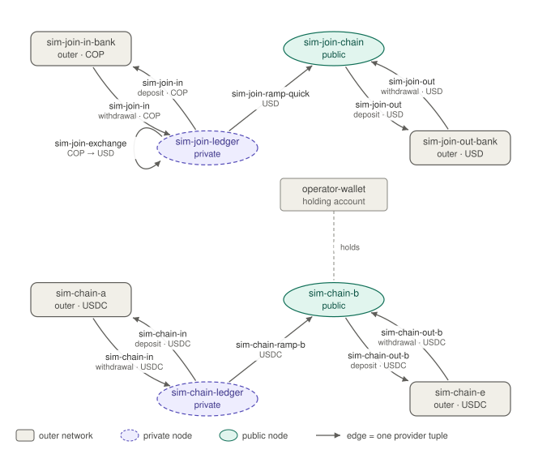

# rutent demo: a funds router on a synthetic network

A scripted, narrated run of rutent that an operator can show a customer in about fifteen minutes. It runs on your
laptop, in one process, against simulated providers on a private network. **Nothing in it holds or moves real
value.**

```sh
cargo run -p rutent-scenarios --bin rutent-demo
```

Or, from the repository's root, `conformance/demo/run.sh`, which passes its arguments on. The first run builds the
workspace, the simulated providers' Wasm modules and `audit-check`, which takes several minutes. A run after that
takes about a minute, most of it the platform admitting eighteen modules.

| Option | What it does |
|---|---|
| `--step` | Waits for Enter between acts. Use it when presenting live |
| `--out DIR` | Where the log and the evidence are written. The default is `rutent-demo/` in cargo's target directory (`target/rutent-demo/`, or under `CARGO_TARGET_DIR`), so a run leaves nothing in the checkout. The demo prints the folder it wrote |
| `--seed N` | The run's seed. Every identifier Core draws follows from it, so one seed always gives the same run. The default is 1 |

The program exits 0 when the whole story ran as told, ending with the outside check passing on the real log and
failing on the tampered copy.

## In a browser: `rutent-demo-api`

The same network, served over HTTP with a page that draws it and replays the three acts and the epilogue through the
API, one call at a time:

```sh
cargo run --manifest-path conformance/scenarios/demo-api/Cargo.toml
```

Then open <http://127.0.0.1:7040/>. Core is put together before the server answers (about a minute after the first
build, as for the demo). The page shows:

- **The network as a graph.** Each node is a vertex, drawn by its kind; each tuple a provider serves is a directed
  edge labelled with the provider, what it does and the assets it moves. An exchange is a loop on its node; two
  bridges between the same chains are two parallel edges. The graph comes from `GET /network`, derived from the
  providers' own shapes like `network.dot`.
- **The route a quote chose**, in blue on the graph, with every other candidate the router weighed dashed, and a list
  of all of them with why each was dropped; hover one to see it on the graph. As segments run, each edge turns green
  (settled) or red (failed or refused).
- **What's happening**: each act's steps, each one an API call with its status, a summary of what it answered and the
  full response.
- **The log, live**: every entry as the demo's timeline shows it, appended as Core writes it.
- **Buttons** for act 1, act 2, act 3 and the epilogue, or all four in order, and a form to quote, accept and run an
  order of your own and to script a provider's fault.

| Option | What it does |
|---|---|
| `--addr HOST:PORT` | Where it listens. The default is `127.0.0.1:7040`, this machine only |
| `--seed N` | The run's seed, as for the demo. The default is 1 |
| `--out DIR` | Where `POST /audit` writes the folder an outside checker gets. The default is `rutent-demo-api/` in cargo's target directory |
| `--lazy` | Puts Core together on the first call that needs it, not at start. The smoke test uses it |
| `--database-url URL` | The transitions database, `postgres://…`; `DATABASE_URL` sets it too. Without one, transitions are kept in memory |
| `--database-ca FILE` | A PEM bundle of the certificate authorities the database's certificate is checked against; `DATABASE_CA_FILE` sets it too. With it the connection is TLS, without it plain |
| `--warm-up` | Builds what Core needs (the platform's executables, the providers' modules, `audit-check`) and exits, without starting Core. The container image runs it when it is built |

Replaying act 1 after an order has run through `sim-andina-cop` puts Core together again first (`POST /reset`, about
a minute): a second order through the same private reserve gets no evidence for its reversal, the known M3 finding
above. An act that stops offers to reset Core and replay it.

### The endpoints

Amounts are strings in the asset's smallest unit (`"5000000"` is 50,000.00). Everything answers JSON; a refusal is a
4xx with `{"error": …}`.

| Endpoint | What it does |
|---|---|
| `GET /network` | The nodes (`id`, `kind`) and the edges (`provider`, `does`, `from`, `to`, assets, fee, declared seconds), the outer nodes an order can start and end at, and the hop limit. Needs no Core |
| `GET /status` | Whether Core is up, its seed, the log's length, the orders and their states, the providers that ran a segment |
| `POST /reset` | Drops Core and puts a new one together; `{"seed": N}` changes the seed |
| `POST /quotes` | `{"from", "to", "amount", "objective"}`, two outer nodes and `lowest_total_cost` or `fastest_settlement`: opens an order and has it quoted. The reserves at each end are read from the graph. Answers the chosen route, every candidate with its drop reason, the quote and its digest; 422 with the candidates when there is no route |
| `POST /orders/{id}/accept` | The customer accepts the quote, on its digest |
| `POST /orders/{id}/run` | Runs the order's route: the accepted one, else a recalculated one waiting, else a linked order's once handed on. Each segment, how it ended, what it gave out and its receipt |
| `POST /orders/{id}/reversal` | Records the reversal the failed segment owes, and asks for it |
| `POST /orders/{id}/recalculate` | Routes again from where the value is shown back; the new route runs on the next `run` |
| `GET /orders/{id}` | Its state, its route, and the executed price once Core reported it |
| `POST /faults` | `{"kind": "fail" \| "refuse", "provider", "operation"?}` scripts a provider's next operation (of that kind, where given); `{"kind": "refuse_start", "nth": N}` has the platform refuse to start the Nth segment from now |
| `POST /holding` | Installs the operator's plain wallet as `sim-polygon`'s holding account |
| `POST /orders/{id}/stuck` | No route is left: the order is stuck where its value rests |
| `POST /orders/{id}/linked` | The customer accepts a linked order from where the value rests to the order's destination |
| `POST /orders/{id}/decide` | `{"by": "alice"}`: an operator decides to hand the value on, citing a provider's kept statement |
| `POST /orders/{id}/move` | `{"by": "bob"}`: another operator carries it out, and the value is handed on; the one who decided is refused (403) |
| `POST /notices` | Core signs and sends its notices |
| `POST /audit` | An hour later by Core's clock, a checkpoint; the folder of the epilogue written to `--out`, and `audit-check` run over it three times. Answers each run's exit code and output. It can be called again later in the run |
| `GET /log?since=N` | The log's entries from the Nth on, each as one timeline line and its fields, and `next` for the following call |
| `GET /world/transitions?since=N&run=R&limit=L` | The network's transitions from the database, from the Nth on, the current run's unless `run` names another |
| `POST /world/transitions` | `{"source": "…", "transitions": [{"piece", "kind", "outcome", "provider"?, "order_id"?, …, "detail"?}]}`: an adapter or an outer piece outside the process records what it did. Kept under the current run, in order |
| `GET /world/runs` | The runs the database holds, newest first, with how many transitions each has |
| `GET /health` | 200 when the server and its database answer, 503 when the database doesn't or a write to it failed |

The server holds no real value and makes no outbound network call other than to its database; the page loads
Cytoscape.js (MIT licence) from `cdn.jsdelivr.net`, pinned to one version. It is one thread, as Core is: requests are
answered one at a time, so a reset holds the others for its minute, and every viewer shares one Core. By default it
listens on the loopback address, and it has no authentication.

### The transitions database

Every transition of the network is recorded, with its outcome: each request an adapter (a provider's module) makes
of an outer piece, and how it came out. The pieces are each provider's book (`book`), and the networks movements
are made on: the public chains (`chain`), the publishers' ledgers (`ledger`) and the outer rails, a bank's or a
chain's addresses (`rail`). A row names the run, its place in it, the piece and what was asked (withdrawal, deposit, transfer, conversion,
reversal, a dry run of one, or a movement), the provider, the nodes, assets and amounts, the order and segment it
served where the API knows them, the outcome (answered, failed, refused; recorded or refused for a movement), Core's
clock and the request itself. `conformance/scenarios/demo-api/src/schema.sql` is the schema; the server applies it
at start.

Everything reaches the database through the API, by one path (`Api::record`):

- The simulated network runs in the server's process, so the API reads what its world received after each call and
  records it before it answers. The simulator isn't changed for it: the world already keeps every request an
  adapter sent an outer piece, in order.
- An adapter or an outer piece outside the process sends the same through `POST /world/transitions`. Nothing in the
  schema or the endpoint knows the simulator, so a real adapter on `test` can use them as they are.

A run is one Core, from its start (or a `POST /reset`) until the next; the database keeps every run. The database
is the demo's world, not Core's: Core's log, its evidence and its state are still in the server's memory, and a
restarted server starts a new Core and a new run. Core surviving a restart is its host contract's (ADR-0002) and the
VOS adapter's, not this database's. The page shows the current run's transitions under the log, as they are kept.

### In a container

```sh
docker build --platform linux/amd64 -f conformance/demo/Dockerfile -t rutent-demo-api .
docker run --rm -p 7040:7040 --platform linux/amd64 --security-opt seccomp=unconfined \
  -e DATABASE_URL='postgres://user@host:5432/db' rutent-demo-api
```

**Where it can run.** The platform runs every provider's module in a jail of its own (`DEC-27`): new user,
network, IPC, UTS, mount and PID namespaces through `unshare`, `pivot_root`, Landlock, and a seccomp allow-list
written for x86_64 that refuses to run unconfined on any other architecture. So the image is `linux/amd64` only, and
its runtime must let it make namespaces: Docker's default seccomp profile refuses `unshare`, so it runs with a
profile that allows it (`--security-opt seccomp=unconfined` works) and Docker's default capabilities, on a kernel
that allows unprivileged user namespaces. AWS Fargate allows neither a seccomp profile nor the namespaces; ECS on
EC2 (x86_64) or a plain x86_64 host does. On macOS the platform uses `sandbox-exec` instead, which is why
`cargo run` works on a Mac.

The image is one stage, built from the repository's root: the assembly checks the platform's executables and the
providers' modules against the sources beside its build, so the image keeps the toolchain, the sources and the
build (several gigabytes; it is a test image). Building it runs `--warm-up`, which builds what Core needs without
starting it, so a container answers about a minute after it starts, while Core admits the eighteen modules. It
listens on port 7040 on every interface, checks its health with `GET /health`, and trusts Amazon RDS's certificate authorities for the database's TLS
(`DATABASE_CA_FILE=/etc/rutent/rds-ca.pem`, fetched from AWS when the image is built). The server has no
authentication: on `test` it belongs behind private-only access.

## Why it is a binary of `rutent-scenarios`

The demo reuses the scenario assembly: Core's three crates put together with the policy engine, the log, the evidence
store and the module platform. The workspace's boundary check (`DEC-2`, `tools/boundary-check`) lets no crate depend
on `rutent-scenarios`, so the demo can't be a package of its own in that workspace without changing that rule.
`rutent-demo` is a binary target inside that package (`conformance/scenarios/src/bin/rutent-demo/`). It shares the
network, the orders, the timeline and the outside check with the API through `src/bin/demo-common/`, a folder each
binary includes as a module of its own and not part of the library.

`rutent-demo-api` is a workspace of its own, `conformance/scenarios/demo-api/`, with its own `Cargo.lock`, which
depends on `rutent-scenarios` by path. Its database client brings tokio, whose features would change the
dependency edges of packages the contracts crate reaches in the root lock, and `tools/contract-guard` treats that as
a change to every contract. Kept apart, the root lock doesn't change. The folder sits inside `rutent-scenarios`'s
tree, which may import every crate of ours, so the boundary check reads it as the assembly's; nothing in the root
workspace imports it. `tools/licence-check` reads every lock under `conformance/` too, and CI formats, lints,
documents and tests the workspace in steps of its own.

Outside them, the demo adds three things to M3's code and changes
nothing there: the network's simulated providers, as new arms of `rutent_conformance::sim::shape_of`,
`Core::set_max_hops`, a setter beside `set_operator_fee`, and `harness::kept_of`, which reads the statements the
evidence store kept without ending Core, so the API can hand the checker its folder mid-run.

## The network

rutent moves value between **nodes**, and there are three kinds:

| Kind | What it is | Who can see a movement there | In the demo |
|---|---|---|---|
| **Outer node** | Where the customer's money starts or ends, outside rutent: a bank rail, or a chain's addresses | That rail's own records, read through its reserve | `sim-co-bank` (COP), `sim-mx-bank` (MXN), `sim-us-bank` (USD), `sim-polygon-addresses`, `sim-base-addresses` (USDC) |
| **Private node** | A ledger held by one publisher, which only that publisher's providers work inside | Only that publisher. Inside it, rutent can rely only on the publisher's word, and the log labels it that way | `sim-andina-ledger`, `sim-azteca-ledger`, `sim-liberty-ledger` |
| **Public node** | A shared ledger on the operator's list, like a public blockchain | Anyone, so Core checks the movements there itself | `sim-polygon`, `sim-base` |

The network is a graph: the nodes are its vertices, and each tuple a provider serves is a directed edge from the node
it takes value from to the node it gives it to. A reserve has two edges, its withdrawal from its outer network and its
deposit back. A ramp or a bridge has one. An exchange is an edge from a node to itself, since it changes the asset
and not the place. Eighteen providers make 23 edges between 10 nodes:



Three publishers each run a bank's reserve, exchanges and ramps inside their own ledger: `sim-andina` in Colombia
(COP), `sim-azteca` in Mexico (MXN) and `sim-liberty` in the US (USD). Two public chains carry USDC between them,
`sim-polygon` and `sim-base`, joined by three bridges: `sim-bridge` (0.10 USDC, 15 minutes), `sim-bridge-fast`
(3.00 USDC, 20 seconds) and `sim-bridge-back`. On each chain a reserve serves the customer's addresses.

The graph is what the router searches. For each order it weighs every path of at most six edges from where the money
is to where it goes, and picks one for the order's objective, lowest total cost or fastest settlement. Most pairs of
places have more than one path: two exchanges from COP to USDC, two ramps out of `sim-andina-ledger`, two bridges
from `sim-polygon` to `sim-base`. Some have none: no route takes MXN to COP within six edges. Every provider that
joins adds an edge. The demo writes this graph next to the log as `network.dot`, in Graphviz form, derived from the
providers' own shapes (`rutent_conformance::sim::shape_of`), so the drawing is the network that runs.

Every exchange converts 1 unit for 1 unit: the simulated exchange has no rate and quotes no fee, so the two COP to
USDC exchanges differ only in the time they declare. Ramps and bridges charge the fees shown.

**Why six edges.** The router's search is hop-limited by design (ADR-0006, `DEC-8`); the limit itself is a policy
bound, `max_hops`, the deployment's to set. M3's scenario kit sets 4; the demo sets 6 (`Core::set_max_hops`), the
least that takes COP to USD across two publishers' ledgers and a chain.

## What each act shows

Each act's order takes one path through the graph, drawn here as a lane:


The demo prints a timeline as it goes. Each act ends with the log entries it added, one line each: its place in the
log, whether Core *verified* it (Core's own record of a call between its parts, or of what the platform did) or a
party *stated* it (a provider's signed statement, kept as signed), what it is, and who. Every order sends 50,000.00 in
its asset: the simulated exchanges and ramps serve no less than 10,000.00, and the fees on the way must leave that
much for the next step.

### Act 0: the network

The demo lists every edge, provider by provider, with its fee and the time it declares.

**What to say:** every provider is admitted by a decision recorded in the log, and its advertisement (what it does,
at what price, how fast) is a signed statement the log keeps. The log knows each provider's key from those records,
not from a setting. The log publishes its first *checkpoint*: a commitment to its contents, signed by the log's own
key, which the operator doesn't hold.

### Act 1: pesos in Colombia to dollars in the US, one exchange failing

The customer sends 50,000.00 COP from their account at `sim-co-bank` to a dollar account at `sim-us-bank`. No
provider does that alone: the route crosses `sim-andina-ledger`, the public chain `sim-base` and `sim-liberty-ledger`,
converting twice, in six segments. On this order `sim-andina-exchange` has been scripted to fail the conversion after
the withdrawal has settled.

1. **Quote.** The router weighs the candidate routes and picks one: withdrawal at `sim-andina-cop`, COP to USDC at
   `sim-andina-exchange`, `sim-andina-base` onto `sim-base`, `sim-liberty-in-base` into `sim-liberty-ledger`, USDC to
   USD at `sim-liberty-fx-in`, and the deposit by `sim-liberty-usd`. Core signs a *decision record* explaining the
   choice. The customer is shown a quote, segment by segment, with each provider's fee.
2. **Accept.** The customer accepts the quote by its digest, so what they accepted can't change afterwards.
3. **Route.** Core hands each segment to its provider in turn. Each line printed is a segment, how it ended, and the
   receipt of Core's record of handing it over. The withdrawal settles; the exchange fails, and nothing more is
   handed over.
4. **Reversal.** Core records the **reversal owed**: the exchange owes back what it took, in full, in the asset it
   took in. Core asks for it, and the value is **shown back** at the node it came from. A provider's own word never
   undoes its own failure. Here the value is inside its publisher's private node, so the word that counts is the
   publisher's, and the log labels it that way.
5. **Recovery.** Core **recalculates** from where the value now is, weighing the routes from `sim-andina-ledger` to
   the same destination, and runs the one it picks. The customer isn't asked again, because the new route ends where
   they accepted. The order completes.
6. **Executed price.** Once every segment has settled, Core reports the price the order *actually* ran at, built
   from what each provider said it did, and records it once.

**What to say:** a failure doesn't lose track of the money. The customer's yes, the route, every hand-over, every
provider's answer and the reversal are in the log, in order, each with a receipt. The log shows where the value was
at each step, who said so, and why the new route was allowed to run.

(The failure comes first on purpose. A second order through the same reserve doesn't get the private ledger's
evidence the reversal needs, so a failure on it can't be shown back. That is reported to M3.)

### Act 2: one request, two objectives, two routes

The customer moves 50,000.00 USDC from their address on `sim-polygon` to one on `sim-base`, and asks for a quote under
each objective. Same request, same graph: the cheapest route crosses on `sim-bridge`, the fastest on
`sim-bridge-fast`. The customer takes the fastest, and it runs and settles.

**What to say:** the router doesn't have one answer per pair of places. It has a graph, and the customer's objective
picks the path. Both quotes, with the candidates each weighed, are in the log.

### Act 3: a stuck order, handed on

50,000.00 MXN from `sim-mx-bank` to USDC at the customer's address on `sim-polygon`: converted in
`sim-azteca-ledger`, ramped onto `sim-base` and bridged back to `sim-polygon`. The operator's own wallet, a real module
and not a simulation, holds `sim-polygon`. The last step, the deposit to the address, is refused its start, and no
other route is left: the order is **stuck**, its value resting in the operator's wallet.

1. The customer accepts a **linked order** that starts where the value rests.
2. **alice** (operator desk A) decides to hand the value on to that linked order, citing a provider's kept statement
   as evidence. Policy permits it.
3. alice tries to carry out her own decision, and is refused. **Two people** are needed: one decides, another moves.
4. **bob** (operator desk B) carries it out. The wallet's own withdrawal record starts the linked order, and its route
   runs and settles.
5. Core signs and sends notices to the customer and the operator.

**What to say:** when automation runs out, people step in, but under the same policy and in the same log: who
decided, on what evidence, who moved it, and that they were different people.

### Epilogue: anyone can check the log

An hour later by Core's clock, the log publishes another checkpoint. Then the demo writes what an outside checker
gets into the output folder:

| Path | What it is |
|---|---|
| `network.dot` | The network as a graph, in Graphviz form: `dot -Tsvg network.dot > network.svg` draws it |
| `log/history.jsonl` | The log, one record per line |
| `log/checkpoints.jsonl` | The checkpoints, as the checker received them when they were published |
| `log/openings.jsonl` | What each checkpoint commits to, handed over by the operator |
| `evidence/kept/` | Every statement kept, salted, filed under its commitment |
| `decision-records/` | The records the router chose and Core signed |
| `timeline.txt` | Everything the demo printed |
| `verify.sh` | The exact `audit-check` command, to run again by hand |
| `tampered/history.jsonl` | A copy of the log with one figure changed |

It then runs **`audit-check`**, the checker's own tool from `rutent-core-audit`, as a separate program, three times.
The tool reads only those files and the log's public key: no database, no network, no operator secret.

1. **The history against the checkpoints.** It holds (exit 0).
2. **Each provider's statement against the evidence kept for it** (`--evidence`). Every statement is borne out, except
   the providers' `inner-segments` statements, which the tool reports as `NotBorneOut`. That is a gap in
   `rutent-core-audit`, not tampering: its evidence read expects a statement about an order to name a transaction at
   its top level, and `inner-segments` names one per segment. The demo says so when those are the only findings, and
   stops if anything else is found. It is reported to M3. Once it's fixed, this step will print exit 0 by itself.
3. **A copy of the log where one amount in one entry was changed tenfold**, as someone with full access to the
   operator's machines could do. The checker rejects it (`DoesNotHold`, exit 1).

`verify.sh` runs the full check, step 2's, so it exits 1 for as long as that gap is open.

**What to say:** you don't have to trust the operator's word about what happened. Anyone holding the checkpoints can
check the whole history, and a rewrite shows up.

## What is simulated and what is real

| Real: the same code that runs in production | Simulated |
|---|---|
| Core: intake, routing, segments, reversals, recalculation, stuck orders, hand-on, notices (`core-orch`) | Every provider except the operator's wallet: banks, exchanges, ramps, bridges, chains (`rutent_conformance::sim`) |
| The policy engine deciding every move, and the two-person rule (`core-authz`) | The networks and their balances: an in-memory world, not a blockchain or a bank |
| The authenticated log, its checkpoints, the evidence store and `audit-check` (`core-audit`) | The failures: scripted (the exchange fails) or planted at the platform's seam (the deposit refused its start) |
| The router (`rutent-router`) and the state machine (`rutent-stm`, on the reference host) | Time: Core's clock is simulated, so "15 minutes to settle" takes no real time |
| The module platform, running each provider as a Wasm module with real keys and signatures (`rutent-prov`) | Exchange rates: every conversion is 1 unit for 1 unit, a placeholder, not a market rate |
| The operator's plain wallet, built from `components/prov/guests/plain-wallet` | The customer, the operator's staff and their logins |

What isn't there yet, so the demo doesn't show it:

- **A server.** Core runs inside this program, and `rutent-demo-api` only serves it to a browser on the same
  machine. The production assembly, with its HTTP interface, is `F-030` (`M4`).
- **Restarts.** Core's own records are in memory. The log and the evidence store could be reopened, but the demo
  doesn't restart.
- **The credential proxy.** No simulated provider needs a secret, so none is resolved.
- **VOS.** The state machine runs on the reference host. `rutent-scenarios-vos` (`components/stm/vos-program/scenarios.sh`)
  runs the same checks on three VOS replicas, but it needs VOS's own binaries, its own toolchain and Linux x86_64. A
  `--vos` switch here would need all of that too, so the demo doesn't offer one.
- **Real providers and real networks.** Admitting Bloque-run providers on test networks, then on production rails, is
  `F-031` (`M4`).

## If something goes wrong

- *"holds no simulated providers"*: the simulated providers' build failed. Run
  `components/prov/module-guests/sim/build.sh` to see why. It needs the `wasm32` target the toolchain file names.
- *audit-check wasn't built*: run `cargo build -p rutent-core-audit --bin audit-check`, then the demo again.
- Any other stop prints the act and step it stopped at. Run with the same `--seed` to reproduce it.
